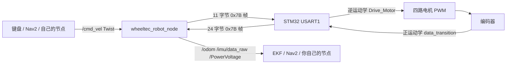
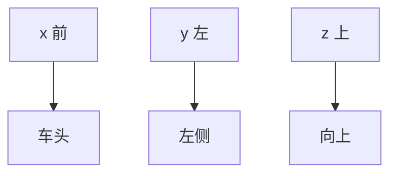

# WHEELTEC ROS 2 从零调试教程

这份笔记按原教材的调试顺序走一遍：**轮子运动 → 串口 → 通信 → 驱控 → 机械臂**。每一站都回答三个问题：现象是什么、代码在哪、怎么用命令验证。

底盘部分对应 ROS 2 的 `turn_on_wheeltec_robot` 包；机械臂部分对应 R550A 的四/六自由度资料，原包是 **ROS 1 Melodic + MoveIt1**，但串口协议和 STM32 代码与底盘是同一套思路，第 5 站会给出 ROS 2 / MoveIt2 的对应写法。

> 阅读前提：会 SSH 登录小车，知道 `ros2 topic list` 是干什么的。不会也没关系，第 7 节把命令逐条拆开讲。

---

## 0. 先建立一张总图



五个调试站对应链条上的五段：

| 站 | 你看到的现象 | 代码层 | 关键文件 | 验证手段 |
|---|---|---|---|---|
| 1 轮子运动 | 车不动、走歪、里程计不对 | ROS 话题 + 运动学 | `wheeltec_robot.cpp`、`balance.c` | `ros2 topic pub/echo` |
| 2 串口 | 节点报 “can not open serial port” | Linux 设备层 | `wheeltec_udev.sh` | `ls -l /dev`、`picocom` |
| 3 通信 | 串口有数据但话题没数据 | 字节协议 | `wheeltec_robot.cpp`、`usartx.c` | 手写 Python 解析器 |
| 4 驱控 | 有指令但轮子不转/反转/抖动 | STM32 控制层 | `balance.c`、`motor.c`、`encoder.c` | OLED、串口原始数据 |
| 5 机械臂 | RViz 会动、真机不动；关节反向 | MoveIt + 舵机 | `wheeltec_arm_six.cpp`、`balance.c` | `rostopic echo /joint_states` |

### 0.1 源码位置

- ROS 2 底盘驱动：`D:\轮趣\基本资料\1.WHEELTEC ROS机器人通用资料\6.ROS2系列教程\3.ROS2机器人应用视频教程：相机与图像处理\2.OpenCV入门及其在ROS2环境下的应用\Program_OpenCV_And_ROS2\5.OpenCV_ROS2_Base\turn_on_wheeltec_robot\`
- STM32 四自由度：`D:\轮趣\基本资料\3.WHEELTEC R550A 4自由度机械臂资料\5.STM32运动底盘源码\...\R550A_C30D(2.0)_四自由度机械臂小车_GMR编码器_2026.08.20.zip`
- STM32 六自由度：`D:\轮趣\基本资料\4.WHEELTEC R550A 6自由度机械臂资料\5.STM32源码\...\R550A_C30D(2.0)_六自由度机械臂小车_GMR编码器_2026.08.20.zip`
- 机械臂 ROS 1 源码：`D:\轮趣\基本资料\4.WHEELTEC R550A 6自由度机械臂资料\4.ROS源码\melodic_wheeltec_arm_20240411.zip`

### 0.2 上车先做三件事

```bash
# 1. 连小车热点，然后 SSH
ssh wheeltec@192.168.0.100

# 2. 进工作空间编译；--symlink-install 让你改 Python/launch 后不用反复编译
cd ~/wheeltec_ros2
colcon build --symlink-install

# 3. 每个新终端都要 source，否则找不到包
source install/setup.bash

# 4. 确认包在
ros2 pkg list | grep wheeltec
```

`colcon build` 只编译工作空间里所有包；只改一个包时用 `--packages-select turn_on_wheeltec_robot` 更快。编译报错先看第一个 `error:`，后面的往往是连锁反应。

### 0.3 安全底线

- 第一次上电把**轮子架空**，机械臂周围清空。
- 一个串口同时只能被一个进程打开。开 `picocom` 前先 `Ctrl+C` 掉底盘节点。
- `cmd_vel` 是**最后一条指令保持**，不是看门狗。你发一次 `0.2` 然后关掉终端，车会一直走，直到再收到 `0` 或驱动节点退出。

---

## 1. 第 1 站：轮子运动

### 1.1 先让轮子转起来

```bash
# 终端 A：启动底盘、IMU、EKF、TF、模型
ros2 launch turn_on_wheeltec_robot turn_on_wheeltec_robot.launch.py

# 终端 B：键盘遥控
ros2 run wheeltec_robot_keyboard wheeltec_keyboard
```

按键含义：

| 键 | 作用 | 对应消息 |
|---|---|---|
| `i` | 前进 | `linear.x > 0` |
| `,` | 后退 | `linear.x < 0` |
| `j` / `l` | 常规模式左转/右转；全向模式左移/右移 | `angular.z` 或 `linear.y` |
| `k` | 立即停车 | 全零 `Twist` |
| `q` / `z` | 线速度、角速度同时 ×1.1 / ×0.9 | 改步长 |
| `w` / `x` | 只调线速度 | 改步长 |
| `e` / `c` | 只调角速度 | 改步长 |
| `b` | 常规 / 全向模式切换 | 改 `linear.y` 的用法 |

注意 `b` 的边界：阿克曼和四驱车机械上不能横移，切到全向模式也不会真的横着走。

### 1.2 不用键盘：直接发 `/cmd_vel`

键盘节点本质上就是一个发布 `geometry_msgs/msg/Twist` 的节点。你可以直接替代它：

```bash
# 以 10 Hz 持续前进，线速度 0.2 m/s
ros2 topic pub --rate 10 /cmd_vel geometry_msgs/msg/Twist \
  "{linear: {x: 0.2, y: 0.0, z: 0.0}, angular: {x: 0.0, y: 0.0, z: 0.0}}"

# 原地左转，角速度 0.5 rad/s
ros2 topic pub --rate 10 /cmd_vel geometry_msgs/msg/Twist \
  "{linear: {x: 0.0, y: 0.0, z: 0.0}, angular: {x: 0.0, y: 0.0, z: 0.5}}"

# 麦轮横移：y 正方向是车的左侧
ros2 topic pub --rate 10 /cmd_vel geometry_msgs/msg/Twist \
  "{linear: {x: 0.0, y: 0.2, z: 0.0}, angular: {x: 0.0, y: 0.0, z: 0.0}}"

# 只发一次零速度，停车
ros2 topic pub --once /cmd_vel geometry_msgs/msg/Twist \
  "{linear: {x: 0.0, y: 0.0, z: 0.0}, angular: {x: 0.0, y: 0.0, z: 0.0}}"
```

参数解释：

- `--rate 10`：每秒发 10 次。控制话题建议 10–20 Hz，太低会一顿一顿，太高没有意义。
- `--once` 或 `-1`：只发一条就退出。**退出后下位机仍保持最后一条速度**。
- 末尾的 YAML 必须符合 `Twist` 的字段结构；少写字段会取默认值 0。

### 1.3 `Twist` 的坐标系

ROS 使用 REP-103 约定的右手坐标系：

- `x` 正方向：车头前方
- `y` 正方向：车的左侧
- `z` 正方向：向上
- `angular.z > 0`：绕 z 轴逆时针，也就是**左转**



差速车和四驱车只有 `linear.x` 与 `angular.z` 有意义；麦轮和全向轮才有 `linear.y`。给差速车发 `linear.y`，ROS 端会照样打包，但 STM32 端不使用。

### 1.4 从三轴速度到四个轮速：逆运动学

这一步在 STM32 的 `BALANCE/balance.c` 里，函数 `Drive_Motor()`，从第 19 行开始。ROS 只负责把 `vx, vy, wz` 送下来，**怎么分到四个轮子是下位机算的**。

麦轮公式（源码原样）：

```c
MOTOR_A.Target = +Vy + Vx - Vz * (Axle_spacing + Wheel_spacing);
MOTOR_B.Target = -Vy + Vx - Vz * (Axle_spacing + Wheel_spacing);
MOTOR_C.Target = +Vy + Vx + Vz * (Axle_spacing + Wheel_spacing);
MOTOR_D.Target = -Vy + Vx + Vz * (Axle_spacing + Wheel_spacing);
```

四驱（滑移转向）：

```c
MOTOR_A.Target = Vx - Vz * (Wheel_spacing + Axle_spacing) / 2.0f;
MOTOR_B.Target = Vx - Vz * (Wheel_spacing + Axle_spacing) / 2.0f;
MOTOR_C.Target = Vx + Vz * (Wheel_spacing + Axle_spacing) / 2.0f;
MOTOR_D.Target = Vx + Vz * (Wheel_spacing + Axle_spacing) / 2.0f;
```

履带：

```c
MOTOR_A.Target = Vx - Vz * Wheel_spacing / 2.0f;
MOTOR_B.Target = Vx + Vz * Wheel_spacing / 2.0f;
MOTOR_C.Target = 0;
MOTOR_D.Target = 0;
```

三个容易读错的地方：

1. **WHEELTEC 的间距是“半间距”**。`robot_select_init.h` 里 `MEC_wheelspacing = 0.093`、`MEC_axlespacing = 0.085`，注释明确写了 “Mec_Car is half wheelspacing”。所以公式里的 `Axle_spacing + Wheel_spacing` 是半轴距 + 半轮距，正好是麦轮绕中心旋转的等效半径项。
2. **`Vz` 的单位是 rad/s**，乘上米得到 m/s，量纲是对的。
3. **每个轮子最后都夹在 ±3.5 m/s**（`amplitude`），防止一条异常指令把车弹出去。

麦轮为什么是这组正负号：四个轮子呈 X 形布置，辊子与车轴成 45°。A、C 是一组对角轮，B、D 是另一组；`Vy` 让对角线两轮同向、另一对角线反向，`Vz` 让左右两侧反向。记不住就记“**Vx 全加，Vy 对角反，Vz 左右反**”。

### 1.5 从编码器回到三轴速度：正运动学

编码器读回来的是四个轮子的线速度，STM32 在 `data_transition()`（`HARDWARE/usartx.c` 第 48 行）里反算成车体三轴速度，再打包成 24 字节帧发给 ROS：

```c
// 麦轮
X_speed = (A + B + C + D) / 4 * 1000;
Y_speed = (A - B + C - D) / 4 * 1000;
Z_speed = (-A - B + C + D) / 4 / (Axle_spacing + Wheel_spacing) * 1000;

// 四驱
X_speed = (A + B + C + D) / 4 * 1000;
Y_speed = 0;
Z_speed = (-B - A + C + D) / 2 / (Axle_spacing + Wheel_spacing) * 1000;

// 履带
X_speed = (A + B) / 2 * 1000;
Z_speed = (B - A) / Wheel_spacing * 1000;
```

这里的 `A/B/C/D` 是四个轮子的线速度，单位 m/s；`*1000` 是转成 mm/s 再发串口。ROS 端再用 `Odom_Trans()` 除回来。

### 1.6 ROS 2 节点里的里程计积分

`wheeltec_robot.cpp` 的 `Control()`（第 620 行）每读到一帧有效数据，就把车体速度积分成世界坐标下的位姿：

```cpp
Robot_Pos.X += (Robot_Vel.X * cos(Robot_Pos.Z) - Robot_Vel.Y * sin(Robot_Pos.Z)) * Sampling_Time;
Robot_Pos.Y += (Robot_Vel.X * sin(Robot_Pos.Z) + Robot_Vel.Y * cos(Robot_Pos.Z)) * Sampling_Time;
Robot_Pos.Z += Robot_Vel.Z * Sampling_Time;
```

为什么不能直接 `X += Vx * dt`：`Robot_Vel` 是**车体坐标系**下的速度，车头一转，同一个 `Vx` 在世界坐标里的方向就变了。上面两行是一个二维旋转矩阵：

$$
\begin{bmatrix} \dot{x} \\ \dot{y} \end{bmatrix}
=
\begin{bmatrix} \cos\theta & -\sin\theta \\ \sin\theta & \cos\theta \end{bmatrix}
\begin{bmatrix} v_x \\ v_y \end{bmatrix}
$$

`Robot_Pos.Z` 直接对角速度积分，单位 rad。`Publish_Odom()`（第 129 行）再把 `Z` 转成四元数，填进 `nav_msgs/msg/Odometry` 的 `pose` 和 `twist`。

注意：**这个驱动节点不发布 TF**。`odom -> base_footprint` 由 EKF 节点发布；源码里虽然包含了 `tf2_ros` 头文件，但没有实例化 broadcaster。所以 `tf2_echo odom base_footprint` 查不到是正常的，应该查 `odom_combined base_footprint`。

### 1.7 轮子调试实验（按顺序做）

**实验 1：方向对不对（轮子架空）**

```bash
ros2 topic pub --once /cmd_vel geometry_msgs/msg/Twist "{linear: {x: 0.2}}"
```

四个轮子都应该向前转。如果有轮子反转，先查电机线/编码器线，再查 `Set_Pwm()` 里的正负号，最后查车型选择。

**实验 2：横移（仅麦轮/全向）**

```bash
ros2 topic pub --once /cmd_vel geometry_msgs/msg/Twist "{linear: {y: 0.2}}"
```

车应该向**左**平移。向右平移是 `y: -0.2`。如果方向反了，检查麦轮辊子朝向（四个轮的辊子应呈 X 形）或 `Vy` 的符号。

**实验 3：自转**

```bash
ros2 topic pub --once /cmd_vel geometry_msgs/msg/Twist "{angular: {z: 0.5}}"
```

从上往下看应该**逆时针**转。

**实验 4：里程计符号（轮子架空，用手转轮子）**

```bash
ros2 topic echo /odom --once
```

- 向前推车：`pose.position.x` 增大，`twist.linear.x` 为正。
- 向左推车：`pose.position.y` 增大。
- 逆时针转车：`pose.orientation` 的四元数 z 分量变正，`twist.angular.z` 为正。

**实验 5：里程计准不准（地上量 1 米）**

让车直行 1 米，看 `/odom` 的 `x`。误差超过 5% 时，按这个顺序查：

1. 轮胎直径是否与 `robot_select_init.h` 里的 `Mecanum_75` / `Black_WheelDiameter` 等宏一致；
2. 编码器线数 `Photoelectric_500` / `Hall_13` 是否正确；
3. 减速比 `HALL_60F` / `MD36N_*` 是否正确；
4. 轮胎是否打滑（打滑是机械问题，改参数救不了）。

**注意一个版本差异**：ROS 1 版驱动里有一组 `odom_x_scale / odom_y_scale / odom_z_scale_positive / odom_z_scale_negative` 修正系数；这份 ROS 2 源码的 `Control()` 里**没有**这组乘法。所以 ROS 2 下里程计偏差要靠 STM32 的轮径/线数/减速比参数修，而不是在 ROS 端乘系数。

---

## 2. 第 2 站：串口

### 2.1 物理链路

ROS 主控（Jetson / 树莓派 / RDK）通过 USB Type-C 连 STM32 控制板。板载 USB 转 TTL 芯片（常见 CH9102 或 CP2102）把 USB 信号转成 TTL 串口，接到 STM32 的 USART1。


ROS 端看到的是一个 `/dev/ttyUSB0`、`/dev/ttyACM0` 或 `/dev/ttyCH343USB0` 设备。

### 2.2 先找到设备

```bash
# 看 USB 设备有没有被识别
lsusb

# 看串口设备节点
ls -l /dev/ttyUSB* /dev/ttyACM* /dev/ttyCH343USB* 2>/dev/null

# 看内核日志里最近插入的设备
dmesg | tail -20
```

`lsusb` 里应该能看到 `1a86:55d4`（CH9102）或 `10c4:ea60`（CP2102）。`dmesg` 里会写 `ch341-uart converter now attached to ttyCH343USB0` 之类的行，这就是设备名。

### 2.3 固定别名：为什么不能写 `/dev/ttyUSB0`

USB 设备号是**按插入顺序分配**的。今天底盘是 `ttyUSB0`、雷达是 `ttyUSB1`，明天可能反过来。代码里写死 `/dev/ttyUSB0`，换一次插口就打开错设备。

WHEELTEC 的解法是用 udev 规则给每个设备起固定别名。脚本在 `turn_on_wheeltec_robot/wheeltec_udev.sh`。

设备号与别名：

| 设备 | USB 序列号 | 别名 |
|---|---|---|
| 串口版雷达 | 0001 | `/dev/wheeltec_lidar` |
| STM32 控制器 | 0002 | `/dev/wheeltec_controller` |
| 惯导 IMU | 0003 | `/dev/wheeltec_IMU` |
| 语音模块 | 0004 | `/dev/wheeltec_mic` |
| GNSS | 0005 | `/dev/wheeltec_gnss` |

执行：

```bash
cd ~/wheeltec_ros2/src/turn_on_wheeltec_robot
sudo chmod +x wheeltec_udev.sh
sudo sh wheeltec_udev.sh

# 重新插拔 USB，或手动触发
sudo udevadm control --reload-rules
sudo udevadm trigger

# 验证
ls -l /dev/wheeltec_controller
```

看到 `wheeltec_controller -> ttyCH343USB0` 这样的软链接就成功了。

一条规则拆开看：

```bash
KERNEL=="ttyCH343USB*",
ATTRS{idVendor}=="1a86",
ATTRS{idProduct}=="55d4",
ATTRS{serial}=="0002",
MODE:="0777",
GROUP:="dialout",
SYMLINK+="wheeltec_controller"
```

- `KERNEL`：内核设备名匹配，`*` 是通配；
- `ATTRS{idVendor}` / `idProduct`：USB 厂商号/产品号，确认是这颗芯片；
- `ATTRS{serial}`：USB 序列号，WHEELTEC 用 `CH34xSerCfg.exe` 把每块板改成 0001–0005；
- `MODE`：设备权限，0777 表示所有人可读写；
- `GROUP`：所属组，`dialout` 是 Ubuntu 的串口组；
- `SYMLINK`：创建的固定别名。

### 2.4 权限问题

如果不想用 0777，可以把用户加进 `dialout` 组：

```bash
sudo usermod -aG dialout $USER
# 退出 SSH 重新登录，组权限才生效
groups
```

临时救急：

```bash
sudo chmod 666 /dev/ttyUSB0
```

但这在重新插拔后会失效，正式做法还是 udev 规则。

### 2.5 ROS 2 节点怎么打开串口

`wheeltec_robot.cpp` 构造函数末尾（第 727 行附近）：

```cpp
Stm32_Serial.setPort(usart_port_name);   // 默认 /dev/wheeltec_controller
Stm32_Serial.setBaudrate(serial_baud_rate); // launch 传 115200
serial::Timeout _time = serial::Timeout::simpleTimeout(2000);
Stm32_Serial.setTimeout(_time);
Stm32_Serial.open();
```

要点：

- `serial::Serial` 来自 `ros-humble-serial`，不是 ROS 自带，`package.xml` 里依赖名是 `serial`。
- 115200 是 STM32 端 `uart1_init(115200)` 定死的，两边必须一致。
- `simpleTimeout(2000)` 是读超时 2000 ms。`read()` 是阻塞的，读不到数据就等 2 秒。这决定了断连时节点不会立刻报错，而是“卡住”。
- `open()` 失败只打印错误，节点**不会退出**。所以看到节点在跑、话题没数据，先看有没有这行错误。

### 2.6 脱离 ROS 验证串口

先把底盘节点停掉，避免“设备忙”。

**方法 A：picocom 看原始字节**

```bash
sudo apt install picocom
picocom -b 115200 /dev/wheeltec_controller
# 退出：Ctrl+A 然后 Ctrl+Q
```

正常应该看到一串乱码——那是二进制帧，不是文本。能看到持续刷屏，说明串口通、STM32 在发数据。

**方法 B：stty + xxd**

```bash
stty -F /dev/wheeltec_controller 115200 raw -echo
timeout 2 cat /dev/wheeltec_controller | xxd | head
```

应该看到每 24 字节一帧，帧头 `7b`、帧尾 `7d`。

**方法 C：Python 读原始字节**

```python
import serial

ser = serial.Serial("/dev/wheeltec_controller", 115200, timeout=1)
while True:
    data = ser.read(24)
    if data:
        print(data.hex(" "))
```

如果三招都读不到数据，问题不在 ROS，继续查：STM32 是否上电、USB 线是否只供电不传数据、串口号是否选错、波特率是否匹配。

### 2.7 串口故障树

| 现象 | 最可能原因 | 怎么确认 | 处理 |
|---|---|---|---|
| `Permission denied` | 用户不在 `dialout`，或 udev 没生效 | `ls -l /dev/wheeltec_controller` | 加组 / 重跑 udev |
| `Device or resource busy` | 另一个节点或 picocom 占着 | `sudo lsof /dev/wheeltec_controller` | 杀掉占用进程 |
| 打开成功但没数据 | 串口号错、STM32 没跑、线只供电 | `dmesg`、换线、看 STM32 电源灯 | 换口/换线/重新烧录 |
| 数据是乱码 | 波特率不一致 | 确认两端都是 115200 | 改 launch 或 STM32 |
| 数据时有时无 | USB 供电不足、干扰、线太长 | 换短粗线、独立供电 | 换线/加磁环 |
| 节点启动报 `can not open serial port` | 别名不存在 | `ls -l /dev/wheeltec_controller` | 重跑 `wheeltec_udev.sh` |

---

## 3. 第 3 站：通信协议

### 3.1 为什么不用 JSON

ROS 和 STM32 之间是**定长二进制帧**，原因很实际：

- STM32F103 内存小，解析 JSON 要缓冲区、要字符串处理，容易爆；
- 定长帧可以用状态机逐字节收，不需要动态分配；
- 每帧带 BCC 异或校验，能挡住大部分线路干扰；
- 100 Hz 控制周期下，解析开销必须可预测。

代价是：**字节序、单位、正负号、帧头帧尾必须两端完全一致**，改一边不改另一边就会“有数据但全是错的”。

### 3.2 下行帧：ROS → STM32（11 字节）

`wheeltec_robot.cpp` 的 `Cmd_Vel_Callback()`（第 55 行）构造，`Send_Data.tx[11]`：

| 下标 | 内容 | 类型 | 说明 |
|---|---|---|---|
| 0 | `0x7B` | uint8 | 帧头 `FRAME_HEADER` |
| 1 | 模式 | uint8 | 0 正常；1/2/3 回充相关 |
| 2 | 0 | uint8 | 预留 |
| 3–4 | `vx × 1000` | int16 大端 | 高字节在前，单位 mm/s |
| 5–6 | `vy × 1000` | int16 大端 | 仅麦轮/全向有效 |
| 7–8 | `wz × 1000` | int16 大端 | 单位 0.001 rad/s |
| 9 | BCC | uint8 | 前 9 字节逐位异或 |
| 10 | `0x7D` | uint8 | 帧尾 `FRAME_TAIL` |

对应代码：

```cpp
Send_Data.tx[0] = FRAME_HEADER;      // 0x7B
Send_Data.tx[1] = AutoRecharge;      // 模式
Send_Data.tx[2] = 0;

transition = twist_aux->linear.x * 1000;
Send_Data.tx[4] = transition;        // 低 8 位
Send_Data.tx[3] = transition >> 8;   // 高 8 位
// y、z 同理
Send_Data.tx[9]  = Check_Sum(9, SEND_DATA_CHECK);
Send_Data.tx[10] = FRAME_TAIL;
Stm32_Serial.write(Send_Data.tx, sizeof(Send_Data.tx));
```

为什么乘 1000：浮点直接传要 4 字节且两端浮点格式未必一致；放大成整数后，1 mm/s 的分辨率对小车足够，`int16` 的范围是 ±32.767 m/s，也够用。C++ 的 `short` 转换是**截断**不是四舍五入，所以 0.1234 m/s 会变成 123 mm/s。

### 3.3 上行帧：STM32 → ROS（24 字节）

STM32 在 `data_transition()` 里填 `Send_Data.buffer[24]`，20 Hz 发送：

| 下标 | 内容 | 说明 |
|---|---|---|
| 0 | `0x7B` | 帧头 |
| 1 | `Flag_Stop` | 软件失能标志 |
| 2–3 | `X_speed` | mm/s，int16 大端 |
| 4–5 | `Y_speed` | mm/s，int16 大端 |
| 6–7 | `Z_speed` | 0.001 rad/s，int16 大端 |
| 8–9 | `accel.x` | IMU 原始值 |
| 10–11 | `accel.y` | IMU 原始值 |
| 12–13 | `accel.z` | IMU 原始值 |
| 14–15 | `gyro.x` | IMU 原始值 |
| 16–17 | `gyro.y` | IMU 原始值 |
| 18–19 | `gyro.z` | IMU 原始值 |
| 20–21 | 电压 | mV，int16 大端 |
| 22 | BCC | 前 22 字节异或 |
| 23 | `0x7D` | 帧尾 |

ROS 端 `Get_Sensor_Data_New()`（第 494 行）解析：

```cpp
Robot_Vel.X = Odom_Trans(Receive_Data.rx[2], Receive_Data.rx[3]);
Robot_Vel.Y = Odom_Trans(Receive_Data.rx[4], Receive_Data.rx[5]);
Robot_Vel.Z = Odom_Trans(Receive_Data.rx[6], Receive_Data.rx[7]);

Mpu6050_Data.accele_x_data = IMU_Trans(Receive_Data.rx[8],  Receive_Data.rx[9]);
// ...
Mpu6050.linear_acceleration.x = Mpu6050_Data.accele_x_data / ACCEl_RATIO;
Mpu6050.angular_velocity.x    = Mpu6050_Data.gyros_x_data * GYROSCOPE_RATIO;

Power_voltage = transition_16 / 1000 + (transition_16 % 1000) * 0.001;
```

### 3.4 接收状态机：为什么逐字节读

`Get_Sensor_Data_New()` 不一次读 24 字节，而是一次读 1 字节，用 `static int count` 数满 24：

```cpp
Stm32_Serial.read(Receive_Data_Pr, 1);
Receive_Data.rx[count] = Receive_Data_Pr[0];

if (Receive_Data_Pr[0] == FRAME_HEADER || count > 0)
    count++;
else
    count = 0;

if (count == 24) {
    count = 0;
    if (Receive_Data.Frame_Tail == FRAME_TAIL) {
        check = Check_Sum(22, READ_DATA_CHECK);
        if (check == Receive_Data.rx[22]) {
            // 解析
        }
    }
}
```

这段状态机的核心是 `count > 0`：一旦开始收帧，中间再出现 `0x7B` 也不会重置计数，只把它当普通数据。只有收到帧尾且校验通过才处理。校验失败就丢掉这 24 字节，下一帧重新对齐。

它比旧的 `Get_Sensor_Data()` 好在：旧函数一次读 24 字节，如果串口缓冲区错位，只能靠“读掉一个错误字节再试”来纠正；新函数逐字节推进，天然能重新同步。代价是每个字节进一次循环，CPU 开销略大，但对 20 Hz 的 24 字节帧完全无所谓。

**局限**：如果 24 字节窗口里恰好混入一个 `0x7B`，且校验碰巧通过，理论上会误判。BCC 只有 8 位，误判概率 1/256；工程上够用，但不是强校验。

### 3.5 BCC 校验

`Check_Sum()`（第 333 行）：

```cpp
unsigned char turn_on_robot::Check_Sum(unsigned char Count_Number, unsigned char mode)
{
    unsigned char check_sum = 0, k;
    if (mode == 0)  // 接收
        for (k = 0; k < Count_Number; k++)
            check_sum ^= Receive_Data.rx[k];
    if (mode == 1)  // 发送
        for (k = 0; k < Count_Number; k++)
            check_sum ^= Send_Data.tx[k];
    return check_sum;
}
```

就是逐字节异或。发送时对前 9 字节算，接收时对前 22 字节算。异或的性质是 `a ^ b ^ b = a`，所以接收端把整帧（含校验位）再异或一遍，结果为 0 就说明没出错。

### 3.6 有符号数还原：`Odom_Trans` 的小技巧

```cpp
float turn_on_robot::Odom_Trans(uint8_t Data_High, uint8_t Data_Low)
{
    short transition_16 = 0;
    transition_16 |= Data_High << 8;
    transition_16 |= Data_Low;
    return (transition_16 / 1000) + (transition_16 % 1000) * 0.001;
}
```

如果直接写 `transition_16 / 1000.0`，结果也对。源码这种写法是为了在整数域里处理**负数**：

- `transition_16 = -1234`
- C++ 整数除法向零截断：`-1234 / 1000 = -1`
- 取余保留符号：`-1234 % 1000 = -234`
- 结果：`-1 + (-0.234) = -1.234`

正数同样成立：`1234 -> 1 + 0.234 = 1.234`。所以它等价于 `transition_16 / 1000.0f`，只是写法更“嵌入式”。

### 3.7 IMU 的单位与轴映射

STM32 发的是原始 `short`，ROS 端用两个比例因子还原：

```cpp
#define ACCEl_RATIO      1671.84f
#define GYROSCOPE_RATIO  0.00026644f
```

推导：

- 加速度计量程 ±2g，16 位有符号范围 ±32768。`32768 / 19.6 ≈ 1671.84`，单位是 LSB/(m/s²)。所以 `原始值 / 1671.84` 得到 m/s²。
- 陀螺仪量程 ±500 °/s，`32768 / 500 = 65.536` LSB/(°/s)。再除以 57.3 转 rad：`1 / 65.536 / 57.3 ≈ 0.00026644` rad/s per LSB。

轴映射在 STM32 端完成：

```c
Accelerometer.X_data = imu.accel.y;
Accelerometer.Y_data = -imu.accel.x;
Accelerometer.Z_data = imu.accel.z;
```

因为 IMU 芯片的贴装方向和车体坐标系不一致：芯片的 y 轴指向车头，芯片的 x 轴指向车右，所以要做一次“交换 + 取反”。如果你换了 IMU 型号或重新贴装，这段映射必须跟着改，否则 `/imu/data_raw` 的符号会全错。

### 3.8 手写一个串口解析器

把下面代码存成 `parse_odom.py`，在小车上跑。先停掉底盘节点，或者用另一个串口。

```python
#!/usr/bin/env python3
import struct
import serial

PORT = "/dev/wheeltec_controller"
BAUD = 115200


def xor8(data):
    c = 0
    for b in data:
        c ^= b
    return c


def main():
    ser = serial.Serial(PORT, BAUD, timeout=0.2)
    buf = bytearray()
    while True:
        buf += ser.read(ser.in_waiting or 1)

        while len(buf) >= 24:
            i = buf.find(0x7B)
            if i < 0:
                buf.clear()
                break
            if i:
                del buf[:i]
            if len(buf) < 24:
                break

            frame = bytes(buf[:24])
            if frame[23] != 0x7D or xor8(frame[:22]) != frame[22]:
                del buf[:1]      # 不是完整帧，丢一个字节重新对齐
                continue

            vx, vy, wz = struct.unpack(">hhh", frame[2:8])
            ax, ay, az, gx, gy, gz = struct.unpack(">hhhhhh", frame[8:20])
            mv = struct.unpack(">h", frame[20:22])[0]
            print(
                f"vx={vx/1000:+.3f} m/s  vy={vy/1000:+.3f} m/s  wz={wz/1000:+.3f} rad/s  "
                f"acc=({ax},{ay},{az})  gyro=({gx},{gy},{gz})  battery={mv/1000:.2f} V"
            )
            del buf[:24]


if __name__ == "__main__":
    main()
```

这段代码的重点不是语法，而是三个动作：**找帧头 → 等 24 字节 → 校验失败就丢 1 字节重来**。自己写一遍，比看十遍源码更能理解“错位”是怎么回事。

### 3.9 手写一个速度发送器

```python
#!/usr/bin/env python3
import time
import serial

PORT = "/dev/wheeltec_controller"
BAUD = 115200


def xor8(data):
    c = 0
    for b in data:
        c ^= b
    return c


def make_cmd(vx, vy, wz, mode=0):
    body = bytearray([0x7B, mode & 0xFF, 0x00])
    for v in (vx, vy, wz):
        n = int(round(v * 1000)) & 0xFFFF
        body += bytes([n >> 8, n & 0xFF])
    body.append(xor8(body))
    body.append(0x7D)
    return bytes(body)


def main():
    ser = serial.Serial(PORT, BAUD, timeout=0.2)
    try:
        for _ in range(20):          # 2 秒
            ser.write(make_cmd(0.1, 0.0, 0.0))
            time.sleep(0.1)
        ser.write(make_cmd(0.0, 0.0, 0.0))
    finally:
        ser.close()


if __name__ == "__main__":
    main()
```

**轮子架空再跑。** 这段代码直接绕过 ROS，能验证“串口 + 协议 + 下位机”整条链路。如果它能动、ROS 不能动，问题就在 ROS 节点或话题；如果它也不动，问题在串口/STM32。

### 3.10 用 ROS 2 命令验证通信层

```bash
# 看底盘节点发布/订阅了什么
ros2 node info /wheeltec_robot

# 看里程计一帧
ros2 topic echo /odom --once

# 看里程计频率，正常 20 Hz 左右
ros2 topic hz /odom

# 看 IMU 频率
ros2 topic hz /imu/data_raw

# 看消息定义
ros2 interface show nav_msgs/msg/Odometry
ros2 interface show sensor_msgs/msg/Imu
```

如果 `ros2 topic hz /odom` 有 20 Hz，说明串口、协议、解析都通了；如果 `ros2 node info` 里 `/cmd_vel` 有订阅者但车不动，去第 4 站查驱控。

---

## 4. 第 4 站：驱控

这一站看 STM32 内部。ROS 只送到“三轴目标速度”，真正让轮子转的是 STM32 的 100 Hz 控制循环。

### 4.1 工程地图

以四自由度 C30D-2.0 工程为例：

| 文件 | 作用 |
|---|---|
| `USER/main.c` | 入口，初始化后创建 FreeRTOS 任务 |
| `BALANCE/balance.c` | 核心：逆运动学、100 Hz 控制循环、PI、舵机 |
| `BALANCE/system.c` | 硬件初始化、全局变量、车型参数挂载 |
| `BALANCE/robot_select_init.c` | 读拨码/电位器选车型，写入轮距、轴距、减速比、轮径 |
| `HARDWARE/usartx.c` | 串口 1/3/5、CAN 收发，24 字节帧打包，`0x7B`/`0xAA` 帧解析 |
| `HARDWARE/motor.c` | TIM1/TIM9/TIM10/TIM11 PWM 初始化 |
| `HARDWARE/encoder.c` | TIM2–TIM5 正交编码器读数 |
| `HARDWARE/timer.c` | TIM8 舵机 PWM 初始化 |
| `HARDWARE/adc.c` | 电池电压采集 |

工程是 Keil MDK 的，源码多为 **GBK 编码**。用 VS Code 打开如果中文乱码，把编码切成 GB18030；不要用 UTF-8 保存，否则 Keil 里会乱。

### 4.2 启动与任务

`main.c` 只做三件事：`systemInit()`、创建 `start_task`、启动调度器。`start_task` 再创建：

| 任务 | 频率 | 作用 |
|---|---|---|
| `Balance_task` | 100 Hz | 读编码器、逆运动学、PI、PWM、舵机 |
| `IMU_task` | 由 IMU 决定 | 读 MPU6050 / ICM20948 |
| `data_task` | 20 Hz | 打包 24 字节帧，从串口 1/3/5 和 CAN 发出 |
| `show_task` | 低速 | OLED 显示 |
| `ps2_task` | 低速 | PS2 手柄 |
| `led_task` | 低速 | 状态灯 |

为什么控制是 100 Hz：速度环需要足够快的采样来抑制负载变化；10 ms 一次，配合 10 kHz 的 PWM，既有带宽又不至于让 F103 忙不过来。

### 4.3 100 Hz 控制循环的顺序

`Balance_task()`（`balance.c` 第 95 行）每一轮按固定顺序做：

```c
vTaskDelayUntil(&lastWakeTime, F2T(RATE_100_HZ));  // 固定 10 ms 周期
Get_Velocity_Form_Encoder();                       // 1. 编码器 -> 轮速 m/s
if (Check == 0) {
    if      (APP_ON_Flag) Get_RC();                // 2. 遥控源选择
    else if (PS2_ON_Flag) PS2_control();
    else                  Drive_Motor(Move_X, Move_Y, Move_Z); // 3. 逆运动学
    Drive_Robot_Arm();                             // 4. 机械臂位置环
    if (Turn_Off(Voltage) == 0) {                  // 5. 保护检查
        MOTOR_A.Motor_Pwm = Incremental_PI_A(MOTOR_A.Encoder, MOTOR_A.Target);
        // B/C/D 同理
        Limit_Pwm(16700);                          // 6. 限幅
        Set_Pwm(..., Position1, Position2, Position3, Position4); // 7. 写 PWM
    } else {
        Set_Pwm(0,0,0,0,0,0,0,0);
    }
}
```

这个顺序很重要：**先读反馈，再算目标，再算输出，最后写寄存器**。如果你在调试时把某一步移到前面，会出现“用上一周期的速度算这一周期的 PWM”的一拍延迟，表现为抖动或响应变慢。

### 4.4 编码器到 m/s

`Get_Velocity_Form_Encoder()`（第 883 行）：

```c
OriginalEncoder.A = -Read_Encoder(2);
OriginalEncoder.B = -Read_Encoder(3);
OriginalEncoder.C = -Read_Encoder(4);
OriginalEncoder.D = -Read_Encoder(5);

MOTOR_A.Encoder = Encoder_A_pr * CONTROL_FREQUENCY * Wheel_perimeter / Encoder_precision;
```

`Read_Encoder()` 读的是**这 10 ms 内的计数增量**，不是总计数。所以：

$$
v = \frac{\Delta \text{counts} \times f_{\text{control}} \times \pi D}{N_{\text{lines}} \times 4 \times i}
$$

- `CONTROL_FREQUENCY = 100`：每秒 100 个周期；
- `Wheel_perimeter = πD`：轮子周长；
- `Encoder_precision = 4 × 线数 × 减速比`：轮子转一圈对应的计数。乘 4 是因为正交编码器四倍频。

举例：500 线编码器、60 减速比、75 mm 麦轮：

- `Encoder_precision = 4 × 500 × 60 = 120000`
- `Wheel_perimeter = π × 0.075 ≈ 0.2356 m`
- 10 ms 内计数增量为 1200：`v = 1200 × 100 × 0.2356 / 120000 ≈ 0.2356 m/s`

如果 `Wheel_perimeter` 或 `Encoder_precision` 填错，ROS 端看到的 `/odom` 速度就会整体偏大或偏小，而且**所有轮子同比例错**。这是里程计不准最常见的原因。

### 4.5 增量式 PI

`Incremental_PI_A()`（第 476 行）：

```c
static float Bias, Pwm, Last_bias;
Bias = Target - Encoder;
Pwm += Velocity_KP * (Bias - Last_bias) + Velocity_KI * Bias;
if (Pwm > 16700) Pwm = 16700;
if (Pwm < -16700) Pwm = -16700;
Last_bias = Bias;
return Pwm;
```

- `Target` 是逆运动学算出的目标轮速，`Encoder` 是实测轮速，单位都是 m/s；
- 增量式 PI 输出的是 **PWM 的增量**，不是绝对 PWM；
- `Velocity_KP = 950`、`Velocity_KI = 850`（`system.c` 第 53 行）；
- 每个轮子有独立的 `static` 变量，所以 A/B/C/D 四个函数不能合并——合并了状态就串了。

为什么用增量式而不是位置式：增量式天然带积分，且切换目标时不会因为积分饱和产生大跳变；对电机速度环这种“持续跟踪”的场景更稳。

调参顺序：先 `Kp` 到能跟上但不振荡，再 `Ki` 消除稳态误差。`Ki` 太大会在低速时抖动，太小会长期差一点速度。改完要重新编译烧录，不能在线调。

### 4.6 PWM 与电机方向

`Set_Pwm()`（第 342 行）：

```c
if (motor_a < 0) PWMA1 = 16799, PWMA2 = 16799 + motor_a;
else             PWMA2 = 16799, PWMA1 = 16799 - motor_a;
```

每个电机由两路 PWM 控制（类似 H 桥）：一路给满，另一路给 `16799 - |pwm|`，两者之差决定平均电压和方向。`16799` 是 TIM1/TIM9/TIM10/TIM11 的 ARR，PWM 频率 10 kHz。

`Set_Pwm()` 的最后四个参数是舵机 PWM，直接写进 `TIM8->CCR1..4`（`Servo_PWM1` 是宏）。

### 4.7 保护逻辑

| 保护 | 代码 | 作用 |
|---|---|---|
| 低压/失能 | `Turn_Off(Voltage)` | 电压低于 10 V、使能开关不在 ON、或 `Flag_Stop=1` 时，PWM 全 0 |
| 软件失能 | `Flag_Stop` | 置 1 时电机不使能，IMU 的 z 轴角速度也发 0 |
| PWM 限幅 | `Limit_Pwm(16700)` | 防止占空比 100% |
| 堵转检测 | `robot_mode_check()` | 任一路 PWM 超过 2500 就累计，超过 6 次判断为失控/堵转，强制 `EN=0`、`Flag_Stop=1` |
| 指令超时 | `command_lost_count` | 这份源码里被注释掉了，所以**没有超时停车** |

最后一条要特别注意：`cmd_vel` 没有看门狗。发一次速度后不管，车会一直走。做实验时一定用 `--once` 发零速度，或者让驱动节点退出（析构函数会发一帧零速度）。

### 4.8 车型参数是“驱控”的地基

`Robot_Select()` 根据电位器/拨码选车型，然后 `Robot_Init()` 写入：

```c
Encoder_precision = EncoderMultiples * EncoderAccuracy * GearRatio;
Wheel_perimeter   = WheelDiameter * PI;
Wheel_spacing     = WheelSpacing;
Axle_spacing      = AxleSpacing;
```

常见车型参数（`robot_select_init.h`）：

| 车型 | 轮距 | 轴距 | 减速比 | 编码器线数 | 轮径 |
|---|---|---|---|---|---|
| 麦轮 Mec | 0.093（半） | 0.085（半） | 60 | 500 | 0.075 |
| 四驱 FourWheel | 0.187 | 0.173 | 60 | 500 | 0.065 |
| 履带 Tank | 0.235 | 0.222 | 60 | 500 | 0.043 |

如果车型选错，症状很典型：

- 麦轮选成四驱：横移时四个轮子乱转，`/odom` 的 y 恒为 0；
- 轮距/轴距填错：直行正常，一转向角度就偏；
- 轮径填错：直行距离整体偏大/偏小；
- 减速比/线数填错：速度整体偏大/偏小，且与轮径错误的表现一样。

所以调里程计之前，先确认 `Robot_Select()` 选到的 `Car_Mode` 和实际车型一致。如果 OLED 有显示，先核对一眼车型和参数。

---

## 5. 第 5 站：机械臂

### 5.1 原教材的顺序

R550A 机械臂资料不是 ROS 2 教程的一部分，而是一套独立的 ROS 1 Melodic 工作空间 `wheeltec_arm`。原手册的顺序是：

1. 文件结构：URDF 包、MoveIt 配置包、`arm_demo`、`wheeltec_arm_pick`、`wheeltec_arm_rc`、`wheeltec_tracker_pkg`；
2. 通信协议：ROS 与 STM32 的 `0xAA` 帧；
3. 正解 `fk_demo`；
4. 逆解 `ik_demo`；
5. 笛卡尔空间路径 `cartesian_demo`；
6. 键盘控制 `*_arm_keyboard_teleop.launch`；
7. 色块夹取、HSV 调参、虚拟避障、跟随等应用。

这份笔记按同样的顺序讲，但把“协议”和“代码”放在前面，因为调试时先通链路，再谈规划。

工作空间里的 14 个包可以分成三类：

| 类别 | 包 | 作用 |
|---|---|---|
| 车型描述 | `mini_mec_four_arm`、`mini_4wd_four_arm`、`mini_tank_four_arm`、`mini_mec_six_arm`、`mini_4wd_six_arm` | URDF / Xacro，描述车体和机械臂的连杆、关节、外观 |
| MoveIt 配置 | 上述五个包各配一个 `*_moveit_config` | SRDF、运动学求解器、规划组、`demo.launch`，负责“虚拟机械臂” |
| 功能包 | `arm_demo` | 正解、逆解、笛卡尔空间路径三个最小示例 |
| 功能包 | `wheeltec_arm_pick` | 底盘 + 机械臂底层节点、色块夹取、HSV 调参、虚拟避障、语音 |
| 功能包 | `wheeltec_tracker_pkg` | 六自由度专用：人脸跟随、色块跟随、手势识别 |
| 功能包 | `wheeltec_arm_rc` | 键盘同时控制底盘和机械臂 |

记住一个命名规律：`mini_<底盘>_<四|六>_arm`。底盘是 `mec`（麦轮）、`4wd`（四驱）、`tank`（履带）；`four_arm` / `six_arm` 决定关节数和帧长。

### 5.2 机械臂为什么是“半开环”

底盘是闭环：编码器测速 → STM32 做速度环 → 把实测速度回传 ROS → ROS 做里程计。

机械臂不是：**舵机内部自己闭环**（电位器测角度、内部 PID 控位置），STM32 只负责把目标角度翻译成 PWM 脉宽。所以：

- ROS 只发“目标关节角”，不回读“当前关节角”；
- STM32 不向 ROS 回传机械臂位置；
- MoveIt 眼里的“执行”其实是把规划出的关节轨迹一帧帧发下去，并不确认舵机是否到位。

这带来两个调试特点：

1. **RViz 里动得再好，也不代表真机动了**——RViz 用的是假控制器；
2. **关节反向、限位不对，只能在真机上逐个试**，不能靠反馈自动发现。

### 5.3 控制链


关键点是中间那两个“假”节点：

- `move_group` 用 `fake_execution:=true` 启动，规划完不驱动真控制器，而是把期望关节角发布到 `move_group/fake_controller_joint_states`；
- `joint_state_publisher` 的 `source_list` 指向这个话题，把它转发成标准的 `/joint_states`；
- `wheeltec_arm_six` 订阅 `/joint_states`，打包成 `0xAA` 帧从串口发给 STM32。

所以整条链是“**MoveIt 规划 → 假执行器发期望角 → 真机驱动节点转发**”。调试时任何一段断了，RViz 都可能照常动。

### 5.4 通信协议

**四自由度：11 字节**

| 下标 | 内容 | 类型 | 说明 |
|---|---|---|---|
| 0 | `0xAA` | uint8 | 帧头 |
| 1–2 | 关节 1 目标角 ×1000 | int16 大端 | 单位 rad |
| 3–4 | 关节 2 | int16 大端 | |
| 5–6 | 关节 3 | int16 大端 | |
| 7–8 | 关节 4 | int16 大端 | |
| 9 | BCC | uint8 | 前 9 字节异或 |
| 10 | `0xBB` | uint8 | 帧尾 |

示例：`0xAA 0x03 0xE8 0x00 0x00 0x00 0x00 0x00 0x00 0x41 0xBB`

- 关节 1：`0x03E8 = 1000`，除以 1000 得 `1.0 rad`；
- 校验：`0xAA ^ 0x03 ^ 0xE8 ^ ... = 0x41`；
- 帧尾 `0xBB`。

**六自由度：16 字节**

| 下标 | 内容 | 说明 |
|---|---|---|
| 0 | `0xAA` | 帧头 |
| 1–2 | 关节 1 ×1000 | int16 大端 |
| 3–4 | 关节 2 | |
| 5–6 | 关节 3 | |
| 7–8 | 关节 4 | |
| 9–10 | 关节 5 | |
| 11–12 | 关节 6 | |
| 13 | 控制模式 | 1 正常，2 跟随（速度较慢） |
| 14 | BCC | 前 14 字节异或 |
| 15 | `0xBB` | 帧尾 |

舵机活动范围是 -90°~+90°，即 -1.57~+1.57 rad。四自由度的关节 4（夹爪）实际限在 -0.7~0.7；六自由度的关节 4 限在 -0.3~1.57，关节 6 限在 -0.7~0.7。**限位是在 STM32 端做的**，ROS 端发超了也会被夹回来。

### 5.5 ROS 端代码：`joint_states_Callback`

六自由度节点 `wheeltec_arm_pick/src/wheeltec_six_arm_pick/wheeltec_arm_six.cpp`：

```cpp
void turn_on_robot::joint_states_Callback(const sensor_msgs::JointState arm_joint)
{
    short transition;
    Send_Data.tx[0] = FRAME_HEADER_ARM;   // 0xAA

    transition = arm_joint.position[joint_num] * 1000;
    Send_Data.tx[2] = transition;          // 低 8 位
    Send_Data.tx[1] = transition >> 8;     // 高 8 位
    // 关节 2-6 同理，依次写 tx[3..12]

    Send_Data.tx[13] = default_mode;       // 1 正常，2 跟随
    Send_Data.tx[14] = Check_Sum(14, SEND_DATA_CHECK);
    Send_Data.tx[15] = FRAME_TAIL_ARM;     // 0xBB

    Stm32_Serial.write(Send_Data.tx, sizeof(Send_Data.tx));
}
```

几个细节：

- `joint_num` 是参数，默认 4。因为 `/joint_states` 里前面 4 个是底盘的轮子关节，机械臂从第 5 个开始（下标 4）。坦克车型是 2，因为只有两个轮子关节。
- `arm_joint.position[joint_num]` 直接取，没有做名称匹配。所以 `/joint_states` 里关节的**顺序必须固定**，否则会把轮子角度当机械臂角度发下去。
- 订阅在构造函数里：

```cpp
joint_state_Sub = n.subscribe("joint_states", 100,
    &turn_on_robot::joint_states_Callback, this);
```

- 四自由度的帧是 11 字节，只有 4 个关节 + 校验 + 帧尾；六自由度是 16 字节，多了 2 个关节和模式字节。不要拿四自由度的代码去对六自由度的帧。

### 5.6 STM32 端代码：从角度到舵机 PWM

**第一步：解析 `0xAA` 帧。** 六自由度在 `HARDWARE/usartx.c` 的 `USART1_IRQHandler()` 里，和底盘的 `0x7B` 帧共用同一个中断，用两个计数器区分：

```c
rxbuf_car[Count_car] = Usart_Receive;
rxbuf_moveit[Count_moveit] = Usart_Receive;

if (Usart_Receive == FRAME_HEADER_CAR || Count_car > 0)       Count_car++;
else                                                          Count_car = 0;
if (Usart_Receive == FRAME_HEADER_MOVEIT || Count_moveit > 0) Count_moveit++;
else                                                          Count_moveit = 0;

if (Count_moveit == 16) {
    Count_moveit = 0;
    if (rxbuf_moveit[15] == FRAME_TAIL_MOVEIT) {
        for (i = 0; i < 14; i++) check ^= rxbuf_moveit[i];
        if (check == rxbuf_moveit[14]) {
            Moveit_Angle1 = (short)((rxbuf_moveit[1] << 8) + rxbuf_moveit[2]) * 0.001f;
            // 关节 2-6 同理
        }
    }
}
```

四自由度对应的是 `Count_moveit == 11`、帧尾下标 `10`、校验下标 `9`、4 个关节。**这两个版本不要混用**。

注意：四自由度源码里对关节 1 和 4 乘了 `-1`：

```c
Moveit_Angle1 = -Moveit_Angle1 * 0.001f;
Moveit_Angle4 = -Moveit_Angle4 * 0.001f;
```

六自由度源码里没有这两个负号。这是“舵机安装方向”造成的，不是协议差异。换车型/换舵机方向时，这里要跟着改。

**第二步：角度限幅。**

```c
void moveit_angle_limit(void)
{
    Moveit_Angle1 = target_limit_float(Moveit_Angle1, -1.57, 1.57);
    Moveit_Angle2 = target_limit_float(Moveit_Angle2, -1.57, 1.57);
    Moveit_Angle3 = target_limit_float(Moveit_Angle3, -1.57, 1.57);
    Moveit_Angle4 = target_limit_float(Moveit_Angle4, -0.3, 1.57); // 六自由度
    Moveit_Angle5 = target_limit_float(Moveit_Angle5, -1.57, 1.57);
    Moveit_Angle6 = target_limit_float(Moveit_Angle6, -0.7, 0.7);
}
```

**第三步：角度转 PWM 脉宽。**

```c
int SERVO_PWM_VALUE(float angle)
{
    int K = 1000;
    float Ratio = 0.64;                 // 四自由度是 0.6369
    return SERVO_INIT - angle * K * Ratio;
}
```

`SERVO_INIT = 1500`，对应舵机中位。1 rad 约对应 640 个计数。TIM8 的 ARR 是 9999、预分频 167，计数频率 1 MHz，所以 1 个计数 = 1 µs，1500 计数 = 1.5 ms 脉宽。舵机标准是 0.5–2.5 ms 对应 -90°~+90°，所以 500–2500 计数正好覆盖。

**第四步：限 PWM + 位置 PID。**

```c
Moveit_PWM1 = SERVO_PWM_VALUE(Moveit_Angle1) + Moveit_Angle1_init;
// ...
moveit_pwm_limit();   // 400..2600，夹爪 900..2100

Velocity1 = Position_PID1(Position1, Moveit_PWM1);
Position1 += Velocity1;
```

这里有两个“位置”：

- `Moveit_PWM1` 是**目标** PWM；
- `Position1` 是**当前输出** PWM，初值 `SERVO_INIT`。

`Position_PID1()` 是位置式 PID：

```c
Bias = Target - Encoder;
Integral_bias += Bias;
Pwm = Position_KP * Bias / 100 + Position_KI * Integral_bias / 100
    + Position_KD * (Bias - Last_Bias) / 100;
```

默认 `Position_KP = 2, Position_KI = 0, Position_KD = 1`；六自由度在跟随模式下会切成 `0.4 / 0 / 0.5`，让动作更慢更柔。因为目标变化是阶跃的，PID 在这里主要起“平滑接近”的作用，避免舵机一下子跳过去。

**第五步：写寄存器。**

```c
void Set_Mechanical_Arm(int Servo1, ..., int Servo6)
{
    TIM8->CCR1 = Servo1;
    TIM8->CCR2 = Servo2;
    TIM8->CCR3 = Servo3;
    TIM8->CCR4 = Servo4;
    TIM12->CCR1 = Servo5;
    TIM12->CCR2 = Servo6;
}
```

四自由度只用 TIM8 的 4 个通道；六自由度再加 TIM12 的 2 个通道。

### 5.7 MoveIt 怎么把规划变成关节角

原教材的 `arm_demo/src/six_arm_ik_demo.cpp` 是最小可用例子：

```cpp
#include <moveit/move_group_interface/move_group_interface.h>

ros::init(argc, argv, "moveit_ik_demo");
ros::AsyncSpinner spinner(1);
spinner.start();

moveit::planning_interface::MoveGroupInterface arm("arm");
moveit::planning_interface::MoveGroupInterface::Plan my_plan;

arm.setPoseReferenceFrame("base_link");
arm.allowReplanning(true);

arm.setNamedTarget("arm_home");
arm.move();
sleep(1);

geometry_msgs::Pose target_pose = arm.getCurrentPose().pose;
target_pose.position.x += 0.08;
target_pose.position.z -= 0.05;

arm.setStartStateToCurrentState();
arm.setPoseTarget(target_pose);
arm.setPlanningTime(20.0);

if (arm.plan(my_plan) == moveit::planning_interface::MoveItErrorCode::SUCCESS)
    arm.execute(my_plan);
```

这段代码做了五件事：

1. 连接名为 `arm` 的 planning group（在 SRDF 里定义）；
2. 回到预设位姿 `arm_home`；
3. 读当前末端位姿，在 x/z 上各挪一点；
4. 以当前状态为起点做逆解 + 规划；
5. 执行规划出的轨迹。

执行时，MoveIt 并不是直接发串口，而是把轨迹拆成关节角序列，通过假控制器发布 `/joint_states`，再由 `wheeltec_arm_six` 转成 `0xAA` 帧。

**ROS 2 / MoveIt2 的对应写法**：

```cpp
#include <moveit/move_group_interface/move_group_interface.h>
#include <rclcpp/rclcpp.hpp>

auto node = std::make_shared<rclcpp::Node>("moveit_ik_demo");
moveit::planning_interface::MoveGroupInterface arm(node, "arm");
```

其余 API 基本同名：`setNamedTarget`、`setPoseTarget`、`plan`、`execute`。区别是节点、执行器、参数都用 ROS 2 的写法，且需要 `rclcpp::spin` 或 `SingleThreadedExecutor` 让回调跑起来。本套资料里的机械臂包是 ROS 1 的，如果要在 ROS 2 上用，需要把 `ros::NodeHandle`、`ros::Subscriber`、`serial::Serial` 这一层整体迁移，协议和 STM32 代码不用改。

### 5.8 原教材功能清单与实验顺序

原手册第 2 章的功能顺序如下，命令可以直接对照：

| 手册小节 | 功能 | 命令 |
|---|---|---|
| 2.1 | 色块夹取调试：定位色块、记录位置 | `roslaunch wheeltec_arm_pick test_param.launch`，再用 rqt 的 Dynamic Reconfigure 调 `arm_upper_and_lower`、`hand_open_and_close` |
| 2.2 | 机械臂色块夹取 | `roslaunch wheeltec_arm_pick arm_pick_color.launch` |
| 2.3 | 正解 | `roslaunch arm_demo fk_demo.launch` |
| 2.4 | 逆解 | `roslaunch arm_demo ik_demo.launch` |
| 2.5 | 笛卡尔空间路径 | `roslaunch arm_demo cartesian_demo.launch` |
| 2.6 | HSV 阈值调参 | `roslaunch wheeltec_arm_pick color_hsv_adjust.launch` |
| 2.7 | 虚拟空间避障 | `roslaunch wheeltec_arm_pick virtual_space_obstacle_avoidance.launch` |
| 2.8 | 键盘控制 | `roslaunch wheeltec_arm_rc four_arm_keyboard_teleop.launch` 或 `six_arm_keyboard_teleop.launch` |
| 2.9 | 人脸跟随（六自由度） | `roslaunch wheeltec_tracker_pkg face_tracking.launch` |
| 2.10 | 色块跟随（六自由度） | `roslaunch wheeltec_tracker_pkg color_tracking.launch` |
| 2.11 | 手势识别（六自由度） | `roslaunch wheeltec_tracker_pkg gesture_recognition.launch` |
| 2.12 | 语音控制（六自由度） | `roslaunch wheeltec_arm_pick voice_control_arm.launch` + `roslaunch wheeltec_arm_pick voice_init.launch` |

调试时的顺序和手册不完全一样：手册从应用往底层走，调试要从底层往应用走。建议按下面五步来。

**第 1 步：只启动底层，确认串口和机械臂节点**

```bash
# ROS 1
roslaunch wheeltec_arm_pick base_serial.launch car_mode:=mini_mec_six_arm

# 看关节话题有没有数据
rostopic echo /joint_states

# 看机械臂节点在不在
rosnode list | grep arm
```

**第 2 步：只动一个关节，确认方向和限位**

用 `rostopic pub` 手动发一帧 `JointState`。注意：这会直接驱动真机，**先清空周围、手放急停**。

```bash
rostopic pub -1 /joint_states sensor_msgs/JointState \
"{name: ['joint1','joint2','joint3','joint4','joint5','joint6'],
  position: [0.2, 0.0, 0.0, 0.0, 0.0, 0.0]}"
```

观察关节 1 是否朝预期方向转。反了就在 STM32 的 `USART1_IRQHandler` 里改符号，不要改 URDF 去“骗”自己。

**第 3 步：跑正解 / 逆解 / 笛卡尔 demo**

```bash
roslaunch arm_demo fk_demo.launch
roslaunch arm_demo ik_demo.launch
roslaunch arm_demo cartesian_demo.launch
```

每个 demo 成功时终端会打印 “plan_success” 或轨迹执行成功。失败先看 MoveIt 的规划日志，再看 `/joint_states` 有没有在动。

**第 4 步：键盘控制**

```bash
# 四自由度
roslaunch wheeltec_arm_rc four_arm_keyboard_teleop.launch
# 六自由度
roslaunch wheeltec_arm_rc six_arm_keyboard_teleop.launch
```

按键：`1/q`、`2/w`、`3/e`、`4/r`、`5/t`、`6/y` 对应 1–6 关节正/反向；`u/i/o/j/k/l/m/,/.` 控制底盘；`a/z/s/x` 调线速度/角速度步长；`d/c` 调单次按键的关节步长；空格回直；`f` 到预设位置；`b` 切换底盘全向/普通模式。

注意：键盘控制默认会启动机械臂底层节点，所以**不能和别的带底层节点的功能同时开**。跑键盘控制前先关掉 `base_serial.launch` 或其他机械臂节点，否则会抢串口。

**第 5 步：色块夹取**

```bash
# 先定位色块，记下位置
roslaunch wheeltec_arm_pick test_param.launch
rostopic echo /object_tracker/current_position
# 把 angleY 填到 color_location_x，angleX 填到 color_location_y
# 文件：wheeltec_arm_pick/launch/car_location_color.launch

# 再跑夹取
roslaunch wheeltec_arm_pick arm_pick_color.launch
```

六自由度还可以在 `car_location_color.launch` 里用 `rotate_mode` 选择放色块的方式：`chassis` 转底盘，`holder` 转机械臂云台。四自由度没有这个选项，只会转底盘。

这一步依赖相机、HSV 阈值、色块位置参数，属于应用层。底盘和机械臂链路没通之前不要碰。

### 5.9 机械臂调试实验

**实验 1：RViz 动、真机动不动**

按链路从后往前查：

```bash
# 1. 有没有 /joint_states
rostopic hz /joint_states

# 2. 机械臂节点在不在、串口开没开
rosnode info /wheeltec_six_arm

# 3. 串口有没有被别的节点占用
sudo lsof /dev/wheeltec_controller
```

如果 `/joint_states` 有、串口开了、真机不动，检查 `joint_num` 是否和 `/joint_states` 的关节顺序匹配。`joint_num` 错一位，发下去的就是轮子角度。

**实验 2：关节反向**

只动一个关节 ±0.2 rad，看实际转向。反了有两个改法：

- 改 STM32 解析里的符号（推荐，和硬件安装方向一致）；
- 改 URDF 的 joint axis（会影响 MoveIt 的所有规划，不推荐）。

**实验 3：关节抖动或不到位**

- 抖动：先看供电。六个舵机同时动，电流很大，电池电压掉到阈值以下会触发保护。
- 不到位：看 `moveit_pwm_limit` 是否夹住了目标；看 `Position_KP/KD` 是否太小；看舵机是否堵转。
- 动作太猛：把模式字节改成 2（跟随），PID 会切到更柔的一组参数。

**实验 4：夹爪不动**

夹爪是第 4 或第 6 关节，限位比其他关节窄（±0.7）。如果目标角度超了，`moveit_angle_limit` 会夹到边界，看起来像“不动”。先把目标改到 0 附近试。

### 5.10 四自由度 vs 六自由度

| 项目 | 四自由度 | 六自由度 |
|---|---|---|
| ROS 包 | `wheeltec_four_arm` | `wheeltec_six_arm` |
| 帧长 | 11 字节 | 16 字节 |
| 关节数 | 4 | 6 |
| 模式字节 | 无 | 有，下标 13 |
| 舵机定时器 | TIM8 CH1–4 | TIM8 CH1–4 + TIM12 CH1–2 |
| 角度比例 | 0.6369 | 0.64 |
| 关节 4 限位 | -0.7~0.7 | -0.3~1.57 |
| 关节 6 限位 | 无 | -0.7~0.7 |
| 符号翻转 | 关节 1、4 取反 | 源码中不取反 |
| 常见应用 | 色块夹取、沙盘分拣 | 夹取、跟随、手势、语音 |

---

## 6. 全链路联调顺序（一天版）

**上午：让轮子可信**

1. 连热点、SSH、`colcon build`、`source`；
2. `ls -l /dev/wheeltec_controller`，没有就重跑 udev；
3. 启动 `turn_on_wheeltec_robot.launch.py`，看有没有串口错误；
4. `ros2 topic hz /odom`，确认 20 Hz；
5. 轮子架空，`ros2 topic pub --once` 测前进/后退/左转/横移；
6. 地上量 1 米，校里程计；
7. 键盘遥控走一圈，确认没有突然加速/跑偏。

**下午：让机械臂可信**

1. 启动 `base_serial.launch`，`rostopic hz /joint_states`；
2. `rostopic pub -1` 单个关节 ±0.2，确认方向和限位；
3. 跑 `fk_demo` / `ik_demo`，确认 MoveIt 规划能执行；
4. 键盘控制每个关节走一遍；
5. 最后再跑色块夹取等应用。

**联调原则**：每一层只用一种手段验证，不要把“ROS 话题、串口、STM32、机械结构”混在一起猜。先证明这一层通，再往下一层走。

---

## 7. ROS 2 命令手册

这一节把调试中最常用的命令逐条拆开。每条都按“作用 → 关键参数 → 例子 → 怎么读输出”组织。

### 7.1 环境与包

**`ros2 doctor`**

检查 ROS 环境、网络、版本、依赖。机器人“莫名其妙不通”时先跑它。

```bash
ros2 doctor
ros2 doctor --report
```

`--report` 会打印完整报告，包括 `ROS_DOMAIN_ID`、RMW 实现、网络接口。多机通信不通时，先确认两台机器的 `ROS_DOMAIN_ID` 一致。

**`ros2 pkg list`**

列出所有已安装/已 source 的包。

```bash
ros2 pkg list | grep wheeltec
ros2 pkg prefix turn_on_wheeltec_robot
ros2 pkg executables turn_on_wheeltec_robot
```

`pkg prefix` 告诉你包装在哪；`pkg executables` 告诉你 `ros2 run` 能跑哪些程序。找不到包，99% 是没 `source install/setup.bash`。

**`ros2 run`**

运行包里的一个可执行程序。

```bash
ros2 run wheeltec_robot_keyboard wheeltec_keyboard
ros2 run turn_on_wheeltec_robot wheeltec_robot_node --ros-args \
  -p usart_port_name:=/dev/wheeltec_controller \
  -p serial_baud_rate:=115200
```

`--ros-args -p 名:=值` 是运行时改参数；`-r 旧名:=新名` 是重映射话题；`--log-level debug` 打开调试日志。

**`ros2 launch`**

启动一个 launch 文件，可以带参数。

```bash
ros2 launch turn_on_wheeltec_robot turn_on_wheeltec_robot.launch.py
ros2 launch turn_on_wheeltec_robot turn_on_wheeltec_robot.launch.py --show-args
ros2 launch my_pkg demo.launch.py use_sim_time:=true
```

`--show-args` 列出这个 launch 接受哪些参数和默认值，比翻源码快。`--print` 打印展开后的启动描述后退出，适合确认“到底启动了哪些节点”。

### 7.2 节点

**`ros2 node list`**

```bash
ros2 node list
```

看当前有哪些节点。底盘启动后至少应该有 `/wheeltec_robot`、`/ekf_node`、`/robot_state_publisher`、`/joint_state_publisher` 等。

**`ros2 node info`**

```bash
ros2 node info /wheeltec_robot
```

输出分四块：Subscribers、Publishers、Service Servers、Service Clients、Action Servers、Action Clients。调试时先看这个，能立刻知道“谁给谁发数据”。

例如 `/wheeltec_robot` 应该订阅 `/cmd_vel`，发布 `/odom`、`/imu/data_raw`、`/PowerVoltage`。如果 `/cmd_vel` 的订阅者不是它，说明话题被重映射了。

### 7.3 话题

**`ros2 topic list`**

```bash
ros2 topic list
ros2 topic list -t          # 带消息类型
```

`-t` 很重要：同一个话题名可能被不同包用不同消息类型占用，类型不匹配就收不到。

**`ros2 topic info`**

```bash
ros2 topic info /cmd_vel
ros2 topic info /cmd_vel -v # 详细，含 QoS
```

看发布者数量、订阅者数量、消息类型。`-v` 会打印 QoS，排查“有发布者但订阅者收不到”时必看。

**`ros2 topic echo`**

```bash
ros2 topic echo /odom
ros2 topic echo /odom --once
ros2 topic echo /odom --field twist.twist
ros2 topic echo /scan --qos-reliability best_effort
```

- `--once`：打印一条就退出，适合脚本；
- `--field`：只打印某个字段，输出更干净；
- `--qos-reliability`：订阅端 QoS 和发布端不匹配时，用这个显式指定。激光雷达常见 `best_effort`。

**`ros2 topic hz`**

```bash
ros2 topic hz /odom
ros2 topic hz /imu/data_raw
```

输出平均频率、最小/最大间隔、标准差。`/odom` 正常约 20 Hz；如果只有 1–2 Hz，查串口读超时或 STM32 发送任务。

**`ros2 topic bw`**

```bash
ros2 topic bw /camera/image_raw
```

看带宽。图像话题占满 USB/网络时，其他话题会延迟。

**`ros2 topic pub`**

```bash
ros2 topic pub --rate 10 /cmd_vel geometry_msgs/msg/Twist \
  "{linear: {x: 0.2}}"

ros2 topic pub --once /cmd_vel geometry_msgs/msg/Twist \
  "{linear: {x: 0.0}, angular: {z: 0.0}}"

ros2 topic pub --times 20 --rate 10 /cmd_vel geometry_msgs/msg/Twist \
  "{linear: {x: 0.1}}"
```

- `--rate`：频率；
- `--once` / `-1`：只发一条；
- `--times N`：发 N 条后退出；
- 消息体是 YAML，字段可以只写一部分。

**`ros2 topic delay`**

```bash
ros2 topic delay /odom
```

看消息从发布到收到的延迟。多机或 bag 回放时有用。

### 7.4 接口

**`ros2 interface show`**

```bash
ros2 interface show geometry_msgs/msg/Twist
ros2 interface show nav_msgs/msg/Odometry
ros2 interface show sensor_msgs/msg/Imu
```

看消息字段、类型、单位约定。写 `ros2 topic pub` 的 YAML 前先看这个，能避免“字段名拼错”。

**`ros2 interface list`**

```bash
ros2 interface list | grep wheeltec
```

看自定义消息/服务。WHEELTEC 的 `wheeltec_robot_msg/msg/Data` 等会出现在这里。

### 7.5 参数

**`ros2 param list`**

```bash
ros2 param list /wheeltec_robot
```

列出节点声明的参数。注意：只有 `declare_parameter` 过的才有，ROS 2 不会自动把 launch 里的 `<param>` 全变成可查询参数。

**`ros2 param get/set`**

```bash
ros2 param get /wheeltec_robot usart_port_name
ros2 param set /wheeltec_robot serial_baud_rate 57600
```

`set` 只改运行时值，不会写回 launch 文件；节点重启后恢复。串口参数这种启动时就用的，运行时改通常无效。

**`ros2 param dump/load`**

```bash
ros2 param dump /wheeltec_robot > wheeltec_params.yaml
ros2 param load /wheeltec_robot wheeltec_params.yaml
```

保存/恢复参数快照，调参时有用。

### 7.6 服务

**`ros2 service list`**

```bash
ros2 service list
ros2 service list -t
```

**`ros2 service type` / `call`**

```bash
ros2 service type /set_charge
ros2 service call /set_charge turtlesim/srv/Spawn \
  "{x: 1.0, y: 0.0, theta: 0.0, name: ''}"
```

底盘驱动把 `turtlesim/srv/Spawn` 借用来做回充服务：`x` 取 0/1/2 表示模式，其他字段不用。这是源码里的真实写法，不是笔误。调用前先 `ros2 service type` 确认类型。

### 7.7 TF

**`ros2 run tf2_ros tf2_echo`**

```bash
ros2 run tf2_ros tf2_echo odom_combined base_footprint
ros2 run tf2_ros tf2_echo base_footprint base_link
```

打印两个坐标系之间的平移和旋转。底盘驱动不发布 `odom -> base_footprint`，这条由 EKF 发；查不到时先 `ros2 topic echo /tf --once` 看谁在发。

**`ros2 run tf2_tools view_frames`**

```bash
ros2 run tf2_tools view_frames
# 生成 frames.pdf
```

画出整棵 TF 树，能一眼看出哪一段断了。

### 7.8 数据记录

**`ros2 bag record`**

```bash
ros2 bag record -o wheeltec_test /cmd_vel /odom /imu/data_raw
ros2 bag record -a
```

`-o` 指定输出目录；`-a` 记录所有话题（图像/点云很大，慎用）。

**`ros2 bag info`**

```bash
ros2 bag info wheeltec_test
```

看时长、消息数、话题列表。

**`ros2 bag play`**

```bash
ros2 bag play wheeltec_test
ros2 bag play wheeltec_test --rate 0.5
ros2 bag play wheeltec_test --loop
```

回放时注意：如果同时开着真机驱动，`/cmd_vel` 会同时收到回放和真实指令，可能打架。调试时先停驱动。

### 7.9 日志

```bash
ros2 run turn_on_wheeltec_robot wheeltec_robot_node --ros-args --log-level debug
ros2 launch turn_on_wheeltec_robot turn_on_wheeltec_robot.launch.py --screen
```

`--log-level debug` 打开节点调试日志；`--screen` 让 launch 的子进程输出直接打到终端。看串口打开失败、参数未声明这类问题，这两条最直接。

### 7.10 自己写一个速度发布节点

`ros2 topic pub` 适合临时测试；要循环走轨迹，写一个节点更稳。最小例子：

```python
#!/usr/bin/env python3
import rclpy
from rclpy.node import Node
from geometry_msgs.msg import Twist


class SquareTest(Node):
    def __init__(self):
        super().__init__("square_test")
        self.pub = self.create_publisher(Twist, "/cmd_vel", 10)
        self.timer = self.create_timer(0.1, self.tick)
        self.t = 0.0
        self.phase = 0

    def tick(self):
        msg = Twist()
        self.t += 0.1
        if self.phase % 2 == 0:          # 直行 2 秒
            msg.linear.x = 0.2
            if self.t >= 2.0:
                self.t = 0.0
                self.phase += 1
        else:                             # 左转约 90 度
            msg.angular.z = 0.5
            if self.t >= 3.14:
                self.t = 0.0
                self.phase += 1
        self.pub.publish(msg)
        if self.phase >= 8:               # 走完两圈，停车退出
            self.pub.publish(Twist())
            rclpy.shutdown()


def main():
    rclpy.init()
    node = SquareTest()
    rclpy.spin(node)


if __name__ == "__main__":
    main()
```

这是**开环**轨迹：靠时间估算角度，轮子打滑就会走歪。它的价值不是“走得准”，而是验证“我的节点能不能控制车”。要做准，得订阅 `/odom` 做闭环，或者直接用 Nav2。

---

## 8. 故障速查表

| 症状 | 先查哪一层 | 命令 | 常见原因 |
|---|---|---|---|
| 节点起不来，报找不到包 | 环境 | `ros2 pkg list \| grep wheeltec` | 没 source |
| 报 `can not open serial port` | 串口 | `ls -l /dev/wheeltec_controller` | 别名没建/权限不够 |
| 串口开了，`/odom` 没数据 | 通信 | `ros2 topic hz /odom`、`dmesg` | 波特率/线/STM32 没跑 |
| `/odom` 有数据但车不动 | 驱控 | `ros2 topic echo /cmd_vel` | 指令没到/STM32 失能/电池低压 |
| 车走反 | 驱控 | 单发 `linear.x` | 电机线/编码器线/符号 |
| 直行跑偏 | 驱控 | 量 1 米 | 轮径/轮距/轮胎打滑 |
| 转向角度不对 | 驱控 | 原地转 90° | 轴距/轮距参数 |
| 横移方向反 | 驱控 | 单发 `linear.y` | 麦轮辊子方向/`Vy` 符号 |
| 里程计越走越偏 | 参数 | 对比实际距离 | 轮径/线数/减速比 |
| 机械臂 RViz 动、真机不动 | 机械臂链路 | `rostopic hz /joint_states` | `joint_num`/串口/节点 |
| 机械臂关节反向 | STM32 | 单关节 ±0.2 | 符号/安装方向 |
| 机械臂抖动 | 供电/PID | 看电压、听声音 | 电池压降/`Position_KP` |
| 机械臂不动但舵机响 | 限位 | 改目标到 0 附近 | 目标超限被夹 |
| 两个节点抢串口 | 串口 | `sudo lsof /dev/wheeltec_controller` | 重复启动 |

---

## 9. 一句话总结

底盘调试的实质是**四段转换**：`Twist` → 11 字节 → 逆运动学 → PWM；反馈是反过来一遍。机械臂调试的实质是**一段转换**：`/joint_states` → `0xAA` 帧 → 舵机 PWM，没有反馈。把这两条链路的每一段都用命令单独验证过，再联调，就不会在“车不动”的时候同时怀疑 ROS、串口、STM32 和电池。

## 相关

- [[ROS 2 底盘串口驱动代码解析]]
- [[ROS 2 里程计与 IMU 代码解析]]
- [[ROS 2 常用命令与调试]]
- [[WHEELTEC 小车上手与调试指南]]
- [[WHEELTEC ROS1 教程学习笔记]]
- [[机器人轮胎与底盘构型]]
- [[ROS Index]]
