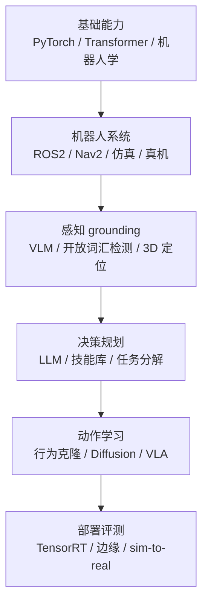
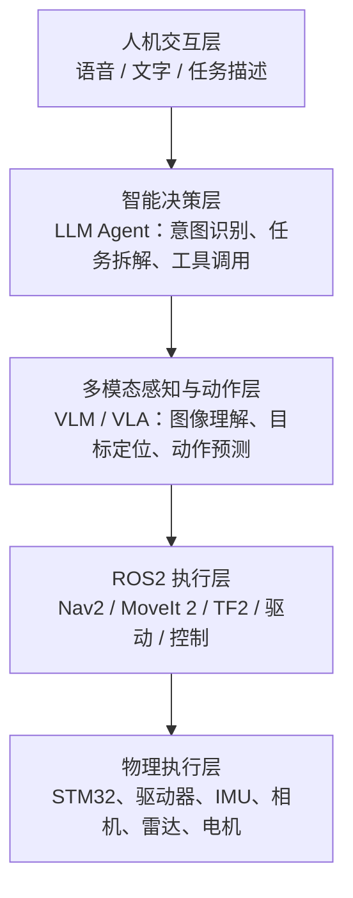
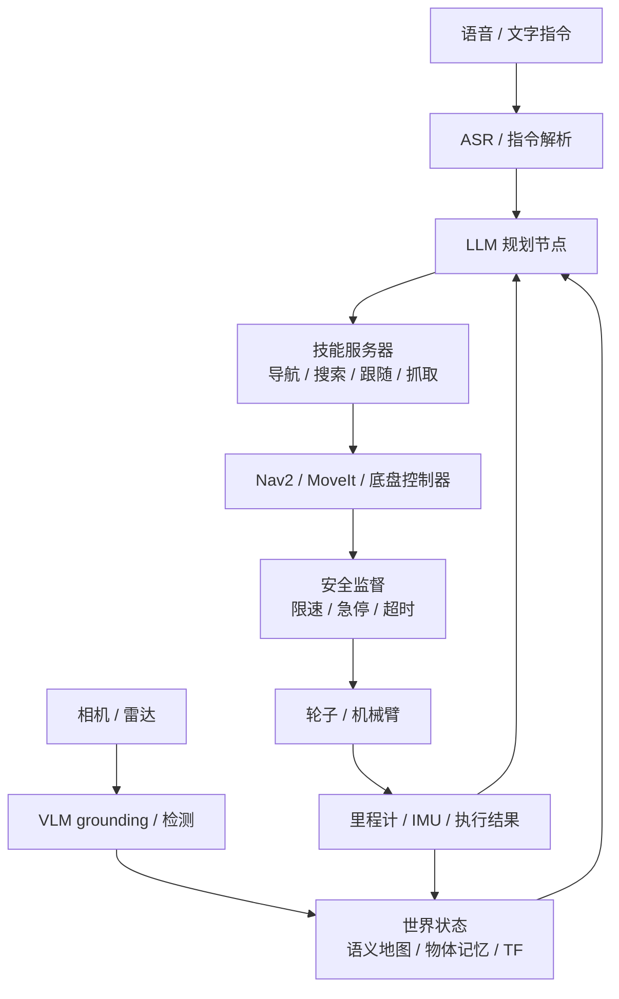

# 初始路线

> WHEELTEC 具身智能工作框架 v0.3  
> 2026-11-02 初稿 · 2026-11-03 补 LLM / VLM / VLA 与 ROS2 的结合路线 · 同日拍板上位机与首个 demo  
> 目标：把公司现有的机器人产品、ROS2 栈和多模态大模型能力，做成可交付、可评测、可复制的具身智能功能。

> [!note] v0.2 补了什么
> 读了一份「IMU / STM32 / LLM·VLA 怎么接 ROS2」的对话，把能用的部分并了进来：运行时五层视角、上位机与下位机分工、三个递进任务与交付物、30 天补基础计划、可直接参考的开源项目。原有 90 天产品计划、验收指标、避坑清单保持不动，只在末尾补了几条。

> [!note] v0.3 改了什么
> 五个前提有了答案（机型、部署方式、开发环境、交付节点、算力），1.4 从「待确认」变成「已确认」；90 天计划里加了一节「落地方案 v1」；技术选型补了上位机。具体设计与接口拆到 [[技术方案 v1]]，这一篇只留决策和路线。

---

## 一、先定目标

### 1.1 一句话目标

**不是“学会某个具身大模型”，而是成为能把 VLM/LLM/VLA 接到真实机器人上，并用指标证明系统有效的人。**

具体说，要能独立完成这条闭环：

```text
语言指令 → 物理世界 grounding → 任务规划 → 技能执行 → 结果反馈 → 失败恢复
```

### 1.2 三层目标

| 层次 | 目标 | 验收 |
| --- | --- | --- |
| 岗位目标 | 具身智能算法 / 机器人学习 / VLA / 语义导航 | 有真机 demo、仿真复现、量化指标 |
| 能力目标 | 感知 grounding、任务规划、动作生成、安全执行、评测 | 能独立跑通并解释每一层 |
| 差异化目标 | 不只会调 API，也不硬凹从零训大模型 | 有真机、有数据、有 sim-to-real 经验 |

### 1.3 工作原则

1. **先模块化，后端到端**：LLM/VLM + 技能库先跑通，再考虑 VLA 端到端。
2. **先真机闭环，后仿真扩展**：公司产品是实车，真机 demo 优先。
3. **先指标，后模型**：没有 baseline 和评测集，不换模型。
4. **先安全，后智能**：大模型不能直接控制电机，必须有硬约束。
5. **先产品化，后论文化**：教育/科研客户要的是稳定、可演示、可维护。

### 1.4 五个前提（已有答案）

路线不是通用的，这五个答案会直接改变优先级：

| 问题 | 为什么影响路线 | 2026-11-03 的答案 |
| --- | --- | --- |
| 主要机型 | 移动底盘先深 Nav2，机械臂先深 MoveIt 2；两者都要，工作量翻倍 | 两者都有；demo 先移动底盘，机械臂后置 |
| 模型从哪里来 | 决定是做「接 API」还是做「部署与适配」 | 云端 API 可用，本地做兜底 |
| 开发环境 | WSL2 跑 Gazebo、接真机串口都会踩坑 | Jetson Orin NX 16GB，JetPack 6 / Ubuntu 22.04 |
| 第一个交付节点 | 学习顺序服从交付节点，不是反过来 | 未定，不着急 → 里程碑改门禁制 |
| 计算硬件 | 决定模型规模和要不要量化、蒸馏 | 16 GB 统一内存，3B 可常驻，7B 需 INT4 |

具体落地见 [[技术方案 v1]]。

---

## 二、总体技术路线



### 2.1 各层学什么

| 层级 | 要学什么 | 产出/验收 |
| --- | --- | --- |
| 0 基础 | PyTorch、Transformer/ViT、CLIP、扩散/流匹配基础、行为克隆、SE(2)/SE(3)、相机模型 | 能读懂 RT-1/RT-2/OpenVLA/Octo 的 method |
| 1 机器人系统 | ROS2 Humble、TF、Nav2、URDF、Gazebo、真机 SSH | 语言指令 → Nav2 目标点，能避障到达 |
| 2 感知 grounding | Qwen-VL/LLaVA、Grounding DINO、SAM、深度图、开放词汇检测 | “找红色杯子” → bbox/3D 点 |
| 3 决策规划 | LLM function calling、任务分解、RAG、SayCan 式技能选择 | “去厨房拿杯子” → 技能序列 |
| 4 动作学习 | 行为克隆、DAgger、Diffusion Policy、Octo/SmolVLA/OpenVLA、LoRA | 50—200 条演示微调，仿真成功率超 baseline |
| 5 部署评测 | ONNX/TensorRT、边缘推理、延迟、安全限幅、sim-to-real | 真机 demo + 成功率/碰撞率/延迟表 |

### 2.2 关键取舍

- 不从零训练 7B VLA：没算力、没数据。先用 SmolVLA/Octo 或 OpenVLA + LoRA。
- 不只做 prompt/RAG：那只是 LLM 应用，不是具身智能，必须有动作落到机器人。
- 不同时追人形、机械臂、导航：先选一个主战场。
- 不无指标地换模型：具身岗位和产品都看“怎么证明变好了”。

### 2.3 换个角度：运行时五层

L0—L5 回答的是「我按什么顺序学」；系统真正跑起来时，是另一种切法：



两张图要分开看：

- **学习分层（L0—L5）** 是能力地图，越往下越难；
- **运行时五层** 是责任边界，越往下越实时、越不能出错。

同一个模型在两张图里的位置完全不同。VLA 在学习分层里是最难的一层，但在运行时它只是第三层的一个**可选**组件——导航这件事 Nav2 做得又稳又便宜，没有必要为了用 VLA 而把 VLA 塞进每一次导航。

### 2.4 上位机与下位机：ROS2 负责「怎么走」，STM32 负责「真的动」

产品里的分工基本是固定的：

| 层 | 跑什么 | 语言 | 时间尺度 |
| --- | --- | --- | --- |
| 上位机 | Linux + ROS2：感知、定位、规划、导航 | C++ / Python | 10—20 Hz，容忍几十毫秒抖动 |
| 下位机 | MCU（WHEELTEC 这类底盘是 STM32）：读编码器与 IMU、跑 PID、输出 PWM | C | 1 kHz 级，硬实时 |

WHEELTEC 的底盘就是这套结构的现成实例：ROS2 侧把 `cmd_vel` 打成 11 字节帧发下去，STM32 解帧、闭环、驱动电机，再把 24 字节状态帧（三轴速度 + IMU + 电压）回传。逐字节的解析见 [[ROS 2 底盘串口驱动代码解析]]。

由此得到两条硬约束：

- **大模型既不能进下位机，也不能进上位机的硬实时回路。** 它只往上走，输出技能和参数；电机怎么转由下位机的 PID 决定。
- **IMU 的价值在短期。** 加速度计测的是比力（静止时也含重力，所以能估倾角），陀螺仪测角速度；积分一次得速度、两次得位置，误差必然累积，所以必须和轮速、雷达、视觉融合（[[ROS 2 里程计与 IMU 代码解析]]、[[ROS 2 EKF 传感器融合配置解析]]）。

要把 IMU 这条线补扎实，顺序是：IMU 基础（加速度 / 角速度 / roll-pitch-yaw）→ 坐标系 → 四元数 → 卡尔曼滤波 → VIO / LIO。前两步在 [[ROS 2 里程计与 IMU 代码解析]] 的 Mahony 滤波那节能直接对上代码，比自己推一遍快。

---

## 三、三条产品方向

| 方向 | 为什么适合 WHEELTEC | 交付物 | 指标 |
| --- | --- | --- | --- |
| **语义导航 / 具身交互** | 已有 ASR、LLM、VLM、TTS、Nav2 和真实机器人，改造成本最低 | “去会议室找白板” → 自主到达并确认 | 指令成功率、grounding 准确率、导航成功率、延迟 |
| **主动物体搜索** | 可复用 RRT/前沿探索、Nav2、VLM，演示效果好 | “找红色杯子” → 主动探索直到找到 | 搜索成功率、耗时、路径长度、碰撞率 |
| **机械臂数据闭环 / VLA 预研** | 公司有 moveit 四轴/六轴车型，可作为高端卖点 | 遥操作采数据 → 训练 ACT/Diffusion/VLA → 仿真/真机评测 | 成功率、泛化成功率、推理延迟 |

**优先级：语义导航 > 主动物体搜索 > VLA 预研。**  
语义导航直接建立在现有 AI 多模态链路上，最容易在 1—2 个月内做出可演示、可写进产品说明的成果。

---

## 四、系统架构

### 4.1 总体数据流



对应到 WHEELTEC 现有链路：

```text
ASR → LLM/RAG → 动作函数 → ROS 功能
```

升级为：

```text
ASR 节点 → /instruction
VLM grounding 节点 → /objects
/instruction + /objects + /map → LLM 规划节点 → /plan
/plan → 技能服务器 → Nav2 Action / 机械臂 Action
→ 安全监督 → /cmd_vel
→ /odom /tf /执行结果 → 回到规划节点
```

### 4.2 ROS2 节点划分

| 节点 | 职责 | 接口 |
| --- | --- | --- |
| `instruction_parser` | LLM 把自然语言转成结构化任务，校验 JSON，失败重试 | Service/Action |
| `grounding_node` | VLM/Grounding DINO/SAM 找目标，深度图转 3D，TF 到 map | Service/Topic |
| `semantic_map_server` | 地点名、房间名、物体位置，存 YAML/JSON | Service/Topic |
| `skill_server` | `NavigateTo`、`SearchObject`、`Follow`、`Speak` | Action Server |
| `safety_supervisor` | 限速、急停、超时、碰撞检测、非法动作拦截 | Topic/Service |
| `eval_logger` | 记录指令、轨迹、成功/失败、延迟 | Topic/文件 |

### 4.3 节点设计原则

- LLM 不直接输出速度，只输出技能和参数，由技能层执行。
- 所有长任务用 ROS2 Action，不用 Topic 硬凑。
- 每个技能有超时、取消和失败返回，不能静默卡死。
- 配置驱动 `car_mode`，不硬编码话题名和车型参数。
- 大模型节点和实时控制节点分开执行器/进程，避免阻塞。

### 4.4 三个递进任务与交付物

架构不要一次全上。按 A → B → C 递进，每一步都能独立演示、独立验收：

| 任务 | 做什么 | 交付物 | 对应节点 |
| --- | --- | --- | --- |
| **A · LLM + ROS2 Agent** | 自然语言 → 调 ROS2 工具 → 导航 / 查状态 | 一个 Agent、一套 ROS2 Tool 接口、一套执行与反馈机制 | `instruction_parser` + `skill_server` |
| **B · VLM + ROS2 感知** | 摄像头识别指定物体，换算到机器人坐标系 | 图像采集节点、VLM 推理接口、目标定位与 TF 转换 | `grounding_node` |
| **C · VLA + ROS2 操作** | 视觉 + 语言 → 抓取 / 放置动作 | VLA 推理服务、动作适配层、数据采集与评估、安全执行 | `skill_server` 的操作分支 |

A 是第一优先级：它用最低成本把「LLM 到底能不能调动机器人」这件事坐实，也最容易在周会上演示。B 决定机器人有没有「眼睛」。C 依赖机械臂和真机数据，提前开工只会在硬件适配上卡住。

三个任务合起来是一条完整链路，实习结束时的成果就是这条路线的证据。

---

## 五、大模型节点与 ROS2 节点的关系

### 5.1 一句话

**大模型节点不是 ROS2 的替代品，而是 ROS2 计算图里的“认知节点”。**  
ROS2 负责感官、手脚和反射弧；大模型负责语义理解、任务规划和泛化。

### 5.2 三种形态

| 形态 | 做法 | 优点 | 缺点 |
| --- | --- | --- | --- |
| 进程内节点 | 在 `rclpy` 节点里直接加载模型 | 简单、延迟低 | 推理阻塞回调，占 GPU/内存 |
| 独立模型服务 | 模型跑在单独进程/服务，ROS2 节点通过 service/action 调用 | 隔离好、可独立重启、显存可控 | 多一层通信，要处理超时 |
| 外部云服务 | ROS2 节点作为客户端调云端 API | 本地算力要求低 | 依赖网络、延迟高、隐私风险 |

**推荐：感知模型做独立服务，LLM 做规划服务，VLA 做 Action Server。**  
不要让一个节点既收图像、又跑 7B 模型、又发 `/cmd_vel`。

### 5.3 能力与接口对应

| 大模型能力 | 输入 | 输出 | 推荐接口 |
| --- | --- | --- | --- |
| ASR 语音识别 | 音频流 | 文本 | Topic 或 Service |
| VLM 视觉理解 | 图像 + 文本 | 描述/bbox/3D 点 | Service（短）或 Action（长） |
| 开放词汇检测 | 图像 + 类别词 | bbox/mask | Topic（连续）或 Service（按需） |
| LLM 任务规划 | 指令 + 机器人状态 | JSON 计划 | Service/Action |
| VLA 策略 | 图像 + 指令 + 本体状态 | 动作块 | Action |
| TTS 播报 | 文本 | 音频 | Topic |
| 导航 | 目标位姿 | 反馈/结果 | Nav2 Action |
| 机械臂 | 目标位姿/关节 | 轨迹/结果 | MoveIt Action |

### 5.4 实时性分层

| 模块 | 典型频率 | 实时性 |
| --- | --- | --- |
| 相机/雷达 | 10—30 Hz | 硬实时 |
| 检测/VLM | 1—10 Hz | 软实时 |
| LLM 规划 | 事件触发 | 软实时 |
| Nav2 控制 | 10—20 Hz | 硬实时 |
| 安全监督 | 50—100 Hz | 硬实时 |

**大模型不能放在硬实时链路里。** LLM 几秒回一次没问题，底盘控制不能等。

### 5.5 VLA 的接法：推理服务 + 桥接节点 + 安全监控

VLA 比 LLM 更难接，因为它的输出直接是动作。推荐拆成四个角色，谁也不越界：

```text
ROS2 相机/状态节点
   ↓ 图像 + 本体状态
VLA 推理服务（PyTorch，独立进程）
   ↓ 预测的动作块 Action Chunk
ROS2 桥接节点（消息 ↔ 模型接口）
   ↓ 动作校验（范围 / 单位 / 频率）
MoveIt 2 / 控制器
   ↓
机械臂
```

- **VLA Inference Server**：只做推理，不碰 ROS。
- **ROS2 Bridge Node**：负责协议转换，是全系统唯一知道两边的胶水。
- **Robot Controller**：只执行校验过的动作。
- **Safety Monitor**：动作范围、碰撞风险、急停状态，独立于模型。

为什么是「动作块」而不是单步动作？因为多数 VLA 一次预测一段连续动作序列，这样能减少推理次数、动作也更连续。但**不同 VLA 的动作空间、频率、归一化方式都不同**，必须按它训练时的配置适配，不能随便互换。

---

## 六、具身智能闭环六步

### 6.1 定义技能库

先把机器人会做的事定义成有限技能：

- `navigate_to(place)`
- `search_object(label)`
- `detect_object(label)`（只识别定位，不移动）
- `follow_person()`
- `look_at(target)`
- `pick(object)`（有机械臂）
- `speak(text)`
- `get_robot_state()`（位姿、电量、是否被占用，给 LLM 当上下文）

每个技能一个 Action 接口，有输入、反馈、结果、超时、取消。**LLM 只在这些技能里选，不允许自由发挥。**

技能清单本身就是安全边界：模型能做的最大破坏，等于技能库能造成的最坏结果。所以**不要给 LLM 一个 `publish_cmd_vel()` 工具**。

### 6.2 语言 grounding 到物理世界

“会议室”“白板”“红色杯子”必须落到：

- 地图坐标，或
- 相机像素 + 深度 + TF 得到的三维点，或
- 语义地图里的物体记录。

这一步是具身智能和聊天机器人的分界线：**语言必须能指向物理实体**。

### 6.3 世界状态与记忆

维护一个轻量语义地图：

```yaml
places:
  meeting_room: {x: 3.2, y: 1.5, yaw: 0.0}
objects:
  whiteboard: {x: 3.0, y: 2.0, confidence: 0.8, last_seen: 12.3}
```

VLM 更新它，LLM 读它。没有记忆，机器人每次都要重新找。

### 6.4 LLM 做任务分解，不做底层控制

LLM 输出结构化计划，例如：

```json
{
  "steps": [
    {"skill": "navigate_to", "args": {"place": "meeting_room"}},
    {"skill": "search_object", "args": {"label": "whiteboard"}},
    {"skill": "speak", "args": {"text": "找到了白板"}}
  ]
}
```

用 JSON Schema/Pydantic 校验；非法技能、缺参数、超时，直接拒绝或重试。**绝不让 LLM 直接输出 `/cmd_vel`。**

### 6.5 技能层执行，反馈给规划层

技能服务器调用 Nav2 Action：

```python
self.nav_client.send_goal_async(goal, feedback_callback=self.feedback)
```

执行结果（成功/失败/被取消/卡住）回传给 LLM，LLM 决定重试、换技能或询问用户。这就是“闭环”。

### 6.6 安全监督

独立于大模型的硬约束：

- 速度/角速度限幅。
- 急停、碰撞检测、超时。
- 只允许技能库里的动作。
- 大模型节点失联时，底盘自动停。

**安全层不能由大模型自己判断。**

---

## 七、90 天落地计划

### 第 1—2 周：摸底与 baseline

- 跑通现有 AI 多模态 demo，画出节点/话题/TF 图。
- 定义 3 个指标：指令成功率、端到端延迟、人工接管率。
- 建一个 50 条指令的评测集，覆盖 3—5 个场景。
- 交付：现状架构图 + baseline 报告。

### 第 3—4 周：语义导航 v1

- 先不做 VLM，用“地点名 → 地图坐标”的语义地图 + Nav2。
- LLM 输出 `{action: navigate, target: "会议室"}`，JSON Schema 校验。
- 交付：20 条指令，成功率 > 70%。

### 第 5—6 周：VLM grounding

- 加开放词汇检测/VLM，把 bbox + 深度 + TF 变成 map 系 3D 点。
- 到达后用 VLM 复核“是不是目标物体”。
- 交付：物体寻找/导航 demo，grounding 准确率有数据。

### 第 7—8 周：鲁棒性与边缘部署

- 加超时、重试、断网 fallback、本地小模型兜底。
- 量化/ONNX/TensorRT，测端到端延迟。
- 在不同 `car_mode`、不同传感器上回归。
- 交付：50 条指令评测报告 + 延迟表。

### 第 9—12 周：产品化或预研

- 产品化：一键 launch、配置文件、错误提示、演示视频、用户文档。
- 预研：如果有机械臂，搭 LeRobot 数据管线，微调 SmolVLA/Octo，做仿真评测。
- 交付：内部 release + 下一阶段 roadmap。

### 如果只有 3 个月

```text
第 1 月：语义导航
第 2 月：VLA 仿真复现
第 3 月：真机 + 评测 + 写报告
```

不要贪多。

### 已拍板：落地方案 v1（2026-11-03）

真正开工要用的四条决定：

| 决定 | 结论 | 影响 |
| --- | --- | --- |
| 上位机 | Jetson Orin NX 16GB 开发套件 | 本地 3B VLM 可常驻；8 GB 会顶到天花板 |
| 车型 | 移动底盘 + 机械臂双线，靠配置切换 | demo 只做移动底盘，机械臂放到最后一阶段 |
| 模型部署 | 云端为主、本地兜底 | 端到端延迟按 3 s 设计 |
| 第一个 demo | 实验室找红色杯子 | 先用经典 CV，VLM 只做到达后的复核 |

交付节点还没定，所以里程碑从「按周排」改成「按门禁过」：

```text
G1 手打坐标能到点 → G2 地名能到点 → G3 听懂话 → G4 红杯子能定位
→ G5 到了能确认 → G6 能泛化（换颜色/物体）→ G7 能交付（断网/双车型回归）
```

接口定义、评测集、待定风险都在 [[技术方案 v1]]。

### 个人侧：30 天补基础

产品计划之外，我自己还有一条压缩版的能力路线。四段，每段带验收，否则容易学成「看过」：

| 阶段         | 天数    | 学什么                                                                    | 验收                                 |
| ---------- | ----- | ---------------------------------------------------------------------- | ---------------------------------- |
| ROS2 基础    | 1—7   | Node / Topic / Service / Action、发布订阅、Launch、Parameter、TF2、RViz2        | 独立写一个 Python 节点：收传感器数据、发控制指令       |
| ROS2 + LLM | 8—14  | LLM API、Prompt、Function Calling、LangGraph、Action Client、JSON Schema 校验 | 自然语言控制 Gazebo 里的机器人完成导航            |
| VLM + ROS2 | 15—21 | 多模态调用、`cv_bridge`、RGB-D、Grounding、TF2 坐标变换                             | 说出物体名 → 识别 → 给出 `base_link` 下的三维位置 |
| VLA + ROS2 | 22—30 | 动作预测、OpenVLA / SmolVLA、LeRobot 采数据、Action Chunking、推理服务部署              | 仿真或实机上完成一次语言条件抓取                   |

这张表是压缩目标，不代表 30 天能熟练 VLA。真机的硬件适配和数据采集，通常比训练本身更耗时。

第一个项目直接用**公司自己的车**（移动底盘 + Jetson），不要再走 TurtleBot3：用自己的 URDF 和驱动包练，收获能直接留在公司；TurtleBot3 上跑通的代码，换到实车要重写一遍。

如果车暂时排不上，用 Gazebo 加载 `wheeltec_robot_urdf` 做同样的链路，接口一致，迁到实车只改 launch。

---

## 八、技术选型

| 环节 | 建议 | 原因 |
| --- | --- | --- |
| VLM | 云端 Qwen-VL 为主，本地 Qwen2.5-VL-3B 兜底 | 云端质量高，本地保证断网可用 |
| 开放词汇检测 | Grounding DINO、YOLO-World | 不依赖固定类别 |
| 分割 | SAM/SAM2 | 给抓取/测距提供 mask |
| LLM | 云端 API 为主，本地 Qwen2.5-7B（INT4）兜底 | 客户现场可能没有外网，必须能降级 |
| 技能层 | Nav2 Action + 自定义 Action Server | 复用成熟导航，别重造 |
| 模仿学习 | ACT、Diffusion Policy | 数据量小、稳定 |
| VLA | SmolVLA、Octo、OpenVLA LoRA | 先小后大，不从零训 |
| 部署 | ONNX/TensorRT、Jetson Orin NX **16GB** | 产品必须看延迟和功耗；16 GB 是本地 3B VLM 的门槛 |
| 数据 | ROS bag → LeRobot/RLDS | 社区工具链成熟 |

### 可以直接抄作业的开源项目

| 项目 | 方向 | 拿来看什么 |
| --- | --- | --- |
| **ROSA**（NASA JPL） | LLM + ROS | 怎么把 ROS 能力封装成 Agent 的工具集——这套「工具层」设计直接对应 4.2 的 `skill_server` |
| **Nav2** | 移动导航 | 技能层底座，`navigate_to_pose` action |
| **MoveIt 2** | 机械臂 | 抓取与轨迹规划 |
| **OpenVLA** | VLA | 模型结构与动作接口；有 LoRA 微调路线 |
| **SmolVLA** | 轻量 VLA | 输入多视角图像 + 本体状态 + 语言，输出动作块，适合边缘部署 |
| **LeRobot** | 数据与训练 | 遥操作采数据 → 数据集 → 训练 → 部署的完整工作流 |
| **Intel AgenticROS** | 系统集成 | VLM 推理服务与 ROS2 控制的分层接法 |

读的顺序：先 ROSA 看工具封装，再 LeRobot 看数据管线，最后 OpenVLA / SmolVLA 看动作接口。直接啃 VLA 论文容易卡在模型细节，而实习里真正要交的是**接口和链路**。

### 接口定义示例

```text
# srv/Plan.srv
string instruction
string state_json
---
bool success
string plan_json
string error
```

```text
# action/ExecutePlan.action
string plan_json
---
bool success
string message
---
string current_skill
float32 progress
```

### 规划节点骨架

```python
class LLMPlanner(Node):
    def __init__(self):
        super().__init__('llm_planner')
        self.declare_parameter('model', 'qwen2.5-7b')
        self.create_service(Plan, '/plan', self.handle_plan)

    def handle_plan(self, req, res):
        try:
            plan = self.llm(req.instruction, req.state_json)
            plan = validate_plan(plan)          # 只允许技能库
            res.success = True
            res.plan_json = json.dumps(plan)
        except Exception as e:
            res.success = False
            res.error = str(e)
        return res
```

注意：LLM 调用慢时，不要放在默认单线程执行器里阻塞图像回调；用 `MultiThreadedExecutor`、独立回调组，或把模型放独立进程。

---

## 九、产品化必须补的工程课

教育/科研客户和论文实验不一样，下面这些决定功能能不能卖：

1. **一键启动**：客户不想记 10 个终端命令。
2. **错误可读**：断网、找不到目标、定位丢失，要给出人话提示。
3. **安全兜底**：限速、急停、超时、非法指令拦截。
4. **多车型兼容**：差速/麦轮/阿克曼、不同雷达相机，至少做配置化。
5. **离线可用**：云端 API 不能是唯一路径。
6. **可评测**：每次改模型/提示词，跑同一套回归集。
7. **可维护**：模型、提示词、技能配置分开，别写死在代码里。
8. **可解释**：客户能看到“现在在做什么、为什么失败”。
9. **输出可验证**：模型给的每个字段都要有明确的单位、坐标系、取值范围。`{"x": 1.2, "y": 0.5}` 没有 `frame_id` 就是废数据。
10. **推理与实时分离**：推理服务可以有几百毫秒甚至几秒的抖动，控制回路不行。两者必须能独立重启、独立降级。

---

## 十、验收指标

| 指标 | 定义 | 建议目标 |
| --- | --- | --- |
| 指令成功率 | 完整完成指令的比例 | 首版 > 70%，稳定版 > 85% |
| grounding 准确率 | 找到正确目标的比例 | > 80% |
| 导航成功率 | 到达目标附近的比例 | > 90% |
| 碰撞率 | 每 100 次任务碰撞次数 | 越低越好，安全优先 |
| 端到端延迟 | 从说完指令到开始动作 | 本地 < 3 s，云端 < 5 s |
| 人工接管率 | 需要人介入的任务比例 | 持续下降 |
| 恢复成功率 | 失败后重试成功的比例 | > 60% |

评测集要固定，覆盖：

- 不同房间/光照/障碍。
- 不同车型/传感器。
- 同义表达、模糊指令、错误指令。
- 目标不存在、目标被遮挡、网络断开。

---

## 十一、避坑

1. **在图像回调里同步跑 7B 模型** → 回调阻塞、图像堆积。用独立节点/线程/进程。
2. **VLM 输出像素坐标没做 TF** → 目标点飘。必须 `camera_link → map` 变换。
3. **RGB 和深度图时间戳不同步** → 3D 点错。用 `message_filters` 近似同步。
4. **LLM 输出自由文本** → 解析失败。用 JSON Schema + 重试 + 兜底。
5. **没有超时和取消** → 机器人卡死。所有 Action 都要 timeout/cancel。
6. **没有安全层** → 模型幻觉直接变成撞墙。技能白名单 + 速度限幅 + 急停。
7. **只做云端** → 断网就废。本地小模型 + 云端兜底。
8. **没有评测集** → 改完不知道好坏。固定 50—100 条指令回归。
9. **只在一个房间/一台车/一个网络下能跑** → 无法产品化。
10. **追最大模型** → 延迟、成本、稳定性都会崩。
11. **把 VLM 的 bbox 当成抓取位姿** → 语义定位只到「大概在哪」。真抓取还要姿态估计、抓取点检测、碰撞检测和轨迹规划。
12. **只要 JSON 合法就执行** → 合法不等于合理。还要校验目标在可通行区域、机器人当前状态允许、参数在量程内。
13. **拿 A 模型的输出喂 B 控制器** → 不同 VLA 的动作空间、频率、归一化都不同，必须按训练配置适配。

---

## 十二、一句话总结

**在 WHEELTEC，技术价值不是“会调 Qwen-VL”，而是“能把语言、视觉、导航/操作、安全、评测串成客户能用的闭环”。**  
先把语义导航做成可交付功能，再用机械臂数据闭环和 VLA 预研拉高上限。

---

## 相关

- [[技术方案 v1]] —— 这一篇的落地版：上位机、接口定义、红杯子 demo 管线、门禁与评测集。
- [[WHEELTEC ROS1 教程学习笔记]]
- [[WHEELTEC ROS 教程学习报告]]
- [[机器人轮胎与底盘构型]]
- [[ROS 2 通信机制]]
- [[ROS 2 节点编程]]
- [[SLAM 与导航]]
- [[VLA 与机器人 AI]]
- [[模型推理加速]]
- [[ROS 2 底盘串口驱动代码解析]] —— 上位机 / 下位机分工的具体代码实例。
- [[ROS 2 里程计与 IMU 代码解析]] —— IMU 数据怎么变成里程计和四元数。
- [[ROS 2 EKF 传感器融合配置解析]] —— IMU 与轮速融合的参数层。
- [[ROS 2 Nav2 多点导航代码解析]] —— 技能层要调的那个 action 的真面目。
- [[机器人系统调试与工程实践]]
