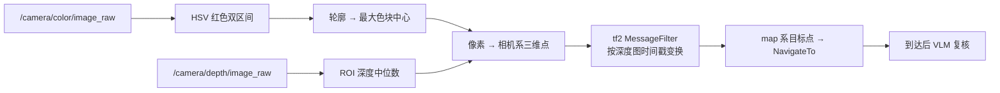

# 技术方案 v1

> 2026-11-03  
> 定位：[[初始路线]] 是「往哪走」，这一篇是「具体怎么做」。  
> 一句话：**先做「语言 → 地点 → Nav2」的语义导航闭环；红杯子 demo 先用经典 CV，VLM 只做复核；VLA 放最后，且只在有机械臂的车型上预研。**

## 一、已拍板的前提

| 项 | 结论 | 影响 |
| --- | --- | --- |
| 上位机 | Jetson Orin NX 16GB 开发套件 | 本地 3B VLM 可常驻，7B 可跑但慢；决定量化与延迟预算 |
| 车型 | 既有移动底盘，也有带机械臂的车型 | 双 profile 配置；机械臂分支后置 |
| 云端 API | 允许 | 主路径走云端，本地做断网降级 |
| 第一个 demo | 实验室找红色杯子 | 评测集围绕它建，可复用现有视觉代码 |
| 交付节点 | 未定，不着急 | 里程碑用门禁制，不排日期 |

## 二、上位机与预算

| 项 | 规格 | 数量 | 估算价 |
| --- | --- | --- | --- |
| 上位机 | Jetson Orin NX **16GB** 开发套件（含载板与散热） | 1 | ¥5,000–6,500 |
| 存储 | NVMe SSD 1TB（M.2 2280） | 1 | ¥450 |
| 供电 | DC-DC 稳压模块 24V→12V 5A | 1 | ¥80 |
| 网络 | 5GHz 路由器 / AP（实验室已有则免） | 1 | ¥200 |
| 标定 | 棋盘格 + ArUco 标定板 | 1 | ¥60 |
| | | **合计** | **约 ¥5,800–7,300** |

### 2.1 为什么是 16GB

- **16 GB 统一内存 + 102 GB/s 带宽**：3B VLM（INT4 约 2.5 GB）可常驻，7B INT4（约 4.5 GB）能跑但慢。
- **8 GB 版本会顶到天花板**：ROS2 + Nav2 约 2 GB，深度与图像管线约 0.5 GB，系统约 1 GB，3B 模型加 KV cache 要 3 GB 以上，只剩不到 1 GB 余量，任何一步加料都要重来。
- **10–25 W**：底盘 24 V 电池经 DC-DC 直接供，不用逆变器、不加配重、不怕震动。
- **JetPack 6 = Ubuntu 22.04**，与 ROS2 Humble 对齐，不用折腾系统版本。
- **它就是产品的参考平台**：在它上面踩到的功耗、散热、量化问题，客户车上会原样出现。

### 2.2 备选与不建议

| 方案 | 结论 |
| --- | --- |
| Orin Nano 8GB Super（约 ¥2,000–2,500） | 预算被砍时的退路，本地只做兜底，3B 要 INT4 且延迟翻倍 |
| AGX Orin（¥1.5 万起） | 超配，不做训练用不着 |
| x86 + RTX 装机 | 要逆变器、重、散热和震动都是新问题，移动底盘上得不偿失 |
| 4GB 版本 Jetson | 装完系统就没了，不要买 |

### 2.3 采购前自查

WHEELTEC 部分车型出厂带算力，先确认再花钱：

```bash
cat /etc/nv_tegra_release   # Jetson 会打印 L4T 版本
nvidia-smi                  # x86 + 独显
free -h                     # 总内存
```

车上已经是 Orin NX 16GB 的话，这笔钱改买 SSD、AP 和深度相机支架。

## 三、总体架构

```text
语音 / 文字
   ↓
instruction_parser（LLM，独立进程）
   ↓ /plan  JSON，经 Pydantic 校验
skill_server（Action Server）
   ├─ NavigateTo   → Nav2 navigate_to_pose
   ├─ SearchObject → grounding_node
   ├─ Speak        → TTS
   └─ Stop         → 直接发零速
   ↓
collision_monitor（Nav2 自带）+ cmd_vel_watchdog（自写薄层）
   ↓ /cmd_vel
turn_on_wheeltec_robot（现成，不改）
   ↓ 串口 11 / 24 字节
STM32
```

三条硬约束：

1. **底盘驱动包一个字都不改。** 它已经验证过，动它等于把风险引到自己身上。新东西全挂在 `/cmd_vel` 之上。
2. **LLM 没有 `publish_cmd_vel` 这个工具。** 技能库就是安全边界。
3. **模型节点和实时控制节点分开进程、分开执行器。** 7B 推理绝不能在图像回调里同步跑。

## 四、A0：语义导航 v1（先不上模型）

**目的**：先证明「语言 → 车动起来」这条链路通，把不确定性从模型上挪开。

```yaml
# semantic_map.yaml
places:
  meeting_room: {x: 3.2, y: 1.5, yaw: 0.0}
  lab_door:     {x: 0.4, y: -2.1, yaw: 1.57}
  lab_table:    {x: 2.0, y: 0.8, yaw: 3.14}
```

- 解析器用**关键词 + 正则**，输出固定 JSON
- `skill_server` 只实现 `NavigateTo` 一个 action，内部调 Nav2
- 刻意不用 LLM：如果「会议室 → 坐标 → 到达」都不稳，接上模型只会让问题更难查

**验收**：20 条指令成功率 > 70%，全程 `/cmd_vel` 可回放。

## 五、A：接 LLM，工具调用与失败恢复

- `instruction_parser` 换成 LLM，走 Function Calling；云端为主，本地 3B 兜底
- 输出必须过 **Pydantic + JSON Schema**：技能名在枚举里、地名在语义地图里、参数在量程内
- 失败路径三条：输出非法 → 重试一次 → 规则兜底；导航 `ABORTED` → 原样回传给 LLM 决策；超时 → 停机并播报原因

```text
# action/NavigateTo.action
string place                     # 语义地图里的键
---
bool success
string message                   # 失败原因，要原样回传给 LLM
---
string state                     # planning / driving / arrived
float32 progress
```

**延迟预算**：云端单次调用 1–3 s，端到端「说完话到车动」< 3 s。

**验收**：50 条指令（含同义表达、模糊指令、不存在的地点），成功率 > 80%。

## 六、B：红杯子 demo

### 6.1 先用经典 CV，VLM 只做复核



理由很实际：**给客户演示时，30 ms 的确定性管线比 2 s 的概率模型可靠得多。** 你们已有的 `visualTracker.py` 本来就是「HSV → 轮廓 → 深度中位数」，改造成本极低。

VLM 只负责两件事：

1. 到了之后确认「这是不是红色杯子」，压掉误检；
2. 以后换成「蓝色的瓶子」时顶上来——这是泛化，不是主路径。

### 6.2 复用现有代码时要先修的四处

读 `visualTracker.py` 时标出来的问题，直接关系到红杯子检测：

| 问题 | 现象 | 修法 |
| --- | --- | --- |
| HSV 红色只取 0–10 | 偏紫的红、冷白平衡的相机检测不到 | 加 170–180 区间，两段 mask 取或 |
| `erode(iterations=4)` | 远处的杯子被腐蚀没 | 改 1–2 次，或改开运算 |
| 深度 NaN 与 0 混用 | 16UC1 的无效值是 0，不是 NaN | 按编码分别处理 |
| 硬编码内参 | 换相机角度全错 | 读 `camera_info` |

### 6.3 像素到三维

```text
X = (u - cx) · Z / fx
Y = (v - cy) · Z / fy
Z = depth[u, v]
```

再用 `tf2_ros.MessageFilter` 从 `camera_link` 变到 `map`——**必须按深度图的时间戳**，用最新 TF 的话车一动点就飘。输出 `geometry_msgs/PointStamped`。

**验收**：20 个物体、5 个位置，grounding 准确率 > 80%，3D 点与卷尺实测误差 < 10 cm。

```text
# msg/SceneObject.msg
string label
float32 confidence
geometry_msgs/PointStamped position
string source          # color / vlm / dino
```

## 七、双车型策略

| 车型 | profile | 加载什么 | 现在做不做 |
| --- | --- | --- | --- |
| 移动底盘（差速 / 麦轮） | `mobile` | Nav2 params + 底盘 launch | 做，demo 主战场 |
| 带机械臂（moveit 四轴 / 六轴） | `manipulator` | 再加 MoveIt 2 + 操作技能 | 后置，先确认现有驱动状态 |

- `car_mode` 决定 profile，不硬编码话题名与车型参数
- 两套代码不是两套仓库，是同一份代码加配置分支
- 先在 `mobile` 上把 A0 → A → B 跑通，`manipulator` 只做 C 阶段的接入验证

## 八、安全与降级

| 风险 | 措施 |
| --- | --- |
| LLM 幻觉 | 技能白名单（枚举），没有 `publish_cmd_vel` 工具 |
| 输出格式错 | Pydantic 校验 + 重试 + 规则兜底 |
| 车失控 | Nav2 `collision_monitor` + watchdog 零速 |
| 进程卡死但不退出 | `cmd_vel_watchdog`：500 ms 无新指令发零速（现有驱动只在析构时停车） |
| 算力过载 | 模型独立进程；`MultiThreadedExecutor` + 独立回调组 |
| 断网 | 本地 3B 兜底，切换时播报 |

## 九、里程碑（门禁制，不排日期）

| 门禁 | 判据 | 依赖 |
| --- | --- | --- |
| G1 链路通 | 手打坐标 → 车到点 → 返回成功 | 现有栈 |
| G2 地名到点 | 20 条指令成功率 > 70% | A0 |
| G3 听懂话 | 50 条指令成功率 > 80%，端到端 < 3 s | A |
| G4 看得见 | 红杯子 3D 点误差 < 10 cm | B |
| G5 认得出 | 到达后复核，误检率 < 20% | B + VLM |
| G6 能泛化 | 换 3 种颜色 / 物体仍可用 | B |
| G7 能交付 | 断网、重定位、双车型回归全过 | 全部 |

哪天做完算哪天，但每道门禁必须有一次公开演示或一份数据。

## 十、评测集

固定 50 条指令，覆盖：

- 5 个地点 × 同义表达
- 模糊指令（「去那边」）、错误指令（不存在的地点）
- 目标不存在、目标被遮挡、网络断开
- 三种 `car_mode` 各跑一遍

## 十一、待定与风险

1. **交付节点未定**：决定 B 阶段能否做到 VLM 复核，还是只交到 G4。
2. **云端厂商与数据合规**：实验室画面能不能出内网，要提前问清楚。
3. **机械臂车型的 MoveIt 现状**：驱动是否可用、有无标定，直接决定 C 阶段能否启动。
4. **相机内外参**：深度相机是否已标定，未标定的话 10 cm 误差目标达不到。
5. **最可能翻车的地方**：不是模型，是 TF 与时间戳同步。先做 G1，就是为了把这个风险提前暴露。

## 相关

- [[初始路线]] —— 岗位目标、产品方向、90 天计划与验收指标。
- [[ROS 2 底盘串口驱动代码解析]] —— `/cmd_vel` 的下游，串口协议逐字节。
- [[ROS 2 视觉跟随代码解析]] —— `visualTracker` 的原始实现，B 阶段的改造起点。
- [[ROS 2 图像处理节点代码解析]] —— `cv_bridge`、编码、QoS。
- [[ROS 2 Nav2 多点导航代码解析]] —— action 与状态机。
- [[VLA 与机器人 AI]] —— C 阶段的理论背景。
- [[工作框架 Index]]
