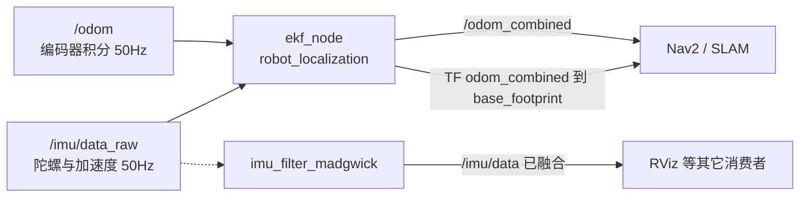

# ROS 2 EKF 传感器融合配置解析

轮式里程计短时准、长时漂；IMU 的角速度短时准、姿态会漂。两个都不够用，但**误差特性互补**——这正是卡尔曼滤波存在的理由。

WHEELTEC 用 `robot_localization` 的 `ekf_node` 把两者融合，输出 `/odom_combined`，并发布 `odom_combined → base_footprint` 的 TF。整个系统的定位精度，很大程度由这个 YAML 决定。

> 文件位置：`...\turn_on_wheeltec_robot\config\ekf.yaml`、`ekf_carto.yaml`、`imu.yaml`
> 加载它的 launch：`wheeltec_ekf.launch.py`

## 一、数据流



注意 EKF 吃的是 `/imu/data_raw`，不是 madgwick 融合后的 `/imu/data`。原因：EKF 自己会积分角速度、自己估计姿态，喂一份「已经融合过」的数据等于重复处理，还会引入相关性假设错误。madgwick 的输出留给别的模块用。

## 二、YAML 的第一层：节点名必须对上

```yaml
ekf_filter_node:
    ros__parameters:
        frequency: 30.0
        ...
```

ROS 2 的参数文件按 **节点名 → `ros__parameters`** 组织。这里的 `ekf_filter_node` 必须和 launch 里的 `name=` 完全一致：

```python
Node(
    package='robot_localization',
    executable='ekf_node',
    name='ekf_filter_node',          # ← 对应 YAML 第一行
    parameters=[ekf_config],
    remappings=[('/odometry/filtered', 'odom_combined')],
)
```

名字对不上时**不报错**，只是所有参数都用默认值——这是 ROS 2 参数文件最常见的坑。启动后可以用 `ros2 param get /ekf_filter_node frequency` 确认是否真的读到了。

## 三、全局参数：滤波器怎么跑

```yaml
frequency: 30.0              # 输出频率
sensor_timeout: 2.0          # 超过 2 秒没数据，只预测不校正
two_d_mode: true             # 平面模式：强制 z、roll、pitch 为 0
transform_time_offset: 0.0
transform_timeout: 0.2
print_diagnostics: false
publish_tf: true
publish_acceleration: false
```

`two_d_mode: true` 很关键。移动机器人在平面运动，z、roll、pitch 理论上恒为 0，但 IMU 噪声会让它们有小数值。打开这个开关，滤波器直接把这些维度锁死，**避免「机器人以为自己在爬坡」**导致的姿态漂移。

`publish_tf: true` 是这段配置真正的产出：EKF 发布 `odom_combined → base_footprint`。底盘驱动只发 `/odom` 话题，不发 TF（见 [[ROS 2 底盘串口驱动代码解析]]），所以这条边必须由 EKF 负责。

## 四、三个坐标系：决定 TF 树

```yaml
map_frame: map
odom_frame: odom_combined
base_link_frame: base_footprint
world_frame: odom_combined
```

按 REP-105 的约定：

| 参数 | 含义 | 本例 |
|---|---|---|
| `map_frame` | 全局固定系 | `map`（EKF 不管，SLAM 发 `map → odom`） |
| `odom_frame` | 局部连续系 | `odom_combined` |
| `base_link_frame` | 机器人本体 | `base_footprint`（不是 `base_link`！） |
| `world_frame` | 滤波器输出位姿相对于谁 | `odom_combined` |

`world_frame == odom_frame` 表示：**滤波器融合的是连续数据（编码器、IMU），输出的是局部定位**。它发布的 TF 是 `odom_combined → base_footprint`。

如果哪天要融合 GPS 这种绝对位置，才把 `world_frame` 设成 `map`，并且必须保证**另有节点发布 `odom → base_link`**，否则 TF 树断了。YAML 注释里专门写了这条规则，值得读完。

## 五、两个输入：odom 与 imu

```yaml
odom0: odom
odom0_config: [false, false, false,
               false, false, false,
               true,  true,  false,
               false, false, true,
               false, false, false]
odom0_differential: true
odom0_relative: false
odom0_queue_size: 1

imu0: /imu/data_raw
imu0_config: [false, false, false,
              false, false, true,
              false, false, false,
              false, false, true,
              false, false, false]
imu0_differential: false
imu0_relative: true
imu0_queue_size: 10
imu0_remove_gravitational_acceleration: true
```

### 5.1 15 个布尔值的含义

顺序固定为：

```
x, y, z,
roll, pitch, yaw,
vx, vy, vz,
vroll, vpitch, vyaw,
ax, ay, az
```

对照着看：

| 输入 | 打开的项 | 意思 |
|---|---|---|
| `odom0` | `vx, vy, vyaw` | 只用编码器算出的**速度**，不用它积出来的位置 |
| `imu0` | `yaw, vyaw` | 用 IMU 的**朝向**和**角速度**，不用它的加速度 |

为什么不用 odom 的 x/y？因为轮式里程计的位置是积分出来的，误差随时间累积；而其**瞬时速度**是编码器直接测的，短时可靠。用速度、不用位置，是移动机器人融合的标准做法。

为什么不用 IMU 的加速度？低成本 IMU 的加速度噪声大、还有零偏，二次积分漂得比轮速还快。同理，`imu0_remove_gravitational_acceleration: true` 只是为保险——本项目加速度三项本来就关着。

### 5.2 `differential` 与 `relative`

- `odom0_differential: true`：把绝对位姿转成「相邻两帧的增量」再融合。本例 pose 三项全 `false`，所以它实际不起作用；留着是为了以后有人打开 pose 项时不出现「开机位置跳变」。
- `imu0_relative: true`：把**第一条** IMU 数据的 yaw 当作 0。机器人上电时朝向未知，先定义为 0，之后相对它积分。这解释了为什么开机后 RViz 里车头总是指向 +x。

### 5.3 融合的权重从哪来

滤波器不是简单平均，它按**协方差**加权。协方差的来源有两处：

1. 消息自带：`/odom` 的 `twist.covariance` 里 vyaw 在运动时是 `1e3`（见 [[ROS 2 里程计与 IMU 代码解析]]），等于说「编码器角速度不可信」。
2. 配置里的 `process_noise_covariance`：过程噪声，表示「模型本身有多不确定」。

```yaml
process_noise_covariance: [0.05, ... 0.025, ... 0.06, ... 0.02, ...]
```

对角线上依次对应 15 个状态。速度项 `0.025`、yaw 项 `0.06`、vyaw 项 `0.02`——值越大，滤波器越愿意相信测量值而不是预测值。

这就是「调 EKF」的本质：**改的不是公式，是对各传感器的信任分配**。调参时的判断依据永远是「哪个量在漂、哪个量在抖」，而不是抄一组数。

## 六、imu.yaml：另一个滤波器

```yaml
imu_filter_madgwick:
    ros__parameters:
        fixed_frame: "base_footprint"
        use_mag: false
        publish_tf: false
        world_frame: "enu"
        orientation_stddev: 0.05
```

`imu_filter_madgwick` 是互补滤波/梯度下降法的姿态融合节点，作用类似驱动里那段 Mahony，但更标准。

- `use_mag: false`：没有磁力计，只用陀螺 + 加速度，所以 yaw 会漂。
- `publish_tf: false`：**绝不能再发 TF**。IMU 的位姿如果也发 `odom → base_footprint`，就和 EKF 打架了。TF 的所有权必须唯一。
- `orientation_stddev: 0.05`：给输出姿态一个标准差，下游据此判断可信度。

## 七、两个 EKF 配置：为什么有 `ekf_carto.yaml`

`wheeltec_ekf.launch.py` 里用 `carto_slam` 参数二选一：

```python
Node(condition=IfCondition(carto_slam),
     name='carto_ekf_filter_node', parameters=[ekf_carto_config], ...)
Node(condition=UnlessCondition(carto_slam),
     name='ekf_filter_node', parameters=[ekf_config], ...)
```

Cartographer 对输入的要求和 Nav2 不同（时间戳、frame 命名、是否要融合 IMU 姿态），所以单独一份配置。切换时只改一个 launch 参数：

```bash
ros2 launch turn_on_wheeltec_robot turn_on_wheeltec_robot.launch.py carto_slam:=true
```

这也是一种架构提示：**同一份代码、不同参数文件**，比复制两个包干净得多。

## 八、运行验证

```bash
ros2 launch turn_on_wheeltec_robot turn_on_wheeltec_robot.launch.py

# 1. 参数真的读到了吗
ros2 param get /ekf_filter_node two_d_mode
ros2 param get /ekf_filter_node world_frame

# 2. 输出在不在、频率对不对
ros2 topic hz /odom_combined
ros2 topic echo /odom_combined --once

# 3. TF 有没有人发
ros2 run tf2_ros tf2_echo odom_combined base_footprint

# 4. 诊断：滤波器是否在抱怨输入
ros2 topic echo /diagnostics
```

一个很实用的对照实验：

- 把 `odom0_config` 里的 `vyaw` 关掉，只留 IMU 的 yaw/vyaw，快速原地转圈，观察 `/odom_combined` 的角度是否更平滑；
- 再把 `imu0_config` 的 yaw 关掉，只留编码器，直行 5 米后看朝向偏多少。

两次对比就能直观理解「谁在修正谁」。

## 九、配置层面的坑

- **节点名不匹配**：YAML 静默失效，所有参数用默认值。先 `ros2 param get` 验证。
- **YAML 缩进**：ROS 2 用 YAML 1.2，缩进错会解析失败或参数丢失；`ros2 param dump` 能看实际生效值。
- **`base_link` 与 `base_footprint` 写混**：TF 树断，Nav2 报 `Timed out waiting for transform`。
- **两个节点都 `publish_tf: true`**：EKF 和 madgwick 同时发同一条边，RViz 里机器人抖动。只留 EKF。
- **`world_frame` 与 `odom_frame` 不一致却没人发 odom→base**：TF 树断开。融合绝对位置时才这么设。
- **`two_d_mode: false` 又用低成本 IMU**：z 和 roll/pitch 漂移，机器人「以为自己在倾斜」。

## 相关

- [[ROS 2 里程计与 IMU 代码解析]] —— 两路输入的协方差是怎么设计的。
- [[ROS 2 TF 与 URDF 代码解析]] —— EKF 发布的 TF 在整个树里的位置。
- [[ROS 2 Launch 文件代码解析]] —— 参数文件如何被加载、条件如何切换。
- [[SLAM 与导航]] —— 融合后的位姿被谁消费。
- [[ROS Index]]
