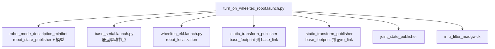

# ROS 2 Launch 文件代码解析

一条 `ros2 launch` 命令要拉起十几个节点、填几十个参数、还要按车型选不同的模型——这些都在 launch 文件里。它本质上是**一个用 Python 写的启动脚本**，只不过返回值必须是一个 `LaunchDescription`。

WHEELTEC 的 launch 目录是一套现成教材：有最简节点启动、有参数注入、有条件分支、有嵌套包含、有车型选择。这一篇按「从最小到完整」的顺序读。

> 源码位置：`...\5.OpenCV_ROS2_Base\turn_on_wheeltec_robot\launch\` 与教程第 5 章 `ROS2Launch文件启动\`

## 一、最小可用 launch

```python
from launch import LaunchDescription
from launch_ros.actions import Node

def generate_launch_description():          # 函数名固定，launch 系统按名调用
    return LaunchDescription([
        Node(
            package='demo_nodes_cpp',
            executable='talker',
            name='my_talker',
            output='screen',
        ),
    ])
```

三件事：

1. `generate_launch_description()` 是入口，名字不能改。
2. 返回 `LaunchDescription`，里面是一串 **action**。
3. `Node` 是最常用的 action：启动一个可执行文件。

`ros2 launch <包名> <文件名>` 的工作流程是：找到包的 `share/` 目录 → 执行这个 Python 文件 → 拿到 `LaunchDescription` → 逐个执行 action。

## 二、Node action 的常用字段

以底盘启动文件为例：

```python
# base_serial.launch.py L8-25
launch_ros.actions.Node(
    package='turn_on_wheeltec_robot',
    executable='wheeltec_robot_node',
    output='screen',
    parameters=[{'usart_port_name': '/dev/wheeltec_controller',
                 'serial_baud_rate': 115200,
                 'robot_frame_id': 'base_footprint',
                 'odom_frame_id': 'odom_combined',
                 'cmd_vel': 'cmd_vel',
                 'akm_cmd_vel': 'none',
                 'product_number': 0}],
)
```

| 字段 | 作用 | 注意 |
|---|---|---|
| `package` | 包名 | 必须已 `colcon build` 并 source |
| `executable` | 可执行名 | CMake 的 `add_executable` 名或 setup.py 的 `console_scripts` 名 |
| `name` | 节点名 | 不写就用代码里的名字；写了会**覆盖**代码里的名字 |
| `output='screen'` | 日志打到终端 | 不写则进 `~/.ros/log`，调试时看不到 |
| `parameters` | 参数 | 列表里可以放字典、YAML 路径、`Path` |
| `remappings` | 话题重映射 | `[('/odom', '/wheel_odom')]` |
| `arguments` | 命令行参数 | 给 `static_transform_publisher` 这类非 ROS 接口的程序用 |
| `condition` | 条件执行 | `IfCondition(...)` / `UnlessCondition(...)` |
| `namespace` | 命名空间 | 多机时给每个机器人加前缀 |

`parameters` 的三种写法都合法：

```python
parameters=[{'key': 1}]                                  # 直接给值
parameters=['/path/to/params.yaml']                      # 给 YAML 文件
parameters=[Path(pkg_dir, 'config', 'ekf.yaml')]         # pathlib 路径
```

`Path` 那种写法在 WHEELTEC 代码里随处可见，因为 `get_package_share_directory()` 返回的是字符串，拼路径容易漏分隔符。

## 三、参数：声明与取值

```python
carto_slam = LaunchConfiguration('carto_slam', default='false')   # L27 取值
carto_slam_dec = DeclareLaunchArgument('carto_slam', default_value='false')  # L29 声明+默认值
```

这两个是配套的：

- `DeclareLaunchArgument` 定义「这个 launch 接受一个叫 carto_slam 的参数，默认 false」，同时让它出现在 `ros2 launch ... --show-args` 里。
- `LaunchConfiguration` 是**占位符**，真正取值发生在运行时。

为什么不能直接用 Python 变量？因为 launch 支持从命令行覆盖：

```bash
ros2 launch turn_on_wheeltec_robot turn_on_wheeltec_robot.launch.py carto_slam:=true
```

`LaunchConfiguration('carto_slam')` 在运行时解析成命令行给的值。**声明要放进 `LaunchDescription` 才会生效**（L94），只写 `LaunchConfiguration` 而忘记 `add_action(DeclareLaunchArgument)`，参数永远是默认值。

## 四、包含另一个 launch

```python
wheeltec_robot = IncludeLaunchDescription(
    PythonLaunchDescriptionSource(
        os.path.join(launch_dir, 'base_serial.launch.py')),
)

robot_ekf = IncludeLaunchDescription(
    PythonLaunchDescriptionSource(
        os.path.join(launch_dir, 'wheeltec_ekf.launch.py')),
    launch_arguments={'carto_slam': carto_slam}.items(),   # 把参数往下传
)
```

`IncludeLaunchDescription` 把另一个 launch 文件当成一个 action 展开。注意：

- 路径要拼到**安装后的 share 目录**（`get_package_share_directory`），不是源码目录。改完源码 launch 要重新 `colcon build`，或用 `--symlink-install`。
- `launch_arguments` 的值可以是普通字符串，也可以是 `LaunchConfiguration` 占位符，所以 `carto_slam` 能从最外层一路传到 EKF 节点。
- 被包含的文件也可以有自己的 `DeclareLaunchArgument`；外层传了就覆盖。

## 五、条件执行：一个文件支持多种配置

```python
# wheeltec_ekf.launch.py L21-40
return LaunchDescription([
    carto_slam_dec,
    Node(
        condition=IfCondition(carto_slam),
        package='robot_localization',
        executable='ekf_node',
        name='carto_ekf_filter_node',
        parameters=[ekf_carto_config],
        remappings=[('/odometry/filtered', 'odom_combined')],
    ),
    Node(
        condition=UnlessCondition(carto_slam),
        package='robot_localization',
        executable='ekf_node',
        name='ekf_filter_node',
        parameters=[ekf_config],
        remappings=[('/odometry/filtered', 'odom_combined')],
    ),
])
```

用 `carto_slam` 一个开关在「Cartographer 专用 EKF 配置」和「普通 EKF 配置」之间切换。两个 Node 写在一个文件里，**同一时刻只会启动一个**，因为条件互斥。

`remappings` 那行也值得注意：`robot_localization` 默认发布 `/odometry/filtered`，这里改成 `odom_combined`，是为了和底盘、Nav2 的约定对齐。**重映射是接口适配层**，不改别人代码就能接进自己的系统。

## 六、车型选择：GroupAction + IfCondition

`robot_mode_description.launch.py` 有 20 多种车型，每种都要「一个 robot_state_publisher + 两个静态 TF」。它用函数封装重复，用 GroupAction 做分组：

```python
def generate_robot_node(robot_urdf, child):
    return launch_ros.actions.Node(
        package='robot_state_publisher',
        executable='robot_state_publisher',
        name=f'robot_state_publisher_{child}',      # 名字带后缀，避免重名
        arguments=[os.path.join(
            get_package_share_directory('wheeltec_robot_urdf'),
            'urdf', robot_urdf)],
    )

def generate_static_transform_publisher_node(translation, rotation, parent, child):
    return launch_ros.actions.Node(
        package='tf2_ros',
        executable='static_transform_publisher',
        name=f'base_to_{child}',
        arguments=[translation[0], translation[1], translation[2],
                   rotation[0], rotation[1], rotation[2], parent, child],
    )

senior_akm_ = GroupAction(
    condition=IfCondition(senior_akm),
    actions=[
        generate_robot_node('senior_akm_robot.urdf', 'senior_akm'),
        generate_static_transform_publisher_node(['0.26', '0', '0.228'], ['0','0','0'],
                                                'base_footprint', 'laser'),
        generate_static_transform_publisher_node(['0.26', '0', '0.228'], ['0','0','0'],
                                                'base_footprint', 'camera_link'),
    ])
```

`GroupAction` 的意义：把多个 action 绑成一个整体，**条件写在组上，组内全部一起启停**。否则你要给每个 Node 都写一遍 `condition`。

这套模式的可读性其实一般——20 多个 `GroupAction` 加 20 多个 `LaunchConfiguration`，真正的开关在最后 30 行 `ld.add_action(...)`。读的时候**先看最后**：谁被 add 进去，谁才是默认启动的。

一个细节：`top_mec_dl_` 的条件写成了 `IfCondition(top_mec_bs)`（L105），复制粘贴漏改。这种 bug 不会报错，只会在选 `top_mec_dl` 车型时启动错模型。

## 七、完整启动树

`turn_on_wheeltec_robot.launch.py` 是总入口，它把底盘相关的一切串起来：



```python
ld = LaunchDescription()
ld.add_action(minibot_type)                     # 车型模型
#ld.add_action(flagship_type)                   # 二选一，注释掉另一个
ld.add_action(carto_slam_dec)
ld.add_action(wheeltec_robot)                   # 底盘 + EKF
ld.add_action(base_to_link)
ld.add_action(base_to_gyro)
ld.add_action(joint_state_publisher_node)
ld.add_action(imu_filter_node)
ld.add_action(robot_ekf)
```

**action 的 add 顺序不等于启动完成顺序**。launch 会尽快把所有节点都拉起来，具体谁先就绪不确定。所以 TF 树里 `odom_combined → base_footprint` 可能在 `base_footprint → base_link` 之后才出现，RViz 一开始报「No transform」是正常的，等一两秒就好。

## 八、传感器选择：注释即配置

`wheeltec_lidar.launch.py` 和 `wheeltec_camera.launch.py` 用的是另一种风格——**把所有型号都写出来，最后只 add 一个**：

```python
Lsm10_m10p_uart = IncludeLaunchDescription(
    PythonLaunchDescriptionSource(os.path.join(Lslidar_launch_dir, 'lsm10p_uart_launch.py')))

ld = LaunchDescription()
ld.add_action(Lsm10_m10p_uart)     # 换成别的雷达就改这一行
return ld
```

雷达有 8 种（LSM10 串口/网口、LSM10P、LSN10、LD14、LD06），相机有 5 种（Astra S/Pro、Dabai、Gemini、USB）。这种「注释切换」的写法对厂商发货很方便，对使用者不友好——**它没有参数化**。

想改成运行时选择，可以这样做：

```python
lidar = LaunchConfiguration('lidar', default='lsm10p_uart')
DeclareLaunchArgument('lidar', description='lsm10p_uart / lsn10 / ld14 ...')
ld.add_action(GroupAction(
    condition=IfCondition(PythonExpression(["'", lidar, "' == 'lsm10p_uart'"])),
    actions=[Lsm10_m10p_uart]))
```

`PythonExpression` 能把两个 substitution 拼成表达式求值。代价是可读性，收益是 `ros2 launch ... lidar:=ld14` 就能换硬件。

## 九、常见坑

- **改了 launch 不生效**：`get_package_share_directory` 读的是 `install/share/`，不是 `src/`。改完要 `colcon build`，或从一开始就用 `--symlink-install`。
- **`DeclareLaunchArgument` 忘了 add**：参数有默认值，但从命令行改不动。
- **条件写错车型**：像 `top_mec_dl_` 那样复制粘贴没改，启动的是另一个模型，TF 位置会整体偏。
- **`name` 重复**：两个节点同名，后启动的把先启动的踢掉（ROS 2 允许同名节点并存，但 `ros2 node list` 只显示一个，参数会互相覆盖）。WHEELTEC 用 `f'robot_state_publisher_{child}'` 加后缀正是为了避免这个。
- **`output` 没写**：节点崩了你看不到 traceback，只能去 `~/.ros/log/latest/` 翻。
- **参数类型**：`'serial_baud_rate': 115200` 是 int；写成 `'115200'` 字符串，`declare_parameter<int>` 会报类型错误。

## 十、动手练习

```bash
# 看这个 launch 接受哪些参数
ros2 launch turn_on_wheeltec_robot turn_on_wheeltec_robot.launch.py --show-args

# 只启动底盘，不启动传感器，观察节点图
ros2 launch turn_on_wheeltec_robot base_serial.launch.py
ros2 node list
ros2 topic list

# 用参数覆盖车型
ros2 launch turn_on_wheeltec_robot turn_on_wheeltec_robot.launch.py carto_slam:=true
```

建议自己写一个 `my_bringup.launch.py`：包含底盘 launch，再启动一个自己写的订阅节点，用 `DeclareLaunchArgument` 控制是否启动 RViz。写完你对 launch 的理解就固化了。

## 相关

- [[ROS 2 工作空间与构建]] —— `share/` 目录从哪来。
- [[ROS 2 节点编程]] —— 被启动的节点长什么样。
- [[ROS 2 TF 与 URDF 代码解析]] —— 这里启动的静态 TF 与模型节点，具体在做什么。
- [[ROS 2 EKF 传感器融合配置解析]] —— `ekf.yaml` 被谁加载、参数怎么生效。
- [[ROS 2 Nav2 多点导航代码解析]] —— 另一个「总入口」式 launch。
- [[ROS Index]]
