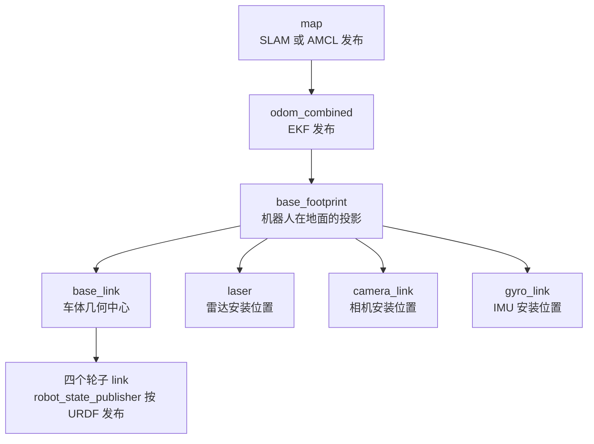

# ROS 2 TF 与 URDF 代码解析

机器人系统里所有的「在哪」都靠 TF 回答：雷达看到的障碍物在哪、相机看到的人在哪、我要往哪个方向走。而 URDF 回答的是「机器人自己长什么样」——每个部件在机体坐标系的哪个位置。

这一篇把 WHEELTEC 的 TF 树拆开：哪一段由谁发布、代码怎么写、哪些地方容易出岔子。

> 代码位置：
> - 静态 TF 与模型启动：`...\turn_on_wheeltec_robot\launch\turn_on_wheeltec_robot.launch.py`、`robot_mode_description.launch.py`
> - URDF 文件：`...\8.ROS2精细URDF模型配置使用\wheeltec_robot_urdf.zip` 里的 `wheeltec_robot_urdf/urdf/*.urdf`

## 一、这棵树的形状



六个坐标系，三条来源：

| 变换 | 谁发布 | 类型 |
|---|---|---|
| `map → odom_combined` | SLAM（slam_toolbox / cartographer）或 AMCL | 动态、低频 |
| `odom_combined → base_footprint` | `robot_localization` 的 EKF | 动态、30 Hz |
| `base_footprint → base_link / laser / camera_link / gyro_link` | `static_transform_publisher` | 静态 |
| `base_link → 各轮子 link` | `robot_state_publisher`（读 URDF） | 由 `joint_states` 驱动 |

记住一句话：**TF 树上每一条边只能有一个父节点，但可以有很多个子节点**。同一条边被两个节点同时发布，就是灾难——RViz 会疯狂在两个位置之间跳。

## 二、底盘启动文件里的两段静态 TF

```python
# turn_on_wheeltec_robot.launch.py L40-51
base_to_link = launch_ros.actions.Node(
    package='tf2_ros',
    executable='static_transform_publisher',
    name='base_to_link',
    arguments=['0', '0', '0', '0', '0', '0', 'base_footprint', 'base_link'],
)

base_to_gyro = launch_ros.actions.Node(
    package='tf2_ros',
    executable='static_transform_publisher',
    name='base_to_gyro',
    arguments=['0', '0', '0', '0', '0', '0', 'base_footprint', 'gyro_link'],
)
```

八个位置参数的含义：

```
x y z   三个平移（米）
旋转     三个角度（旧式位置参数，顺序为 yaw pitch roll，弧度）
parent  父坐标系
child   子坐标系
```

这里有 6 个 `0`，因为 `base_footprint` 与 `base_link` 原点重合。那两个旋转也全 0，所以就算把 yaw/pitch/roll 的顺序记错，这段代码也不会出问题——但换成雷达那种带安装角度的变换就会。

> ROS 2 新版更推荐具名参数：`--x 0 --y 0 --z 0 --qx 0 --qy 0 --qz 0 --qw 1 --frame-id base_footprint --child-frame-id base_link`。位置参数是为兼容旧脚本保留的，新代码建议用具名形式，少一个「顺序记错」的坑。

### 2.1 为什么要有 `base_footprint`

`base_link` 是车体几何中心，通常离地面 10–20 cm；`base_footprint` 是它在**地面上的投影**，z 恒为 0。

导航算法假设机器人是平面上的一个圆/矩形，用 `base_footprint` 做规划最自然：高度信息不参与计算。几乎所有导航配置（代价地图、AMCL、Nav2）都默认以 `base_footprint` 为机器人本体。

代价是：`base_link` 与 `base_footprint` 之间必须有一个静态变换，且**只能是零平移、零旋转**（投影不改变朝向）。这里正是 `0 0 0 0 0 0`。

## 三、雷达与相机的静态 TF：为什么写在 launch 里

`robot_mode_description.launch.py` 为每种车型都配了两条：

```python
senior_akm_ = GroupAction(
    condition=IfCondition(senior_akm),
    actions=[
        generate_robot_node('senior_akm_robot.urdf', 'senior_akm'),
        generate_static_transform_publisher_node(['0.26', '0', '0.228'], ['0','0','0'],
                                                'base_footprint', 'laser'),
        generate_static_transform_publisher_node(['0.26', '0', '0.228'], ['0','0','0'],
                                                'base_footprint', 'camera_link'),
    ])
```

雷达装在车头前方 0.26 m、离地 0.228 m。这个数**因车型而异**，所以写在 launch 里，用 `GroupAction` 和车型绑定。

为什么不写进 URDF？两个原因：

1. **URDF 是整份文件**，改一个安装位置要改 XML；launch 里是一行数组，改起来快。
2. **同一份 URDF 可能被多种雷达复用**，安装高度取决于选的雷达型号，用 launch 覆盖更灵活。

代价是：**信息分散在两处**。你看到 URDF 里也有 `laser` link 时，要确认它是不是 fixed joint——如果 URDF 也定义了 `base_link → laser`，而 launch 又发布 `base_footprint → laser`，TF 树就会打架。本仓库的 URDF 里 `laser`、`camera_link` 是独立 link 但**没有 joint 连到 base_link**，所以不冲突。读别人的包时，这是第一个要检查的地方。

### 3.1 一个常见错误：父坐标系写成了 `base_link`

上面写的是 `base_footprint → laser`。如果改成 `base_link → laser`，雷达高度会少算 `base_link` 到地面的那 10–20 cm，**建图时障碍物整体偏高**，导航时以为能钻过去的缝隙其实钻不过去。

判断方法：`ros2 run tf2_tools view_frames`，看树里 `laser` 的父节点是谁，以及 `base_link` 和 `base_footprint` 之间是不是零变换。

## 四、`robot_state_publisher`：URDF 怎么变成 TF

```python
def generate_robot_node(robot_urdf, child):
    return launch_ros.actions.Node(
        package='robot_state_publisher',
        executable='robot_state_publisher',
        name=f'robot_state_publisher_{child}',
        arguments=[os.path.join(
            get_package_share_directory('wheeltec_robot_urdf'),
            'urdf', robot_urdf)],
    )
```

`robot_state_publisher` 做两件事：

1. 解析 URDF，建立 link/joint 的结构；
2. 订阅 `/joint_states`，**用关节角算出每个 link 的位姿**，发布成 TF。

所以它需要两样输入：URDF 文件（命令行参数给路径）+ 关节状态（话题）。

`joint_state_publisher` 就是来补第二样的：

```python
joint_state_publisher_node = launch_ros.actions.Node(
    package='joint_state_publisher',
    executable='joint_state_publisher',
    name='joint_state_publisher',
)
```

它会给 URDF 里所有可动关节发默认角度（通常是 0）。机器人没有关节编码器反馈时，用它凑数——轮子不会在 RViz 里转，但 TF 树完整、模型显示正常。

> 注意：`joint_state_publisher` 与 `joint_state_publisher_gui` 是两个包。前者无界面，后者会弹滑块窗口。launch 里用的是前者，避免在没有显示器的机器人主控上崩溃。

## 五、URDF 本身：一个 link 一个 joint

```xml
<robot name="mini_mec_robot">
  <link name="base_link">
    <inertial>
      <origin xyz="-0.0176 -0.0212 0.0071" rpy="0 0 0"/>
      <mass value="0.6796"/>
      <inertia ixx="0.000516" ixy="-1.7e-06" ixz="-4.2e-07"
               iyy="0.000761" iyz="-2.6e-07" izz="0.001165"/>
    </inertial>
    <visual>
      <origin xyz="0 0 0" rpy="0 0 0"/>
      <geometry>
        <mesh filename="package://wheeltec_robot_urdf/meshes/mini_mec_robot_meshes/base_link.STL"/>
      </geometry>
      <material name=""><color rgba="0.741 0.902 0.957 1"/></material>
    </visual>
    <collision>
      <origin xyz="0 0 0" rpy="0 0 0"/>
      <geometry>
        <mesh filename="package://wheeltec_robot_urdf/meshes/mini_mec_robot_meshes/base_link.STL"/>
      </geometry>
    </collision>
  </link>

  <joint name="lf_wheel_joint" type="continuous">
    <origin xyz="0.0789 0.0991 -0.0363" rpy="0 0 0"/>
    <parent link="base_link"/>
    <child link="lf_wheel_link"/>
    <axis xyz="0 1 0"/>
  </joint>
</robot>
```

### 5.1 link 的三个子块各有用途

| 子块 | 给谁用 | 本例 |
|---|---|---|
| `inertial` | 物理仿真（Gazebo）算质量与转动惯量 | SolidWorks 自动算出 |
| `visual` | RViz、渲染 | STL 网格 + 颜色 |
| `collision` | 碰撞检测、运动规划 | 用同一份 STL（省事，但性能差） |

真机上 `inertial` 不参与任何计算，但**仿真里缺了它物体会飘**；`collision` 用高精度网格会让规划变慢，工业上常换成简化几何体（box、cylinder）。

`package://` 是 ROS 的资源定位协议，`robot_state_publisher` 和 RViz 会去对应包的 `share/` 目录找网格。**路径写错时模型不显示，但 TF 照常发布**——所以「RViz 里看不到车、TF 却正常」通常查这里。

### 5.2 joint 类型

`type="continuous"` 表示无限旋转的关节，适合轮子；`fixed` 表示固定连接（没有 `/joint_states` 也能算 TF）；`revolute` 有角度上下限；`prismatic` 是滑动。

`axis xyz="0 1 0"` 是轮子的旋转轴——绕 y 轴转。麦轮、差速轮的轴都在这条线上，区别只在安装位置和辊子角度。

## 六、验证 TF 树

```bash
# 生成 PDF 图：frames.pdf
ros2 run tf2_tools view_frames

# 查两个坐标系之间的实际变换
ros2 run tf2_ros tf2_echo odom_combined base_footprint
ros2 run tf2_ros tf2_echo base_footprint laser

# 命令行看当前 TF 话题
ros2 topic echo /tf_static --once
ros2 topic hz /tf
```

`view_frames` 是最省时间的工具：它会画出整棵树、标注每个变换的发布频率和最近一次更新时间。树里出现两个父节点、或者某条边频率为 0，一眼就能看出来。

## 七、坑与判断依据

- **TF 跳变**：同一条边被两个节点发布。查 `ros2 node info` 找谁在发 `/tf`，或看 `view_frames` 里的警告。
- **`base_link` 与 `base_footprint` 混用**：导航配置里写 `base_link`，而传感器挂在 `base_footprint` 下，高度全错。整个仓库统一用 `base_footprint`。
- **静态 TF 的时间戳**：`static_transform_publisher` 发的是「无限有效期」的变换，不受 `use_sim_time` 影响；仿真里如果时间源不对，动态 TF 会报 `TF_OLD_DATA`，静态 TF 却正常——这个差异常让人误判。
- **URDF 改了但 TF 没变**：`robot_state_publisher` 在启动时读一次 URDF，改文件必须重启节点（或重新 launch）。
- **中文注释导致编译/解析失败**：`robot_mode_description.launch.py` 用的是 GBK 编码，里面有中文注释。Python 3 默认按 UTF-8 读源码，遇到非法字节会报 `SyntaxError`。这类文件**不要在 Windows 下用默认编码另存**，也不要用 UTF-8 工具改它。
- **两个 `robot_state_publisher` 同名**：WHEELTEC 用 `robot_state_publisher_{child}` 加后缀，正是为了避免多车型切换时互相覆盖。

## 八、这段代码教给你的分层

TF 树其实是一份「谁负责什么」的契约：

- **传感器安装位置**是机械设计决定的，属于**静态**信息 → 静态 TF / URDF。
- **机器人在世界里的位姿**是运行时估计出来的 → EKF / SLAM 发布**动态** TF。
- **轮子转角**是执行器状态 → `joint_states` + `robot_state_publisher`。

分清这三类，你就知道出问题时该找谁：模型错位找静态 TF，漂移找 EKF/SLAM，轮子不转找 `joint_states`。

## 相关

- [[TF 与 URDF]] —— 概念层：REP-105、四元数、坐标系约定。
- [[ROS 2 里程计与 IMU 代码解析]] —— `odom_combined → base_footprint` 的数据来源。
- [[ROS 2 EKF 传感器融合配置解析]] —— `publish_tf` 与三个 frame 参数。
- [[ROS 2 Launch 文件代码解析]] —— 这些节点是怎么被拉起来的。
- [[SLAM 与导航]] —— `map → odom` 由谁维护。
- [[ROS Index]]
