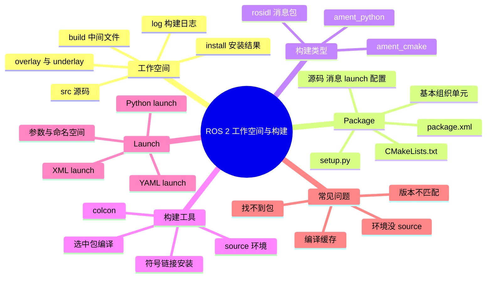

# ROS 2 工作空间与构建

ROS 2 的代码不是散着放的，而是按「工作空间 → Package → 节点/库/消息」组织。刚开始最容易混乱的是 `src`、`build`、`install`、`log` 四个目录，以及为什么改完代码要重新 `colcon build` 和 `source`。把这一套弄清楚，从零建项目就不会心虚。

## 知识体系思维导图



## 1. 工作空间的四个目录

一个典型的 ROS 2 工作空间长这样：

```text
ros2_ws/
├── src/        # 源码和软件包
├── build/      # 编译中间文件
├── install/    # 安装后的可执行文件、库、环境脚本
└── log/        # 每次构建的日志
```

- **`src`**：你真正要写和要改的代码放这里。一个工作空间可以有多个 Package。
- **`build`**：`colcon` 编译时生成的中间文件，一般不用手动改。
- **`install`**：编译成功后安装到这里。`source install/setup.bash` 就是把这个目录加进环境变量。
- **`log`**：构建日志。编译失败时，`log/latest_build/` 里通常有更完整的错误信息。

`build` 和 `install` 可以删掉重编，`src` 不能随便删。新手最常见的错误是把代码写进 `build` 或 `install`，下次编译就没了。

## 2. 从零建一个工作空间

```bash
mkdir -p ~/ros2_ws/src
cd ~/ros2_ws
colcon build
source install/setup.bash
```

建包：

```bash
cd ~/ros2_ws/src
ros2 pkg create my_package --build-type ament_python --dependencies rclpy std_msgs
```

`ament_python` 适合纯 Python 包，`ament_cmake` 适合 C++ 包或需要编译消息的包。消息包通常用 `ament_cmake`。

## 3. Package 里面有什么

一个 Package 至少包含：

- **`package.xml`**：包名、版本、作者、依赖、构建类型。别人 `rosdep install` 时靠它装依赖。
- **`CMakeLists.txt`** 或 **`setup.py`**：构建配置。
- **源码目录**：Python 包通常是 `my_package/`，C++ 包通常是 `src/`、`include/`。
- **`launch/`**：启动文件。
- **`config/`**：YAML 参数。
- **`msg/`、`srv/`、`action/`**：自定义接口。

Python 包的 `setup.py` 里要写 `entry_points`，否则 `ros2 run` 找不到可执行程序：

```python
entry_points={
    'console_scripts': [
        'talker = my_package.talker:main',
    ],
},
```

## 4. colcon 常用命令

```bash
# 编译整个工作空间
colcon build

# 只编译某个包
colcon build --packages-select my_package

# 编译时使用符号链接，改 Python 代码不用反复 build
colcon build --symlink-install

# 查看某个包的编译日志
colcon build --packages-select my_package --event-handlers console_direct+

# 清理后重编
rm -rf build install log
colcon build
```

编译完成后必须 `source install/setup.bash`，否则当前终端找不到新包。每个新终端都要 source 一次，或者把它写进 `~/.bashrc`。

## 5. Overlay 与 Underlay

ROS 2 的环境是叠加的：

- **Underlay**：系统安装的 ROS 2，比如 `/opt/ros/humble`。
- **Overlay**：你自己工作空间的 `install`。

`source /opt/ros/humble/setup.bash` 之后再 `source ~/ros2_ws/install/setup.bash`，你自己的包就会覆盖同名的系统包。这就是为什么有时候「明明改了代码，运行的还是旧版本」——终端 source 的顺序不对，或者根本没 source。

## 6. Launch 文件

一个 launch 文件可以一次启动多个节点、传参数、配命名空间、设置 remap。ROS 2 支持 Python、XML、YAML 三种写法，Python 最灵活。

```python
from launch import LaunchDescription
from launch_ros.actions import Node


def generate_launch_description():
    return LaunchDescription([
        Node(
            package='my_package',
            executable='talker',
            name='talker',
            output='screen',
            parameters=[{'rate': 1.0}],
        ),
    ])
```

运行：

```bash
ros2 launch my_package talker.launch.py
```

常见用途：

- 同时启动相机、检测、导航；
- 给不同机器人设置不同 `namespace`；
- 用 `remap` 把 `/cmd_vel` 改到 `/robot1/cmd_vel`；
- 从 YAML 加载参数。

## 7. 常见构建问题

| 现象 | 常见原因 | 处理 |
| --- | --- | --- |
| `Package not found` | 没 source，或包不在 `src` 下 | `source install/setup.bash`，检查目录 |
| 改了代码没变化 | 没重新 build，或 source 了旧环境 | 重新 `colcon build`，确认 source 顺序 |
| 找不到消息类型 | 消息包没编译，或依赖没声明 | 先编译消息包，检查 `package.xml` |
| Python 入口找不到 | `setup.py` 的 `entry_points` 没写 | 补 `console_scripts` 后重编 |
| 编译一半失败 | 依赖缺失或版本不匹配 | 看 `log/latest_build/`，按错误装依赖 |
| 多个工作空间冲突 | overlay 覆盖了同名包 | 调整 source 顺序，或改包名 |

## 相关

- [[ROS 2 节点编程]]
- [[ROS 2 常用命令与调试]]
- [[ROS 基础与架构]]
- [[ROS Index]]
