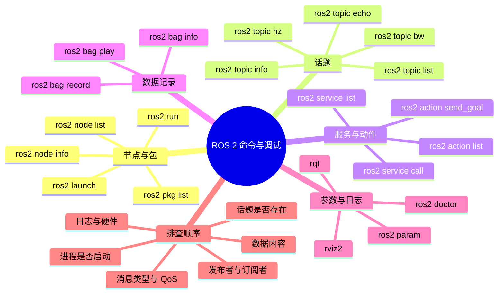

# ROS 2 常用命令与调试

ROS 2 的命令行工具是最快的「看系统状态」方式。面试里问「话题没数据怎么查」「机器人不动怎么排查」，真正加分的不是背命令，而是知道先看什么、再看什么。这一篇把常用命令和排查顺序放在一起。

## 知识体系思维导图



## 1. 节点与包

```bash
ros2 node list                 # 当前运行的节点
ros2 node info /talker         # 某个节点的发布、订阅、服务
ros2 pkg list                  # 已安装的包
ros2 pkg executables my_pkg    # 包里的可执行程序
ros2 run my_pkg talker         # 运行一个节点
ros2 launch my_pkg demo.launch.py
```

`ros2 node info` 很有用：它能告诉你这个节点订阅了什么、发布了什么、提供了哪些服务。排查「谁在发这个数据」时，比盲目 `topic echo` 快。

## 2. 话题

```bash
ros2 topic list                # 所有话题
ros2 topic list -t             # 带消息类型
ros2 topic info /scan          # 发布者、订阅者、消息类型
ros2 topic echo /scan          # 打印消息内容
ros2 topic echo /scan --once   # 只打印一条
ros2 topic hz /scan            # 发布频率
ros2 topic bw /scan            # 带宽占用
```

排查「话题没数据」时，按这个顺序：

1. `ros2 topic list` 看话题是否存在；
2. `ros2 topic info /scan` 看有没有发布者、消息类型是什么；
3. `ros2 topic echo /scan` 看有没有实际消息；
4. 检查发布者节点是否启动、是否报错；
5. 检查两端的 QoS 是否兼容；
6. 检查 `ROS_DOMAIN_ID`、网络、防火墙、传感器驱动和硬件连接。

## 3. 服务与动作

```bash
ros2 service list
ros2 service type /add_two_ints
ros2 service call /add_two_ints example_interfaces/srv/AddTwoInts "{a: 1, b: 2}"

ros2 action list
ros2 action info /navigate_to_pose
ros2 action send_goal /navigate_to_pose nav2_msgs/action/NavigateToPose "{pose: ...}" --feedback
```

服务调用要注意参数格式，类型写错会直接报解析错误。Action 的 `--feedback` 能看到过程反馈，排查导航卡住时很有用。

## 4. 参数

```bash
ros2 param list
ros2 param get /talker rate
ros2 param set /talker rate 2.0
ros2 param dump /talker
ros2 param load /talker params.yaml
```

参数适合运行时可调的配置，比如频率、阈值、话题名。不要把大量静态配置都塞进参数，配置文件用 YAML 更清晰。

## 5. 数据记录与回放

```bash
ros2 bag record /scan /camera/image_raw
ros2 bag record -a                 # 记录所有话题
ros2 bag info my_bag               # 查看包信息
ros2 bag play my_bag               # 回放
ros2 bag play my_bag --rate 0.5    # 半速回放
```

bag 是调试和复现问题的利器。现场跑一遍、录下来，回去慢慢回放，比在机器人上反复试快得多。注意 bag 会占很大空间，图像和点云尤其大。

## 6. 日志与可视化

```bash
ros2 run my_pkg talker --ros-args --log-level debug
ros2 launch my_pkg demo.launch.py --screen
rqt
rviz2
ros2 doctor
```

- `--log-level debug`：打开更详细的日志。
- `--screen`：让 launch 的输出直接打到终端。
- `rqt`：图形化看话题、服务、节点、日志。
- `rviz2`：看 TF、点云、图像、地图、路径。
- `ros2 doctor`：检查环境、网络、版本等常见配置问题。

## 7. 典型排查：机器人不动

按「从上层到底层」的顺序：

1. **节点是否启动**：`ros2 node list` 看导航、控制器、底盘驱动在不在。
2. **控制指令有没有发**：`ros2 topic echo /cmd_vel` 看有没有速度指令。
3. **指令内容对不对**：线速度、角速度是不是 0，坐标系对不对。
4. **底盘驱动有没有收到**：看驱动日志、`ros2 topic info` 的订阅者。
5. **硬件状态**：急停、使能、电池、通信线、电机报错。
6. **规划有没有输出**：导航 Action 的 feedback、全局路径、局部代价地图。
7. **TF 是否完整**：`ros2 run tf2_tools view_frames` 看坐标树有没有断。

这个顺序的价值是：先判断「是没发指令、发了没收到、收到没执行、执行了没动」，而不是一上来就改代码。

## 8. 典型排查：模型在电脑上快，上机器人慢

不要只看模型单次推理时间，先测端到端：

- 图像采集耗时；
- 图像传输和格式转换耗时；
- 预处理耗时；
- 模型推理耗时；
- 后处理耗时；
- ROS 消息序列化和排队耗时。

然后看机器人端 CPU/GPU 占用、内存、功耗、散热。瓶颈可能在数据拷贝、USB 带宽、网络，而不是模型本身。

## 9. 命令背后的思路

命令只是工具，真正要建立的是「数据流视角」：

- 谁发布？
- 谁订阅？
- 消息类型是什么？
- 频率和延迟大概多少？
- 哪一步断了？

能把一个机器人系统画成「节点 + 话题 + TF」的图，排查就已经完成一半。

## 相关

- [[ROS 2 通信机制]]
- [[ROS 2 节点编程]]
- [[机器人系统调试与工程实践]]
- [[ROS Index]]
