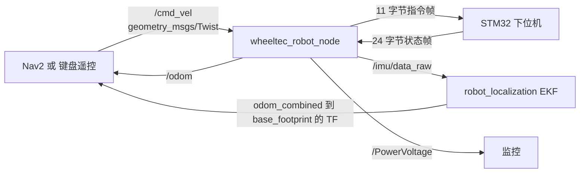

# ROS 2 底盘串口驱动代码解析

这是整套 WHEELTEC ROS2 系统里最底层、也最值得逐行读的一个节点：`turn_on_wheeltec_robot` 包里的 `wheeltec_robot.cpp`。它把「ROS 世界」和「STM32 世界」缝在一起——一边是 `cmd_vel` 话题，另一边是 24 字节一帧的串口数据。

读懂它，你就同时读懂了四件事：节点怎么写、参数怎么用、串口协议怎么设计、嵌入式代码怎么被 ROS 包起来。

> 源码位置：`D:\轮趣\...\6.ROS2系列教程\3.ROS2机器人应用视频教程：相机与图像处理\2.OpenCV入门及其在ROS2环境下的应用\Program_OpenCV_And_ROS2\5.OpenCV_ROS2_Base\turn_on_wheeltec_robot\`
> 主文件：`src/wheeltec_robot.cpp`（783 行）、头文件 `include/turn_on_wheeltec_robot/wheeltec_robot.h`（264 行）

## 一、它在系统里的位置



注意一个容易误解的点：**这个节点不发布 TF**。头文件里虽然 `#include <tf2_ros/transform_broadcaster.h>`，但全文件没有实例化 broadcaster。`odom → base_footprint` 的变换由 EKF 节点发布（见 [[ROS 2 EKF 传感器融合配置解析]]）。驱动只负责把数据算出来、发出去。

## 二、类结构：一个节点就是一个类

```cpp
// wheeltec_robot.h L190
class turn_on_robot : public rclcpp::Node
{
public:
    turn_on_robot();                 // 构造函数：参数、话题、串口全在这
    ~turn_on_robot();                // 析构：发停车指令、关串口
    void Control();                  // 主循环：读串口、积分、发布
    serial::Serial Stm32_Serial;     // 串口对象
private:
    rclcpp::Subscription<geometry_msgs::msg::Twist>::SharedPtr Cmd_Vel_Sub;
    rclcpp::Publisher<nav_msgs::msg::Odometry>::SharedPtr odom_publisher;
    rclcpp::Publisher<sensor_msgs::msg::Imu>::SharedPtr imu_publisher;
    rclcpp::Publisher<std_msgs::msg::Float32>::SharedPtr voltage_publisher;
    // ... 回充相关 3 个发布、2 个订阅、1 个服务
    void Cmd_Vel_Callback(const geometry_msgs::msg::Twist::SharedPtr twist_aux);
    bool Get_Sensor_Data_New();
    unsigned char Check_Sum(unsigned char Count_Number, unsigned char mode);
    short IMU_Trans(uint8_t Data_High, uint8_t Data_Low);
    float Odom_Trans(uint8_t Data_High, uint8_t Data_Low);
    Vel_Pos_Data Robot_Pos, Robot_Vel;   // X/Y/Z 三元组
    MPU6050_DATA Mpu6050_Data;           // 原始 short 值
    // ...
};
```

`main` 只有四行：

```cpp
int main(int argc, char** argv)
{
    rclcpp::init(argc, argv);
    turn_on_robot Robot_Control;   // 构造时把一切准备好
    Robot_Control.Control();       // 进入 while 循环
    return 0;
}
```

这个结构值得借鉴：构造只做「声明与准备」，`Control()` 做「运行时循环」。不要把死循环写进构造函数，否则节点无法被正常的生命周期管理。

## 三、构造函数：参数、话题、串口

### 3.1 参数声明

```cpp
turn_on_robot::turn_on_robot() : rclcpp::Node("wheeltec_robot")   // L675 节点名
{
    this->declare_parameter<int>("serial_baud_rate");                       // L691
    this->declare_parameter<std::string>("usart_port_name", "/dev/wheeltec_controller");
    this->declare_parameter<std::string>("odom_frame_id", "odom");
    this->declare_parameter<std::string>("robot_frame_id", "base_footprint");
    this->declare_parameter<std::string>("gyro_frame_id", "gyro_link");

    this->get_parameter("serial_baud_rate", serial_baud_rate);
    this->get_parameter("usart_port_name", usart_port_name);
    this->get_parameter("odom_frame_id", odom_frame_id);
    this->get_parameter("robot_frame_id", robot_frame_id);
    this->get_parameter("gyro_frame_id", gyro_frame_id);
```

三个细节：

- `serial_baud_rate` **没有默认值**。launch 里必须传，否则 `get_parameter` 拿到 0，串口打不开。这是「参数必填」的一种写法。
- 帧名做成参数，是为了同一个驱动能配到不同机器人上。
- `declare_parameter` 之后才能 `get_parameter`；ROS 2 不再有 ROS 1 那种「参数服务器随便读」的行为。

### 3.2 话题与服务

```cpp
odom_publisher = create_publisher<nav_msgs::msg::Odometry>("odom", 2);          // L703
imu_publisher  = create_publisher<sensor_msgs::msg::Imu>("imu/data_raw", 2);
voltage_publisher = create_publisher<std_msgs::msg::Float32>("PowerVoltage", 1);

Cmd_Vel_Sub = create_subscription<geometry_msgs::msg::Twist>(
    "cmd_vel", 2, std::bind(&turn_on_robot::Cmd_Vel_Callback, this, _1));       // L723

SetCharge_Service = this->create_service<turtlesim::srv::Spawn>(
    "/set_charge", std::bind(&turn_on_robot::Set_Charge_Callback, this, _1, _2)); // L717
```

队列深度全是 `2` 或 `1`，这是控制话题的正确做法：**只关心最新指令**，积压旧指令等于让机器人执行过期动作。对比教程里 `String` 的深度 10——那只是演示。

`imu/data_raw` 这个名字有约定含义：**未融合的原始 IMU**。有 `imu/data` 才是融合后的姿态。这里驱动发的是原始角速度和加速度，姿态四元数虽然算了，但仍挂在 `imu/data_raw` 上，交给下游的 `imu_filter_madgwick` 再处理一次。

### 3.3 串口初始化

```cpp
try {
    Stm32_Serial.setPort(usart_port_name);          // L731
    Stm32_Serial.setBaudrate(serial_baud_rate);     // L732
    serial::Timeout _time = serial::Timeout::simpleTimeout(2000);
    Stm32_Serial.setTimeout(_time);                 // L734 读超时 2000 ms
    Stm32_Serial.open();
} catch (serial::IOException& e) {
    RCLCPP_ERROR(this->get_logger(), "can not open serial port ...");
}
```

`serial` 是第三方库（`ros-humble-serial`），不是 ROS 自带。2000 ms 的超时很关键：`read()` 是阻塞的，读不到数据就等 2 秒——这决定了整个节点的最坏循环周期，也解释了为什么机器人断连时 `/odom` 会停但不报错。

## 四、下行：从 Twist 到 11 字节

### 4.1 帧格式

| 字节 | 内容 | 说明 |
|---|---|---|
| 0 | `0x7B` | 帧头 `FRAME_HEADER` |
| 1 | 模式 | 0 正常 / 1、2、3 回充相关 |
| 2 | 0 | 预留 |
| 3–4 | `vx × 1000` | 高字节在前，单位 mm/s |
| 5–6 | `vy × 1000` | 麦轮/全向才有意义 |
| 7–8 | `wz × 1000` | 单位 0.001 rad/s |
| 9 | BCC | 字节 0–8 逐位异或 |
| 10 | `0x7D` | 帧尾 `FRAME_TAIL` |

### 4.2 打包代码

```cpp
void turn_on_robot::Cmd_Vel_Callback(const geometry_msgs::msg::Twist::SharedPtr twist_aux)
{
    short transition;

    Send_Data.tx[0] = FRAME_HEADER;   // 0x7B
    Send_Data.tx[1] = AutoRecharge;   // 模式位
    Send_Data.tx[2] = 0;

    transition = twist_aux->linear.x * 1000;   // L66 浮点乘 1000 转整数
    Send_Data.tx[4] = transition;              // L67 低 8 位
    Send_Data.tx[3] = transition >> 8;         // L68 高 8 位

    transition = twist_aux->linear.y * 1000;   // L73
    Send_Data.tx[6] = transition;
    Send_Data.tx[5] = transition >> 8;

    transition = twist_aux->angular.z * 1000;  // L80
    Send_Data.tx[8] = transition;
    Send_Data.tx[7] = transition >> 8;

    Send_Data.tx[9]  = Check_Sum(9, SEND_DATA_CHECK);  // L84 校验 0-8
    Send_Data.tx[10] = FRAME_TAIL;                     // L85 0x7D

    Stm32_Serial.write(Send_Data.tx, sizeof(Send_Data.tx));  // L88
}
```

为什么乘 1000？因为串口只能传字节，浮点要拆成定点整数。0.25 m/s 传成 250，下位机再除以 1000。这是嵌入式通信的通用做法，牺牲三位小数换简单与确定性。

`transition` 声明成 `short`（有符号 16 位，范围 −32768…32767）意味着速度上限约 ±32.7 m/s（角速度 ±32.7 rad/s），机器人远远够用。但注意：**超出范围会静默溢出**，`50000` 变成负数，机器人朝反方向猛冲。工业代码应在这里加 clamp。

### 4.3 BCC 校验

```cpp
unsigned char turn_on_robot::Check_Sum(unsigned char Count_Number, unsigned char mode)
{
    unsigned char check_sum = 0, k;
    if (mode == 0)  // 校验接收帧
        for (k = 0; k < Count_Number; k++)
            check_sum = check_sum ^ Receive_Data.rx[k];
    if (mode == 1)  // 校验发送帧
        for (k = 0; k < Count_Number; k++)
            check_sum = check_sum ^ Send_Data.tx[k];
    return check_sum;
}
```

BCC = 逐字节异或。它只能发现单比特错误和奇数个比特错误，不能纠错，也比 CRC 弱；但对 115200 波特率的短帧足够，且单片机端一行代码就能算。

## 五、上行：24 字节状态帧与状态机

### 5.1 帧内容

| 字节 | 内容 |
|---|---|
| 0 | `0x7B` 帧头 |
| 1 | `Flag_Stop` 预留 |
| 2–3 | vx，mm/s |
| 4–5 | vy，mm/s |
| 6–7 | wz，0.001 rad/s |
| 8–13 | 加速度 ax / ay / az，原始 short |
| 14–19 | 角速度 gx / gy / gz，原始 short |
| 20–21 | 电池电压，mV |
| 22 | BCC，字节 0–21 异或 |
| 23 | `0x7D` 帧尾 |

### 5.2 为什么不能一次 read 24 字节

早期版本 `Get_Sensor_Data()` 一次读 24 字节再找帧头帧尾，代码里明确写了它的问题：

> 更新说明：该校验方法会导致出现读取错误数据或者正确数据不处理的情况，现在已不用该校验方法，换成逐帧校验方式。

原因很实际：串口是**字节流**，不保证每次 `read` 正好落在帧边界。可能读到「半帧 + 下半帧」，也可能帧中间的数据恰好等于 `0x7B`。所以改用逐字节状态机：

```cpp
bool turn_on_robot::Get_Sensor_Data_New()
{
    uint8_t Receive_Data_Pr[1];
    static int count, count2;

    Stm32_Serial.read(Receive_Data_Pr, sizeof(Receive_Data_Pr));   // L500 一次只读 1 字节

    Receive_Data.rx[count] = Receive_Data_Pr[0];                   // L509 填进缓冲区

    if (Receive_Data_Pr[0] == FRAME_HEADER || count > 0)           // L521
        count++;
    else
        count = 0;

    if (count == 24) {                                             // L554 收满一帧
        count = 0;
        if (Receive_Data.Frame_Tail == FRAME_TAIL) {               // 帧尾对
            check = Check_Sum(22, READ_DATA_CHECK);
            if (check == Receive_Data.rx[22]) {                    // 校验对
                // 解析速度、IMU、电压 ...
                return true;
            }
        }
    }
    return false;
}
```

状态机三要素：**等待帧头 → 累计计数 → 满 24 字节校验**。只要计数没到 24 就一直往 `rx[count]` 里塞；一旦校验失败，`count` 归零，下一帧重新同步。哪怕中途数据里出现 `0x7B`，最多影响一帧。

这套写法简单，但有一个隐患：**帧同步可能锁死在错误位置**。如果某一帧丢了几个字节，之后每次凑满 24 字节的尾字节都可能不是 `0x7D`，于是永远失败。更稳的做法是「失步时扫描缓冲区找帧头」。教程版本靠 UART 本身的低误码率撑住了。

### 5.3 数据换算

```cpp
float turn_on_robot::Odom_Trans(uint8_t Data_High, uint8_t Data_Low)
{
    short transition_16 = 0;
    transition_16 |= Data_High << 8;
    transition_16 |= Data_Low;
    return (transition_16 / 1000) + (transition_16 % 1000) * 0.001;
}
```

`transition_16` 是 `short`（有符号），所以 `0xFFFF` 会解释成 −1，负数速度能正确还原。`/1000 + %1000*0.001` 在数学上等于 `×0.001`，只是拆成整数部分和小数部分写，避免浮点转换在单片机端的开销——这段代码是从 STM32 工程直接搬过来的风格。

IMU 原始值则用另一套比例：

```cpp
#define GYROSCOPE_RATIO 0.00026644f   // 量程 ±500°/s：1/65.5/57.30
#define ACCEl_RATIO     1671.84f      // 量程 ±2g：32768/19.6
```

这两个常数必须和 STM32 里 IMU 初始化的量程一致。**换了固件量程却不改这里，姿态会整体缩放错**，是实际调试中最隐蔽的坑之一。

电压：`transition_16/1000 + (transition_16%1000)*0.001`，mV → V，同一个套路。

## 六、主循环：驱动与控制的分工

```cpp
void turn_on_robot::Control()
{
    _Last_Time = rclcpp::Node::now();
    while (rclcpp::ok())
    {
        _Now = rclcpp::Node::now();
        Sampling_Time = (_Now - _Last_Time).seconds();          // L630

        if (true == Get_Sensor_Data_New())                       // L632 读到完整帧
        {
            Robot_Pos.X += (Robot_Vel.X*cos(Robot_Pos.Z) - Robot_Vel.Y*sin(Robot_Pos.Z)) * Sampling_Time;
            Robot_Pos.Y += (Robot_Vel.X*sin(Robot_Pos.Z) + Robot_Vel.Y*cos(Robot_Pos.Z)) * Sampling_Time;
            Robot_Pos.Z += Robot_Vel.Z * Sampling_Time;           // L637 Z 实际是 yaw

            Quaternion_Solution(...);                             // Mahony 姿态解算
            Publish_Odom();
            Publish_ImuSensor();
            Publish_Voltage();

            _Last_Time = _Now;                                    // L648
        }
        // 回充数据发布 ...
        rclcpp::spin_some(this->get_node_base_interface());       // L661 处理 cmd_vel 回调
    }
}
```

三个必须看懂的点：

1. **`spin_some` 放在循环里**，而不是 `rclcpp::spin`。因为主线程已经被串口读取占住，没法定时器等回调；`spin_some` 是「顺手把当前排队的回调都处理掉」。C++ 的 `spin` 本身也支持多线程执行器，但这里用单线程轮询，简单直接。
2. **`_Last_Time` 只在成功读到帧时更新**。所以 `Sampling_Time` 是「距上一帧成功数据的时间」，不是固定 20 ms。串口丢帧时积分间隔自动变长，位移不会漏算——这是这段代码里少见的、正确的鲁棒性设计。
3. **循环没有 sleep**。它靠串口 `read` 的阻塞（最长 2 s）控制节奏；正常有数据时，循环频率等于下位机发帧频率（约 50 Hz）。

## 七、那个奇怪的服务：用 turtlesim 的 Spawn 做回充服务

```cpp
void turn_on_robot::Set_Charge_Callback(
    const shared_ptr<turtlesim::srv::Spawn::Request> req,
    shared_ptr<turtlesim::srv::Spawn::Response> res)
{
    if (round(req->x) == 1)      Send_Data.tx[1] = 1;   // 开始回充
    else if (round(req->x) == 2) Send_Data.tx[1] = 2;   // 取消
    else if (round(req->x) == 0) Send_Data.tx[1] = 0, AutoRecharge = 0;

    Send_Data.tx[9]  = Check_Sum(9, SEND_DATA_CHECK);
    Send_Data.tx[10] = FRAME_TAIL;
    Stm32_Serial.write(Send_Data.tx, sizeof(Send_Data.tx));
    // 用 res->name 回 "true"/"false" 表示成功与否
}
```

`turtlesim/srv/Spawn` 原本是「在画布上生成一只海龟」，请求字段是 `x, y, theta, name`。这里借用它的 `x` 传命令码、`name` 传结果字符串。

这当然不优雅——正确的做法是自定义 `srv/SetCharge.srv`，里面写 `int8 command` 和 `bool success`。但它揭示了一个工程现实：**自定义服务类型要改 CMakeLists、生成代码、两端同步编译**，在快速验证阶段，借一个现成类型最快。读别人代码时看到这种「张冠李戴」，先别急着骂，先看它省掉了什么成本。

## 八、析构函数：安全退出

```cpp
turn_on_robot::~turn_on_robot()
{
    // 组一帧速度全 0 的指令
    Send_Data.tx[0] = FRAME_HEADER;
    Send_Data.tx[1] = 0; Send_Data.tx[2] = 0;
    Send_Data.tx[3] = 0; Send_Data.tx[4] = 0;
    Send_Data.tx[5] = 0; Send_Data.tx[6] = 0;
    Send_Data.tx[7] = 0; Send_Data.tx[8] = 0;
    Send_Data.tx[9]  = Check_Sum(9, SEND_DATA_CHECK);
    Send_Data.tx[10] = FRAME_TAIL;
    Stm32_Serial.write(Send_Data.tx, sizeof(Send_Data.tx));  // 停车
    Stm32_Serial.close();
}
```

节点退出前给下位机发零速度，是移动机器人的安全底线。否则 ROS 端断了，STM32 还保持上一个速度指令，车会一直跑。

但要注意：**Ctrl+C 时析构不一定执行**。`SIGINT` 会让 `rclcpp::ok()` 变 false，`Control()` 返回，对象在 `main` 结束时析构——正常路径会执行。如果进程被 `kill -9`，析构不会执行，此时只能靠 STM32 端的「串口超时自动停车」兜底。所以下位机固件里必须有一个看门狗。

## 九、编译、运行、验证

```bash
cd ~/wheeltec_ros2
colcon build --packages-select turn_on_wheeltec_robot
source install/setup.bash

# 启动底盘（会顺带启动 EKF、imu_filter、模型、静态 TF）
ros2 launch turn_on_wheeltec_robot turn_on_wheeltec_robot.launch.py

# 另开终端
ros2 topic echo /odom --once
ros2 topic echo /imu/data_raw --once
ros2 topic echo /PowerVoltage
ros2 topic hz /odom            # 正常约 50 Hz

# 手动发速度，观察车动不动
ros2 topic pub --once /cmd_vel geometry_msgs/msg/Twist \
  "{linear: {x: 0.1}, angular: {z: 0.0}}"
```

排查顺序：`ls -l /dev/wheeltec_controller` 看设备在不在 → `ros2 param get /wheeltec_robot serial_baud_rate` 看参数对不对 → `ros2 topic hz /odom` 看有没有数据 → 有数据但不动，再查 `cmd_vel` 有没有被别的节点覆盖。

## 十、读这段代码能学到的工程判断

- **协议设计**：帧头帧尾 + 定长 + 异或校验，是资源受限场景的经典三件套；代价是没有重传、没有序号。
- **状态机优于整帧读取**：串口是流，任何「假设一次读正好一帧」的代码都会在真实设备上翻车。
- **单位在协议边界统一**：ROS 侧用 SI 单位（m/s、rad/s），串口侧用定点整数，转换只发生在驱动这一个地方。这是分层带来的好处。
- **控制话题队列要小**：`cmd_vel` 深度 2，宁可丢旧指令，也不要执行过期指令。
- **退出要停车**：析构发零速度 + 下位机看门狗，两层保险。
- **参数不是装饰**：串口号、波特率、frame_id 都可以从 launch 覆盖，同一份代码才能装到不同车型上。

## 相关

- [[ROS 2 里程计与 IMU 代码解析]] —— 本篇只讲了「怎么收数据」，位移积分、协方差、姿态解算在那篇。
- [[ROS 2 话题通信代码解析]] —— 订阅与发布的写法基础。
- [[ROS 2 节点编程]] —— 节点、回调、执行器的概念。
- [[ROS 2 EKF 传感器融合配置解析]] —— `/odom` 和 `/imu/data_raw` 之后去了哪。
- [[TF 与 URDF]] —— `odom_combined → base_footprint → base_link` 的坐标链。
- [[机器人轮胎与底盘构型]] —— `Robot_Vel.Y` 为什么只在全向底盘有效。
- [[WHEELTEC ROS 教程学习报告]]
- [[ROS Index]]
