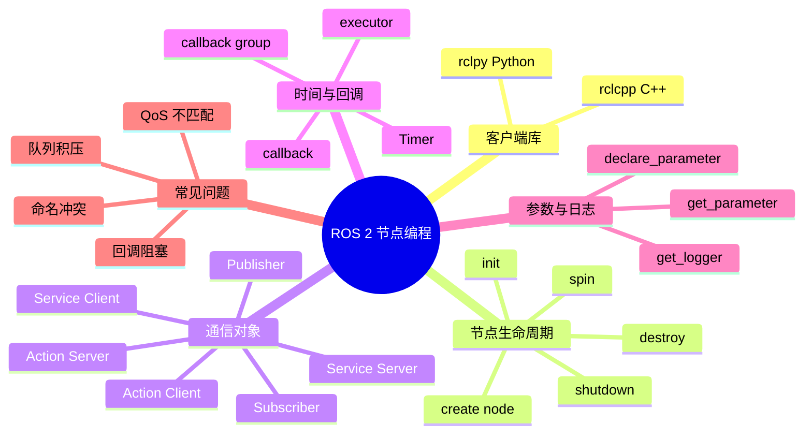

# ROS 2 节点编程

这一篇关注「怎么写一个能跑的节点」。概念懂不等于会写，面试官给一段 `rclpy` 代码时，至少要能指出哪一行创建发布者、哪一行是回调、`spin` 在做什么。下面以 Python 的 `rclpy` 为主，C++ 的 `rclcpp` 结构是对应的。

## 知识体系思维导图



## 1. 一个节点的最小结构

```python
import rclpy
from rclpy.node import Node
from std_msgs.msg import String


class Talker(Node):
    def __init__(self):
        super().__init__('talker')
        self.publisher_ = self.create_publisher(String, 'chatter', 10)
        self.timer = self.create_timer(1.0, self.publish_message)
        self.count = 0

    def publish_message(self):
        msg = String()
        msg.data = f'Hello ROS 2: {self.count}'
        self.publisher_.publish(msg)
        self.get_logger().info(msg.data)
        self.count += 1


def main(args=None):
    rclpy.init(args=args)
    node = Talker()
    rclpy.spin(node)
    node.destroy_node()
    rclpy.shutdown()


if __name__ == '__main__':
    main()
```

## 2. 每一部分在做什么

| 代码 | 作用 |
| --- | --- |
| `class Talker(Node)` | 定义一个节点类，继承 `Node` |
| `super().__init__('talker')` | 给节点起名字，注册到 ROS 图里 |
| `create_publisher(String, 'chatter', 10)` | 创建发布者，消息类型 `String`，话题 `/chatter`，队列深度 10 |
| `create_timer(1.0, callback)` | 每隔 1 秒调用一次回调 |
| `publish(msg)` | 把消息发到话题上 |
| `rclpy.spin(node)` | 让节点进入事件循环，持续处理回调 |
| `destroy_node()` | 释放节点资源 |
| `rclpy.shutdown()` | 关闭 rclpy |

`rclpy.spin` 是最容易被忽略的一行。没有它，节点初始化完就退出，定时器、订阅回调都不会执行。

## 3. 订阅者

```python
class Listener(Node):
    def __init__(self):
        super().__init__('listener')
        self.subscription = self.create_subscription(
            String,
            'chatter',
            self.callback,
            10
        )

    def callback(self, msg):
        self.get_logger().info(f'I heard: {msg.data}')
```

订阅者和发布者只靠话题名和消息类型匹配，不需要互相引用。一个话题可以有多个订阅者，也可以有多个发布者，具体行为取决于 QoS 和业务设计。

## 4. 服务端与客户端

服务端：

```python
from example_interfaces.srv import AddTwoInts


class AddServer(Node):
    def __init__(self):
        super().__init__('add_server')
        self.srv = self.create_service(
            AddTwoInts, 'add_two_ints', self.add_callback
        )

    def add_callback(self, request, response):
        response.sum = request.a + request.b
        return response
```

客户端：

```python
class AddClient(Node):
    def __init__(self):
        super().__init__('add_client')
        self.client = self.create_client(AddTwoInts, 'add_two_ints')
        while not self.client.wait_for_service(timeout_sec=1.0):
            self.get_logger().info('waiting for service...')

    def send(self, a, b):
        req = AddTwoInts.Request()
        req.a = a
        req.b = b
        future = self.client.call_async(req)
        return future
```

服务适合短操作。不要在服务回调里做几十秒的推理或导航，否则客户端会一直等。

## 5. 动作

Action 的使用比服务复杂，因为要处理 goal、feedback、result 和 cancel。Python 里通常继承 `ActionServer`，实现 `execute_callback`，在回调里周期性调用 `publish_feedback`，最后返回 result。

适合用 Action 的判断标准：

- 任务耗时明显；
- 需要告诉调用方「进行到哪了」；
- 可能中途取消；
- 需要区分成功、失败、取消三种结果。

## 6. 参数与日志

参数：

```python
self.declare_parameter('rate', 1.0)
rate = self.get_parameter('rate').value
self.timer = self.create_timer(1.0 / rate, self.publish_message)
```

运行时修改：

```bash
ros2 param get /talker rate
ros2 param set /talker rate 2.0
```

日志：

```python
self.get_logger().info('started')
self.get_logger().warn('queue is full')
self.get_logger().error('sensor disconnected')
```

日志比 `print` 更适合机器人系统，因为它带时间、节点名、严重级别，能被 `ros2 launch` 和日志工具统一收集。

## 7. 回调、执行器与线程

节点默认在一个 executor 里跑。单线程 executor 的回调是串行的，一个回调阻塞，后面的回调都排队。

常见问题：

- 订阅回调里跑模型推理，图像消息越积越多；
- 服务回调里等另一个服务，形成死锁；
- 多线程 executor 下多个回调同时改同一个变量，产生数据竞争。

处理思路：

- 回调只做轻量工作，重活丢给独立线程或独立节点；
- 用 `callback_group` 控制哪些回调可以并发；
- 共享数据加锁，或者用消息队列传递；
- 队列深度不要盲目调大，延迟可能更糟。

## 8. Python 与 C++ 的选择

| 对比项 | Python (`rclpy`) | C++ (`rclcpp`) |
| --- | --- | --- |
| 开发速度 | 快，适合原型和数据处理 | 编译、调试成本高 |
| 运行性能 | 纯 Python 计算较慢，可调用高性能库 | 适合高频控制、驱动、性能敏感模块 |
| 内存控制 | 自动管理 | RAII、智能指针、手动控制更细 |
| 常见场景 | AI 模型接入、脚本、验证 | 底盘控制、传感器驱动、实时模块 |

实际项目经常混用：Python 做模型和工具，C++ 做底层控制和驱动。

## 9. 常见坑

- **忘了 source**：`ros2 run` 找不到包。
- **节点重名**：两个节点同名会互相覆盖，用 namespace 或不同名字。
- **QoS 不匹配**：话题存在但收不到数据。
- **回调阻塞**：一个慢回调拖垮整个节点。
- **异常没处理**：传感器断线、消息格式不对，节点直接退出。
- **`spin` 之前就阻塞**：在构造函数里写死循环，节点永远进不了事件循环。

## 相关

- [[ROS 2 通信机制]]
- [[ROS 2 工作空间与构建]]
- [[ROS 2 常用命令与调试]]
- [[ROS Index]]
