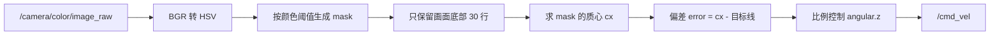

# ROS 2 视觉巡线代码解析

巡线是「感知 → 决策 → 控制」最短的一条闭环：相机看到色带、算出色带偏离画面中心多少、把偏差变成角速度。150 行代码，含金量在中间那 20 行。

这一篇逐段拆 `line_follow.py`，顺便把「为什么这段看起来能跑、但换台相机就不行」讲清楚。

> 源码：`...\Program_OpenCV_And_ROS2\6.OpenCV_ROS2_LineFollow\line_follow.py`（151 行）
> 启动：同目录 `line_follower.launch.py`

## 一、流水线



## 二、颜色阈值：为什么用 HSV

```python
col_black  = (0,   0,   0,  180, 255, 46)   # H S V 下限, H S V 上限
col_red    = (0,   100, 80, 10,  255, 255)
col_blue   = (100, 43,  46, 124, 255, 255)
col_green  = (35,  43,  46, 77,  255, 255)
col_yellow = (26,  43,  46, 34,  255, 255)
```

六元组的含义是 `(H_low, S_low, V_low, H_high, S_high, V_high)`。

用 HSV 而不是 RGB，是因为**光照变化主要影响亮度 V，而颜色本质由色相 H 决定**。同一条红胶带，在灯下和阴影里 RGB 值差很多，H 值却接近。这让阈值在不同光照下更稳。

但 HSV 也有坑，这段代码里就有两个：

1. **红色的 H 是环形的**。红色分布在 H≈0 和 H≈180 两端（OpenCV 的 H 范围是 0–180）。这里只取了 0–10，**漏掉了 170–180 那一段**。偏紫的红、或者白平衡偏冷的相机，会检测不到。
2. **黑色靠 V 低来判**，`V_high=46` 意味着亮度低于 46 都算黑。深色地板、阴影、镜头盖都会被当成黑线。

### 2.1 那两行形态学操作

```python
kernel = numpy.ones((5,5), numpy.uint8)
hsv_erode  = cv2.erode(hsv, kernel, iterations=1)      # L56
hsv_dilate = cv2.dilate(hsv_erode, kernel, iterations=1)  # L57
mask = cv2.inRange(hsv_dilate, (lowerbH,...), (upperbH,...))  # L102
```

注意它是对 **HSV 图像**做腐蚀膨胀，再阈值化——不是常见的「先阈值化，再对 mask 做形态学」。

对 mask 做开运算（先腐后胀）能去掉噪点、保留色块；对 HSV 做，是在平滑色相/饱和度/亮度通道。问题在于 **H 是环形量**：H=2 和 H=178 都是红色，但线性腐蚀会把它们当成两个极端值处理，边界处会算出无意义的中间值。这段代码能工作，是因为阈值范围本来就在 0 附近。

更标准的写法：

```python
mask = cv2.inRange(hsv, lower, upper)
mask = cv2.morphologyEx(mask, cv2.MORPH_OPEN, kernel)   # 去噪
mask = cv2.morphologyEx(mask, cv2.MORPH_CLOSE, kernel)  # 补洞
```

## 三、选颜色：Trackbar 调试法

```python
cv2.createTrackbar(Switch, 'Adjust_hsv', 0, 4, nothing)   # L47
m = cv2.getTrackbarPos(Switch, 'Adjust_hsv')              # L58
if m == 0:   lowerbH, ... = col_red[:3], col_red[3:]
elif m == 1: ... 
```

一个滑条在 5 种预设颜色之间切换，实时看 mask 效果。这是**现场调参的标准手段**：不用改代码重启，边看边选。

`self.tmp` 那个标志位（L45–48）保证窗口只创建一次——`namedWindow` 重复调用虽然不崩，但会反复抢焦点。

上线时应该把这段删掉：主控没有显示器，`namedWindow` 会直接抛异常。

## 四、只看画面底部：ROI 的用意

```python
h, w, d = image.shape
search_top = h - 30
search_bot = h
mask[0:search_top, 0:w] = 0        # L108 上半部分全部清零
mask[search_bot:h, 0:w] = 0        # 最后一行也清零
```

只保留**画面最下面 30 行**，理由很实际：

- 近处的线在画面底部，畸变小、位置最可信；
- 远处的线可能被遮挡、可能是别的颜色物体；
- 只处理底部，计算量小，质心也更稳定。

代价是「预判距离」变短——车开快了会来不及转。要提速就得抬高 ROI，或者用多项式拟合车道线而不是求质心。

## 五、质心：`cv2.moments` 的用法

```python
M = cv2.moments(mask)                 # L111
if M['m00'] > 0:
    cx = int(M['m10'] / M['m00'])     # L113
    cy = int(M['m01'] / M['m00'])
```

`moments` 算的是二值图的几何矩：

- `m00` = 白像素总数（面积）；
- `m10` = Σ(x · 像素值)，`m01` = Σ(y · 像素值)；
- 质心 = `(m10/m00, m01/m00)`。

`m00 > 0` 是必须的判断：mask 全黑时 `m00 = 0`，除法会得到 `nan`。

用质心而不是「最左/最右点」，是因为质心对噪声不敏感：边缘掉几个像素，中心几乎不动。

## 六、控制律：一行 P 控制

```python
erro = cx - w/2 - 60                 # L120
d_erro = erro - last_erro
self.twist.linear.x = 0.11           # 固定前进速度
self.twist.angular.z = -(float(erro)*0.0011 - float(d_erro)*0.0000)  # L124
last_erro = erro
```

### 6.1 那个 `- 60`

目标不是画面中心 `w/2 = 320`，而是 `380`。这说明**相机或色带不在车的正前方**，需要用像素偏移补偿安装误差。

问题在于它是硬编码的：换一台相机、换个安装角度，就得重新标定。更好的写法是做成 ROS 参数：

```python
self.declare_parameter('center_offset', 60)
self.center_offset = self.get_parameter('center_offset').value
```

### 6.2 这其实是纯 P 控制

`d_erro` 那一项乘的是 `0.0000`，微分增益为 0。整行等价于：

```python
angular.z = -erro * 0.0011
```

`erro` 的单位是像素，`0.0011` 把像素换成 rad/s。质心偏左（`erro < 0`）时，`angular.z > 0`，车左转——符号是对的（ROS 约定逆时针为正）。

P 控制的固有问题是**稳态误差**：直线上有恒定偏差时，输出恒定角速度，车会走成一条弧线而不是直线。加 I 项能消掉，但容易积分饱和；加 D 项能抑制超调，但会放大图像噪声。调参顺序一般是 P → D → I。

### 6.3 丢线就停

```python
else:
    self.twist.linear.x = 0.0
    self.twist.angular.z = 0.0
self.cmd_vel_pub.publish(self.twist)   # L133
```

看不到线就停车，是最安全也最保守的策略。工业上更常见的是「按最后一次偏差继续转，同时减速」，给车一个找回线的机会。

注意 `publish` 在 if/else **外面**——无论找没找到线，每帧都发一次速度。这很重要：如果只在找到线时发，丢线后底盘会一直执行上一条指令。

### 6.4 `if cv2.circle:` 这一行

```python
if cv2.circle:          # L118
    erro = cx - w/2 - 60
```

`cv2.circle` 是一个函数对象，**永远为真**。这个 `if` 没有任何作用，应该是调试时留下的残骸（原意可能是「如果画了指示圆」）。

它不影响功能，但说明这段代码是现场改出来的。读开源/厂商代码时，这种「永远为真的条件」「永远为 0 的增益」很常见——**先判断它是不是死代码，再决定要不要照抄**。

## 七、主循环：为什么用 `spin_once`

```python
while rclpy.ok():
    rclpy.spin_once(follower)
    time.sleep(0.1)          # 10 Hz
```

`spin_once` 处理一条消息就返回，然后睡 0.1 秒。这等于把控制频率限制在 10 Hz，同时让 `cv2.waitKey` 有机会刷新窗口。

副作用是**会丢帧**：相机 30 Hz，这里 10 Hz，三分之二的消息被队列丢掉。对巡线够用，对高速跟踪不够。

更合理的结构是用 `create_timer` 定时处理最新帧，或者用多线程执行器 + 回调组。

## 八、QoS 与启动

```python
qos = QoSProfile(depth=10)
self.image_sub = self.create_subscription(Image, '/camera/color/image_raw', self.image_callback, qos)
self.cmd_vel_pub = self.create_publisher(Twist, 'cmd_vel', qos)
```

`QoSProfile(depth=10)` 默认是 **reliable**。如果相机驱动发的是 best_effort，会收不到图——排查方法见 [[ROS 2 图像处理节点代码解析]] 第五节。

启动文件把底盘、相机、巡线节点一起拉起：

```python
# line_follower.launch.py L19-32
wheeltec_camera = IncludeLaunchDescription(... wheeltec_camera.launch.py)
wheeltec_robot  = IncludeLaunchDescription(... turn_on_wheeltec_robot.launch.py)
Node(package='simple_follower_ros2', executable='line_follow', name='line_follow')
```

```bash
ros2 launch simple_follower_ros2 line_follower.launch.py
```

## 九、验证与调参实验

```bash
# 看巡线节点发什么
ros2 topic echo /cmd_vel

# 看处理后的 mask（需要显示器）
# 窗口 Adjust_hsv 会弹出，拖动滑条切颜色

# 记录一段数据，离线调阈值
ros2 bag record /camera/color/image_raw -o line_bag
```

三个能把这段代码真正吃透的实验：

1. **把 `-60` 改成 0**，看车是不是沿着画面中心走——理解安装偏移的影响。
2. **把 `0.0011` 改成 0.003**，观察车在直线上的左右摆动（P 太大导致振荡）。
3. **把 `d_erro` 的系数从 `0.0000` 改成 `0.0005`**，再看振荡是否收敛——这就是 D 项抑制超调。

## 十、这段代码的局限与升级方向

| 局限 | 原因 | 升级方向 |
|---|---|---|
| 只能跟单一颜色 | 阈值法 | 用颜色聚类或语义分割 |
| 光照一变就失效 | HSV 阈值固定 | 自适应阈值、直方图均衡 |
| 丢线就停 | 保守策略 | 记忆最后偏差 + 减速寻找 |
| 纯 P 有稳态误差 | 控制律 | PID，注意积分限幅 |
| 10 Hz 处理 | `sleep(0.1)` | 定时器 + 多线程 |
| 固定像素偏移 | 安装硬编码 | 标定后做成参数 |

## 相关

- [[ROS 2 图像处理节点代码解析]] —— `cv_bridge`、编码、QoS 的基础。
- [[ROS 2 视觉跟随代码解析]] —— 同样输出 `cmd_vel`，但用深度和 PID。
- [[ROS 2 底盘串口驱动代码解析]] —— `cmd_vel` 最终变成电机指令。
- [[机器人系统调试与工程实践]] —— 车不动时的排查顺序。
- [[ROS Index]]
