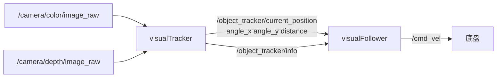

# ROS 2 视觉跟随代码解析

巡线是「跟着地上的线走」，视觉跟随是「跟着一个人走」。后者难在两件事：**目标在三维空间里**（要知道左右偏多少、远近多少），以及**控制量要连续平滑**（不能像巡线那样只有 P）。

WHEELTEC 把它拆成两个节点：`visualTracker` 负责「目标在哪」，`visualFollower` 负责「怎么开过去」。中间用一条自定义消息 `Position` 连接。

> 源码：`...\Program_OpenCV_And_ROS2\7.OpenCV_ROS2_VisualFollow\`
> - `visualTracker.py`（224 行）：彩色图 + 深度图 → `/object_tracker/current_position`
> - `visualFollower.py`（252 行）：位置 → PID → `/cmd_vel`
> - 消息定义：`turn_on_wheeltec_robot/msg/Position.msg`

## 一、两个节点的分工



```yaml
# Position.msg
float32 angle_x
float32 angle_y
float32 distance
```

消息只有三个量，妙处在于**它已经把像素坐标变成了角度和距离**。控制节点不需要知道相机分辨率、视场角，只拿到「偏左 0.2 rad、距离 1.5 米」就能算速度。这是好的接口设计：**感知层负责把物理量算好，控制层只做控制**。

## 二、Tracker：怎么从二维图像得到三维位置

### 2.1 时间同步

```python
im_sub  = message_filters.Subscriber(self, Image, '/camera/color/image_raw')
dep_sub = message_filters.Subscriber(self, Image, '/camera/depth/image_raw',
                                     qos_profile=qos_profile_sensor_data)
self.timeSynchronizer = message_filters.ApproximateTimeSynchronizer(
    [im_sub, dep_sub], queue_size=30, slop=0.05)          # L50
self.timeSynchronizer.registerCallback(self.trackObject)
```

彩色图和深度图是**两条独立的话题**，到达时间不可能完全一致。如果各自订阅、各存一份「最新帧」，很可能拿 A 时刻的彩色图配 B 时刻的深度图——目标一动，深度就对到背景上了。

`message_filters` 解决的就是这个：把多路消息按时间戳配对。

- `ExactTimeSynchronizer`：时间戳必须完全相等，太严格，实际很少用；
- `ApproximateTimeSynchronizer`：允许误差，`slop=0.05` 表示 50 ms 内的消息可以配对。

`queue_size=30` 是等待配对时最多缓存多少条。太小会频繁丢配，太大会增加延迟。

### 2.2 颜色阈值与轮廓

```python
self.targetUpper = np.array([0, 50, 50])      # L28
self.targetLower = np.array([180, 255, 255])  # L29
...
hsv = cv2.cvtColor(frame, cv2.COLOR_RGB2HSV)
org_mask = cv2.inRange(hsv, self.targetUpper, self.targetLower)   # L68
mask = cv2.erode(org_mask, None, iterations=4)
contours = cv2.findContours(mask.copy(), cv2.RETR_EXTERNAL,
                            cv2.CHAIN_APPROX_SIMPLE)[-2]
```

**变量名和语义是反的**：`inRange` 的第二个参数是下限，这里传的是叫 `targetUpper` 的 `[0,50,50]`；第三个参数是上限，传的是叫 `targetLower` 的 `[180,255,255]`。数值本身正确（下限小、上限大），但名字完全颠倒。

读代码时**以函数签名为准，不要信变量名**。这种命名错误在复制粘贴的工程代码里非常常见。

`erode(..., iterations=4)` 腐蚀四次，是为了去掉零散噪点。代价是小目标会被腐蚀没——目标远了就检测不到。

### 2.3 从轮廓到「中心 + 距离」

```python
def analyseContour(self, contour, depthFrame):
    centerRaw, size, rotation = cv2.minAreaRect(contour)   # L179 最小外接矩形
    center = np.round(centerRaw).astype(int)

    minSize = int(min(size) / 3)                            # L185 取内切区域
    depthObject = depthFrame[(center[1]-minSize):(center[1]+minSize),
                             (center[0]-minSize):(center[0]+minSize)]
    depthArray = depthObject[~np.isnan(depthObject)]        # 去掉无效深度
    ...
    averageDistance = np.mean(depthArray)                   # L198
    return (centerRaw, averageDistance)
```

思路很朴素也很稳：

1. `minAreaRect` 得到目标的最小外接旋转矩形，中心就是目标中心；
2. 在中心取一个「矩形短边 1/3」的小方块；
3. 把这块区域里的深度值取平均。

为什么不取轮廓内所有像素的深度？因为轮廓边缘常混进背景深度。**只采中心一小块**，能最大限度保证「采到的都是目标本身」。

`~np.isnan()` 是因为深度相机对玻璃、黑色、超出量程的物体返回 `NaN`。深度图如果是 `16UC1`，无效值是 0，这里就该改成 `depthObject > 0`。

### 2.4 三行代码里的一处死逻辑

```python
if(averageDistance > 400 or averageDistance < 3000):   # L200
    pass
else:
    averageDistance = 400
```

任意实数都满足「大于 400 **或** 小于 3000」（只有同时 ≥3000 且 ≤400 才不满足，不存在）。所以这个分支**永远走 `pass`**，`averageDistance = 400` 永远不会执行。

从上下文看，本意应该是「距离在 400–3000 mm 之外就钳到 400」：

```python
if not (400 <= averageDistance <= 3000):
    averageDistance = 400
```

这类 bug 的可怕之处在于：**它不报错、不影响主流程，只在你依赖这个兜底时才发现兜底不存在**。

### 2.5 像素偏移 → 角度

```python
def calculateAngleX(self, pos):
    centerX = pos[0][0]
    displacement = 2 * centerX / self.pictureWidth - 1     # [-1, 1]
    angle = -1 * np.arctan(displacement * self.tanHorizontal)
    return angle
```

`displacement` 把像素横坐标映射到 `[-1, 1]`：最左 −1、中心 0、最右 1。

然后乘以 `tan(水平半视场角)`。这是**针孔相机的小孔成像关系**：目标在像平面上的偏移量，正比于 `tan(偏角)`。所以反解得到偏角：

```
angle = -atan(displacement × tan(hfov/2))
```

负号让「目标在右边」得到负角度，与 ROS 的逆时针为正一致。

```python
self.pictureHeight = 480
self.pictureWidth = 640
vertAngle = 0.43196898986859655      # 约 24.7°，竖直半视场
horizontalAngle = 0.5235987755982988  # 30°，水平半视场
```

这些是**硬编码**的相机内参。换相机、换分辨率、开畸变校正，都必须重算，否则角度整体缩放错。正确做法是从 `camera_info` 话题读内参矩阵，或在启动时用参数传。

## 三、Follower：PID 怎么把角度变成速度

### 3.1 两路 PID

```python
targetDist = 600
self.PID_controller = simplePID(
    [0, targetDist],        # 目标：偏角 0 rad、距离 600 mm
    [1.2, 0.2],             # Kp
    [0, 0.00],              # Ki
    [0.005, 0.00])          # Kd
```

两个通道、两组增益：

| 通道 | 目标 | Kp | Kd | 输出 |
|---|---|---|---|---|
| 偏角 | 0 rad（正前方） | 1.2 | 0.005 | `angular.z` |
| 距离 | 600 mm | 0.2 | 0 | `linear.x` |

角度的 Kp 大，因为「转过去」要快；距离的 Kp 小，因为前后移动要稳。距离通道没有 D（距离测量噪声大，微分会放大噪声），角度通道有很小的 D。

### 3.2 PID 类逐段

```python
def update(self, current_value):
    current_value = np.array(current_value)
    if self.timeOfLastCall is None:              # 第一次调用
        self.timeOfLastCall = time.perf_counter()
        return np.zeros(np.size(current_value))  # 不输出控制量

    error = self.setPoint - current_value        # 目标减当前

    # 死区：误差很小就当作 0，避免原地抖
    if -0.1 < error[0] < 0.1:
        error[0] = 0
    if -150 < error[1] < 150:
        error[1] = 0

    # 目标较近时放大误差，让车更积极地靠近
    if error[1] > 0 and self.setPoint[1] < 1200:
        error[1] = error[1] * (1200 / self.setPoint[1]) * 0.5
        error[0] = error[0] * 0.8

    P = error
    deltaT = time.perf_counter() - self.timeOfLastCall
    self.integrator += error * deltaT            # 积分
    I = self.integrator
    D = (error - self.last_error) / deltaT       # 微分
    self.last_error = error
    self.timeOfLastCall = time.perf_counter()

    return self.Kp * P + self.Ki * I + self.Kd * D
```

几个值得注意的设计：

- **第一次调用返回 0**：因为还不知 `deltaT`，算不出 D 和 I。这是离散 PID 的正确做法。
- **死区**：偏角 ±0.1 rad（约 5.7°）、距离 ±150 mm 内不动作。没有死区，噪声会让车一直小幅左右抖。
- **放大系数其实是个空操作**：`setPoint[1] = 600`，`(1200/600)*0.5 = 1.0`，乘了等于没乘。只有把目标距离改成 300 时，系数才变成 2.0。这种「参数依赖的隐藏行为」很难从代码表面看出来。
- **`Ki = 0`**：没有积分项，所以稳定后会有稳态误差（跟车距离会略大于 600 mm）。要消掉就得加 I，但要配积分限幅。

### 3.3 输出整形

```python
angularSpeed = np.clip(-uncliped_ang_speed, -self.max_speed, self.max_speed)  # L71
linearSpeed  = np.clip(-uncliped_lin_speed, -self.max_speed, self.max_speed)
```

两个动作：

1. **取负**：PID 的误差定义是「目标 − 当前」。目标在右边时 `angle_x` 为负、误差为正，若直接输出会右转过头；取负后方向正确。
2. **限幅**：`max_speed = 0.3`。限幅是安全底线——PID 在目标突然消失或跳变时会输出巨大值，不限制会直接撞墙。

```python
if (distance > 2000) or (distance == 0):
    self.stopMoving()
else:
    self.cmdVelPublisher.publish(velocity)
```

距离超过 2 米（跟丢了）或为 0（深度无效）就停车。这两条是**失效保护**，比控制律本身更重要。

## 四、被注释掉的遥控逻辑

```python
self.controllerLossTimer = threading.Timer(1, self.controllerLoss)
self.controllerLossTimer.start()
...
def buttonCallback(self, joy_data): ...
```

代码里有一套完整的手柄接管逻辑：1 秒收不到手柄消息就 `controllerLoss()` 停车。但**没有任何地方订阅 `/joy`**，所以 `buttonCallback` 永远不会被调用。

后果是：节点启动 1 秒后，定时器触发一次 `controllerLoss()`，打印 `lost connection` 并把 `active` 设为 `False`。而 `positionUpdateCallback` 开头那句 `if not self.active: return` 被注释掉了，所以跟踪照常进行。

这是典型的「功能砍掉一半、代码没删干净」。读的时候要知道：**这些行不参与运行**，别花时间去理解它们。

`main` 的 `finally` 里还有一处：

```python
visualFollower.destroy_node()
controllerLoss = visualFollower.controllerLoss()   # 节点已销毁，还在 publish
```

销毁节点后再调 `stopMoving()`，会往一个已销毁的 publisher 发消息。多数情况下只是报个错，但属于该修的顺序问题——应该先停车再销毁。

## 五、运行与验证

```bash
# 启动底盘 + 相机
ros2 launch turn_on_wheeltec_robot wheeltec_sensors.launch.py

# 启动 tracker
ros2 run <包名> visualTracker
ros2 topic echo /object_tracker/current_position

# 启动 follower
ros2 run <包名> visualFollower
ros2 topic echo /cmd_vel
```

调试顺序：

1. 先确认 `/camera/depth/image_raw` 真的有数据（`ros2 topic hz`），没有深度就谈不上跟随；
2. 把目标放在正前方 0.6 m，看 `angle_x` 是否接近 0、`distance` 是否接近 600；
3. 目标左移，`angle_x` 应变正（ROS 逆时针为正）；
4. 最后再让 follower 输出速度。

## 六、这段代码的三个设计教训

- **感知与控制分离**：tracker 输出物理量（角度、距离），follower 只做 PID。换跟踪算法不用改控制，换控制律不用动感知。
- **失效保护优先于控制精度**：距离无效、跟丢、超时，一律停车。机器人项目里，安全逻辑的优先级永远高于性能。
- **硬编码是技术债**：相机内参、目标距离、颜色阈值全部写死在代码里。换一台相机就要改代码、重新编译，这是原型和产品的分界线。

## 相关

- [[ROS 2 视觉巡线代码解析]] —— 另一条从图像到 `cmd_vel` 的路径，纯 P 控制。
- [[ROS 2 图像处理节点代码解析]] —— `cv_bridge`、编码、QoS。
- [[ROS 2 底盘串口驱动代码解析]] —— `cmd_vel` 的下游。
- [[ROS 2 通信机制]] —— 自定义消息与话题。
- [[VLA 与机器人 AI]] —— 从「跟一个色块」到「听懂一句话去跟某个人」。
- [[ROS Index]]
