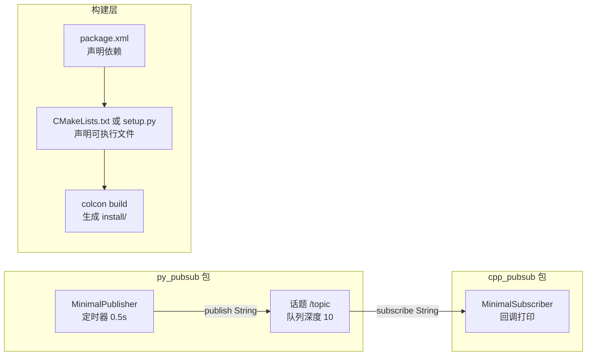

# ROS 2 话题通信代码解析

这是一套可以真正编译、真正跑起来的最小工程：一个 Python 包 `py_pubsub`、一个 C++ 包 `cpp_pubsub`，各含一个发布者和一个订阅者。它来自 WHEELTEC ROS2 教程第 4 章《ROS2 通信类型的实现与使用》，也是后面所有机器人节点的骨架——底盘驱动、图像处理、视觉跟随，剥掉业务逻辑之后都是这个结构。

> 源码位置：`D:\轮趣\基本资料\1.WHEELTEC ROS机器人通用资料\6.ROS2系列教程\1.ROS2入门与编程开发教程\4.ROS2通信类型的实现与使用\`

## 一、先看全景



四个文件构成一个包：源码、`package.xml`（我是谁、依赖谁）、构建脚本（怎么编）、以及安装规则（装到哪）。ROS 2 能 `ros2 run` 到你的程序，靠的是后三个文件，不是源码本身。

## 二、Python 发布者

```python
# py_pubsub/py_pubsub/publisher_member_function.py
import rclpy
from rclpy.node import Node
from std_msgs.msg import String

class MinimalPublisher(Node):                 # 继承 Node
    def __init__(self):
        super().__init__('minimal_publisher_py')          # L23 节点名
        self.publisher_ = self.create_publisher(String, 'topic', 10)  # L25
        timer_period = 0.5
        self.timer = self.create_timer(timer_period, self.timer_callback)  # L28
        self.i = 0

    def timer_callback(self):
        msg = String()
        msg.data = 'Hello World(py): %d' % self.i
        self.publisher_.publish(msg)          # L37
        self.get_logger().info('发布的消息: "%s"' % msg.data)
        self.i += 1

def main(args=None):
    rclpy.init(args=args)                     # L43
    minimal_publisher = MinimalPublisher()    # L45
    rclpy.spin(minimal_publisher)             # L46
    rclpy.shutdown()                          # L48
```

### 2.1 五个参数各自是什么

`create_publisher(消息类型, 话题名, 队列深度)`：

| 参数 | 本例 | 含义 |
|---|---|---|
| 消息类型 | `String` | 必须和订阅端完全一致，类型不匹配时两端**不会报错**，只是收不到数据 |
| 话题名 | `'topic'` | 相对名字。节点没有命名空间时解析成 `/topic` |
| 队列深度 | `10` | QoS 的 depth：发布端攒了 10 条还没发出去时，第 11 条挤掉最老的 |

### 2.2 为什么必须有 `spin`

`create_timer` 只是把回调**登记**到节点上，真正触发它的是执行器。`rclpy.spin(node)` 进入一个循环：等事件（定时器到期、订阅来消息、服务请求）→ 调用对应回调 → 再等。没有 `spin`，`main` 会瞬间执行完退出，定时器一次都不会响。

这是初学者最常犯的错：写了 `create_subscription` 却忘了 `spin`，然后疑惑「为什么回调不执行」。

### 2.3 `rclpy.init` 与 `shutdown` 的配对

`init` 初始化中间件（DDS）、`shutdown` 释放。`spin` 在收到 Ctrl+C 时返回，所以正常退出路径是 `init → spin → shutdown`。异常路径下应把 `shutdown` 放进 `try/finally`——教程里的写法没有做，Ctrl+C 之外的崩溃可能留下未释放的 DDS 资源，反复重启后偶尔会看到端口占用。

## 三、Python 订阅者

```python
class MinimalSubscriber(Node):
    def __init__(self):
        super().__init__('minimal_subscriber_py')
        self.subscription = self.create_subscription(
            String, 'topic', self.listener_callback, 10)   # L23-27
        self.subscription        # L29 防止 flake8 报「变量未使用」

    def listener_callback(self, msg):
        self.get_logger().info('订阅的消息: "%s"' % msg.data)
```

`create_subscription(类型, 话题名, 回调函数, 队列深度)`。回调参数 `msg` 就是消息对象，`msg.data` 对应 `String.msg` 里的 `string data` 字段。

第 29 行那句孤零零的 `self.subscription` 看着奇怪，作用只是让 linter 认为这个成员被读过。创建订阅时若不给返回值赋给成员变量，Python 的垃圾回收会**立刻销毁订阅对象**，回调就再也不会触发——这是 rclpy 一个真实的坑，C++ 里同样要把 `SharedPtr` 存成成员。

## 四、C++ 发布者

```cpp
#include "rclcpp/rclcpp.hpp"
#include "std_msgs/msg/string.hpp"
using namespace std::chrono_literals;

class MinimalPublisher : public rclcpp::Node
{
public:
    MinimalPublisher() : Node("minimal_publisher"), count_(0)
    {
        publisher_ = this->create_publisher<std_msgs::msg::String>("topic", 10);  // L17
        timer_ = this->create_wall_timer(500ms,
                     std::bind(&MinimalPublisher::timer_callback, this));          // L20
    }
private:
    void timer_callback()
    {
        auto message = std_msgs::msg::String();
        message.data = "Hello, world! " + std::to_string(count_++);
        RCLCPP_INFO(this->get_logger(), "发布的消息：'%s'", message.data.c_str());
        publisher_->publish(message);
    }
    rclcpp::TimerBase::SharedPtr timer_;
    rclcpp::Publisher<std_msgs::msg::String>::SharedPtr publisher_;
    size_t count_;
};

int main(int argc, char *argv[])
{
    rclcpp::init(argc, argv);
    rclcpp::spin(std::make_shared<MinimalPublisher>());   // L44
    rclcpp::shutdown();
    return 0;
}
```

### 4.1 与 Python 的三处结构差异

1. **消息类型是模板参数**。`create_publisher<std_msgs::msg::String>`，而 rclpy 把类型当普通参数传。C++ 靠模板在编译期检查，写错类型直接编译失败；Python 写错类型要到运行时才炸。
2. **回调用 `std::bind` 绑定成员函数**。`std::bind(&类::函数, this)` 把成员函数变成可调用对象，`this` 是让回调能访问成员变量。订阅者还要加占位符 `_1`，因为回调有一个消息参数。
3. **节点对象由 `std::make_shared` 管理生命周期**。`rclcpp::spin` 接收 `SharedPtr`，内部持有引用，出作用域时才析构。

### 4.2 `create_wall_timer` 与 `create_timer` 的区别

`wall_timer` 用**系统墙钟**（steady clock）计时；另有 `create_timer` 用 ROS 时间，会受 `use_sim_time` 和 `/clock` 影响。仿真里必须用后者，否则 Gazebo 暂停时定时器还在跑。教程的小例子不涉及仿真，用 wall timer 没问题。

## 五、C++ 订阅者

```cpp
using std::placeholders::_1;

class MinimalSubscriber : public rclcpp::Node
{
public:
    MinimalSubscriber() : Node("minimal_subscriber")
    {
        subscription_ = this->create_subscription<std_msgs::msg::String>(
            "topic", 10,
            std::bind(&MinimalSubscriber::topic_callback, this, _1));  // L17-18
    }
private:
    void topic_callback(const std_msgs::msg::String &msg) const
    {
        RCLCPP_INFO(this->get_logger(), "订阅的消息：'%s'", msg.data.c_str());
    }
    rclcpp::Subscription<std_msgs::msg::String>::SharedPtr subscription_;
};
```

`_1` 是占位符：调用时第一个实参（消息）填到这里。`const &` 表示只读引用，避免拷贝整条消息。`RCLCPP_INFO(日志器, 格式串, 参数)` 是 printf 风格的宏，`msg.data.c_str()` 是因为 `%s` 只认 C 字符串。

## 六、构建文件：程序怎么变成可执行文件

### 6.1 Python 包 `setup.py`

```python
setup(
    name=package_name,
    packages=[package_name],
    data_files=[
        ('share/ament_index/resource_index/packages', ['resource/' + package_name]),
        ('share/' + package_name, ['package.xml']),
    ],
    entry_points={
        'console_scripts': [
            'talker = py_pubsub.publisher_member_function:main',    # L24
            'listener = py_pubsub.subscriber_member_function:main',  # L26
        ],
    },
)
```

`console_scripts` 是关键：左边是 `ros2 run py_pubsub talker` 里的可执行名，右边是「模块路径:入口函数」。`resource/py_pubsub` 那个空文件是 ament 用来索引包的标记，缺了 `ros2 pkg list` 找不到你。

### 6.2 C++ 包 `CMakeLists.txt`

```cmake
find_package(ament_cmake REQUIRED)
find_package(rclcpp REQUIRED)
find_package(std_msgs REQUIRED)

add_executable(talker src/publisher_member_function.cpp)      # L17
ament_target_dependencies(talker rclcpp std_msgs)             # L18
add_executable(listener src/subscriber_member_function.cpp)
ament_target_dependencies(listener rclcpp std_msgs)

install(TARGETS talker listener DESTINATION lib/${PROJECT_NAME})  # L23-26
ament_package()
```

`ament_target_dependencies` 一次性把 `find_package` 找到的头文件路径、库、编译选项挂到目标上。`install(... DESTINATION lib/${PROJECT_NAME})` 决定了 `ros2 run` 去哪找二进制——不写 `install`，`colcon build` 能过，但 `ros2 run` 报「找不到可执行文件」。

### 6.3 `package.xml`

```xml
<package format="3">
  <name>cpp_pubsub</name>
  <buildtool_depend>ament_cmake</buildtool_depend>
  <depend>rclcpp</depend>
  <depend>std_msgs</depend>
  <export><build_type>ament_cmake</build_type></export>
</package>
```

`<depend>` 同时声明构建、运行、导出三种依赖；`build_type` 告诉 colcon 用 CMake 还是 setuptools 来编。Python 包的 `package.xml` 里则写 `<build_type>ament_python</build_type>`。

## 七、编译与验证

```bash
cd ~/ros2_ws
colcon build --packages-select py_pubsub cpp_pubsub
source install/setup.bash

# 终端 1：Python 说，C++ 听
ros2 run py_pubsub talker
ros2 run cpp_pubsub listener

# 另开终端观察
ros2 topic list
ros2 topic info /topic -v          # 看发布者/订阅者数量和 QoS
ros2 topic echo /topic             # 打印消息内容
ros2 topic hz /topic               # 应约 2 Hz
```

跨语言能通，说明两边对 `std_msgs/msg/String` 的序列化一致——ROS 2 的消息定义由 IDL 生成，语言只是外壳。

## 八、这段代码里值得记住的坑

- **订阅对象必须被持有**：Python 存成员变量，C++ 存 `SharedPtr`，否则对象析构、回调消失。
- **`spin` 是回调的发动机**：没有它，定时器、订阅、服务全都静止。
- **队列深度不是「缓存条数」而是「最多积压几条」**：控制类话题（`cmd_vel`）要小，传感器数据可以大；深度设太大只会让延迟越积越高。
- **类型不匹配不报错**：发布 `String`、订阅 `Int32`，`ros2 topic list` 里名字一样，但永远收不到。`ros2 topic info -v` 才能看出类型。
- **Python 节点名与可执行名是两回事**：节点名在 `super().__init__()` 里，可执行名在 `setup.py` 里；`ros2 node list` 显示的是前者。

## 相关

- [[ROS 2 通信机制]]
- [[ROS 2 节点编程]]
- [[ROS 2 工作空间与构建]]
- [[ROS 2 常用命令与调试]]
- [[ROS Index]]
