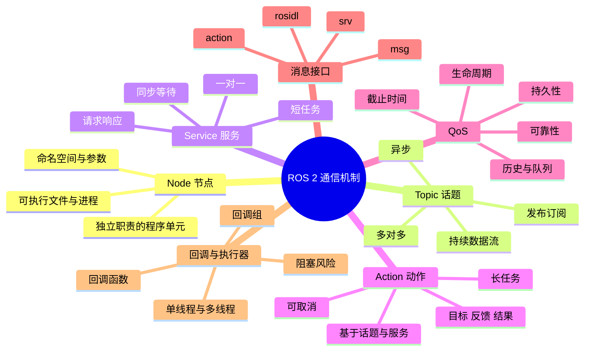

# ROS 2 通信机制

ROS 2 里最核心的四个概念是 Node、Topic、Service、Action。它们不是四个孤立的名词，而是一套「怎么把任务拆成程序、程序之间怎么说话」的约定。写节点之前先把这四件事分清楚，后面看别人的 launch 文件和话题列表会轻松很多。

## 知识体系思维导图



## 1. Node：程序的基本单元

Node 是一个具有相对独立职责的程序单元。摄像头驱动是一个节点，目标检测是一个节点，底盘控制也是一个节点。每个节点可以单独启动、单独调试、单独替换。

一个节点通常包含：

- 一个名字，比如 `/camera`、`/detector`；
- 若干发布者、订阅者、服务端、客户端；
- 参数、定时器、日志；
- 自己的回调函数。

节点的好处是**解耦**。检测算法改了，不需要重写相机驱动；底盘换了，只要新驱动还发布同样的速度话题，上层导航就不用动。

## 2. Topic：持续的数据流

Topic 采用发布—订阅模式。发布者（Publisher）往话题上写消息，订阅者（Subscriber）从话题上读消息。双方不需要知道对方是谁，只认话题名和消息类型。

适合 Topic 的场景：

- 摄像头持续发布图像；
- 激光雷达持续发布扫描数据；
- 里程计持续发布位姿；
- 导航模块持续发布速度指令。

特点：

- **异步**：发布者发完就走，不等待订阅者处理。
- **多对多**：一个话题可以有多个发布者和多个订阅者。
- **有队列**：消息按 QoS 配置排队，队列满了会丢旧消息或新消息。
- **不等于可靠**：是否可靠、是否保留历史，取决于 QoS。

## 3. Service：一次请求，一次响应

Service 采用请求—响应模式。客户端发一个请求，服务端处理后返回一个响应。它适合「短、明确、需要结果」的操作，比如查询参数、重置状态、触发一次标定。

特点：

- **同步感**：客户端通常要等响应，虽然底层可以是异步调用。
- **一对一**：一个请求对应一个服务端。
- **不适合长任务**：如果服务端处理很久，客户端会一直等，中间也没有进度反馈。

## 4. Action：长任务 + 进度 + 可取消

Action 适合耗时较长、需要反馈进度、并且可能中途取消的任务。典型例子是「导航到某个目标点」：机器人要走几十秒甚至几分钟，期间要告诉上层走到哪了，遇到情况还要能取消。

一个 Action 包含：

- **Goal**：目标，比如目标位姿。
- **Feedback**：周期反馈，比如剩余距离、当前进度。
- **Result**：最终结果，比如成功、失败原因。
- **Cancel**：取消请求。

Action 在实现上通常由几个 Topic 和 Service 组合而成，但对使用者来说，它就是一个带反馈和取消能力的长任务接口。

## 5. 怎么选：一张表

| 实际需求 | 优先选择 | 原因 |
| --- | --- | --- |
| 连续获取相机图像、雷达数据 | Topic | 数据流持续、异步、允许多订阅 |
| 查询一次设备状态并立即返回 | Service | 请求—响应，结果明确 |
| 导航到目标点，需要进度和取消 | Action | 长任务，需要 feedback 和 cancel |
| 发布速度指令 | Topic | 高频、持续、不需要逐个确认 |
| 触发一次标定 | Service | 短操作，等待结果 |
| 机械臂抓取，过程较长 | Action | 需要反馈和中断 |

判断顺序可以记成三句话：**持续不断用 Topic，一问一答用 Service，耗时能取消用 Action。**

## 6. QoS：Topic 的通信质量

QoS（Quality of Service）决定消息怎么传。ROS 2 常见的几个维度：

| 维度 | 常见取值 | 含义 |
| --- | --- | --- |
| Reliability | `reliable` / `best_effort` | 是否保证消息送达 |
| Durability | `volatile` / `transient_local` | 是否给后加入的订阅者补发历史消息 |
| History | `keep_last` / `keep_all` | 保留最近若干条还是全部 |
| Depth | 整数 | 队列深度 |
| Deadline | 时间 | 期望的消息周期 |
| Lifespan | 时间 | 消息最长有效期 |
| Liveliness | 自动/手动 | 如何判断发布者还活着 |

几个实用判断：

- 传感器高频数据常用 `best_effort`，丢一两帧比延迟堆积更好。
- 地图、静态配置常用 `transient_local`，让后启动的节点也能拿到最后一份。
- 控制指令通常要 `reliable`，但队列不能太深，否则旧指令会延迟执行。
- QoS 不匹配是「话题存在但收不到数据」的常见原因，排查时一定要看两端的 QoS。

## 7. 消息接口

ROS 2 的消息定义放在 `.msg`、`.srv`、`.action` 文件里，由 `rosidl` 生成 Python、C++ 等语言的代码。

常见消息包：

- `std_msgs`：`String`、`Int32`、`Bool` 等基础类型。
- `sensor_msgs`：`Image`、`LaserScan`、`Imu`、`PointCloud2`。
- `geometry_msgs`：`Twist`、`Pose`、`TransformStamped`。
- `nav_msgs`：`Odometry`、`Path`、`OccupancyGrid`。

自定义消息的步骤通常是：建 `msg/` 目录、写 `.msg` 文件、在 `package.xml` 和 `CMakeLists.txt` 里声明 `rosidl_default_generators`、编译、`source` 环境。

## 8. 回调与执行器

节点收到消息后执行的是**回调函数**。ROS 2 用 Executor 来调度这些回调。

- **单线程执行器**：所有回调排在一个线程里，简单但容易互相阻塞。
- **多线程执行器**：多个回调可以并行，但要处理线程安全。
- **回调组**：`MutuallyExclusive` 组内回调不会并发，`Reentrant` 组内可以并发。

一个常见坑：订阅回调里做耗时推理，导致后续图像消息排队、延迟越来越大。解决思路是缩短回调、把推理放到独立线程或独立节点、控制队列深度，并检查 QoS 是否设置了过大的 depth。

## 9. 最小发布者示例

```python
import rclpy
from rclpy.node import Node
from std_msgs.msg import String


class Talker(Node):
    def __init__(self):
        super().__init__('talker')
        self.publisher_ = self.create_publisher(String, 'chatter', 10)
        self.timer = self.create_timer(1.0, self.publish_message)
        self.count = 0

    def publish_message(self):
        msg = String()
        msg.data = f'Hello ROS 2: {self.count}'
        self.publisher_.publish(msg)
        self.get_logger().info(msg.data)
        self.count += 1


def main(args=None):
    rclpy.init(args=args)
    node = Talker()
    rclpy.spin(node)
    node.destroy_node()
    rclpy.shutdown()
```

这段代码里，`create_publisher` 建发布者，`create_timer` 每秒触发一次回调，`publish` 发消息，`rclpy.spin` 让节点持续处理回调。

## 相关

- [[ROS 2 节点编程]]
- [[ROS 2 常用命令与调试]]
- [[ROS 基础与架构]]
- [[ROS Index]]
