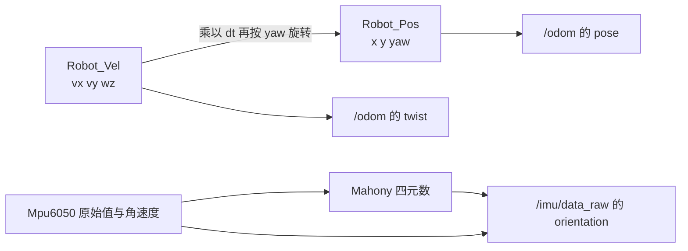

# ROS 2 里程计与 IMU 代码解析

底盘驱动从串口拿到的是「这一刻的速度」和「一堆原始 IMU 整数」。要变成导航能用的 `/odom` 和 `/imu/data_raw`，还差三步：**速度积分成位姿**、**协方差告诉下游该信多少**、**原始角速度加速度融合成姿态**。

这一篇逐行读的就是这三步。代码都在 `wheeltec_robot.cpp` 与 `Quaternion_Solution.cpp` 里。

> 承接：[[ROS 2 底盘串口驱动代码解析]]（协议与收帧）

## 一、三个量的关系



关键认知：**里程计不是传感器读数，是积分结果**。它必然漂移，而且误差会累积。这就是为什么还需要 EKF、需要激光定位——单靠轮式里程计，走十米就可能偏半米。

## 二、里程计发布：把 yaw 变成四元数

```cpp
void turn_on_robot::Publish_Odom()
{
    tf2::Quaternion q;
    q.setRPY(0, 0, Robot_Pos.Z);                    // L134 平面机器人只有 yaw
    geometry_msgs::msg::Quaternion odom_quat = tf2::toMsg(q);

    nav_msgs::msg::Odometry odom;
    odom.header.stamp = rclcpp::Node::now();
    odom.header.frame_id = odom_frame_id;           // L139 父坐标系
    odom.pose.pose.position.x = Robot_Pos.X;
    odom.pose.pose.position.y = Robot_Pos.Y;
    odom.pose.pose.position.z = Robot_Pos.Z;        // L142 注意这里
    odom.pose.pose.orientation = odom_quat;

    odom.child_frame_id = robot_frame_id;           // L145 子坐标系
    odom.twist.twist.linear.x = Robot_Vel.X;
    odom.twist.twist.linear.y = Robot_Vel.Y;
    odom.twist.twist.angular.z = Robot_Vel.Z;
    // 协方差选择 ...
    odom_publisher->publish(odom);
}
```

### 2.1 一个必须指出的问题：`position.z` 装的是 yaw

`Robot_Pos` 这个结构体名义上是「位置」，但代码里 `Z` 实际存的是**累计偏航角**（弧度）：

```cpp
Robot_Pos.Z += Robot_Vel.Z * Sampling_Time;   // L637 角速度积分
```

于是 `odom.pose.pose.position.z = Robot_Pos.Z` 把「朝向」写进了「高度」。在平面上跑，Nav2 不读 z，所以不出事；但任何假设 z≈0 的代码（比如三维建图、点云配准、判断机器人是否离地）都会被这个值污染。

正确的写法是 `position.z = 0`，yaw 只放在四元数里。读源码时能把这种「凑合能跑」的地方认出来，比背 API 有用 —— 因为换一个下游模块，它就会炸。

### 2.2 `frame_id` 与 `child_frame_id`

这两个字段是 REP-105 的约定，不是随便填的字符串：

- `header.frame_id`：位姿相对于哪个坐标系表达。这里是 `odom_combined`（launch 参数传入，见 [[ROS 2 Launch 文件代码解析]]）。
- `child_frame_id`：速度在哪个坐标系表达。这里是 `base_footprint`。

速度是「体坐标系」量，位姿是「世界坐标系」量。导航栈靠这两个名字把数据接到 TF 树上，名字填错不会报错，只会让规划器停在原地。

### 2.3 两套协方差，按「动没动」切换

```cpp
if (Robot_Vel.X == 0 && Robot_Vel.Y == 0 && Robot_Vel.Z == 0)
    memcpy(&odom.pose.covariance,  odom_pose_covariance2,  sizeof(odom_pose_covariance2)),
    memcpy(&odom.twist.covariance, odom_twist_covariance2, sizeof(odom_twist_covariance2));
else
    memcpy(&odom.pose.covariance,  odom_pose_covariance,   sizeof(odom_pose_covariance)),
    memcpy(&odom.twist.covariance, odom_twist_covariance,  sizeof(odom_twist_covariance));
```

协方差是 6×6、按行展开的 36 个数，对角线上依次是 x、y、z、roll、pitch、yaw 的方差。看头文件里的两套值（`wheeltec_robot.h` L86–112）：

| 状态 | x | y | yaw | 含义 |
|---|---|---|---|---|
| 静止 `covariance2` | `1e-9` | `1e-3` | `1e-9` | 编码器几乎不滑，位置和朝向都极可信 |
| 运动 `covariance` | `1e-3` | `1e-3` | `1e3` | 轮子会打滑，尤其**角速度不可信** |

这个设计直接决定了 EKF 怎么融合（见 [[ROS 2 EKF 传感器融合配置解析]]）：运动时把里程计 yaw 的方差抬到 `1e3`，等于告诉滤波器「朝向别信我，去信 IMU」。所以 EKF 配置里 `odom0_config` 只取 `vx, vy, vyaw`，`imu0_config` 取 `yaw, vyaw` —— 两处代码是配套的，不是巧合。

值得学的是这种「**用协方差表达信任度**」的思路：不是简单地丢掉不可靠数据，而是动态调整权重。

## 三、IMU 发布：消息字段与协方差

```cpp
void turn_on_robot::Publish_ImuSensor()
{
    sensor_msgs::msg::Imu Imu_Data_Pub;
    Imu_Data_Pub.header.stamp = rclcpp::Node::now();
    Imu_Data_Pub.header.frame_id = gyro_frame_id;          // gyro_link

    Imu_Data_Pub.orientation.x = Mpu6050.orientation.x;    // Mahony 算出来的
    Imu_Data_Pub.orientation.y = Mpu6050.orientation.y;
    Imu_Data_Pub.orientation.z = Mpu6050.orientation.z;
    Imu_Data_Pub.orientation.w = Mpu6050.orientation.w;
    Imu_Data_Pub.orientation_covariance[0] = 1e6;          // L110 roll 无效
    Imu_Data_Pub.orientation_covariance[4] = 1e6;          // pitch 无效
    Imu_Data_Pub.orientation_covariance[8] = 1e-6;         // L112 yaw 有效

    Imu_Data_Pub.angular_velocity.x = Mpu6050.angular_velocity.x;
    // ...
    Imu_Data_Pub.angular_velocity_covariance[0] = 1e6;     // gx 无效
    Imu_Data_Pub.angular_velocity_covariance[4] = 1e6;     // gy 无效
    Imu_Data_Pub.angular_velocity_covariance[8] = 1e-6;    // gz 有效
    imu_publisher->publish(Imu_Data_Pub);
}
```

### 3.1 `1e6` 是「无效」的行业暗号

REP-145 规定：**协方差矩阵第一个元素设为 `-1` 表示该数据不可用**；而 `1e6` 是「方差极大、等于不可用」的常用替代写法（很多旧驱动这么做，robot_localization 也认）。

这里把 roll、pitch 标成 `1e6`，yaw 标成 `1e-6`，意思是：**这个 IMU 只提供可靠的偏航角**。为什么？因为它没有磁力计，roll/pitch 靠加速度计修正，静止时还行，加速时会被线加速度污染；而 yaw 靠陀螺仪积分，短时间内很准。

### 3.2 `linear_acceleration_covariance` 全是 0 的隐患

代码没有填加速度协方差，默认全 0。按矩阵语义，**0 方差 = 无限信任**。如果哪天有人打开 EKF 的 `imu0_config` 里加速度那三项，滤波器会把这个「完美」的加速度当真，融合结果会瞬间跑飞。

目前配置里加速度三项是 `false`，所以没出事。这是一个典型的「配置间隐式依赖」：填协方差的人默认下游不用加速度，改配置的人不知道协方差没填。

## 四、Mahony 姿态解算：91 行里的控制论

`Quaternion_Solution.cpp` 实现的是 **Mahony 互补滤波**：用加速度计观测到的重力方向去修正陀螺仪的积分漂移。

### 4.1 为什么需要修正

陀螺仪测角速度，积分得到角度。但陀螺有零偏，积分会让角度**线性漂移**：静止放着，十分钟后姿态可能偏了几度。加速度计能测出重力方向，长时间看是绝对参考，但运动时的线加速度会干扰它。

互补滤波的思路：**高频信陀螺，低频信加速度**。

### 4.2 快速平方根倒数

```cpp
float InvSqrt(float number)
{
    volatile long i;
    volatile float x, y;
    volatile const float f = 1.5F;
    x = number * 0.5F;
    y = number;
    i = *((long*)&y);            // 按位读浮点
    i = 0x5f375a86 - (i >> 1);   // 魔数近似
    y = *((float*)&i);
    y = y * (f - (x * y * y));   // 牛顿迭代一次
    return y;
}
```

这是 Quake III 的著名技巧，用整数位运算近似 `1/√x`。在单片机上省几十个周期，在现代 CPU 上其实比 `1.0f/sqrtf(x)` 慢，而且魔数是 32 位平台假设。放在这里属于历史遗留，**不建议在新代码里学**。

### 4.3 误差估计：两个重力方向的叉积

```cpp
// 加速度计测量值归一化
recipNorm = InvSqrt(ax*ax + ay*ay + az*az);
ax *= recipNorm; ay *= recipNorm; az *= recipNorm;

// 由当前四元数推算「估计的重力方向」
halfvx = q1*q3 - q0*q2;
halfvy = q0*q1 + q2*q3;
halfvz = q0*q0 - 0.5f + q3*q3;

// 测量方向 × 估计方向 = 误差
halfex = (ay*halfvz - az*halfvy);
halfey = (az*halfvx - ax*halfvz);
halfez = (ax*halfvy - ay*halfvx);
```

`halfvx/halfvy/halfvz` 是旋转矩阵第三行的一半——也就是「机体坐标系下，估计的重力单位向量」。它和加速度计测到的 `(ax, ay, az)` 本应重合；不重合时的**叉积**就是需要旋转回去的角度误差。

叉积在这里的几何意义：两个单位向量的叉积，方向是旋转轴，模长是夹角的正弦。误差小的时候，它就正比于角度误差——可以当作陀螺仪的修正量。

### 4.4 PI 反馈与四元数积分

```cpp
if (twoKi > 0.0f) {                        // 本例 twoKi = 0，不走这里
    integralFBx += twoKi * halfex * (1.0f/SAMPLING_FREQ);
    gx += integralFBx;
}
gx += twoKp * halfex;                      // 比例修正，Kp = 1.0
gy += twoKp * halfey;
gz += twoKp * halfez;

gx *= (0.5f * (1.0f/SAMPLING_FREQ));       // 乘 0.5*dt
gy *= (0.5f * (1.0f/SAMPLING_FREQ));
gz *= (0.5f * (1.0f/SAMPLING_FREQ));

qa = q0; qb = q1; qc = q2;
q0 += (-qb*gx - qc*gy - q3*gz);
q1 += (qa*gx + qc*gz - q3*gy);
q2 += (qa*gy - qb*gz + q3*gx);
q3 += (qa*gz + qb*gy - qc*gx);
```

最后四行是四元数微分方程 `q̇ = ½ q ⊗ ω` 的离散化。先乘 `0.5*dt` 再更新，等价于欧拉积分一步。

第 82 行再归一化一次，防止数值误差让四元数模长偏离 1——**四元数必须归一化**，否则旋转矩阵会出现缩放。

### 4.5 三个参数背后的取舍

```cpp
#define SAMPLING_FREQ 20.0f   // 采样频率写死 20 Hz
volatile float twoKp = 1.0f;  // 比例增益
volatile float twoKi = 0.0f;  // 积分增益关闭
```

- **`SAMPLING_FREQ` 与实际频率不符**：主循环实际约 50 Hz（下位机帧率），这里按 20 Hz 算。`dt` 偏大 2.5 倍，等于每步多积分了 2.5 倍的角度。结果是滤波器的动态响应变慢、对加速度计的跟随变迟钝。它不会让姿态完全错，但会是「转向时角度滞后」的一个来源。改法：用真实的 `Sampling_Time` 传进来，而不是宏。
- **`twoKi = 0`**：没有积分项，就**无法估计陀螺零偏**。静止时零偏会让 yaw 缓慢漂移，只能靠加速度计的比例修正拉回来。机器人上通常够用，长时间高精度就得上 EKF 或更好的 IMU。
- **`twoKp = 1.0`**：越大越信加速度计（响应快、但运动时抖动），越小越信陀螺（平滑、但漂移）。1.0 是常见折中。

## 五、验证与实验

```bash
# 看里程计
ros2 topic echo /odom --once
ros2 topic hz /odom

# 看 IMU 原始数据
ros2 topic echo /imu/data_raw --once

# 静止放置 1 分钟，看 yaw 漂多少：这是陀螺零偏 + twoKi=0 的直接体现
ros2 topic echo /imu/data_raw --field orientation

# 推着车走直线 1 米，看 odom 的 x 是否接近 1.0；再原地转 90 度，看 yaw
```

可以做三个小实验来真正理解这段代码：

1. **改 `SAMPLING_FREQ` 为 50**，原地快速转 90°，比较改动前后的角度滞后。
2. **把 `twoKp` 调到 5**，推车加速时观察 orientation 抖动变大——这就是「太信加速度计」。
3. **把 IMU 的 `orientation_covariance[8]` 改成 `1e6`**，EKF 会认为 yaw 不可用，导航时朝向会明显漂——验证协方差确实在起作用。

## 六、这段代码的工程启示

- **里程计是积分量**：任何积分都会漂，协方差就是在告诉下游「漂得有多快」。
- **协方差是接口的一部分**：填 0 不是「没填」，是「无限信任」；填 `1e6` 才是「别用」。
- **互补滤波 = 两个传感器的频域分工**：陀螺管高频、加速度计管低频，PI 增益决定分工比例。
- **写死的采样率是隐患**：滤波器里的 `dt` 必须来自真实时间戳，不能靠宏假设。
- **命名要诚实**：`Robot_Pos.Z` 装 yaw，就是给未来的人挖坑。

## 相关

- [[ROS 2 底盘串口驱动代码解析]] —— 原始数据从哪来。
- [[ROS 2 EKF 传感器融合配置解析]] —— 这两路数据如何被融合。
- [[TF 与 URDF]] —— `odom_combined → base_footprint` 的变换由谁发布。
- [[SLAM 与导航]] —— 里程计漂移为什么要靠激光定位修正。
- [[机器人轮胎与底盘构型]] —— 打滑如何影响里程计协方差。
- [[ROS Index]]
