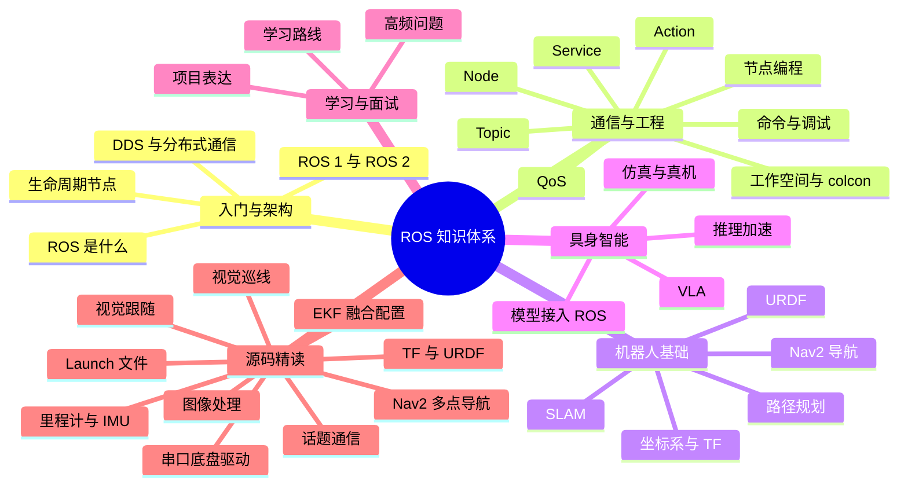

# ROS Index

ROS 与机器人软件的知识入口。这套笔记从一份「ROS 实习面试准备」的对话整理而来，但我没有把它保留成面试题清单，而是拆成了可以长期查阅的知识体系：先理解 ROS 为什么存在，再学通信和工程工具，然后补机器人学基础，最后接到 VLA、模型部署这些具身智能方向。

## 知识体系总图

## 模块一：入门与架构

- [[ROS 基础与架构]] —— ROS 到底是什么、为什么不是操作系统、ROS 1 和 ROS 2 的架构差别、DDS 与生命周期节点。

## 模块二：通信与工程

- [[ROS 2 通信机制]] —— Node、Topic、Service、Action 四种核心概念，QoS、消息接口、回调与执行器。
- [[ROS 2 工作空间与构建]] —— `src/build/install/log`、Package、`colcon`、`ament`、launch 文件。
- [[ROS 2 节点编程]] —— 用 `rclpy` 写发布者、订阅者、定时器、服务与动作，理解 `spin` 和回调。
- [[ROS 2 常用命令与调试]] —— 节点、话题、服务、动作、bag、参数、日志的常用命令与排查顺序。

## 模块三：机器人基础

- [[TF 与 URDF]] —— `map → odom → base_link` 坐标链、TF2、URDF/Xacro、RViz 检查方法。
- [[SLAM 与导航]] —— 同步定位与建图、激光/视觉/视觉惯性 SLAM、Nav2 的定位、代价地图、规划与控制。
- [[路径规划算法]] —— BFS、Dijkstra、A* 的差别，全局规划与局部避障，栅格地图与连续空间。

## 模块四：具身智能

- [[VLA 与机器人 AI]] —— 视觉—语言—动作模型是什么，LLM 与 VLA 的边界，模型怎么接进机器人系统。
- [[模型推理加速]] —— 先测量再优化：混合精度、量化、蒸馏、ONNX/TensorRT、吞吐与延迟的区别。

## 模块五：工程与面试

- [[机器人系统调试与工程实践]] —— Linux 命令、进程与资源、日志、仿真与真机差异、机器人不动怎么查。
- [[ROS 学习路线与面试准备]] —— 四周学习路线、十道高频题、自我介绍模板、如何诚实表达自己的边界。

## 实战：WHEELTEC ROS 教程精读

- [[WHEELTEC ROS 教程学习报告]] —— 通读 ROS1/ROS2 两套官方教程（138 份 PDF、1538 页）后的整合报告：串口协议、TF/EKF、五种 2D SLAM、代价地图、AMCL、DWA/TEB、Nav2、视觉、RRT、编队、全覆盖、RTK、自动回充、AI 多模态与语义导航，附 13 张原理图和命令/参数/排障速查表。
- [[WHEELTEC ROS1 教程学习笔记]] —— 只针对 ROS1 系列（73 份 PDF、1069 页）的学习笔记：按「基础 → 上车 → 建图 → 导航 → 视觉 → 进阶」组织，每章带命令、验证方法和实验清单，并补了底盘/轮胎、ROS2 迁移和 VLA 的延伸。
- [[机器人轮胎与底盘构型]] —— 教程没展开的底盘知识：差速/麦轮/全向/阿克曼/履带的轮胎选型与运动学，轮胎如何影响里程计和打滑，以及在 ROS1、ROS2 控制器与 VLA 动作空间里的具体表现。

## 上手与操作

- [[WHEELTEC 小车上手与调试指南]] —— 拿到实车后的现场手册：连小车热点、Windows 直连与 VMware 桥接、SSH/VNC、启动底盘与键盘控制、雷达相机自检、按网络/ROS/串口/传感器四层排障，附常见症状速查表和命令卡。

## 代码精读：WHEELTEC ROS 2 源码

前面的笔记讲「是什么」，这一组讲「代码怎么写、每一行为什么」。全部来自 `D:\轮趣\...\6.ROS2系列教程` 里的真实工程文件，按依赖顺序排列：

**第一层：单节点怎么写**

- [[ROS 2 话题通信代码解析]] —— `py_pubsub` 与 `cpp_pubsub` 两个包：节点类、发布订阅、定时器、`setup.py` / `CMakeLists.txt` / `package.xml` 的每个字段。
- [[ROS 2 Launch 文件代码解析]] —— `generate_launch_description`、`DeclareLaunchArgument`、`IncludeLaunchDescription`、`GroupAction` + 条件，以及 WHEELTEC 的完整启动树。

**第二层：底盘与定位**

- [[ROS 2 底盘串口驱动代码解析]] —— 783 行驱动：参数声明、串口打开、`cmd_vel` 打包成 11 字节、24 字节状态帧的逐字节状态机、BCC 校验、析构停车。
- [[ROS 2 里程计与 IMU 代码解析]] —— 速度积分成位姿、两套协方差按动静切换、IMU 消息字段、Mahony 互补滤波 91 行逐行讲。
- [[ROS 2 EKF 传感器融合配置解析]] —— `ekf.yaml` 逐参数：15 维配置向量、`differential` 与 `relative`、过程噪声、TF 所有权。
- [[ROS 2 TF 与 URDF 代码解析]] —— `static_transform_publisher` 的 8 个参数、`robot_state_publisher` 怎么把 URDF 变成 TF、link 与 joint 的结构。

**第三层：视觉与控制**

- [[ROS 2 图像处理节点代码解析]] —— `cv_bridge` 的编码转换、回调里显示为什么会掉帧、QoS 不匹配导致收不到图。
- [[ROS 2 视觉巡线代码解析]] —— HSV 阈值、`moments` 求质心、ROI、纯 P 控制，以及代码里的死分支。
- [[ROS 2 视觉跟随代码解析]] —— 彩色与深度的 `message_filters` 同步、像素偏移转角度、自定义 `Position` 消息、PID 类逐行。

**第四层：导航**

- [[ROS 2 Nav2 多点导航代码解析]] —— Nav2 bringup 组合、地图与参数、`/goal_pose` 与 action 状态话题、循环状态机与它的边界问题。

> 读法建议：先自己看一遍源码，再对照笔记；重点不是「这段代码干嘛」，而是「作者为什么这么写」「哪里是凑合能跑」。笔记里标出的死代码、命名颠倒、越界风险，都是真实存在的，不是笔误。

## 建议阅读顺序

1. 先读 [[ROS 基础与架构]]，建立「ROS 是中间层」的直觉。
2. 接着读 [[ROS 2 通信机制]] 和 [[ROS 2 工作空间与构建]]，这是写代码前必须懂的两块。
3. 动手时对照 [[ROS 2 节点编程]] 和 [[ROS 2 常用命令与调试]]。
4. 有实车或想跟一套完整教程走，先读 [[WHEELTEC ROS1 教程学习笔记]] 按「底盘 → 建图 → 导航 → 视觉」做一遍，再用 [[WHEELTEC ROS 教程学习报告]] 补 ROS2、进阶功能和 AI；底盘选型随时查 [[机器人轮胎与底盘构型]]。
5. 想理解移动机器人，再读 [[TF 与 URDF]]、[[SLAM 与导航]]、[[路径规划算法]]。
6. 想做具身智能，最后读 [[VLA 与机器人 AI]] 和 [[模型推理加速]]。
7. 找实习或准备面试时，用 [[ROS 学习路线与面试准备]] 收口。

## 三条主线

- **通信主线**：Node 是程序单元，Topic 是持续数据流，Service 是短请求，Action 是长任务。几乎所有 ROS 问题都能先归到这四个概念上。
- **机器人主线**：感知给出「周围是什么」，TF 给出「各部分在哪」，SLAM 给出「我在哪」，导航给出「怎么去」，控制给出「怎么动」。
- **AI 主线**：模型只负责「理解与决策」的一部分，输出还要经过坐标变换、轨迹规划、控制器和安全检查，才能变成电机指令。

## 来源与说明

- 原始材料：[ChatGPT 分享的 ROS 实习面试准备对话](https://chatgpt.com/share/6ada13f5-ed9c-83ec-b142-3ac5a5348a50)。
- 原对话偏「一晚冲刺面试」，这里按知识体系重排，并补了 ROS 2 的通用背景、工程细节和常见坑。
- 笔记里的命令、版本和 API 以 ROS 2 Humble/Jazzy 为主，具体项目仍要以实际发行版和官方文档为准。

## 相关

- [[Vault Index]]
- [[AI Research Index]]
