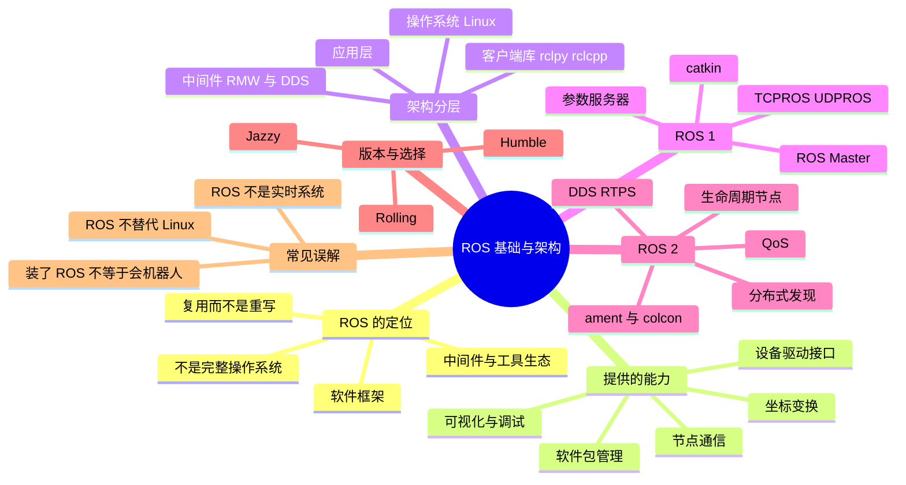

# ROS 基础与架构

ROS 常被翻译成「机器人操作系统」，但它并不管理 CPU、内存和文件系统。它更像一层中间件和工具生态：把摄像头、激光雷达、定位、规划、控制这些本来各写各的模块，用统一的通信方式和工程规范接起来。理解这一点，后面学 Node、Topic、TF 才不会把它们当成孤立的名词。

## 知识体系思维导图



## 1. ROS 到底是什么

ROS 是 Robot Operating System 的缩写，但它不是像 Linux、Windows 那样负责管理硬件资源的操作系统。更准确的说法是：**一套用于构建机器人应用的软件框架和工具生态**。

它主要提供四类东西：

- **通信机制**：让不同程序之间传消息，比如摄像头节点把图像发给检测节点。
- **设备驱动和功能包**：激光雷达、相机、底盘、机械臂通常都有现成的 ROS 驱动或功能包。
- **工程组织方式**：用 Package 组织代码，用工作空间管理依赖，用 `colcon` 编译。
- **调试工具**：`ros2 topic echo`、RViz、rqt、rosbag 等，能直接看到数据流和坐标关系。

所以 ROS 的价值不是「让机器人变聪明」，而是**让不同人写的模块能拼在一起**。没有 ROS 也能做机器人，但每换一个传感器、每换一个团队，接口就要重写一遍。

## 2. 架构分层

从下往上可以分成四层：

| 层次 | 作用 | 例子 |
| --- | --- | --- |
| 操作系统层 | 进程、内存、文件、网络、驱动 | Ubuntu、Linux 内核 |
| 中间件层 | 发现节点、传输消息、配置 QoS | DDS、RMW |
| 客户端库层 | 给 Python/C++ 提供统一 API | `rclpy`、`rclcpp` |
| 应用层 | 感知、定位、规划、控制等业务 | SLAM、Nav2、机械臂驱动 |

ROS 2 的通信不是自己从零写的，而是把 DDS（Data Distribution Service）作为中间件。DDS 负责分布式发现、消息传输和 QoS。常见的 DDS 实现有 Fast DDS、Cyclone DDS、Connext，具体默认用哪一个会随 ROS 2 发行版变化，但概念是一样的。

## 3. ROS 1 与 ROS 2 的区别

| 对比项 | ROS 1 | ROS 2 |
| --- | --- | --- |
| 通信架构 | 依赖 ROS Master 做名字服务和节点发现 | 基于 DDS，节点分布式发现，没有单点 Master |
| 通信协议 | TCPROS / UDPROS | DDS / RTPS |
| QoS | 配置比较简单 | 可靠性、历史、持久性、截止时间等可配 |
| 多机通信 | 可以，但要配置 Master 和网络 | 原生面向分布式，但仍要配网络和 Domain |
| 生命周期 | 没有统一的托管节点机制 | 支持 Managed / Lifecycle Nodes |
| 构建工具 | `catkin`、`rosbuild` | `ament`、`colcon` |
| 典型版本 | Noetic（已停止维护） | Humble、Jazzy、Rolling |

面试里常问「ROS 2 比 ROS 1 好在哪里」，不要只背「去掉了 Master」。更完整的说法是：

> ROS 2 用 DDS 做分布式发现和通信，去掉了 ROS Master 这个单点，同时提供更细的 QoS、生命周期节点和多机部署能力。它更适合现代机器人系统，但 ROS 2 本身不自动保证硬实时，实时性还要靠操作系统、调度、DDS 配置和系统设计。

## 4. DDS 在 ROS 2 里做了什么

DDS 是一个以数据为中心的发布—订阅中间件。可以把它理解成一个「自带地址簿的邮局」：

- **发现**：节点加入网络后，自动找到同 Domain 内发布/订阅同一话题的节点，不需要中心服务器。
- **传输**：根据配置选择可靠传输或尽力而为传输。
- **QoS**：定义消息要不要保证送达、保留多久、队列多深、对延迟有没有要求。
- **Domain**：用 Domain ID 隔离不同的机器人网络，避免同一局域网内互相干扰。

这也解释了一个常见问题：为什么 `ros2 topic list` 看不到别的机器人的话题？可能是 Domain ID 不一致，也可能是网络、组播、防火墙或 `ROS_DOMAIN_ID` 没配好。

## 5. 生命周期节点

普通节点的状态是「启动了就一直在跑」。生命周期节点把状态拆成几个阶段：

```text
unconfigured → inactive → active → finalized
                  ↑          │
                  └──────────┘
```

对应操作是 `configure`、`activate`、`deactivate`、`cleanup`、`shutdown`。它的好处是驱动和关键模块可以「先配置好，再统一激活」，出问题时也能安全地停到 inactive，而不是直接崩溃。

相机的驱动、激光雷达驱动、导航栈里的某些服务器，经常用生命周期节点来管理启动顺序。

## 6. 版本选择

截至 2026 年，学习和项目里最常见的是：

- **Humble Hawksbill**：2022 年发布，Ubuntu 22.04，长期支持，资料多，很多教程和公司项目还在用。
- **Jazzy Jalisco**：2024 年发布，Ubuntu 24.04，较新的 LTS，新项目可以优先考虑。
- **Rolling**：滚动开发版，功能最新，但不适合作为稳定项目基线。

新手不必纠结版本，先确认三件事：Ubuntu 版本、ROS 2 发行版、Python 版本是否匹配。ROS 2 的安装和使用高度依赖系统版本，混装很容易出问题。

## 7. 常见误解

- **「ROS 是操作系统」**：不是。它运行在 Linux 之上，不负责内核、进程调度和内存管理。
- **「用了 ROS 2 就实时了」**：不是。ROS 2 提供了实时友好的机制，但硬实时需要 PREEMPT_RT、合理的 executor、DDS 配置和实时线程优先级。
- **「ROS 2 没有 Master 就没有中心」**：通信上没有单点 Master，但工程上仍可能有 launch、参数服务器、发现服务等集中配置。
- **「会写一个发布者就会 ROS」**：通信只是入口。机器人系统还包括 TF、URDF、传感器、导航、控制和调试。

## 相关

- [[ROS 2 通信机制]]
- [[ROS 2 工作空间与构建]]
- [[ROS Index]]
