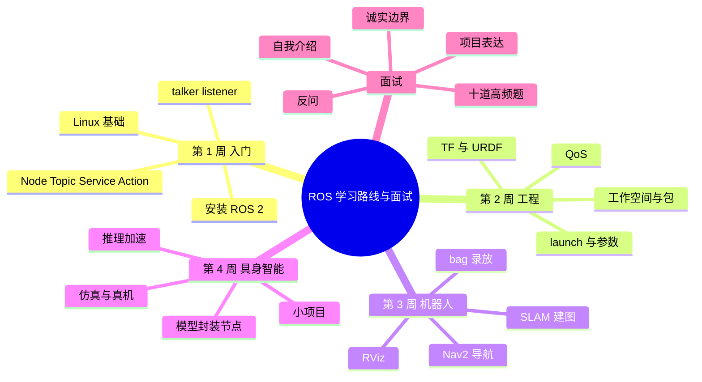

# ROS 学习路线与面试准备

这篇不是「七天速成 ROS」，而是把学习顺序和面试表达放在一起。ROS 的知识面很宽，如果没有路线，很容易今天看 SLAM、明天看 VLA，最后每个词都听过，但一个节点都没跑过。下面按「先能跑，再能讲，最后能接项目」组织。

## 知识体系思维导图

## 1. 先确认基础

ROS 2 主要跑在 Ubuntu 上，常用 Python 和 C++。开始前至少要有：

- 会用 Linux 基本命令：`cd`、`ls`、`grep`、`ps`、`kill`、`chmod`；
- 会写 Python 函数和类；
- 知道进程、线程、内存、网络的基本概念；
- 能看懂 CMake 或 `setup.py` 的基本结构。

C++ 不用一开始就很强，但至少能读懂类、指针、引用和编译错误。机器人底层驱动和控制大量用 C++，完全避开不现实。

## 2. 四周学习路线

### 第 1 周：跑通最小节点

目标：知道 ROS 2 是什么，能运行 talker/listener。

- 安装 Ubuntu 22.04/24.04 和对应 ROS 2（Humble/Jazzy）；
- 学 Node、Topic、Service、Action 的区别；
- 运行官方 `demo_nodes_cpp` 或 `demo_nodes_py`；
- 用 `ros2 node list`、`ros2 topic list`、`ros2 topic echo` 看数据；
- 自己写一个发布者和订阅者。

验收：能不看教程，说出 `create_publisher`、`create_subscription`、`spin` 分别在做什么。

### 第 2 周：工程化

目标：能从零建一个包，并用 launch 启动。

- 工作空间 `src/build/install/log`；
- `ros2 pkg create`，`ament_python` 与 `ament_cmake`；
- `package.xml`、`setup.py`、`CMakeLists.txt`；
- `colcon build`、`source install/setup.bash`；
- launch 文件、参数、namespace、remap；
- QoS 的基本配置。

验收：能建一个包，包含两个节点，用 launch 一次启动，并能用参数改频率。

### 第 3 周：机器人基础

目标：理解 TF、URDF、SLAM、Nav2 的关系。

- TF 树：`map → odom → base_link → sensor`；
- URDF/Xacro：Link、Joint、Visual、Collision、Inertial；
- RViz 看模型、TF、激光、地图；
- Gazebo 或 Webots 跑一个移动机器人；
- 用 SLAM Toolbox 建图，保存地图；
- 用 AMCL 定位，用 Nav2 导航。

验收：能解释「为什么导航前要先有 map 和 TF」，能说出 AMCL 发布哪个变换。

### 第 4 周：接一个 AI 模型

目标：把模型封装成 ROS 节点，并测延迟。

- 订阅图像话题，做预处理；
- 调用模型推理；
- 发布检测结果或目标位姿；
- 用 `ros2 topic hz` 和时间戳测端到端延迟；
- 尝试 FP16/ONNX/TensorRT 中的一种；
- 在仿真里跑通，再考虑真机。

验收：能画出一条从相机到控制指令的数据流，并指出每段的耗时。

## 3. 十道高频题

| 问题 | 回答要点 |
| --- | --- |
| 你对 ROS 的理解是什么？ | 机器人软件框架，提供节点通信、包管理、TF、调试工具，让感知/定位/规划/控制协同。 |
| Topic、Service、Action 的区别？ | 持续数据流用 Topic，短请求响应用 Service，长任务带反馈和取消用 Action。 |
| 没有太多 ROS 项目经验，为什么应聘？ | 计算机/AI 背景、Python 和模型实验经验，正在补 ROS 通信、Linux 调试和机器人基础，愿意从数据、节点、验证做起。 |
| 机器人无法移动怎么排查？ | 节点是否启动 → `/cmd_vel` 有没有 → 指令是否为 0 → 驱动是否收到 → 急停/电池/通信 → 规划与 TF → 日志。 |
| SLAM 是什么？ | 同步定位与建图，运动过程中估计位姿并构建地图，两者相互依赖。 |
| Dijkstra 与 A* 的区别？ | Dijkstra 按累计代价扩展；A* 加启发函数估计剩余代价，通常搜索更少，最优性依赖可采纳性。 |
| 如何提高模型推理速度？ | 先测端到端延迟和瓶颈，再考虑混合精度、量化、蒸馏、推理引擎，最后验证精度和任务成功率。 |
| 仿真与真机的区别？ | 仿真可重复、低成本，但传感器噪声、动力学、延迟、硬件限制不同，仍需真机验证。 |
| 如何处理不熟悉的代码仓库？ | 读 README、目录、依赖、启动脚本 → 跑示例 → 画节点/话题数据流 → 最小复现 → 小步修改。 |
| 遇到不会的问题怎么办？ | 明确条件和目标，提出假设，设计最小实验，查官方文档，向团队确认硬件/接口约束。 |

## 4. 自我介绍模板

不要逐字背，按自己的真实经历填：

> 面试官您好，我目前就读于 ____ 专业。我的项目经历主要集中在 Python、深度学习和模型优化方面。我做过 ____，使用了 PyTorch / Hugging Face，并尝试过 ____（比如教师—学生蒸馏、量化、部署）。
>
> 我希望往 AI 工程和具身智能方向发展，因此对机器人软件开发、ROS 通信机制，以及视觉语言模型在机器人中的应用比较感兴趣。
>
> 我也清楚自己目前在 ROS 和实际机器人控制方面还需要积累。如果有机会加入团队，我希望从数据处理、节点开发、模型接入和仿真验证做起，尽快熟悉项目代码和开发流程，再逐步承担更完整的功能。

关键不是把简历复述一遍，而是让面试官知道：**你会什么、你想做什么、你缺什么、你打算怎么补。**

## 5. 把项目经历接到机器人岗位

如果你做的是 NLP、CV 或推荐，不要硬说「我做过机器人」。可以迁移的是：

- 数据处理和清洗；
- 模型训练、评估、误差分析；
- 推理延迟和显存优化；
- 实验设计和对比；
- Python 工程能力。

不能假装的是：

- 独立做过 ROS 项目；
- 调过真实机器人；
- 写过底层控制；
- 处理过传感器标定。

面试官通常能听出边界。诚实说「我没做过，但我理解它的流程，可以从这里开始」比硬编故事更可信。

## 6. 面试前两小时怎么冲刺

- 40 分钟：Node、Topic、Service、Action、QoS、工作空间、常用命令。
- 35 分钟：SLAM、TF、URDF、Nav2、BFS/Dijkstra/A*。
- 30 分钟：VLA、推理加速、仿真与真机、项目表达。
- 25 分钟：模拟面试，每题 30–60 秒。

不要通宵刷论文。临近面试，清醒和表达清楚比多背十个名词更有用。

## 7. 可以反问面试官的问题

- 团队目前主要用 ROS 1 还是 ROS 2？主要平台是移动底盘、机械臂还是其他？
- 实习生会优先参与 ROS 功能开发、真机数据采集、模型部署还是算法调优？
- 岗位提到 VLA 和推理优化，团队更侧重现有模型部署，还是数据采集、微调和训练？
- 团队怎么做出入测试和安全验证？有没有仿真环境？

这些问题能帮你判断岗位的技术含量，也能体现你关心工程落地。

## 8. 最后三条

- **诚实**：不会就说不会，但要说出你会怎么学、怎么验证。
- **结构**：回答问题先给结论，再给原因，再给例子。
- **验证**：任何方案都要说清楚「怎么知道它有效」。

## 相关

- [[ROS Index]]
- [[ROS 基础与架构]]
- [[ROS 2 通信机制]]
- [[机器人系统调试与工程实践]]
