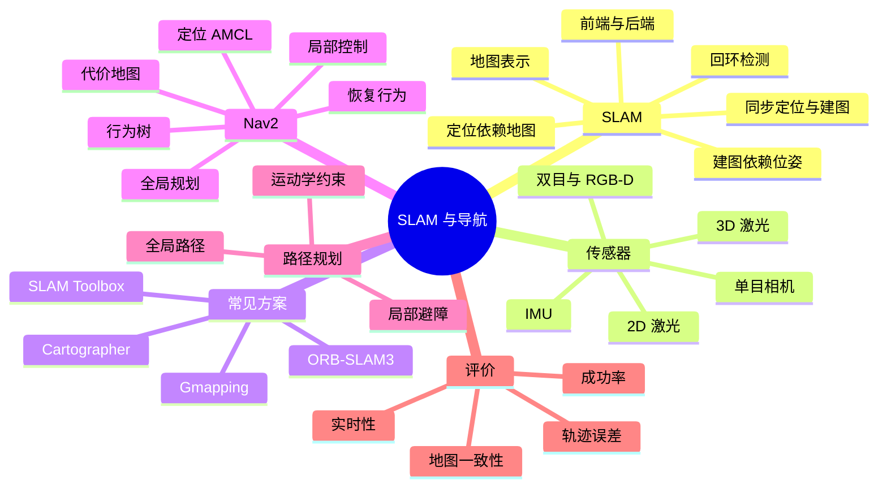

# SLAM 与导航

SLAM 和导航经常被混在一起问。简单区分：SLAM 解决「我在哪、周围长什么样」，导航解决「知道自己在哪之后，怎么从 A 走到 B」。前者偏估计和建图，后者偏规划、避障和控制。移动机器人项目里，两者通常前后衔接。

## 知识体系思维导图



## 1. SLAM 是什么

SLAM 的全称是 Simultaneous Localization and Mapping，同步定位与建图。

机器人进入一个陌生环境时，面临一个循环依赖：

- 要知道自己在哪里，需要一张地图作为参考；
- 要建地图，又需要知道自己每个时刻在哪里，才能把观测放到正确位置。

SLAM 就是同时估计这两个量。它不是一个算法，而是一类问题的统称，包含前端里程计、后端优化、回环检测、地图构建等模块。

## 2. SLAM 的基本流程

```text
传感器数据 → 前端（特征/匹配/里程计） → 位姿初值
                                  ↓
                            后端优化（图优化/滤波）
                                  ↓
                            回环检测 → 修正累计误差
                                  ↓
                            地图构建
```

- **前端**：从相邻帧数据估计运动，速度快，但会漂。
- **后端**：把多帧约束放在一起优化，得到更一致的轨迹。
- **回环检测**：识别「又回到来过的地方」，消除长期累计误差。
- **地图构建**：把观测拼成栅格地图、点云地图或特征地图。

## 3. 常见 SLAM 类型

| 类型 | 传感器 | 特点 | 常见方案 |
| --- | --- | --- | --- |
| 2D 激光 SLAM | 单线激光雷达 | 稳定、算力低，适合室内移动机器人 | Gmapping、Cartographer、SLAM Toolbox |
| 3D 激光 SLAM | 多线激光雷达 | 建三维地图，适合户外和自动驾驶 | LIO-SAM、LeGO-LOAM、FAST-LIO |
| 视觉 SLAM | 单目/双目/RGB-D | 信息丰富，受光照和纹理影响 | ORB-SLAM3、VINS-Fusion |
| 视觉惯性 SLAM | 相机 + IMU | 融合视觉和惯性，鲁棒性更好 | VINS、ORB-SLAM3 |

选择时看场景：室内结构化环境，2D 激光通常最省事；户外大场景，3D 激光或视觉惯性更合适；算力有限的底盘，优先考虑 2D 激光。

## 4. 地图表示

- **栅格地图**：把空间分成小格子，每格标记占据/空闲/未知。Nav2 的静态地图就是这种。
- **点云地图**：保留三维点，信息多但数据量大。
- **特征地图**：存路标点，主要用于视觉 SLAM。
- **拓扑地图**：存节点和连接关系，适合高层路径规划。

栅格地图的代价是分辨率固定：格子太粗，窄通道过不去；格子太细，内存和计算增加。

## 5. 导航栈 Nav2

ROS 2 的导航框架是 Nav2。它不是一个节点，而是一组生命周期节点和服务：

| 模块 | 作用 |
| --- | --- |
| `bt_navigator` | 用行为树组织导航流程 |
| `planner_server` | 全局路径规划 |
| `controller_server` | 局部轨迹跟踪和避障 |
| `behavior_server` | 恢复行为，比如原地旋转、后退、等待 |
| `smoother_server` | 路径平滑 |
| `waypoint_follower` | 多点巡航 |
| `velocity_smoother` | 速度平滑和限幅 |

Nav2 的典型数据流：

```text
目标位姿 → bt_navigator → planner_server 生成全局路径
         → controller_server 跟踪路径并发布 /cmd_vel
         → 底盘执行
         ← 代价地图、定位、传感器持续更新
```

## 6. 定位：AMCL

AMCL 是自适应蒙特卡洛定位，用粒子滤波估计机器人在地图里的位姿。

- 每个粒子代表一个可能的位姿；
- 根据运动模型预测粒子分布；
- 根据激光观测给粒子加权；
- 重采样，保留高权重粒子；
- 粒子数量自适应调整。

AMCL 发布 `map → odom` 变换，修正里程计漂移。它需要一张已知地图，所以通常和建图分开：先 SLAM 建图，保存地图，再用 AMCL 定位和 Nav2 导航。

## 7. 代价地图

代价地图（Costmap）是导航的「风险地图」，每个格子有一个代价值：

- **静态层**：来自地图的障碍物；
- **障碍层**：来自实时传感器，比如激光、点云；
- **膨胀层**：在障碍物周围加安全距离，避免机器人贴边；
- **体素层**：三维障碍投影到二维。

调参重点：

- `inflation_radius` 太小，机器人容易擦边；
- 太大，窄通道会被完全堵死；
- `robot_radius` 要按实际外形设置，不能只写一个点；
- 传感器话题和 TF 必须正确，否则代价地图是空的。

## 8. 全局规划与局部控制

- **全局规划**：在静态地图上找一条从起点到目标的路径。常见算法是 Dijkstra、A*、Smac。
- **局部控制**：沿着全局路径走，同时避开实时出现的障碍。常见算法是 DWA、TEB、MPC。
- **恢复行为**：卡住时清理代价地图、原地旋转、后退、重新规划。

全局规划不保证路径可执行，局部控制也不保证全局最优。两者要配合，还要考虑机器人运动学约束，比如差速底盘不能横移、阿克曼底盘有最小转弯半径。

## 9. 仿真与真机

仿真适合快速验证算法和参数：

- Gazebo：物理仿真，传感器插件丰富；
- Isaac Sim：GPU 加速，适合视觉和 AI；
- Webots：轻量，适合教学。

仿真和真机的差距主要来自：

- 传感器噪声和延迟；
- 轮胎打滑、地面摩擦；
- 电机响应和机械间隙；
- 通信延迟和计算资源；
- 光照、反光、动态障碍。

所以仿真里跑通不代表真机能用，最终要在真机上做小范围、低速、有人看护的验证。

## 10. 怎么评价一个 SLAM/导航系统

- **轨迹误差**：ATE（绝对轨迹误差）、RPE（相对位姿误差）。
- **地图一致性**：回环后墙面是否重影、地图是否闭合。
- **导航成功率**：到达目标的比例。
- **安全性**：碰撞次数、急停次数。
- **实时性**：单帧处理时间、控制频率。
- **鲁棒性**：光照变化、动态障碍、传感器短时失效。

## 相关

- [[TF 与 URDF]]
- [[路径规划算法]]
- [[机器人系统调试与工程实践]]
- [[ROS Index]]
