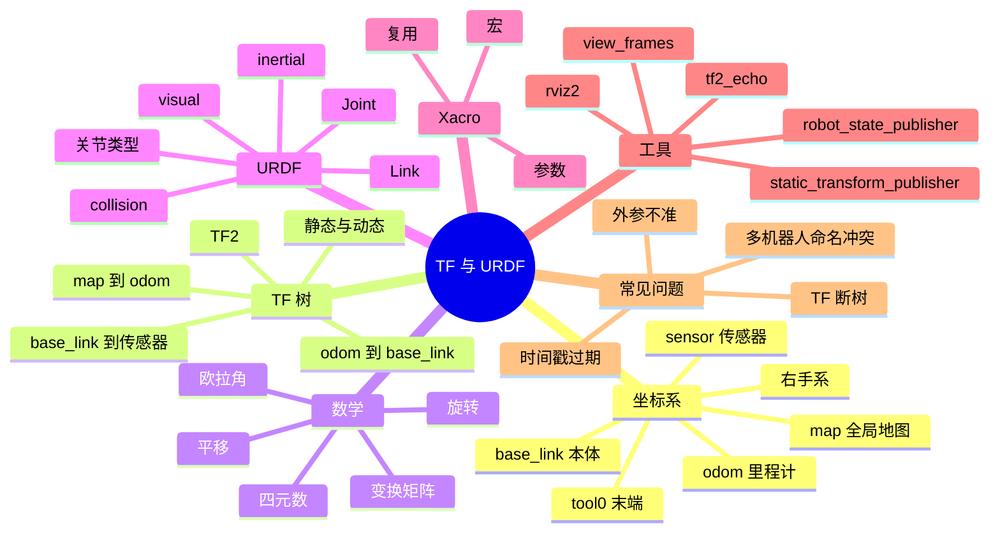

# TF 与 URDF

机器人里所有「在什么位置」的问题，最后都要落到坐标系上。相机看到障碍物在图像中间，这个「中间」要经过相机坐标系、机械臂坐标系、机器人本体坐标系，才能变成底盘能理解的方向。TF 管的就是这些坐标系之间的实时变换，URDF 管的是机器人由哪些刚体和关节组成。

## 知识体系思维导图



## 1. 为什么需要坐标系

假设相机检测到一个杯子在图像中心。这个信息本身不能直接让机械臂去抓，因为：

- 图像坐标是二维的，缺少深度；
- 相机装在机器人上，相机坐标不等于机器人坐标；
- 机械臂有自己的基座和关节；
- 底盘可能还在移动。

所以需要一条坐标链，把「杯子在相机前方 0.5 米」一路换算到「杯子在机器人基座坐标系下的三维位置」。TF 就是维护这条链的工具。

## 2. 常见坐标系

| 坐标系 | 含义 | 谁发布 |
| --- | --- | --- |
| `map` | 全局地图坐标系，相对稳定 | SLAM 或定位模块 |
| `odom` | 里程计坐标系，连续但会漂移 | 轮式里程计、视觉里程计 |
| `base_link` | 机器人本体坐标系 | 底盘驱动或状态估计 |
| `base_footprint` | 本体在地面的投影 | 底盘驱动 |
| `laser` / `lidar_link` | 激光雷达坐标系 | 静态 TF |
| `camera_link` | 相机坐标系 | 静态 TF |
| `tool0` / `ee_link` | 机械臂末端坐标系 | 机械臂驱动 |

名字不是强制的，但 `map`、`odom`、`base_link` 是社区约定，换名字会让很多现成工具不兼容。

## 3. 典型 TF 树

移动机器人最常见的一条链是：

```text
map → odom → base_link → laser_link
                       → camera_link
                       → imu_link
```

- **`map → odom`**：由定位模块发布。AMCL 或 SLAM 根据地图和传感器观测，估计机器人在地图里的位置，同时修正里程计漂移。
- **`odom → base_link`**：由里程计发布。它连续、平滑，但长时间会漂。
- **`base_link → sensor`**：通常是静态 TF，描述传感器安装位置。

机械臂则是另一条链：

```text
base_link → shoulder_link → upper_arm_link → forearm_link → ... → tool0
```

## 4. TF2 的基本用法

发布静态变换：

```bash
ros2 run tf2_ros static_transform_publisher \
  --x 0.1 --y 0 --z 0.5 --roll 0 --pitch 0 --yaw 0 \
  --frame-id base_link --child-frame-id laser_link
```

查看两个坐标系的关系：

```bash
ros2 run tf2_ros tf2_echo map base_link
```

生成 TF 树图：

```bash
ros2 run tf2_tools view_frames
```

代码里查询变换（Python）：

```python
import rclpy
from rclpy.node import Node
from tf2_ros import Buffer, TransformListener


class TfListener(Node):
    def __init__(self):
        super().__init__('tf_listener')
        self.buffer = Buffer()
        self.listener = TransformListener(self.buffer, self)

    def lookup(self):
        try:
            t = self.buffer.lookup_transform(
                'map', 'base_link', rclpy.time.Time()
            )
            self.get_logger().info(str(t.transform.translation))
        except Exception as e:
            self.get_logger().warn(f'TF not ready: {e}')
```

## 5. 平移、旋转与四元数

一个变换包含平移和旋转：

- **平移**：`x, y, z`，单位通常是米。
- **旋转**：常用四元数 `x, y, z, w` 表示，避免欧拉角的万向锁。
- **欧拉角**：`roll, pitch, yaw`，人更容易理解，但顺序和范围要注意。

面试里不要求手推四元数，但要能说清楚：

> 四元数用四个数表示三维旋转，比欧拉角更稳定，插值也更自然。ROS 的 TF 消息里旋转就是四元数，人机交互时再转成欧拉角显示。

## 6. URDF：机器人由什么组成

URDF 是 XML 格式，描述机器人的结构：

```xml
<link name="base_link">
  <visual>
    <geometry>
      <box size="0.5 0.4 0.2"/>
    </geometry>
  </visual>
  <collision>
    <geometry>
      <box size="0.5 0.4 0.2"/>
    </geometry>
  </collision>
  <inertial>
    <mass value="10.0"/>
    <inertia ixx="0.1" ixy="0" ixz="0"
             iyy="0.1" iyz="0" izz="0.1"/>
  </inertial>
</link>

<joint name="laser_joint" type="fixed">
  <parent link="base_link"/>
  <child link="laser_link"/>
  <origin xyz="0.1 0 0.5" rpy="0 0 0"/>
</joint>
```

核心元素：

- **Link**：刚体，比如底盘、连杆、传感器。
- **Joint**：连接两个 Link，定义运动类型和约束。
- **Visual**：显示用的几何。
- **Collision**：碰撞检测用的几何，通常比 Visual 简单。
- **Inertial**：质量和惯性，仿真和动力学需要。

常见关节类型：

| 类型 | 运动 | 例子 |
| --- | --- | --- |
| `fixed` | 不动 | 雷达、相机安装 |
| `revolute` | 有限角度旋转 | 机械臂关节 |
| `continuous` | 无限旋转 | 轮子 |
| `prismatic` | 直线滑动 | 升降机构 |
| `floating` | 六自由度 | 特殊连接 |
| `planar` | 平面运动 | 简化模型 |

## 7. Xacro

URDF 写多了会重复，Xacro 用宏和参数复用：

```xml
<xacro:macro name="sensor" params="name xyz">
  <link name="${name}_link"/>
  <joint name="${name}_joint" type="fixed">
    <parent link="base_link"/>
    <child link="${name}_link"/>
    <origin xyz="${xyz}" rpy="0 0 0"/>
  </joint>
</xacro:macro>

<xacro:sensor name="laser" xyz="0.1 0 0.5"/>
<xacro:sensor name="camera" xyz="0.2 0 0.4"/>
```

`robot_state_publisher` 读取 URDF 和关节状态，发布 `base_link` 到各 Link 的 TF。没有它，RViz 里的机器人模型不会动。

## 8. 常见问题

- **TF 断树**：`view_frames` 里出现两棵不连通的树，通常是某个 static transform 没发，或者 frame 名字拼错。
- **时间戳过期**：`lookup_transform` 报 `LookupException` 或 `ExtrapolationException`，检查发布频率、时间同步和 `use_sim_time`。
- **外参不准**：相机和雷达的安装位置写错，标定没做，融合结果会偏。
- **多机器人冲突**：多个机器人用同一个 `base_link`，需要加 namespace 和 frame prefix。
- **RViz 不显示**：Fixed Frame 设错、TF 没发布、模型路径不对。

## 相关

- [[SLAM 与导航]]
- [[ROS 2 通信机制]]
- [[机器人系统调试与工程实践]]
- [[ROS Index]]
