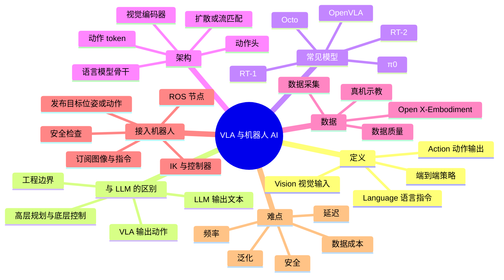

# VLA 与机器人 AI

VLA 是 Vision-Language-Action 的缩写，通常译成「视觉—语言—动作模型」。它想解决的问题是：机器人看到环境、听到一句自然语言指令，直接生成动作，而不是先由人写好每个任务的规则。它和大语言模型有关系，但不是「把 GPT 接上电机」这么简单。

## 知识体系思维导图



## 1. VLA 是什么

VLA 模型通常包含三部分输入输出：

- **Vision**：相机图像、深度图、环境状态；
- **Language**：自然语言指令，比如「把红色杯子放进盒子」；
- **Action**：末端执行器位姿、关节角、速度指令或动作序列。

它不是简单的「图像分类 + 文本分类」，而是把视觉和语言作为条件，学习一个动作策略。训练数据通常是大量机器人示教轨迹，每条轨迹包含「看到什么、听到什么、做了什么」。

## 2. 和 LLM 的关系

大语言模型擅长理解语言、拆解任务、生成高层计划。比如你告诉它「去厨房拿一瓶水」，它可以拆成「走到厨房 → 找到水瓶 → 伸手 → 抓取 → 返回」。

但 LLM 输出的是文本，不是电机指令。真正执行还要：

1. 把文本计划转成机器人能理解的目标；
2. 做坐标变换，把目标从地图坐标转到机械臂基座坐标；
3. 做逆运动学，求关节角；
4. 做轨迹规划和碰撞检测；
5. 交给控制器，按控制周期发指令；
6. 做安全检查，比如力超限、速度超限、急停。

VLA 可以理解为把「视觉 + 语言 → 动作」这一步也交给模型学，但模型输出仍然要经过机器人系统的接口和安全层。**不能把语言模型生成的文本直接当成电机控制指令。**

## 3. 常见 VLA 模型

| 模型 | 特点 |
| --- | --- |
| RT-1 | 较早的机器人 Transformer，多任务、多机器人数据训练 |
| RT-2 | 把视觉语言模型的能力迁移到机器人动作，强调语义泛化 |
| OpenVLA | 开源 VLA，基于视觉语言模型，便于复现和微调 |
| π0 | 强调通用机器人策略，使用流匹配生成动作 |
| Octo | 开源通用机器人策略，支持多种机器人和任务 |
| RDT | 面向双臂机器人的扩散策略 |

这些模型的细节不需要全背，面试里能说清楚「VLA 是把视觉和语言条件映射到动作，常见做法是基于视觉语言模型加动作头，用机器人示教数据训练」就够。

## 4. 动作怎么表示

VLA 的输出通常有几种形式：

- **离散动作 token**：把动作维度离散化，像生成文本一样生成动作 token；
- **连续回归**：直接回归末端位姿或关节角；
- **扩散模型**：从噪声中逐步去噪，生成一条动作轨迹；
- **流匹配**：学习从简单分布到动作分布的变换，采样更快。

不同表示影响训练难度、推理速度和动作平滑度。离散 token 容易借用语言模型架构，但精度受离散化影响；扩散/流匹配能生成多模态动作，但推理开销更大。

## 5. 怎么把 VLA 接进 ROS

一个常见的工程结构：

```text
相机节点 → /camera/image_raw ┐
                              ├→ VLA 节点 → /vla/action 或 /target_pose
语言指令 → /instruction ──────┘
                                              ↓
                                      运动规划 / IK / 控制器
                                              ↓
                                          /cmd_vel 或关节指令
```

VLA 节点要做的事：

- 订阅图像、深度、机器人状态、语言指令；
- 做预处理，比如缩放、归一化、时间对齐；
- 调用模型推理；
- 把输出转换成 ROS 消息；
- 处理超时、无效动作、异常输入；
- 发布目标位姿、动作序列或速度指令。

关键问题：

- **输入输出类型**：图像编码、坐标系、单位、时间戳。
- **推理延迟**：模型多久出一次动作，控制频率能不能跟上。
- **动作频率**：VLA 可能几赫兹，底层控制可能几百赫兹，中间需要插值或缓冲。
- **安全**：动作限幅、碰撞检测、急停、人工接管。
- **失败恢复**：模型输出不合理时，回退到传统规划器或停止。

## 6. 仿真与真机

仿真适合：

- 快速验证模型接口和 ROS 节点；
- 生成大量带标注的数据；
- 测试异常和安全逻辑；
- 对比不同模型。

真机才能暴露：

- 传感器噪声和延迟；
- 光照、反光、遮挡；
- 机械臂动力学和抓取失败；
- 通信和计算资源限制；
- 人机共存的安全问题。

所以 VLA 的落地通常是「仿真预训练/验证 + 真机小范围采集/微调 + 安全兜底」。

## 7. 数据和泛化

VLA 的瓶颈往往不是模型结构，而是数据：

- 真机示教成本高；
- 不同机器人、不同相机、不同场景的数据分布差异大；
- 动作标注和时间对齐容易出错；
- 长任务需要大量轨迹。

常见做法：

- 用 Open X-Embodiment 等公开数据集预训练；
- 在自己的机器人上采集少量高质量数据微调；
- 用仿真补充罕见场景；
- 用语言标注增强任务多样性；
- 用传统控制器做安全兜底。

## 8. 评价

- **任务成功率**：在未见过的物体、位置、指令下能不能完成。
- **泛化能力**：换背景、换光照、换物体还能不能用。
- **动作质量**：是否平滑、是否抖动、是否超限。
- **推理延迟**：从图像到动作的时间。
- **鲁棒性**：传感器缺失、指令模糊、动态障碍。
- **安全性**：碰撞、力超限、急停响应。

## 9. 面试里怎么说

如果被问「大语言模型能直接控制机器人吗」，可以这样回答：

> 要区分任务规划和底层控制。LLM 适合理解指令、拆解任务、生成高层计划；VLA 进一步把视觉、语言和动作建模结合起来。但模型输出还要经过动作接口、坐标变换、轨迹规划、控制器和安全检查，不能直接把文本当成电机指令。

这段话的核心是：你理解 AI 模型和机器人系统之间的工程边界。

## 相关

- [[模型推理加速]]
- [[ROS 2 节点编程]]
- [[SLAM 与导航]]
- [[ROS Index]]
