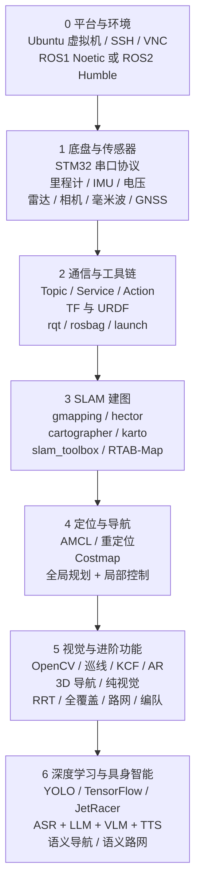

# WHEELTEC ROS 教程学习报告

这份报告来自对 `D:\轮趣\1.WHEELTEC ROS机器人通用资料` 下两套教程的系统阅读：`5.ROS1系列教程` 共 73 份 PDF、1069 页，`6.ROS2系列教程` 共 65 份 PDF、469 页（ROS2 资料的实际文件夹名是 `6.ROS2系列教程`，不是 5）。内容从虚拟机安装、串口通信一路覆盖到 SLAM、Nav2、视觉、多机编队、深度学习和多模态大模型。

它不是把 138 份文档缩写成目录，而是按「一个机器人从能动，到能建图，到能自主导航，再到能听懂人话」的工程顺序重新组织。读完之后，应该能回答三个问题：这套代码里每个模块在干什么、关键参数改哪里、出问题时先查什么。

---

## 一、资料地图：两套教程分别讲什么

| 系列 | 份数 / 页数 | 主要内容 | 适合阶段 |
| --- | --- | --- | --- |
| ROS1 系列 | 73 / 1069 | 工作空间、话题、TF、STM32 通信、传感器、雷达建图、2D 导航、SLAM 算法原理、OpenCV、视觉跟随/巡线、RTAB-Map、纯视觉、RRT、编队、Qt、APP、深度学习 | 想理解「经典 ROS 机器人栈」的全貌 |
| ROS2 系列 | 65 / 469 | ROS2 入门与编程、colcon、DDS、Nav2、slam_toolbox/cartographer、RTAB-Map、路径跟踪、路网、自动重定位、RTK-GNSS、自动回充、AI 多模态大模型 | 想跟当前主流栈和具身智能方向接轨 |

两套资料的章节结构几乎一一对应，可以当成「同一台车的两代软件实现」来对照读：

- **基础层**：工作空间与功能包、roslaunch/launch.py、话题与服务、TF、URDF、rqt。
- **硬件层**：ROS 主控 + STM32 底盘、USB 转串口、udev 别名、传感器型号选择。
- **应用层**：雷达跟随、2D 建图、2D 导航、视觉跟随、巡线、KCF、AR 标签、Web 图传。
- **进阶层**：视觉 + 雷达 3D 建图导航、纯视觉建图导航、RRT 自主探索、全覆盖、路径跟踪、路网、多机编队、自动回充、GNSS 室外导航。
- **智能层**：Darknet/YOLO、TensorFlow/PyTorch、JetRacer 沙盘、ROS2 AI 多模态大模型。

> 阅读建议：不要从 221 页的《WHEELTEC ROS 机器人功能使用与解析》第一页硬啃。先按本报告第四到第六章把「底盘—建图—导航」主线跑通，再回头把它当字典查。

---

## 二、技术路线总览



这条线可以压成两个闭环：

1. **运动闭环**：`/cmd_vel` → STM32 → 电机 → 编码器 → `/odom` + `/imu` → EKF → TF。
2. **导航闭环**：传感器 → SLAM/AMCL → `map → odom → base_link` → Costmap → 全局路径 → 局部速度 → `/cmd_vel`。

几乎所有「小车不动」「地图飘」「导航撞墙」的问题，都能先归到这两个闭环的某一环。

### 分阶段目标

| 阶段 | 学完能做到 | 关键验收 |
| --- | --- | --- |
| 0 平台 | SSH 登录小车、同步代码、编译工作空间 | `ros2 topic list` 能看到底盘和雷达话题 |
| 1 底盘 | 键盘控制小车、看懂里程计和 IMU | `rviz` 中 RobotModel 与 TF 正常，轮子方向正确 |
| 2 通信 | 写发布/订阅节点、改 launch、查 TF | 自己写的节点能收 `/scan` 并发布 `/cmd_vel` |
| 3 建图 | 用 2—3 种算法建出可用栅格地图 | 回环处墙体不重影，地图可保存为 `.yaml/.pgm` |
| 4 导航 | 单点/多点导航、调代价地图和局部规划器 | 窄道能过、转弯不画龙、能从错误位姿恢复 |
| 5 进阶 | 视觉跟随、巡线、RRT、路网、编队 | 每个功能能独立启动并解释其节点图 |
| 6 智能 | 用语音驱动建图/导航/跟随，理解 VLM 接入方式 | 能说清「语言 → 动作函数 → ROS 话题」的映射 |

---

## 三、ROS1 与 ROS2：同一台车，两代中间件

WHEELTEC 的 ROS1 与 ROS2 代码做的是同一件事，但工程习惯差别很大。对照表如下：

| 维度 | ROS1 | ROS2 |
| --- | --- | --- |
| 通信架构 | 依赖 `roscore` / Master，中心化 | DDS 去中心化，节点自动发现 |
| 多机通信 | `ROS_MASTER_URI` + `ROS_HOSTNAME` | 同一 `ROS_DOMAIN_ID` 即可发现 |
| 构建系统 | `catkin_make`，`src/build/devel` | `colcon build`，`src/build/install/log` |
| 启动文件 | XML `.launch` | Python `.launch.py` |
| 参数 | 全局参数服务器 | 每个节点自己的参数，支持 YAML |
| C++ / Python API | roscpp / rospy | rclcpp / rclpy |
| 导航栈 | `move_base` + `amcl` + `costmap_2d` | Nav2：生命周期节点 + 行为树 + Action Server |
| 仿真 | Gazebo Classic | Gazebo / Ignition，接口不同 |
| 典型发行版 | Melodic / Noetic | Foxy / Humble / Jazzy |

### 对写代码最直接的影响

- ROS1 里 `ros::NodeHandle` 一创建就能收全局参数；ROS2 要显式声明 `declare_parameter`，否则运行时改参数会报「参数未声明」。
- ROS1 的 launch 用 `<node pkg=... type=...>`；ROS2 用 `Node(package=..., executable=...)`，并且大量使用 `IncludeLaunchDescription` 组合子 launch。
- ROS2 的节点有生命周期：`unconfigured → inactive → active → finalized`。Nav2 启动时如果某个节点卡在 `inactive`，先看 `ros2 lifecycle get`，不要只盯 `ros2 node list`。
- ROS2 的 Nav2 把「规划、控制、恢复、行为树」拆成独立服务器，通过 Action 通信；ROS1 的 `move_base` 是一个大节点。调参时 ROS2 要改 `nav2_params.yaml` 里对应的 `planner_server`、`controller_server`、`behavior_server` 段。

> 这套教程的 ROS2 部分默认 Humble，ROS1 部分默认 Noetic/Melodic。命令里的包名与话题名以实际出厂镜像为准，升级发行版后先 `ros2 pkg list | grep wheeltec` 核对。

---

## 四、机器人本体：底盘、传感器与串口协议

### 4.1 硬件组成

WHEELTEC 小车是典型的「上位机 + 下位机」结构：

- **上位机（ROS 主控）**：Jetson Orin Nano/NX、Raspberry Pi、RDK X3/X5 等，跑 Ubuntu + ROS，负责雷达、相机、SLAM、导航、视觉和大模型。
- **下位机（运动控制）**：STM32F103/F407，负责电机 PWM、编码器计数、IMU 采样、电池电压采集，并通过串口与上位机交换数据。
- **传感器**：2D 激光雷达、RGB/RGB-D 相机、板载 IMU、麦克风阵列、毫米波雷达、GNSS/RTK 接收机。
- **通信**：USB 转 TTL（CH9102、CP2102 等）把 STM32 和雷达接到主控 USB。

### 4.2 udev 固定设备名

Linux 的 `/dev/ttyUSB*` 会随插拔顺序变化，所以出厂脚本用 udev 规则按 USB 设备号绑定别名：

| 传感器 | 设备号 | 固定别名 |
| --- | --- | --- |
| 串口版雷达 | 0001 | `/dev/wheeltec_lidar` |
| STM32 控制器 | 0002 | `/dev/wheeltec_controller` |
| 惯导 IMU | 0003 | `/dev/wheeltec_IMU` |
| 语音传感器 | 0004 | `/dev/wheeltec_mic` |
| GNSS 接收机 | 0005 | `/dev/wheeltec_gnss` |

脚本是 `turn_on_wheeltec_robot/wheeltec_udev.sh`，核心是写 `/etc/udev/rules.d/wheeltec_controller.rules`，用 `ATTRS{idVendor}`、`ATTRS{idProduct}`、`ATTRS{serial}=="0002"` 匹配，再 `SYMLINK+="wheeltec_controller"`。改完执行：

```bash
sudo chmod 777 wheeltec_udev.sh
sudo sh wheeltec_udev.sh
# 重新插拔后确认
ls -l /dev | grep wheeltec
```

这一步看似琐碎，但它决定了 launch 文件里写的设备名是否稳定。换了 USB 口就「雷达打不开」的情况，八成是别名没生效。

### 4.3 串口协议：24 字节上行 + 11 字节下行

#### STM32 → ROS（上行，24 字节）

| 字节 | 内容 |
| --- | --- |
| 1 | 帧头 `0x7B` |
| 2 | 预留 / `Flag_Stop` |
| 3—8 | 底盘 X、Y、Z 方向速度，每轴 2 字节，高字节在前 |
| 9—20 | IMU 三轴加速度 + 三轴角速度，各 2 字节 |
| 21—22 | 电池电压，2 字节 |
| 23 | BCC 校验位 |
| 24 | 帧尾 `0x7D` |

#### ROS → STM32（下行，11 字节）

| 字节 | 内容 |
| --- | --- |
| 1 | 帧头 `0x7B` |
| 2—3 | 预留 |
| 4—9 | 目标线速度 X/Y、角速度 Z，各 2 字节 |
| 10 | BCC 校验 |
| 11 | 帧尾 `0x7D` |

关键细节：

- 浮点速度先乘 1000 再转 `short`，拆成高 8 位和低 8 位发送，接收端再合并、除以 1000，恢复成 m/s。
- BCC 校验把第 1—21 字节按位异或，与第 23 字节比较；下行则校验第 1—9 字节。
- 只有麦轮/全向轮能真正执行 Y 轴速度；差速和阿克曼车型在 STM32 端忽略 Y 轴。
- 节点退出时，析构函数会补发一帧「速度为 0」，防止小车失控继续跑。

这段协议解释了为什么「ROS 端发了 `/cmd_vel` 但车不动」：可能是串口别名错、波特率错、BCC 不过、下位机没上电，或者车型把 Y 轴速度丢了。排查时先 `ros2 topic echo /cmd_vel` 看有没有数据，再看串口 `ls -l /dev/wheeltec_controller`，最后才怀疑 STM32 固件。

### 4.4 bringup：一个 launch 拉起整车

ROS1 的 `/dev/wheeltec_controller` 由 `turn_on_wheeltec_robot.launch` 统一启动；ROS2 对应 `turn_on_wheeltec_robot.launch.py`。它通常包含：

| 子 launch                           | 作用                               |
| ---------------------------------- | -------------------------------- |
| `base_serial.launch.py`            | 启动 STM32 底层控制节点 `wheeltec_robot` |
| `robot_mode_description.launch.py` | 发布 URDF 关节状态和静态 TF               |
| `wheeltec_ekf.launch.py`           | 扩展卡尔曼滤波，融合里程计与 IMU               |
| `wheeltec_lidar.launch.py`         | 启动激光雷达                           |
| `wheeltec_camera.launch.py`        | 启动相机                             |
| `wheeltec_sensors.launch.py`       | 一次性启动雷达、相机、惯导                    |

启动命令：

```bash
# ROS1
roslaunch turn_on_wheeltec_robot turn_on_wheeltec_robot.launch

# ROS2
ros2 launch turn_on_wheeltec_robot turn_on_wheeltec_robot.launch.py
ros2 node info /wheeltec_robot       # 看发布/订阅了哪些话题
```

### 4.5 TF 与 EKF：map → odom → base_link

建图和导航都依赖同一条坐标链：

```text
map → odom_combined → base_footprint → base_link → laser / camera / gyro / wheel links
```

- `map → odom`：由 SLAM 或 AMCL 发布。建图时是 gmapping/cartographer，定位时是 AMCL。
- `odom → base_footprint`：由 EKF 融合轮式里程计和 IMU 后发布。
- `base_link → 传感器`：由 URDF 的静态 TF 发布。

![[wheeltec-ekf-fusion.png|720]]

*图 1：`robot_pose_ekf` 订阅 `/odom` 与 `/imu`，输出融合后的 `odom_combined` 和 TF。纯轮式里程计在打滑时会漂，IMU 的角速度能补上短时的姿态变化。*

![[wheeltec-tf-tree-mapping.png|620]]

*图 2：雷达建图时的 rqt_graph 与 TF 树。上半部分是节点连接，下半部分能看到 `map → odom_combined → base_footprint` 以及雷达、相机、轮子的静态分支。*

检查 TF 的三条命令：

```bash
rosrun rqt_tf_tree rqt_tf_tree          # ROS1
ros2 run tf2_tools view_frames           # ROS2，生成 frames.pdf
ros2 run tf2_ros tf2_echo map base_link  # 查某两个坐标系的实际变换
```

常见 TF 报错：

- `No transform from [laser] to [map]`：雷达的静态 TF 没发布，或 `frame_id` 拼错。
- `Timed out waiting for transform`：某个 broadcaster 没启动，或系统时间不一致（多机时尤其常见）。
- 建图时地图和雷达点云错位：`odom → base_link` 方向或 URDF 安装偏移写错。

### 4.6 常用话题

| 话题 | 类型 | 说明 |
| --- | --- | --- |
| `/scan` | `sensor_msgs/LaserScan` | 2D 雷达扫描 |
| `/odom` | `nav_msgs/Odometry` | 轮式里程计 |
| `/imu` 或 `/imu/data_raw` | `sensor_msgs/Imu` | 板载 IMU |
| `/PowerVoltage` | 自定义/标准消息 | 电池电压 |
| `/cmd_vel` | `geometry_msgs/Twist` | 目标速度 |
| `/camera/rgb/image_raw` | `sensor_msgs/Image` | ROS1 RGB 图像 |
| `/camera/depth/image` | `sensor_msgs/Image` | ROS1 深度图 |
| `/camera/color/image_raw` | `sensor_msgs/Image` | ROS2 RGB 图像 |
| `/camera/color/camera_info` | `sensor_msgs/CameraInfo` | 相机内参 |
| `/tf`、`/tf_static` | `tf2_msgs/TFMessage` | 动态/静态坐标变换 |

---

## 五、SLAM 建图：从 2D 栅格到 3D 点云

### 5.1 五种 2D 激光 SLAM 的定位

| 算法 | 核心方法 | 是否需要里程计 | 回环检测 | 适用场景 | 主要缺点 |
| --- | --- | --- | --- | --- | --- |
| gmapping | RBPF 粒子滤波 + 扫描匹配 | 需要 | 无 | 中小室内场景 | 粒子携带地图，大场景内存/算力爆炸；回环易错位 |
| hector | 高斯牛顿扫描匹配 | 不需要 | 无 | 无里程计、手持建图 | 快速转向易丢；效果通常不如 gmapping |
| cartographer | 图优化 + 子图 + 回环 | 可选 | 有 | 大场景、商场/机场/校园 | 内存占用大，参数多，源码复杂 |
| karto | 图优化 + 扫描匹配 | 需要 | 有 | 大地图 | 地图刷新慢 |
| slam_toolbox | Karto 前端 + 位姿图 + EPL | 需要 | 有 | 动态环境、持续建图 | 2K 以上大场景可能扭曲；同步模式吃 CPU |

一句话选型：

- **小房间、教学演示**：gmapping，参数少、出图快。
- **没有里程计、想抱着车建图**：hector。
- **大场景、要求回环闭合**：cartographer。
- **ROS2、要长期维护地图、要定位模式**：slam_toolbox。
- **要 3D 点云、RGB-D 相机**：RTAB-Map。

### 5.2 gmapping：最典型的粒子滤波建图

![[wheeltec-gmapping-detail.png|620]]

*图 3：gmapping 的 launch 拆分与核心回调。`laserCallback` 收 `/scan`，内部依次做 `initMapper`、`addScan`、`updateMap`，最后发布 `/map`。*

核心参数（ROS1 `mapping.launch` / ROS2 `slam_gmapping`）：

| 参数 | 含义 | 调整建议 |
| --- | --- | --- |
| `particles` | 粒子数 | 小场景 30—50；大场景加粒子但更吃内存 |
| `xmin/xmax/ymin/ymax` | 初始地图范围 | 按场地大小设，太小会截断地图 |
| `delta` | 栅格分辨率 | 常用 0.05 m |
| `linearUpdate` | 走多远处理一帧 | 0.1—0.5 m |
| `angularUpdate` | 转多少弧度处理一帧 | 0.1—0.5 rad |
| `maxUrange` | 雷达有效距离 | 略小于雷达量程 |

建图命令：

```bash
# ROS1
roslaunch turn_on_wheeltec_robot mapping.launch
roslaunch turn_on_wheeltec_robot map_saver.launch

# ROS2 gmapping
ros2 launch slam_gmapping slam_gmapping.launch.py
ros2 launch wheeltec_nav2 save_map.launch.py
```

ROS1 保存后得到 `WHEELTEC.yaml` + `WHEELTEC.pgm`，默认在 `turn_on_wheeltec_robot/map/`；ROS2 在 `wheeltec_nav2/share/wheeltec_nav2/map/`。

### 5.3 cartographer 与 slam_toolbox

**cartographer** 的关键是「前端扫描匹配 + 子图 + 后端位姿图优化」。它直接订阅 `/odom`，不依赖 `robot_pose_ekf`；其 TF 发布频率约 200 Hz，会覆盖 EKF 的 20 Hz TF，所以切换算法时要确认没有两个节点同时抢 `map → odom`。

```bash
ros2 launch wheeltec_cartographer cartographer.launch.py
```

**slam_toolbox** 有两种模式：

- `online_sync`：每来一帧就更新，精度高、CPU 占用高，适合建图阶段。
- `online_async`：异步处理，延迟低、精度略低，适合边跑边建或算力紧张。

```bash
ros2 launch wheeltec_slam_toolbox online_sync.launch.py
ros2 launch wheeltec_slam_toolbox online_async.launch.py
```

slam_toolbox 还带 RViz 插件，可以直接在界面里 `Save Map`；保存目录是启动终端所在目录，不是固定的 `map/` 文件夹，这点容易踩坑。

### 5.4 3D 建图：RTAB-Map

RTAB-Map 是 RGB-D 图 SLAM：相机每帧提取视觉特征，和里程计一起估计位姿，检测到回环就把新节点加入位姿图并优化。输出既可以是 3D 点云 `cloud_map`，也可以是 2D 栅格 `grid_map`。

ROS1：

```bash
roslaunch turn_on_wheeltec_robot 3d_mapping.launch
```

ROS2：

```bash
ros2 launch wheeltec_robot_rtab wheeltec_slam_rtab.launch.py
```

关键参数：

| 参数 | 作用 |
| --- | --- |
| `approx_sync=true` | RGB 与深度图时间戳不完全同步时使用（Astra Pro 常见） |
| `Reg/Strategy=1` | 视觉 + ICP 的配准策略 |
| `Reg/Force3DoF=true` | 约束为平面 3 自由度，适合地面机器人 |
| `Grid/RangeMin=0.2` | 生成栅格时忽略 0.2 m 内的点，滤掉车体自身 |
| `--delete_db_on_start` | 每次启动清空旧数据库 |

数据库默认在 `~/.ros/rtabmap.db`；如果不加删除参数，下次启动会接着旧地图，容易出现「新地图叠在旧地图上」的怪象。

### 5.5 纯视觉与 ORB-SLAM2

- **纯视觉建图**：只靠相机 + 里程计，不用雷达。因为没有激光 SLAM 来连 `map → odom`，launch 里直接用 `static_transform_publisher` 把 `map` 和 `odom_combined` 固定在一起。代价是精度依赖相机和轮式里程计，速度要稳、起点要空旷。
- **ORB-SLAM2**：特征点法视觉 SLAM，支持单目、双目、RGB-D。它输出相机轨迹和稀疏点云，不直接给 Nav2 用的栅格地图；要用作导航，通常还得另做建图或与激光融合。相机必须先做棋盘格内参标定，否则尺度与重投影误差都会出问题。

```bash
# 纯视觉建图/导航（ROS1）
roslaunch turn_on_wheeltec_robot pure3d_mapping.launch
roslaunch turn_on_wheeltec_robot pure3d_navigation.launch
```

纯视觉导航的关键技巧：用 `depthimage_to_laserscan` 把深度图压成伪 `/scan`，参数 `range_min=0.45`、`range_max=4`、`scan_height=10`，输出到 `laser1` 再喂给 `move_base`。这相当于「用相机假装雷达」，近距离（<0.6 m）和透明/反光物体仍然不可靠。

### 5.6 建图质量的经验规则

1. 速度越慢越好，角速度尤其要慢；hector 建议 < 0.1 rad/s。
2. 起点选空旷处，别让障碍物膨胀后把起点包住，否则后续导航无解。
3. 走闭合路线，让算法有机会回环；但 gmapping 没有回环检测，别指望它自动修正。
4. 建图时不要有人来回走动，动态物体会被写进地图。
5. 建完先检查墙体厚度和直角；墙重影说明位姿估计漂了，重建比硬调参数省时间。

---

## 六、导航：定位、代价地图、规划、控制

### 6.1 Navigation Stack 的整体数据流

![[wheeltec-nav-stack.png|760]]

*图 4：ROS1 Navigation Stack。`amcl` 提供 `map → odom`，`move_base` 内部用全局/局部代价地图分别喂给全局/局部规划器，最后输出 `/cmd_vel`。*

ROS2 的 Nav2 把这张图拆成了多个生命周期节点：

| Nav2 组件 | 对应 ROS1 | 职责 |
| --- | --- | --- |
| `map_server` | `map_server` | 加载 `.yaml/.pgm` 地图 |
| `amcl` | `amcl` | 粒子滤波定位 |
| `planner_server` | `global_planner` | 全局路径 |
| `controller_server` | `local_planner` | 局部轨迹与速度 |
| `behavior_server` | `recovery_behaviors` | 旋转、后退、清代价地图 |
| `bt_navigator` | `move_base` 状态机 | 行为树调度 |
| `waypoint_follower` | 多点导航脚本 | 航点队列 |
| `velocity_smoother` | 无 | 速度平滑与限幅 |

Nav2 的默认行为树大致是：`NavigateToPose → ComputePathToPose → FollowPath`，失败时插入 `Spin`、`BackUp`、`ClearCostmap` 等恢复节点。调 Nav2 时，先用 `ros2 topic echo /behavior_tree_log` 看它卡在哪一步，比盲改参数有效。

![[wheeltec-nav2-costmap-rviz.png|760]]

*图 5：Nav2 在 RViz 中的代价地图、机器人轮廓与规划路径。局部代价地图跟着车走，全局代价地图覆盖整张地图；红蓝色块是膨胀后的高代价区。*

### 6.2 代价地图：三层叠加

![[wheeltec-costmap-layers.png|760]]

*图 6：Costmap 由 Static、Obstacle、Inflation 三层叠加成 Master；`global_costmap` 和 `local_costmap` 各自实例化一套。*

| 层 | 数据来源 | 作用 |
| --- | --- | --- |
| Static Layer | `/map` | 加载静态栅格地图 |
| Obstacle Layer | `/scan`、`/pointcloud` | 实时障碍物 |
| Inflation Layer | 上述两层 | 按 `inflation_radius` 膨胀，给机器人留安全距离 |

关键参数：

| 参数 | 含义 | 典型值/建议 |
| --- | --- | --- |
| `robot_radius` / `footprint` | 机器人半径或多边形轮廓 | 圆车用半径，方车/阿克曼用 footprint |
| `inflation_radius` | 膨胀半径 | 默认 0.55 m；mini 小车可到 0.25 m |
| `cost_scaling_factor` | 代价衰减速度 | 越大，贴障碍物代价上升越快 |
| `obstacle_range` | 障碍物进入代价地图的距离 | 2.5—3.0 m |
| `raytrace_range` | 清除空闲区域的距离 | 3.0—3.5 m |
| `observation_sources` | 观测源 | `scan`，可加 `pointcloud` |

`inflation_radius` 是最容易调坏的一个：太小会贴墙刮蹭，太大会把窄道直接封死。RRT 自主建图文档特别提醒，不同车型要改 `nav2_params.yaml` 里的膨胀半径，mini 系列从 0.55 降到 0.25。

![[wheeltec-map-yaml.png|760]]

*图 7：地图 YAML 的字段。`resolution` 是米/像素，`origin` 是地图左下角在 `map` 系中的位姿，`occupied_thresh`/`free_thresh` 控制灰度到占用概率的映射。*

### 6.3 AMCL：粒子滤波定位

![[wheeltec-amcl-particle-filter.png|760]]

*图 8：AMCL 的四个循环步骤：初始化 → 计算权重 → 重采样 → 状态转移。*

直观理解：

1. 在地图上撒一把粒子，每个粒子代表一个「我可能在这里」的假设。
2. 小车一动，所有粒子按运动模型往前推。
3. 拿每个粒子的预期激光扫描和真实 `/scan` 比对，像的粒子权重高。
4. 按权重重采样，粒子向真实位置聚集；同时保留少量随机粒子，防止「绑架问题」。

关键参数：

| 参数 | 作用 | 建议 |
| --- | --- | --- |
| `min_particles` / `max_particles` | 粒子数上下限 | 500—5000，场地大或初始不确定时加 |
| `update_min_d` | 走多远更新一次 | 0.1—0.25 m |
| `update_min_a` | 转多少更新一次 | 0.1—0.5 rad |
| `laser_max_range` | 激光有效距离 | 略小于雷达量程 |
| `initial_pose` | 初始位姿 | 已知起点时直接给，省去全局定位 |

**自动重定位**（ROS2 `auto_relocalization`）解决的是「不知道自己在哪，或 AMCL 初值差太远」：

1. 加载 PGM 地图，用 OpenCV 距离变换生成障碍物距离场。
2. 对每个候选位姿，把激光端点投到距离场上算似然分。
3. 先低分辨率全局搜索，再局部精细搜索，最后亚像素精化。
4. 输出 `PoseWithCovarianceStamped` 到 `/initialpose`，交给 AMCL 或 slam_toolbox 继续跟踪。

它的实现流程可以记成：`加载地图 → 构建距离场 → 取激光 → 粗搜索 → 候选筛选 → 精搜索 → 协方差 → 发布 /initialpose`。

### 6.4 全局规划：从 Dijkstra 到 Hybrid A*

| 规划器 | 特点 | 适用 |
| --- | --- | --- |
| NavFn / Dijkstra | 栅格最短路，默认方案 | 差速/全向，通用 |
| Global Planner + A* | 启发式搜索，速度快 | 静态地图 |
| Smac 2D | 4/8 邻域 A*，多分辨率、更平滑 | 中等复杂地图 |
| Smac Hybrid-A* | 考虑车辆运动学，前进/倒车 | 阿克曼 |
| Theta* | 任意角度路径，不贴栅格边 | 需要平滑路径 |

WHEELTEC 的 ROS2 参数里，麦轮/全向常用 `NavfnPlanner`，阿克曼常用 `SmacPlannerHybrid`。全局规划器只负责「给一条可行路径」，不负责避障；避障是局部规划器的事。

### 6.5 局部规划：DWA、TEB 与 Nav2 三件套

**DWA（Dynamic Window Approach）** 的思路是「在速度空间采样，预测短时轨迹，打分选最优」：

![[wheeltec-dwa-sampling.png|760]]

*图 9：DWA 在 `(v, ω)` 空间离散采样，每组速度推演一条短轨迹，再按目标距离、障碍物距离、速度等指标评分。*

核心参数：

| 参数 | 含义 |
| --- | --- |
| `max_vel_x` / `min_vel_x` | 前后最大/最小线速度 |
| `max_vel_theta` | 最大角速度 |
| `acc_lim_x` / `acc_lim_theta` | 线/角加速度限制 |
| `sim_time` | 轨迹推演时长 |
| `vx_samples` / `vth_samples` | 速度采样数 |
| `path_distance_bias` | 贴近全局路径的权重 |
| `goal_distance_bias` | 朝向目标的权重 |
| `occdist_scale` | 避障权重 |

**TEB（Timed Elastic Band）** 把路径看成一条可拉伸的橡皮筋：

![[wheeltec-teb-band.png|760]]

*图 10：TEB 在全局路径上插入 N 个位姿控制点，点与点之间定义时间间隔；障碍物、运动学约束、加速度约束都作为「外力」让橡皮筋变形。*

TEB 适合窄道、转弯多、要求轨迹平滑的场景；代价是参数多、容易陷入局部最优。关键参数包括 `max_vel_x`、`max_vel_theta`、`acc_lim_x`、`min_turning_radius`、`weight_kinematics_forward_drive`、`footprint_model`。

**Nav2 的三种局部控制器**：

| 控制器 | 原理 | 适合车型 | 特点 |
| --- | --- | --- | --- |
| DWB | DWA 的 ROS2 重写，速度采样 + 轨迹评分 | 全向、差速 | 成熟、实时性好 |
| MPPI | 采样 + 模型预测 + 路径积分 | 全向、差速、阿克曼 | 非线性、平滑，但算力高 |
| RPP | 纯跟踪 + 曲率限速 + 自适应前视 | 差速、阿克曼 | 路径跟踪精度高，避障弱 |

选型经验：全向/差速先 DWB；阿克曼优先 MPPI 或 RPP；已知路径、要求贴线，用 RPP；复杂动态环境、算力够，用 MPPI。

### 6.6 导航的几种“进阶形态”

| 功能 | 原理 | 关键点 |
| --- | --- | --- |
| 多点导航 | 依次发送多个 `move_base`/Nav2 goal | 航点方向默认车头朝向；到点判定看 `goal_checker` |
| 路网导航 | 手工画路点与无向边，Dijkstra 求最短路，再逐段交给 Nav2 | 边不能穿障碍；`road_net_nav_id` 可指定起终点 |
| 全覆盖 | IPA/boustrophedon 把地图切成房间，生成往返平行线 | `coverage_radius` 决定线间距；推荐 DWA，不推荐阿克曼 |
| 路径跟踪 | 录制 `map→base_link` 轨迹，回放给 Nav2 或 pure pursuit | 避障模式不严格贴线；停障模式贴线但遇障即停 |
| GNSS 室外 | `navsat_transform_node` 把 WGS84 转 map 系，EKF 融合 | 需 RTK 固定解；磁偏角、`yaw_offset` 必须标定 |
| 超声波避障 | 超声波测距接入 Nav2 代价地图/碰撞监测 | 检测范围窄，适合近距补盲 |

**路网导航**是 ROS2 里很实用的一项：在 RViz 里用 `Publish Point` 点路点，切换编辑模式后用两点连线建边，保存为 `manual_roadnet.geojson`；导航时用 Dijkstra 在路网上求最短路，再逐段驱动 Nav2。它把「全局规划」从栅格搜索变成了「图搜索 + 分段跟踪」，在结构化走廊里更稳定。

- 编辑入口：`ros2 launch road_network_planner manual_editor_launch.py`，核心脚本 `manual_network_editor.py`。
- 可视化话题：`/road_network/waypoint_marker`、`/road_network/edge_marker`。
- 服务：`/road_network/set_edit_mode` 切换「点路点 / 连边 / 删除」，`/road_network/save_network` 保存，`/road_network/load_network` 加载。
- 导航指令：向 `/road_net_nav_id` 发 `Int16MultiArray`，例如 `[3, 0]` 表示从路点 3 到路点 0；不指定时默认从当前位置最近的路点出发。

**GNSS 导航**的精度要拆开看：RTK 固定解本身 1—2 cm，但 Nav2 的 `goal_checker` 到达容差通常 0.2—0.5 m，所以最终航点误差常见 10—25 cm，主要不是 RTK 的锅。要更准就调小 `xy_goal_tolerance`，但太小会在目标点附近反复调整。

- 数据链：GNSS 接收机 → `/gps/fix`（`NavSatFix`）→ `navsat_transform_node` 转成 map 系的 `Odometry` → `robot_localization` 的 EKF 与轮速/IMU 融合。
- 必调参数：`magnetic_declination_radians`（当地磁偏角）、`yaw_offset`（IMU 零偏/安装角）、`use_odometry`、`datum`。
- 质量判据：`NavSatStatus.status` 中 RTK 固定解为 4、浮点解为 5；只有 4 才适合做航点导航。
- 航点文件：默认读 `~/gps_waypoints.yaml`，示例是 `demo_waypoints.yaml`；每个航点包含经纬度、朝向和可选停留时间。

---

## 七、视觉：OpenCV、巡线、跟踪与图传

### 7.1 ROS 里的图像链路

```text
相机驱动 → /camera/.../image_raw → cv_bridge → cv::Mat → OpenCV 处理 → 控制量 / 识别结果
```

`cv_bridge` 负责在 ROS 图像消息和 OpenCV `Mat` 之间转换。ROS1 常用 `cv_bridge::CvImagePtr`，ROS2 用 `cv_bridge::toCvShare` 或 `toCvCopy`。编码要匹配：`bgr8`、`rgb8`、`mono8`、`32FC1`（深度图，单位米）。

### 7.2 颜色巡线的完整 pipeline

1. **取图**：订阅 `/camera/color/image_raw`（ROS2）或 `/camera/rgb/image_raw`（ROS1）。
2. **转色域**：BGR → HSV。HSV 把「颜色」和「亮度」分开，比 RGB 抗光照。
3. **阈值分割**：`cv::inRange`，例如红色分两段（H 接近 0 和 180）。
4. **形态学**：`erode` 去噪点，`dilate` 补空洞。
5. **找轮廓**：`findContours`，取面积最大的线。
6. **算中心**：`moments` 求质心，和图像中心比较得到横向误差。
7. **控制**：误差 → PID → 左右轮差速，或直接映射成 `angular.z`。

这套 pipeline 是「传统视觉」的底座。它的上限由光照、地面反光、线条宽度决定；线条建议 ≥ 2 cm，背景颜色要拉开。

### 7.3 视觉跟随、KCF 与 AR 标签

| 功能 | 方法 | 优点 | 局限 |
| --- | --- | --- | --- |
| 颜色跟随 | HSV 阈值 + 轮廓质心 | 简单、实时 | 怕光照和同色干扰 |
| KCF 跟随 | 核相关滤波，手动/自动框选目标 | 速度快，短时遮挡可恢复 | 长时遮挡会丢，尺度变化适应有限 |
| AR 标签 | `ar_track_alvar` / `aruco_ros` 识别二维码 | 能给出 6D 位姿，可测距 | 需要标签在视野内、光照均匀 |
| 深度学习检测 | YOLO/SSD 输出 bbox | 类别多、鲁棒 | 需要算力、训练数据 |

KCF 的控制逻辑：目标框中心与画面中心的偏差 → PID → `angular.z`；框的面积/高度 → 目标距离 → `linear.x`。这也是 AI 多模态里「说一句‘跟随红色方块’就能跟」的底层执行器。

### 7.4 相机标定与图传

- **内参标定**：打印棋盘格，采 15—20 张不同角度图像，用 `camera_calibration` 或 OpenCV `calibrateCamera` 求 `fx, fy, cx, cy, k1, k2, p1, p2`。标定结果写到 `camera_info` 的 YAML。
- **Web 图传**：`web_video_server` 把 ROS 图像转成 MJPEG/HTML5，浏览器访问 `http://<小车IP>:8080`。适合没有 RViz 的场合做远程监控。
- **深度图**：`32FC1` 单位是米；可视化时要做归一化，否则全黑或全白。

---

## 八、进阶系统功能：从单机到多机

### 8.1 RRT 自主探索建图

![[wheeltec-rrt-exploration.png|620]]

*图 11：RRT 边界探索。蓝色是全局树，红色是本地树，黄色是滤波后的边界点，绿色是原始边界点；小车不断把「地图边界」当目标点，边建图边导航。*

流程：

1. 启动建图（ROS2 用 slam_toolbox，RRT 不支持 cartographer）。
2. 启动 `wheeltec_rrt_slam.launch.py`。
3. 在 RViz 用 `Publish Point` 顺时针/逆时针点四个范围点，围成闭合区域。
4. 点第五个点作为随机树起点，一般放在车身上。
5. 小车自动探索；连续 20 秒静止则认为建图完成，自动保存地图并回到起点。

`rrt_exploration` 有五个节点：全局边界检测、本地边界检测、OpenCV 边界检测、滤波器、分配器。WHEELTEC 用前四个 + `wait_for_fin`，多机时分配器会把边界点就近分给各车。

### 8.2 多机编队：领航—跟随 + UDP 广播

![[wheeltec-multi-robot-udp.png|620]]

*图 12：每辆车各自跑自己的 Master（ROS1）或独立 DDS Domain（ROS2），主车只通过 UDP 广播位姿和速度，从车订阅后计算编队速度。这样避免了把所有节点塞进一个 Master 导致的网络拥堵。*

核心设计：

- **算法**：分布式领航—跟随。主车（Leader）广播位姿，从车（Slave）把「主车位姿 + 期望相对坐标」作为目标，用偏差修正线速度/角速度。
- **队形**：改 `slave_x`、`slave_y` 即可。横队 `(0, ±0.8)`，纵队 `(-0.8, 0)`、`(-1.8, 0)`，三角 `(-0.8, ±0.8)`。
- **避障**：改进人工势场法。障碍物越近、越在正前方，对从车线速度/角速度的修正越大；解决了经典势场法「正前方障碍物导致原地不动」的问题。
- **模式 1**：主车原地转，从车绕主车转，队形整体旋转。
- **模式 2**：主车原地转，从车也原地转，队形方向不变。阿克曼推荐模式 2。
- **规模与限速**：5 台以内两种指令方式都能用；6 台以上建议用 `cmd.py` 统一发指令。编队时线速度压到 0.2 m/s、角速度 0.3 rad/s 以下，否则从车跟不上、队形容易散。

ROS1 用 `ROS_MASTER_URI`/`ROS_HOSTNAME` 配网络；ROS2 给每辆车不同的 `ROS_DOMAIN_ID`（主车 0、从车 1/2/…）。两种方式都要求同一网段，且主车/路由器先开机。

```bash
# ROS1
roslaunch wheeltec_multi navigation.launch          # 主车
roslaunch wheeltec_multi wheeltec_slave.launch      # 从车
roslaunch wheeltec_multi keyboard_teleop.launch     # 遥控主车

# ROS2
ros2 launch wheeltec_multi navigation.launch.py
ros2 launch wheeltec_multi wheeltec_slave.launch.py
ros2 run wheeltec_robot_keyboard wheeltec_keyboard
```

### 8.3 自动回充

1. 建图并保存，启动 Nav2。
2. 启动 `auto_recharge_ros2`。
3. 在 RViz 里把 `2D Goal Pose` 的话题改成 `charger_position_update`，用箭头标定充电桩位置和朝向。
4. 按 `q`，小车导航到充电桩前方，再由底层红外/充电模块完成对接。

`diff_point` 和 `diff_angle` 控制「充电桩前多远、偏多少度」的预对接点。充电电流是先快后慢，终端显示的剩余时间只是估算。

配置集中在 `auto_recharge_ros2/config/robot_info.yaml`：

| 字段 | 作用 |
| --- | --- |
| `car_mode` | 车型，决定预对接与倒车策略 |
| `BatteryCapacity` | 电池容量，常见 6100 / 5300 mAh；剩余电量是估算值 |
| `diff_point` | 预对接点相对充电桩的距离 |
| `diff_angle` | 预对接点的角度偏移 |

RViz 里的 `/gola_marker` 显示当前充电桩目标；对接阶段由 STM32 的红外/充电检测接管，ROS 只负责把车送到预对接点。

### 8.4 其他控制与仿真入口

| 功能 | 入口 | 说明 |
| --- | --- | --- |
| 键盘控制 | `wheeltec_keyboard` / `keyboard_teleop.launch` | 最快验证底盘 |
| 手柄 | `joy` + `teleop_twist_joy` | 需要配置轴映射 |
| Qt 界面 | `ROS_QT` 功能包 | 图形化按钮控制、状态显示 |
| APP | WHEELTEC APP | 手机图传、建图、导航 |
| Gazebo | `gazebo` launch | 无实车时验证 URDF、TF、Nav2 |
| Autoware 沙盘 | `sand_table auto_driver.launch.xml` | 车道线、纯跟踪、沙盘自动驾驶 |

Gazebo 的价值在于「把硬件问题隔离掉」：如果仿真里导航正常、实车不正常，优先查传感器标定、串口、TF 和底盘参数，而不是算法。

---

## 九、深度学习、JetRacer 与多模态大模型

### 9.1 传统深度学习路线

| 路线 | 框架 | 任务 | 部署方式 |
| --- | --- | --- | --- |
| Darknet/YOLO | Darknet | 目标检测 | `darknet_ros` 发布 bbox，再接跟随/停障 |
| TensorFlow | TF1/TF2 | 图像分类、检测 | Python 节点加载 `.pb`/SavedModel |
| PyTorch | TorchScript/ONNX | 检测、分割、自定义模型 | 导出 ONNX，TensorRT/ONNX Runtime 加速 |
| JetRacer | NVIDIA JetRacer | 沙盘自动驾驶 | 相机 → 模型 → 转向/油门 |

JetRacer 的完整流程是「数据采集 → 标注/整理 → 训练 → 导出 → 实车推理」。教学沙盘上常见的问题是「训练集和实车视角不一致」：相机高度、俯仰角、光照一变，模型就崩。采集数据时要覆盖不同位置、光照和弯道。

### 9.2 ROS2 AI 多模态：把语言变成动作函数

![[wheeltec-ai-multimodal-workflow.png|620]]

*图 13：AI 多模态的完整闭环：语音 → ASR → RAG + LLM 规划 → VLM 理解/识别 → 动作函数 → ROS 功能 → TTS 播报。*

系统有两种推理模式：

- **单模型**：一个多模态大模型同时做理解、规划、执行。结构简单、成本低，长任务容易逻辑漂移。
- **双模型**：规划层用文本大模型做任务拆解，执行层用多模态大模型结合视觉/雷达监督执行。长任务成功率高，但配置更复杂。

一次典型交互：

```text
用户：“小微小微，跟随前面红色的方块”
ASR  → 文本：“跟随前面红色的方块”
LLM  → 意图：调用物体跟随函数
VLM  → bbox：[560, 348, 759, 612]，label：“红色盒子”
动作 → KCF_follow(560, 348, 759, 612)
执行 → KCF 跟踪 + PID 控制 /cmd_vel
TTS  → “红色方块我来了”
```

动作库覆盖：

- 基础动作：左/右转 X 度、前进/后退 X 米、左/右平移 X 米。
- 导航：开始/结束建图、开始/结束导航、记录当前位置、导航到某点、返回初始位置。
- 功能：物体跟随、巡线、雷达跟随。
- 图像：获取当前视角图像、场景理解。

工程配置：

| 文件 | 作用 |
| --- | --- |
| `param.yaml` | 话题、交互类型、是否双模型 |
| `model_config.yaml` | 阿里云百炼 `app_id` / `api_key` |
| `map_mapping.yaml` | 真实地点名 ↔ 栅格地图坐标的映射 |

`map_mapping.yaml` 是「语义导航」的关键：大模型只认识「水果店」「桌子」这些词，导航需要 `(x, y)`。可以用「记录当前位置」让机器人自动写入，也可以手改。

### 9.3 语义导航与语义路网

- **语义导航**：语音说「导航到水果店」→ LLM 查 `map_mapping.yaml` 得到坐标 → 调 Nav2 → 局部规划器避障 → 到达后 TTS 播报。
- **语义路网**：语音说「去停车场」→ 匹配路点 id → 在 `manual_roadnet.geojson` 上用 Dijkstra 求最短路 → 逐段导航。

这两条链路的价值不是「语音控制」本身，而是展示了**大模型作为任务层、ROS 作为执行层**的分工：LLM 不直接输出电机速度，而是输出结构化的函数调用；底层仍然由 SLAM、Nav2、PID 保证安全与实时性。

### 9.4 这类系统的现实边界

- 依赖网络：ASR、LLM、VLM 都在云端，断网就退化。
- 依赖地图：导航前必须建图、加载地图、完成初始定位。
- 视觉受光照影响：逆光、透明物体、复杂背景都会让 VLM 识别失败。
- 持续性动作会被唤醒词打断：这是当前交互逻辑，不是 bug。
- 安全层仍然靠底层：大模型输出动作函数，但速度限幅、避障、急停仍由 ROS 和 STM32 负责。

---

## 十、关键命令速查

### 10.1 建图与导航

| 任务 | ROS1 | ROS2 |
| --- | --- | --- |
| 启动底盘 | `roslaunch turn_on_wheeltec_robot turn_on_wheeltec_robot.launch` | `ros2 launch turn_on_wheeltec_robot turn_on_wheeltec_robot.launch.py` |
| 雷达建图 | `roslaunch turn_on_wheeltec_robot mapping.launch` | `ros2 launch slam_gmapping slam_gmapping.launch.py` |
| slam_toolbox | — | `ros2 launch wheeltec_slam_toolbox online_sync.launch.py` |
| cartographer | `mapping.launch` 内切 `mapping_mode:=cartographer` | `ros2 launch wheeltec_cartographer cartographer.launch.py` |
| 保存地图 | `roslaunch turn_on_wheeltec_robot map_saver.launch` | `ros2 launch wheeltec_nav2 save_map.launch.py` |
| 2D 导航 | `roslaunch turn_on_wheeltec_robot navigation.launch` | `ros2 launch wheeltec_nav2 wheeltec_nav2.launch.py` |
| 3D 建图 | `roslaunch turn_on_wheeltec_robot 3d_mapping.launch` | `ros2 launch wheeltec_robot_rtab wheeltec_slam_rtab.launch.py` |
| 3D 导航 | `roslaunch turn_on_wheeltec_robot 3d_navigation.launch` | `ros2 launch wheeltec_robot_rtab rtabmap_localization.launch.py` + `wheeltec_nav2_rtab.launch.py` |
| 纯视觉建图 | `roslaunch turn_on_wheeltec_robot pure3d_mapping.launch` | `ros2 launch wheeltec_robot_rtab wheeltec_slam_rtab_pure3d.launch.py` |
| RRT 探索 | `roslaunch turn_on_wheeltec_robot rrt_slam.launch` | `ros2 launch wheeltec_robot_rrt wheeltec_rrt_slam.launch.py` |
| 路径跟踪 | — | `ros2 launch wheeltec_path_follow save_path.launch.py` / `follow_path.launch.py` |
| 路网 | — | `ros2 launch road_network_planner manual_editor_launch.py` |
| GNSS 导航 | — | `ros2 launch nav2_gps_waypoint_follower gps_waypoint_follower.launch.py` |
| 自动回充 | — | `ros2 run auto_recharge_ros2 auto_recharge` |
| 多模态 | — | `ros2 launch largemodel largemodel_control.launch.py` |

### 10.2 调试命令

```bash
# ROS1
rostopic list / echo / hz
rosnode list / info
rosrun rqt_graph rqt_graph
rosrun rqt_tf_tree rqt_tf_tree
rosbag record -a
roswtf

# ROS2
ros2 topic list / echo / hz / info
ros2 node list / info
ros2 param list / get / set
ros2 lifecycle get / set
ros2 run rqt_graph rqt_graph
ros2 run tf2_tools view_frames
ros2 bag record -a
ros2 doctor
```

### 10.3 参数修改位置

| 内容 | ROS1 | ROS2 |
| --- | --- | --- |
| 车型/传感器选择 | `turn_on_wheeltec_robot/launch/turn_on_wheeltec_robot.launch` | 同目录 `turn_on_wheeltec_robot.launch.py` + `wheeltec_param.yaml` |
| 建图算法 | `mapping.launch` 的 `mapping_mode` | 对应算法自己的 launch/param |
| 代价地图 | `costmap_common_params.yaml`、`global/local_costmap_params.yaml` | `nav2_params.yaml` 的 `global_costmap` / `local_costmap` |
| 局部规划器 | `teb_local_planner_params.yaml` / DWA yaml | `nav2_params.yaml` 的 `controller_server` |
| 导航膨胀半径 | costmap 参数 | `nav2_params.yaml` 的 `inflation_radius` |
| 多机网络 | `.bashrc` 的 `ROS_MASTER_URI` / `ROS_HOSTNAME` | `.bashrc` 的 `ROS_DOMAIN_ID` |

---

## 十一、故障排查清单

| 现象 | 优先检查 | 常见原因 |
| --- | --- | --- |
| 小车完全不动 | `/cmd_vel` 有无数据 → 串口别名 → 底盘供电 | 多机通信没配、电量不足、串口被占用、车型 Y 轴速度无效 |
| 能发速度但轮子不转 | `/dev/wheeltec_controller` 是否存在 | udev 别名失效、USB 线松动、STM32 未上电 |
| 雷达没数据 | `ls -l /dev/wheeltec_lidar`、`ros2 topic hz /scan` | 别名错、波特率错、雷达供电不足 |
| 相机没图像 | `ros2 topic list \| grep image`、`v4l2-ctl --list-devices` | 设备号变、USB 带宽不足、分辨率太高 |
| RViz 没有地图 | `map_server` 是否加载、`/map` 是否有数据 | YAML 路径错、地图未保存、启动顺序太早 |
| TF 报错 | `view_frames`、`tf2_echo` | 静态 TF 没发、`frame_id` 拼错、多机时间不同步 |
| 建图墙体重影 | 建图速度、雷达安装、里程计标定 | 转太快、雷达抖动、轮径/轮距参数错 |
| 导航原地打转 | 局部规划器、代价地图、TF | 膨胀半径过大、`goal` 在障碍物内、定位跳变 |
| 导航贴墙/撞墙 | `inflation_radius`、`footprint`、雷达盲区 | 膨胀太小、轮廓写小、雷达装得太低 |
| 多点导航只走第一个点 | 航点话题、`goal_checker` | 到达判定失败、脚本没发下一个点 |
| RRT 不启动 | 四个范围点是否闭合、顺序是否顺/逆时针 | 点没围成区域、RViz 话题没配全 |
| 编队从车不动 | `/multfodom` 是否有数据、网段 | UDP 被挡、IP 不同网段、主车网段没填 |
| AI 语音没反应 | 网络、麦克风、唤醒词 | 断网、API key 错、没喊「小微小微」 |
| 自动回充对不上 | 充电桩标定、`diff_point`/`diff_angle` | 位置/朝向标错、预对接点太远 |

排查顺序建议固定成：**供电 → 设备节点 → 话题数据 → TF → 算法参数 → 机械/环境**。先证明「传感器有数据、TF 能连通」，再谈调参，能省掉大量瞎试。

---

## 十二、把教程变成项目

教程的功能都是「演示级」，要变成简历上的项目，需要加指标和对比。下面是六个可做的方向：

| 项目 | 输入 | 输出 | 可量化指标 | 主要坑 |
| --- | --- | --- | --- | --- |
| 建图-导航 baseline | 室内场地 | 栅格地图 + 自主导航 | 建图重复率、导航成功率、平均耗时 | 地图质量、初始定位、膨胀半径 |
| 多算法 SLAM 对比 | 同一段 rosbag | gmapping/cartographer/slam_toolbox 地图 | 墙体厚度、回环误差、CPU/内存 | 同一 bag、同一评分标准 |
| 语义导航 | 语音 + 地图 | 语音指定地点自主到达 | 指令识别率、到达成功率、任务时长 | 地点映射、ASR 噪声、断网 |
| 视觉巡线 + 目标跟随 | 相机 | 巡线/跟随控制 | 丢线率、跟踪成功率、平均速度 | 光照、PID 参数、遮挡 |
| 全覆盖清扫路径 | 已建地图 | 覆盖路径 | 覆盖率、重复率、碰撞次数 | 房间分割、线间距、窄道 |
| 多机编队 | 2—3 台车 | 队形保持 | 队形误差、通信丢包率、避障成功率 | 网络、时间同步、从车定位 |

写项目描述时，建议按「问题—方案—指标—复盘」四段写，而不是罗列「用了 gmapping、AMCL、TEB」。例如：

> 在 80 m² 室内场景对比 gmapping 与 cartographer：gmapping 建图耗时 4 min、回环处墙体偏移约 12 cm；cartographer 耗时 7 min、偏移约 4 cm，但内存占用高 2.3 倍。最终选择 cartographer 建图、AMCL 定位、TEB 局部规划，导航成功率从 78% 提升到 94%。

---

## 十三、四周学习路线

| 周 | 目标 | 具体任务 | 验收 |
| --- | --- | --- | --- |
| 第 1 周 | 跑通底盘与工具链 | 装虚拟机、SSH、编译、键盘控制、看 `/odom` `/imu` `/scan`、rqt_graph/TF 树 | 能解释每个话题从哪来、TF 谁发布 |
| 第 2 周 | 建图与定位 | gmapping 建图、保存/加载、AMCL 定位、调 `inflation_radius` | 建出无重影地图，能在图上定位 |
| 第 3 周 | 导航与调参 | 单点/多点导航、DWA/TEB 对比、代价地图调参、恢复行为 | 窄道通过、转弯不画龙、失败能恢复 |
| 第 4 周 | 选一个方向做深 | 视觉巡线/跟随、RRT、路网、编队、RTK、或 AI 多模态 | 有 demo、有指标、能讲清架构与坑 |

如果只给一个建议：**先把「建图—保存—加载—定位—导航」这条最小闭环跑通三遍**，再碰视觉和大模型。很多「AI 机器人」的问题，最后都落在 TF、地图和底盘参数上。

---

## 相关

- [[WHEELTEC ROS1 教程学习笔记]]
- [[机器人轮胎与底盘构型]]
- [[ROS Index]]
- [[ROS 基础与架构]]
- [[ROS 2 通信机制]]
- [[ROS 2 工作空间与构建]]
- [[ROS 2 节点编程]]
- [[ROS 2 常用命令与调试]]
- [[TF 与 URDF]]
- [[SLAM 与导航]]
- [[路径规划算法]]
- [[机器人系统调试与工程实践]]
- [[VLA 与机器人 AI]]
- [[模型推理加速]]
- [[ROS 学习路线与面试准备]]
