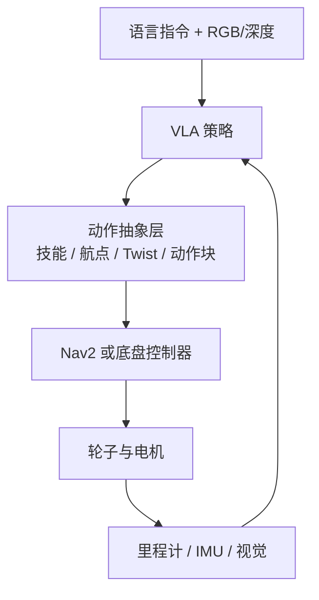

# WHEELTEC ROS1 教程学习笔记

这份笔记只针对 `D:\轮趣\1.WHEELTEC ROS机器人通用资料\5.ROS1系列教程`：73 份 PDF、1069 页。它和 [[WHEELTEC ROS 教程学习报告]] 的分工是：报告负责「全景地图」，这里负责「按学习顺序把每一块跑通」，并在教程没有展开的地方补上底盘、轮胎、ROS2 迁移和 VLA 的延伸知识。

读法建议用三遍：

1. **第一遍只求跑通**：SSH 上车、键盘控制、看里程计、建一张图、导航到一个点。
2. **第二遍画图**：每跑一个功能，用 `rqt_graph` 和 `rqt_tf_tree` 画出节点与 TF，能说清「谁发布、谁订阅、谁提供 TF」。
3. **第三遍改一处**：改一个参数或一行代码，观察行为变化。比如只改 `inflation_radius`，看哪些窄道从「能过」变成「不能过」。

---

## 一、资料地图：先看哪几份

| 目录 | 内容 | 建议 |
| --- | --- | --- |
| `1.ROS基础干货视频教程` | 工作空间、roslaunch、话题、ROS 与 STM32、传感器、rqt、多机、TF、URDF | 先过一遍，配合动手验证 |
| `3.ROS机器人入门使用视频教程` | 虚拟机、车型与传感器设置、编译、里程计/IMU、键盘控制、传感器自检 | 第一次上车必看 |
| `4.ROS机器人应用教程：雷达与2D导航` | 雷达跟随、激光建图、建图算法切换、2D 导航 | 建图导航主线 |
| `5.ROS_SLAM原理与算法详解视频教程` | Costmap、AMCL、全局规划、A*、DWA、TEB | 调参前补原理 |
| `6.ROS机器人应用教程：相机与图像处理` | OpenCV、RGB/深度相机、视觉跟随、巡线、KCF、AR、Web 图传 | 视觉主线 |
| `7.ROS机器人进阶应用教程` | 3D、纯视觉、RRT、APP、编队、Qt、ORB、手柄、Gazebo、全覆盖、毫米波 | 按兴趣选 1—2 个 |
| `9.深度学习教程视频及资料` | Darknet/YOLO、TensorFlow/PyTorch、JetRacer、沙盘 | 想做视觉 AI 再看 |
| `10.ROS1补充资料` | 221 页功能使用与解析、导航机器人搭建、CMake | 当字典查，不要从头啃 |

最值得先读的三份：

- `10.ROS1补充资料/1.WHEELTEC ROS机器人功能使用与解析_2024.11.18.pdf`：官方总手册，覆盖 SSH、多机、键盘、巡线、跟随、建图、导航、3D、纯视觉、语音、KCF、RRT、APP、编队、Web、TensorFlow、AR、手柄、TTS、Qt。
- `7.ROS机器人进阶应用教程/10.gazebo建图导航仿真/gazebo入门教程.pdf`：唯一系统讲 URDF/xacro、joint、gazebo 插件和底盘几何参数的一份。
- `3.ROS机器人入门使用视频教程/4.键盘控制小车移动/键盘控制与小车运动控制实现原理.pdf`：把 `/cmd_vel` → 串口 → STM32 → 电机/舵机讲清楚。

---

## 二、ROS1 基础：六个必须亲手验证的概念

### 2.1 工作空间与功能包

ROS1 的工作空间是 `catkin` 结构：

```text
wheeltec_robot/
  src/
    turn_on_wheeltec_robot/
    wheeltec_robot_rc/
    ...
  build/
  devel/
```

编译与生效：

```bash
cd ~/wheeltec_robot
catkin_make
source devel/setup.bash
```

`package.xml` 声明依赖，`CMakeLists.txt` 声明编译目标。改完 C++ 或 launch 后，至少 `catkin_make` 一次；只改 Python 通常不用编译，但要确认 `source` 的是当前工作空间。

**验证**：`rospack find turn_on_wheeltec_robot` 能输出路径；`roslaunch` 能找到包。

### 2.2 roslaunch 与参数服务器

`roslaunch` 不是简单「启动一个程序」，它同时做三件事：启动节点、加载参数、按条件组合子 launch。

```xml
<launch>
  <arg name="mapping_mode" default="gmapping"/>
  <arg name="navigation" default="false"/>

  <include file="$(find turn_on_wheeltec_robot)/launch/turn_on_wheeltec_robot.launch">
    <arg name="navigation" value="$(arg navigation)"/>
  </include>

  <node pkg="tf" type="static_transform_publisher" name="base_to_laser"
        args="0.12 0 0.18 0 0 0 base_link laser 100"/>
</launch>
```

需要掌握的语法：

| 写法 | 作用 |
| --- | --- |
| `<arg name="x" default="...">` | launch 内部参数，可用 `$(arg x)` 引用 |
| `<param name="..." value="..."/>` | 写到参数服务器 |
| `<rosparam file="..." command="load"/>` | 批量加载 YAML |
| `<include file="$(find pkg)/...">` | 复用子 launch |
| `if="$(eval ...)"` / `unless="$(eval ...)"` | 条件启动 |
| `$(find pkg)` | 包路径 |

**验证**：`rosparam list`、`rosparam get /car_mode`；改一个 `arg` 看节点是否按预期启动。

### 2.3 话题：ROS 里最常用的数据流

```bash
rostopic list
rostopic info /scan
rostopic echo -n 1 /odom
rostopic hz /scan
rostopic pub -1 /cmd_vel geometry_msgs/Twist "{linear: {x: 0.1}, angular: {z: 0}}"
```

要能回答：`/scan` 谁发布、谁订阅？`/odom` 的 `frame_id` 和 `child_frame_id` 是什么？`/cmd_vel` 的单位是 m/s 和 rad/s 吗？

### 2.4 ROS 与 STM32：为什么需要下位机

ROS 主控擅长感知、建图、规划，但不适合直接驱动电机：电机 PWM、编码器计数、IMU 采样、电池电压采集都需要硬实时。WHEELTEC 用 STM32 做下位机，ROS 通过串口发目标速度，STM32 回传里程计、IMU 和电压。

串口协议的关键点：

- 上行 24 字节：帧头 `0x7B`、底盘三轴速度、IMU 六轴、电压、BCC、帧尾 `0x7D`。
- 下行 11 字节：帧头、预留、`vx/vy/wz`、BCC、帧尾。
- 速度先乘 1000 再拆成高低字节，接收端合并后除以 1000。
- 只有麦轮/全向轮能执行 `vy`；差速和阿克曼在 STM32 端忽略 Y 轴。
- 节点退出时会补发一帧零速度，避免小车失控。

**验证**：`rostopic echo /cmd_vel` 有数据；`ls -l /dev/wheeltec_controller` 存在；小车能按键盘前后左右动。

### 2.5 rqt：把系统「看见」

```bash
rosrun rqt_graph rqt_graph       # 节点/话题连接
rosrun rqt_tf_tree rqt_tf_tree   # TF 树
rosrun rqt_plot rqt_plot         # 曲线
rosrun rqt_console rqt_console   # 日志
rosrun rqt_image_view rqt_image_view  # 图像
```

`rqt_graph` 是排查「为什么没数据」的第一工具：先看发布者和订阅者是否真的连上，再看话题名是否拼错。

### 2.6 多机通信：ROS1 的中心化网络

ROS1 依赖 Master。小车当主机时，虚拟机要指向小车的 `ROS_MASTER_URI`，并把 `ROS_HOSTNAME` 设成各自能解析的 IP：

```bash
# 小车端 ~/.bashrc
export ROS_MASTER_URI=http://192.168.0.100:11311
export ROS_HOSTNAME=192.168.0.100

# 虚拟机端 ~/.bashrc
export ROS_MASTER_URI=http://192.168.0.100:11311
export ROS_HOSTNAME=192.168.0.101
```

配套还要：

- 同一网段、能互相 `ping`。
- `~/.bashrc` 改完 `source` 或重开终端。
- 多机编队要时间同步，否则 TF 会报「extrapolation into the future」。
- 文件同步可以用 NFS 或 SSH。

**验证**：虚拟机 `rostopic list` 能看到小车的话题；`rosrun rqt_graph` 能看到跨机节点。

### 2.7 TF：map → odom → base_link

```text
map → odom_combined → base_footprint → base_link → laser / camera / gyro / wheel
```

| 变换 | 谁发布 | 含义 |
| --- | --- | --- |
| `map → odom` | gmapping / cartographer / AMCL | 全局定位修正 |
| `odom → base_footprint` | EKF / 底盘 | 连续里程计 |
| `base_link → 传感器` | URDF 静态 TF | 安装位置 |

检查：

```bash
rosrun tf tf_echo map base_link
rosrun tf view_frames
```

常见错误：`frame_id` 拼错、静态 TF 没启动、多机时间不同步、两个节点同时发布 `map → odom`。

> **通关标准**：不看教程，能画出「键盘 → `/cmd_vel` → STM32 → `/odom` + `/imu` → EKF → TF → RViz」这条链，并指出每一环对应的节点/话题。

---

## 三、第一次上车：从 SSH 到键盘控制

### 3.1 连接与初始化

```bash
ssh -Y wheeltec@192.168.0.100
roslaunch turn_on_wheeltec_robot turn_on_wheeltec_robot.launch
```

另开终端：

```bash
roslaunch wheeltec_robot_rc keyboard_teleop.launch
```

按键通常包括前后左右、加减速和模式切换；麦轮/全向轮按 `B` 进入全向模式后，`j`/`L` 可以横移。全向模式只对麦轮/全向轮有效：阿克曼不能原地转，差速虽能原地转但不能横移。

虚拟机端：

```bash
rviz
```

`Fixed Frame` 选 `odom_combined`，添加 `TF`、`RobotModel`、`LaserScan`。手动搬动小车，模型姿态应跟着变；键盘控制时模型应在地图里移动。

### 3.2 车型参数 `car_mode`

官方用 `car_mode` 一个字符串决定 URDF、TF、底盘参数和功能分支。命名规则：

| 字段 | 含义 |
| --- | --- |
| `mini` / `senior` / `top` / `flagship` | 教育版 / 高配 / 顶配 / 旗舰 |
| `bs` / `dl` | 摆式悬挂 / 独立悬挂 |
| `akm` | 阿克曼 |
| `mec` | 麦轮 |
| `diff` | 差速 |
| `4wd` | 四驱 |
| `tank` | 履带 |
| `omni` | 全向轮 |
| `moveit_six` / `moveit_four` | 六轴 / 四轴机械臂 |

例子：`mini_akm`、`top_akm_bs`、`mini_mec_moveit_six`。实际值以车身白色标签或订单为准，写在 `turn_on_wheeltec_robot.launch` 的 `car_mode` 默认值里。

**为什么不能填错**：它会影响 URDF 调用、轮子/雷达/相机的 TF、代价地图 footprint、局部规划器选择和语音功能分支。填错后常见现象是「模型轮子位置不对」「导航原地转」「阿克曼却尝试横移」。

### 3.3 设备名与 udev

```bash
cd ~/wheeltec_robot/src/turn_on_wheeltec_robot/scripts
sudo chmod +x wheeltec_udev.sh
sudo ./wheeltec_udev.sh
ls -l /dev | grep wheeltec
```

应看到：

| 别名 | 设备 |
| --- | --- |
| `/dev/wheeltec_lidar` | 串口雷达 |
| `/dev/wheeltec_controller` | STM32 |
| `/dev/wheeltec_IMU` | 惯导 |
| `/dev/wheeltec_mic` | 麦克风阵列 |
| `/dev/wheeltec_gnss` | GNSS（部分车型） |

换 USB 口后设备名变了，先重跑 udev，不要急着重装驱动。

### 3.4 传感器自检

```bash
rostopic hz /scan
rostopic echo -n 1 /odom
rostopic echo -n 1 /imu
rostopic echo -n 1 /PowerVoltage
```

- `/scan` 频率应稳定，`ranges` 里有合理距离。
- `/odom` 的 `pose` 和 `twist` 会随推车变化。
- `/imu` 的角速度在转动时变化。
- 电压应在电池标称范围内。

### 3.5 常见起步故障

| 现象 | 先查 | 处理 |
| --- | --- | --- |
| SSH 连不上 | IP、WiFi、网段 | 小车和电脑连同一网络；`ping` |
| `roslaunch` 找不到包 | 工作空间是否 source | `source devel/setup.bash` |
| 小车不动 | `/cmd_vel`、串口别名、电量 | 先 `rostopic echo`，再查 `/dev/wheeltec_controller` |
| 雷达没数据 | udev、供电、波特率 | 重跑 udev；`rostopic hz /scan` |
| 模型歪斜 | IMU 零位 | 按 STM32 复位/用户按键后重建图 |
| RViz 无 TF | 固定坐标系、静态 TF | 选 `odom_combined`；`tf_echo` |

---

## 四、底盘与轮胎：教程没展开、但决定一切的部分

这一节是「附加知识」。官方文档重点讲 `car_mode` 和参数，很少解释轮胎为什么这样选。完整的物理、运动学和 ROS2/VLA 映射放在 [[机器人轮胎与底盘构型]]，这里先给结论。

### 4.1 轮胎在机器人上的五个作用

1. **传递驱动力**：电机扭矩通过轮胎接地点变成推力；摩擦力不够就会打滑。
2. **承载**：车体、电池、雷达、机械臂的重量最终落在轮子上；轮子刚度影响变形和阻力。
3. **缓冲**：橡胶、充气胎、悬挂吸收地面不平；硬轮在瓷砖缝和门槛上容易丢里程计。
4. **提供里程计基准**：编码器测的是轮子转角，乘以有效半径才是距离；轮胎磨损、气压变化都会改变有效半径。
5. **保护地面与降噪**：室内机器人常用 PU/橡胶，避免划伤地板和产生噪音。

### 4.2 五种常见构型

| 构型 | 轮子形态 | 能怎么动 | 典型用途 | ROS 里的影响 |
| --- | --- | --- | --- | --- |
| 差速 | 两个驱动轮 + 万向轮/牛眼轮 | 前进、后退、原地转；不能横移 | 室内通用、成本低 | `Twist` 只用 `linear.x` + `angular.z`；DWA 常用 |
| 四驱/滑移 | 四个固定驱动轮 | 前进、后退、原地转；转向靠左右轮速差 | 重载、粗糙地面 | 转向时轮胎横向刮擦，里程计易漂 |
| 麦轮 | 四个 45° 辊子轮 | 全向：前后、左右、自转、斜行 | 室内窄道、精确对位 | 可用 `linear.y`；对地面和辊子清洁度敏感 |
| 全向轮 | 三个或四个 90° 辊子轮 | 全向，类似麦轮 | 室内科研、全向平台 | 同样可用 `linear.y`；承载和横向力通常弱于麦轮 |
| 阿克曼 | 前轮转向 + 后轮驱动 | 前进、后退、转弯；不能原地转 | 室外、高速、载人/载货 | 有最小转弯半径；规划用 Hybrid-A*，控制用 MPPI/RPP |
| 履带 | 左右两条履带 | 前进、后退、原地转；靠滑移转向 | 楼梯、草地、废墟 | 滑移严重，里程计和定位更依赖 IMU/视觉 |

### 4.3 三个最容易混的几何参数

| 中文 | 通用英文 | 定义 | 用在哪 |
| --- | --- | --- | --- |
| 轮距 | track width / wheel separation | 左右轮中心距 | 差速转向、`diff_drive_controller` 的 `wheel_separation` |
| 轴距 | wheelbase | 前后轴中心距 | 阿克曼转弯半径、`ackermann_steering_controller` 的 `wheelbase` |
| 轮径 | wheel diameter / radius | 轮子直径/半径 | 线速度 ↔ 轮角速度、里程计标定 |

**WHEELTEC 的命名陷阱**：Gazebo 教程里的自定义插件把 `axlebase` 称为「轴距」（前后），把 `wheelbase` 称为「轮距」（左右），和通用英文习惯相反。改参数前一定看注释、量车，不要凭字段名猜。

### 4.4 在 ROS1 里的落点

- **URDF/xacro**：轮子是 `link`，用圆柱几何；驱动轮 joint 用 `continuous`，阿克曼前轮转向用 `revolute`；轮子旋转轴通常是 `0 1 0`。
- **Gazebo**：`<gazebo reference="wheel_link">` 里配 `mu1`、`mu2`、`kp`、`kd`；麦轮还要注意辊子方向。
- **WHEELTEC 插件**：`libgazebo_ros_wheeltec_mec.so` 使用 `axlebase`、`wheelbase`、`wheelDiameter`、`torque`、`max_vel`、`max_turn`。
- **代价地图**：`footprint`/`vertices` 决定车体轮廓，`inflation_radius` 决定安全距离；`min_obstacle_dist` 以车体外侧为基准。
- **规划器**：差速常用 DWA；全向/阿克曼常用 TEB；全覆盖推荐 DWA，不推荐阿克曼。

### 4.5 一分钟选型

| 场景 | 推荐 | 理由 |
| --- | --- | --- |
| 室内平整瓷砖/木地板，预算有限 | 差速 + 橡胶/PU 轮 | 结构简单、控制成熟、成本低 |
| 室内窄道，需要横移/精确对位 | 麦轮 + PU 轮 | 全向运动；但地面要干净 |
| 室内科研，需要全向但负载小 | 全向轮 | 运动灵活；辊子磨损后精度下降 |
| 室外、草地、坡道 | 阿克曼 + 充气/橡胶胎 | 速度快、越障好；不能原地转 |
| 楼梯、废墟、草地 | 履带 | 接地比压低；滑移大、里程计差 |
| 地面有门槛/缝隙 | 大直径轮 + 悬挂 | 通过性好；会抬高重心 |

---

## 五、传感器与数据链路

| 传感器     | 主要话题                                     | 用途             | 检查                  |
| ------- | ---------------------------------------- | -------------- | ------------------- |
| 2D 激光雷达 | `/scan`                                  | 建图、定位、避障       | `rostopic hz /scan` |
| RGB 相机  | `/camera/rgb/image_raw`                  | 巡线、跟随、AR、YOLO  | `rqt_image_view`    |
| 深度相机    | `/camera/depth/image_raw`                | RTAB-Map、纯视觉导航 | 深度图归一化后可视化          |
| IMU     | `/imu` 或 `/mobile_base/sensors/imu_data` | EKF、姿态         | 转动时角速度变化            |
| 电池      | `/PowerVoltage`                          | 电量监控           | 电压在标称范围             |
| 麦克风阵列   | 语音节点内部话题                                 | 语音交互           | 检查音频设备与唤醒           |
| 毫米波雷达   | 厂商自定义话题                                  | 跟随、停障、融合导航     | 看点云/目标话题            |
| 编码器     | 经 STM32 转成 `/odom`                       | 里程计            | 推车看 `pose` 变化       |

### 5.1 静态 TF

雷达、相机、IMU 的安装位置在 `turn_on_wheeltec_robot/launch/robot_model_visualization.launch` 里配置：

- 雷达：`base_to_laser`
- 相机：`base_to_camera`
- IMU：`base_to_gyro`

参数顺序是 `x y z roll pitch yaw parent child period`，单位 m 和 rad。装歪了，地图和点云就会错位。

### 5.2 时间同步

多机时，小车和虚拟机的时间差会导致 TF 插值失败。用 `chrony` 或 `ntpdate` 同步；临时可用 `date -s`，但不建议长期依赖。

### 5.3 数据链路的排查顺序

```text
供电 → 设备节点 → 话题频率 → 数据内容 → TF → 算法
```

先证明「传感器有数据、TF 能连通」，再调算法。否则会在参数里绕很久。

---

## 六、建图：从 gmapping 到 RTAB-Map

### 6.1 2D 建图的标准流程

```bash
# 小车端
roslaunch turn_on_wheeltec_robot mapping.launch

# 虚拟机端
rviz

# 键盘控制建图
roslaunch wheeltec_robot_rc keyboard_teleop.launch

# 建完后保存（必须先保存再退出）
roslaunch turn_on_wheeltec_robot map_saver.launch
```

默认保存到 `turn_on_wheeltec_robot/map/WHEELTEC.yaml` 和 `WHEELTEC.pgm`。也可以自定义：

```bash
rosrun map_server map_saver -f /path/to/my_map
```

`mapping.launch` 已经嵌套了 `turn_on_wheeltec_robot.launch`，所以不需要再单独启动底盘节点。

### 6.2 四种 2D 算法怎么选

`mapping.launch` 里：

```xml
<arg name="mapping_mode" default="gmapping"
     doc="opt: gmapping,hector,cartographer,karto"/>
```

| 算法 | 是否需要里程计 | 回环 | 适用 | 注意 |
| --- | --- | --- | --- | --- |
| gmapping | 需要 | 无 | 中小室内 | 粒子滤波，大场景吃内存；回环处易重影 |
| hector | 不需要 | 无 | 无里程计、手持 | 快速转向易丢；角速度建议 < 0.1 rad/s |
| cartographer | 可选 | 有 | 大场景、回环多 | 会关闭 `robot_pose_ekf`，TF 由 cartographer 发布 |
| karto | 需要 | 有 | 大地图 | 地图刷新慢 |

**cartographer 的特殊点**：`mapping.launch` 会给 `turn_on_wheeltec_robot.launch` 传 `is_cartographer=true`，从而不启动 `robot_pose_ekf`。因为 cartographer 自己发布 `map → odom`，再开 EKF 会抢 TF。切回 gmapping 时要确认 EKF 恢复。

### 6.3 建图质量的经验规则

1. 起点选空旷处，别让障碍物膨胀后把起点包住。
2. 速度慢、角速度更慢；hector 尤其怕快转。
3. 走闭合路线，给 cartographer/karto 回环机会；gmapping 没有回环，别指望自动修正。
4. 建图时不要有人来回走动。
5. 墙体重影说明位姿漂了，重建通常比硬调参数省时间。
6. 建图前如果 RViz 里车身歪斜，按 STM32 复位/用户按键重置 IMU，再重新启动建图。

### 6.4 3D 建图：视觉 + 雷达 + RTAB-Map

```bash
roslaunch turn_on_wheeltec_robot 3d_mapping.launch
```

RViz 里添加 `rtabmap_ros/MapCloud`，话题选 `/rtabmap/mapData`，同时保留 2D 地图图层。RTAB-Map 用 RGB-D 做图 SLAM，输出 3D 点云和 2D 栅格。

关键点：

- `approx_sync=true`：RGB 和深度图时间戳不完全同步时使用。
- `Reg/Strategy=1`：视觉 + ICP。
- `Reg/Force3DoF=true`：约束为平面三自由度。
- `Grid/RangeMin=0.2`：滤掉车体近处点。
- 数据库默认 `~/.ros/rtabmap.db`；不清库会接着旧地图。

### 6.5 纯视觉与 ORB-SLAM2

```bash
roslaunch turn_on_wheeltec_robot pure3d_mapping.launch
roslaunch turn_on_wheeltec_robot pure3d_navigation.launch
```

纯视觉没有激光提供 `map → odom`，launch 里通常用静态 TF 把 `map` 和 `odom_combined` 固定在一起。代价是精度依赖相机和轮式里程计：速度要稳、起点要空旷、光照要均匀。

ORB-SLAM2 是特征点法视觉 SLAM，输出相机轨迹和稀疏点云，不直接给 Nav2 用的栅格地图。要用作导航，通常还要另建栅格图或与激光融合。相机必须先做棋盘格内参标定。

### 6.6 建图实验

| 实验 | 做法 | 验收 |
| --- | --- | --- |
| gmapping 建图 | 20—30 m² 房间，慢速走一圈 | 墙体连续、直角不歪、回环处重影 < 10 cm |
| 算法对比 | 同一段 rosbag 跑 gmapping/cartographer | 记录耗时、内存、墙体厚度 |
| 3D 建图 | 用 RGB-D 相机走一圈 | `/rtabmap/cloud_map` 有点云，2D 栅格可用 |
| 纯视觉 | 空旷房间，慢速 | 轨迹不跳、地图不叠 |

---

## 七、导航：move_base 的每一条数据流

### 7.1 启动与节点

```bash
roslaunch turn_on_wheeltec_robot navigation.launch
```

`navigation.launch` 做了四件事：

1. 启动底盘（`navigation=true`，从而开启局部规划器）。
2. 启动雷达。
3. 用 `map_server` 加载 `map/WHEELTEC.yaml`。
4. 启动 AMCL 和多点导航节点 `send_mark.py`。

RViz 里设置 `2D Pose Estimate` 给初始位姿，再用 `2D Nav Goal` 发目标。

### 7.2 代价地图

| 层 | 数据 | 作用 |
| --- | --- | --- |
| Static | `/map` | 静态墙体 |
| Obstacle | `/scan` | 实时障碍 |
| Inflation | 上述两层 | 按膨胀半径留安全距离 |

关键文件：

```text
turn_on_wheeltec_robot/params_costmap_car/param_<car_mode>/
  costmap_car_params.yaml
  teb_local_planner_params.yaml
turn_on_wheeltec_robot/param_nav_common/
  base_global_planner_params.yaml
```

关键参数：

| 参数 | 作用 | 调整后果 |
| --- | --- | --- |
| `footprint` / `vertices` | 车体轮廓 | 写小了会擦墙，写大了窄道过不去 |
| `inflation_radius` | 膨胀半径 | 太大封窄道，太小贴墙 |
| `min_obstacle_dist` | 局部规划离障碍最小距离 | 以车体外侧为基准；太小易撞 |
| `max_vel_x` | 最大线速度 | 太快建图/定位都容易漂 |
| `max_vel_theta` | 最大角速度 | 太快转弯丢定位 |

注意：膨胀半径小于车身时不起作用，真正生效的是 `footprint`。所以「把膨胀改小就能过窄道」只在车身本身过得去时成立。

### 7.3 AMCL

AMCL 用粒子滤波估计 `map → base_link`：

1. 初始化粒子。
2. 运动更新。
3. 用 `/scan` 和地图算权重。
4. 重采样。

关键参数：`min_particles`、`max_particles`、`update_min_d`、`update_min_a`、`laser_max_range`。初始位姿已知时直接给 `2D Pose Estimate`，比全局搜索快。

### 7.4 全局规划：Dijkstra 还是 A*

默认 `use_dijkstra=true`。改成 A*：

```yaml
use_dijkstra: false
use_grid_path: true
```

文件在 `param_nav_common/base_global_planner_params.yaml`。Dijkstra 稳、A 星快；地图大时 A 星的启发式更明显。

### 7.5 局部规划：TEB 默认，DWA 用于差速

官方源码默认局部规划器是 TEB，适合全向和阿克曼；差速车常用 DWA。切换在 `turn_on_wheeltec_robot.launch` 里注释/取消注释对应的 `include`：

```xml
<!-- TEB：一般用于全向、阿克曼 -->
<include file="$(find turn_on_wheeltec_robot)/launch/include/teb_local_planner.launch"
         if="$(arg navigation)"/>

<!-- DWA：一般用于差速 -->
<!-- <include file="$(find turn_on_wheeltec_robot)/launch/include/dwa_local_planner.launch"
             if="$(arg navigation)"/> -->
```

TEB 关键参数：

| 参数 | 作用 |
| --- | --- |
| `max_vel_x` / `max_vel_theta` | 速度上限 |
| `acc_lim_x` / `acc_lim_theta` | 加速度上限 |
| `min_turning_radius` | 阿克曼最小转弯半径 |
| `weight_kinematics_forward_drive` | 倾向前进 |
| `weight_kinematics_turning_radius` | 转弯半径约束 |
| `weight_obstacle` | 避障权重 |
| `min_obstacle_dist` | 离障碍最小距离 |

DWA 关键参数：`max_vel_x`、`min_vel_x`、`max_vel_theta`、`acc_lim_x`、`acc_lim_theta`、`sim_time`、`vx_samples`、`vth_samples`、`path_distance_bias`、`goal_distance_bias`、`occdist_scale`。

### 7.6 多点导航与恢复行为

`send_mark.py` 负责多点导航：在 RViz 用 `Publish Point` 依次点目标，小车按顺序走。默认每个点的朝向是建图起点车头方向；要改朝向，参考官方论坛帖子或直接发 `move_base_msgs/MoveBaseActionGoal`。

恢复行为包括：

- 清理代价地图。
- 原地旋转找路。
- 后退。
- 放弃当前目标。

如果小车在目标附近反复调整，先看 `xy_goal_tolerance` 和 `yaw_goal_tolerance`，再看局部规划器是否被障碍物膨胀卡住。

### 7.7 进阶导航功能

| 功能 | 入口 | 要点 |
| --- | --- | --- |
| RRT 自主建图 | `roslaunch turn_on_wheeltec_robot rrt_slam.launch` | 四个边界点顺时针/逆时针围成区域，第五个点作起点；连续 20 s 静止后保存并返回 |
| 全覆盖 | `roslaunch ipa_room_exploration ipa_room_exploration.launch` | 先建图；切 DWA；不推荐阿克曼 |
| 多机编队 | `roslaunch wheeltec_multi navigation.launch` + `wheeltec_slave.launch` | 主从机各自 Master；UDP 广播；队形改 `slave_x/slave_y` |
| 毫米波融合 | 对应 launch | 用于停障/跟随；注意雷达与毫米波的坐标系 |
| 3D 导航 | `3d_navigation.launch` | RTAB-Map 定位 + move_base |
| 纯视觉导航 | `pure3d_navigation.launch` | 深度图转伪 `/scan`；近处 < 0.6 m 不可靠 |

### 7.8 导航实验

| 实验 | 做法 | 验收 |
| --- | --- | --- |
| 单点导航 | 给一个 5 m 外的目标 | 能到、不撞、不长期原地转 |
| 窄道 | 找一条比车宽 10—20 cm 的通道 | 调 `inflation_radius` 后能过 |
| 动态障碍 | 中途放一个箱子 | 局部规划能绕或停 |
| 定位恢复 | 把车抱到别处，再给初始位姿 | AMCL 能重新收敛 |
| 多点 | 点 4 个点 | 按顺序走完 |

---

## 八、视觉：OpenCV、巡线、KCF、AR

### 8.1 图像链路

```text
相机驱动 → /camera/.../image_raw → cv_bridge → cv::Mat → OpenCV → 控制量/识别结果
```

`cv_bridge` 的编码要匹配：`bgr8`、`rgb8`、`mono8`、`32FC1`（深度，单位米）。

### 8.2 颜色巡线

1. 订阅 RGB 图像。
2. BGR → HSV。
3. `inRange` 阈值分割。
4. `erode`/`dilate` 去噪。
5. `findContours` 找最大轮廓。
6. `moments` 求质心。
7. 质心与画面中心的偏差 → PID → `angular.z`。

线条建议 ≥ 2 cm，背景颜色要拉开，避免反光。

### 8.3 视觉跟随与 KCF

- 颜色跟随：HSV 阈值 + 轮廓质心，简单但怕光照。
- KCF：框选目标，核相关滤波跟踪；短时遮挡可恢复，长时遮挡会丢。
- 控制：目标框中心偏差 → `angular.z`；框面积/高度 → 距离 → `linear.x`。

### 8.4 AR 标签与 Web 图传

- `ar_track_alvar` / `aruco_ros` 识别二维码，能给 6D 位姿，适合精确停靠。
- `web_video_server` 把图像转成网页视频，默认端口 8080，浏览器访问 `http://<小车IP>:8080`。

### 8.5 视觉实验

| 实验 | 做法 | 验收 |
| --- | --- | --- |
| 巡线 | 贴一条 3 cm 黑线 | 能连续跟，丢线能停 |
| 颜色跟随 | 红色方块 | 目标移动时能跟，遮挡后能恢复 |
| KCF | 框选任意物体 | 短时遮挡不丢 |
| AR 停靠 | 贴 AR 标签 | 能测距并停在标签前 |

---

## 九、进阶功能地图

| 功能 | 入口/文档 | 观察什么 |
| --- | --- | --- |
| 视觉 + 雷达 3D | `3d_mapping.launch` / `3d_navigation.launch` | 点云与栅格是否对齐 |
| 纯视觉 | `pure3d_mapping.launch` / `pure3d_navigation.launch` | 深度图转伪雷达的效果 |
| RRT | `rrt_slam.launch` | 边界点、随机树、20 s 静止判定 |
| 全覆盖 | `ipa_room_exploration.launch` | 房间分割、覆盖路径、重复率 |
| 多机编队 | `wheeltec_multi` | 队形误差、UDP 丢包、从车避障 |
| APP | WHEELTEC APP | 图传、建图、导航 |
| Qt | `ROS_QT` | 按钮控制、状态显示 |
| 手柄 | `joy` + `teleop_twist_joy` | 轴映射、死区 |
| Gazebo | `wheeltec_description` / `wheeltec_world_gazebo.launch` | URDF、TF、摩擦、插件 |
| TensorFlow | `ros_tensorflow` | 检测框、延迟 |
| AR | `ar_track_alvar` | 标签位姿、测距 |
| TTS | 语音功能包 | 文本转音频 |
| Autoware 沙盘 | `sand_table auto_driver.launch.xml` | 车道线、纯跟踪 |

> ROS1 系列里没有自动回充和 RTK-GNSS 的完整章节，这两项主要在 ROS2 系列；不要在这套资料里找错。

---

## 十、ROS1 → ROS2：迁移对照

| ROS1 | ROS2 | 备注 |
| --- | --- | --- |
| `roscore` / Master | DDS，无中心 | 多机用 `ROS_DOMAIN_ID` |
| `catkin_make` | `colcon build` | `src/build/install/log` |
| XML `.launch` | Python `.launch.py` | `Node`、`IncludeLaunchDescription` |
| `rospy` / `roscpp` | `rclpy` / `rclcpp` | 参数要 `declare_parameter` |
| `move_base` | Nav2 | 生命周期节点 + 行为树 + Action |
| `costmap_2d` | `nav2_costmap_2d` | 参数在 `nav2_params.yaml` |
| `amcl` | `nav2_amcl` | `robot_model_type` 要匹配底盘 |
| `robot_pose_ekf` | `robot_localization` | `ekf_node` |
| `map_server` | `nav2_map_server` | 同样 `.yaml/.pgm` |
| DWA/TEB | DWB/MPPI/RPP | 按车型选 |
| `rosrun rqt_graph` | `ros2 run rqt_graph rqt_graph` | 类似 |

### 10.1 轮子在 ROS2 里的落点

- **URDF/xacro**：轮子 `link` + `continuous` joint；阿克曼前轮 `revolute`；传感器 `fixed`。
- **ros2_control**：硬件接口暴露轮子的 `velocity` 命令和 `position/velocity` 状态。
- **控制器**：
  - 差速：`diff_drive_controller/DiffDriveController`，参数 `wheel_separation`、`wheel_radius`、左右轮 joint 名。
  - 阿克曼：`ackermann_steering_controller/AckermannSteeringController`，参数 `wheelbase`、`track_width`、`wheel_radius`、转向/驱动 joint。
  - 麦轮/全向：不是所有发行版都有稳定的官方控制器；常见做法是自定义 `ros2_control` 控制器，或由底盘节点直接订阅 `/cmd_vel`。用之前先查当前发行版的 `ros2_controllers`。
- **Nav2**：`footprint`、`inflation_radius`、`robot_model_type`、局部控制器选择都要跟构型匹配。
- **Gazebo**：`mu1`/`mu2` 摩擦、`fdir1` 方向、joint damping/friction。

### 10.2 最小验证

```bash
ros2 launch turn_on_wheeltec_robot turn_on_wheeltec_robot.launch.py
ros2 topic echo /odom
ros2 run tf2_ros tf2_echo odom base_link
ros2 control list_controllers
```

如果 `odom` 有数据但 TF 不动，先查 `enable_odom_tf` 和 EKF 是否同时发布 `odom → base_link`。

---

## 十一、ROS2 → VLA：轮子在哪里出现

VLA（Vision-Language-Action）可以粗略理解为「看图 + 听指令 → 输出动作」的策略模型。它不直接替代 SLAM/Nav2，而是坐在它们上面，负责语义理解和任务决策。



### 11.1 四种动作表示

| 表示 | 例子 | 优点 | 缺点 |
| --- | --- | --- | --- |
| 离散技能 | 「前进」「左转」「停止」 | 稳、易接 ROS，安全 | 表达粗，难做精细操作 |
| 航点/目标位姿 | `PoseStamped` | 复用 Nav2 规划避障 | 依赖地图和定位 |
| 车体速度 | `Twist` | 直接、连续 | 需要安全层和限幅 |
| 轮速/关节轨迹 | 左右轮角速度 | 最底层、最精确 | 与车型强绑定，难迁移 |

### 11.2 轮胎/构型对 VLA 的影响

- **动作维度**：差速只有 `(v, ω)`；麦轮/全向多一个 `vy`；阿克曼多一个转向角约束，且不能原地转。
- **运动学约束**：VLA 输出「左转 90°」时，阿克曼需要一段前进弧线，差速可以原地转。
- **里程计可靠性**：麦轮打滑、履带滑移会让 `odom` 漂，VLA 依赖的定位会偏；需要 SLAM/视觉修正。
- **sim-to-real**：轮胎摩擦、轮径、负载、地面材质都会改变动力学；训练时要随机化 `mu`、轮径、延迟，部署前要标定。
- **语言 grounding**：VLA 能理解「在草地上慢一点」，但它不知道轮胎材质；轮胎是 embodiment，不是语义 token。

### 11.3 WHEELTEC 上的落地方式

现有 AI 多模态功能是「ASR → LLM/RAG → 动作函数 → ROS 话题」，还不是端到端 VLA。要往 VLA 走，可以分三层：

1. **语义层**：VLA/LLM 把「去水果店」变成技能或航点。
2. **技能层**：调用 Nav2、跟随、巡线等现成功能。
3. **安全层**：速度限幅、碰撞检测、急停、超时。

不要让 VLA 直接输出 PWM。轮子层仍然由底盘控制器和 STM32 保证实时性与安全。

更完整的轮胎物理、运动学和 ROS2 控制器参数见 [[机器人轮胎与底盘构型]]。

---

## 十二、实验清单、排障与四周计划

### 12.1 十个实验

| # | 实验 | 验收 |
| --- | --- | --- |
| 1 | SSH + bringup | `rostopic list` 有底盘/雷达话题 |
| 2 | 键盘控制 + RViz | 模型随车动，TF 正常 |
| 3 | 推车看里程计 | `/odom` 位置/姿态变化合理 |
| 4 | gmapping 建图 | 地图闭合、墙不重影 |
| 5 | 保存/加载地图 | 重启后能加载并定位 |
| 6 | 单点导航 | 5 m 目标能到、不撞 |
| 7 | 窄道调参 | 改 `inflation_radius` 前后对比 |
| 8 | 视觉巡线 | 连续跟线，丢线能停 |
| 9 | KCF/AR | 短时遮挡可恢复；AR 能测距 |
| 10 | RRT 或全覆盖 | 能自主探索/覆盖并保存地图 |

### 12.2 排障表

| 现象 | 优先检查 | 常见原因 |
| --- | --- | --- |
| 小车不动 | `/cmd_vel`、串口别名、电量 | 多机没连、udev 失效、车型 Y 轴无效 |
| 雷达没数据 | `/dev/wheeltec_lidar`、`rostopic hz` | 别名错、波特率错、供电不足 |
| 相机没图像 | 设备号、分辨率 | USB 带宽不足、驱动未启动 |
| 地图重影 | 建图速度、IMU、轮径 | 转太快、雷达抖动、轮径参数错 |
| 导航原地转 | 局部规划器、膨胀、TF | 目标在障碍内、定位跳变 |
| 贴墙/撞墙 | `inflation_radius`、`footprint` | 膨胀太小、轮廓写小、雷达盲区 |
| 多点只走一个 | `send_mark.py`、目标队列 | 到达判定失败、话题没发 |
| RRT 不启动 | 四个边界点 | 没围成闭合区域、顺序不对 |
| 编队从车不动 | `/multfodom`、网段 | UDP 被挡、IP 不同网段 |
| TF 报错 | `tf_echo`、时间同步 | 静态 TF 没发、多机时间不同步 |

### 12.3 四周计划

| 周 | 目标 | 任务 |
| --- | --- | --- |
| 第 1 周 | 上车与基础 | SSH、bringup、键盘、RViz、TF、rqt |
| 第 2 周 | 建图 | gmapping、保存/加载、算法对比、3D 建图 |
| 第 3 周 | 导航 | AMCL、costmap、TEB/DWA、多点、窄道调参 |
| 第 4 周 | 选一个方向 | 视觉巡线/跟随、RRT、全覆盖、编队或深度学习 |

如果只做一件事：把「建图 → 保存 → 加载 → 定位 → 导航」这条闭环重复三遍，直到每一步的节点、话题、TF 都能不看文档说出来。

---

## 相关

- [[WHEELTEC ROS 教程学习报告]]
- [[机器人轮胎与底盘构型]]
- [[ROS Index]]
- [[ROS 基础与架构]]
- [[TF 与 URDF]]
- [[SLAM 与导航]]
- [[路径规划算法]]
- [[ROS 2 通信机制]]
- [[ROS 2 常用命令与调试]]
- [[VLA 与机器人 AI]]
- [[机器人系统调试与工程实践]]
