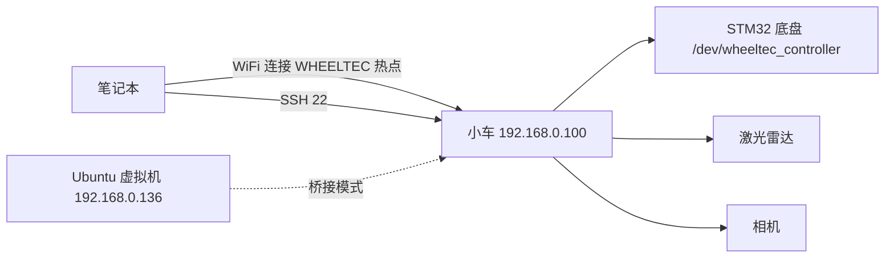

# WHEELTEC 小车上手与调试指南

拿到笔记本和小车后，最短路径是：**给小车通电 → 等热点 → 笔记本连热点 → ping / SSH → 启动底盘 → 键盘控制 → 看传感器数据 → 出问题按层排查**。这篇把官方 ROS1/ROS2 教程里的上手步骤和实际排障顺序合并成一份现场手册；命令同时给出两个版本，先确认自己是哪一套再照抄。

## 0. 十分钟上手清单

- [ ] 电池充满、装好，急停松开，周围留出 1 m 空间
- [ ] 小车开机，等 1–3 分钟，能看到 `WHEELTEC...` 热点
- [ ] 笔记本连该热点，密码 `dongguan`
- [ ] `ping 192.168.0.100` 通
- [ ] `ssh -Y wheeltec@192.168.0.100` 能登录
- [ ] 启动底盘，`/odom` 有数据
- [ ] 键盘控制，轮子先离地试方向
- [ ] 雷达、相机分别启动，rviz / rqt 能看到数据

## 1. 先认清这套系统

| 角色 | 默认值 | 说明 |
| --- | --- | --- |
| 小车（ROS 主机） | `192.168.0.100` | 开机默认发热点，SSH 用户 `wheeltec` |
| 小车热点 | SSID 含 `WHEELTEC`，密码 `dongguan` | 官方 ROS2 教程明确给出的默认值 |
| ROS1 工作空间 | `/home/wheeltec/wheeltec_robot` | ROS1 镜像 / 教程 |
| ROS2 工作空间 | `/home/wheeltec/wheeltec_ros2` | ROS2 Humble 镜像 |
| 虚拟机（可选从机） | `192.168.0.136` | 官方虚拟机镜像默认静态 IP |
| SSH / VNC 密码 | 以随车资料为准；热点与 VNC 默认 `dongguan` | 首次登录后建议自己改掉 |

先确认 ROS 版本，别把 ROS1 和 ROS2 的命令混用：

```bash
ls ~                          # 看是 wheeltec_robot 还是 wheeltec_ros2
printenv ROS_DISTRO           # melodic / noetic / humble / ...
ros2 --version                # 有输出就是 ROS2
rosversion -d                 # 有输出就是 ROS1
```

连接拓扑：



## 2. 连接小车热点

### 2.1 笔记本直接连（最快验证）

1. 小车开机，等待热点出现。
2. 笔记本连接 SSID 含 `WHEELTEC` 的热点，密码 `dongguan`。
   - Windows 提示「无 Internet，是否保持连接」时，选**保持连接**。
3. 确认笔记本拿到了同网段地址：

   ```powershell
   ipconfig        # Windows，看 WLAN 适配器
   ip addr         # Ubuntu
   ```

   应该是 `192.168.0.x`。
4. 测试连通：

   ```bash
   ping 192.168.0.100
   ```

5. 登录小车：

   ```bash
   ssh wheeltec@192.168.0.100
   # 需要转发图形界面时
   ssh -Y wheeltec@192.168.0.100
   ```

   `-Y` 要求本机有 X server。Windows 自带 OpenSSH 能连，但默认没有 X server，所以纯命令行用普通 `ssh` 即可；要跑 rviz 还是进 Ubuntu 虚拟机。

6. 首次登录输入 `yes` 接受指纹。如果换过主控或重刷过镜像，提示 host key 冲突：

   ```bash
   ssh-keygen -R 192.168.0.100
   ```

Windows 上的两个坑：

- 同时连着宿舍路由、手机热点时，`192.168.0.0/24` 可能冲突，或者流量走错网卡。先把其他网络断开。
- 不要用手机热点中转，多一层 NAT，ROS 发现和 SSH 都更容易出问题。

### 2.2 官方路线：VMware + Ubuntu 虚拟机

官方教程默认用虚拟机，原因是 rviz、rqt 这些图形工具在 Ubuntu 里最省事，ROS1 的多机通信配置也现成。

1. 笔记本先连上小车热点。
2. VMware → 编辑 → 虚拟网络编辑器 → `VMnet0` → 桥接模式。
3. 「已桥接至」选择**连着小车热点的无线网卡**，不要选「自动」，也不要选以太网。
4. 虚拟机设置 → 网络适配器 → 桥接模式。
5. 虚拟机内 `ip addr` 确认地址；官方镜像默认静态 `192.168.0.136`。
6. `ping 192.168.0.100` 验证。
7. ROS1 还要把虚拟机配成从机，编辑 `~/.bashrc`：

   ```bash
   export ROS_MASTER_URI=http://192.168.0.100:11311
   export ROS_HOSTNAME=192.168.0.136
   ```

   然后 `source ~/.bashrc`，并新开终端。ROS2 不需要 master，同一网段、同一 `ROS_DOMAIN_ID` 即可。

8. 想要完整桌面，可在虚拟机里用 Remmina 连 VNC：地址 `192.168.0.100`，密码默认 `dongguan`。

**WSL2 提醒**：WSL2 默认 NAT 模式访问不到 `192.168.0.100`。Win11 22H2 以上可以在 `.wslconfig` 里设 `networkingMode=mirrored`，但 DDS 多播仍可能不稳。要跑图形界面，优先 VMware 桥接；只跑命令，Windows 自带 `ssh` 就够。

### 2.3 让小车连外部 WiFi（可选）

默认模式是小车自己发热点。如果想让小车和笔记本都连实验室/宿舍路由：

1. 给小车接显示器、键鼠。
2. 点右上角 WiFi 图标 → `Disconnect`，停止发热点。
3. 再点 WiFi 图标，选择目标 WiFi，输入密码。
4. 无桌面时可用命令行：

   ```bash
   nmcli device wifi list
   nmcli device wifi connect "SSID" password "密码"
   ```

5. 连接优先级数字越大越优先。想让小车开机自动连路由而不是发热点，就把该连接的优先级调高。
6. 换网后 IP 会变：`ip addr` 查新地址，并同步修改 `.bashrc` 里的 `ROS_MASTER_URI` / `ROS_HOSTNAME`。建议在路由器里做 DHCP 静态绑定，避免每次重连都改配置。

### 2.4 连通性验证顺序

```bash
# 笔记本
ping -c 4 192.168.0.100
ssh -v wheeltec@192.168.0.100

# 小车上
ip addr
hostname -I
```

ping 通但 ROS 里看不到节点/话题，说明不是网络层问题，直接跳到第 5.2 节。

## 3. 登录后先做的五件事

```bash
pwd
ls ~
printenv ROS_DISTRO
df -h
free -h
tail -30 ~/.bashrc
```

- 确认工作空间：`~/wheeltec_robot`（ROS1）或 `~/wheeltec_ros2`（ROS2）。
- 确认磁盘和内存：bag、日志、编译产物很容易把磁盘写满。
- 确认时间：ROS2 编译和 TF 对时间敏感。时间不对先校准；有网用 `sudo ntpdate` 或 chrony，没网手动 `sudo date -s "2026-11-04 10:00:00"`。
- 知道密码的话，尽早 `passwd` 改掉默认密码。

### 改代码的两种方式

**方式一：VS Code Remote-SSH（推荐）**

本机 VS Code 安装 `Remote - SSH`，连接 `wheeltec@192.168.0.100`，直接打开 `~/wheeltec_ros2`。编辑、搜索、终端都在远程，不用来回拷文件。

**方式二：NFS 挂载（官方教程）**

```bash
sudo mkdir -p /mnt/wheeltec
sudo mount -t nfs 192.168.0.100:/home/wheeltec/wheeltec_ros2/ /mnt/wheeltec
```

ROS1 把路径换成 `/home/wheeltec/wheeltec_robot`。挂载后在本机编辑 `/mnt/wheeltec`，等于直接改小车上的文件。

单文件临时同步也可以用 `scp` / `rsync`。

## 4. 启动底盘、控制与看数据

### 4.1 ROS2

终端 1，启动底盘：

```bash
ssh -Y wheeltec@192.168.0.100
ros2 launch turn_on_wheeltec_robot turn_on_wheeltec_robot.launch.py
```

终端 2，键盘控制：

```bash
ssh -Y wheeltec@192.168.0.100
ros2 run wheeltec_robot_keyboard wheeltec_keyboard
```

| 按键 | 作用 |
| --- | --- |
| `i` / `,` | 前进 / 后退 |
| `j` / `l` | 左转 / 右转（全向模式下变成左右平移） |
| `k` | 停车，发布 0 速度 |
| `q` / `z` | 线速度、角速度同时 ×1.1 / ×0.9 |
| `w` / `x` | 只调线速度 ×1.1 / ×0.9 |
| `e` / `c` | 只调角速度 ×1.1 / ×0.9 |
| `b` | 常规模式 / 全向模式切换 |

阿克曼车型不能直接左右平移；四驱、阿克曼切到全向模式后 `j` / `l` 也无效。

看数据：

```bash
ros2 topic list
ros2 topic echo /odom
ros2 topic echo /imu/data_raw
ros2 topic hz /scan
```

外设单独自检：

```bash
ros2 launch turn_on_wheeltec_robot wheeltec_lidar.launch.py
ros2 launch turn_on_wheeltec_robot wheeltec_camera.launch.py
rqt_image_view
```

车型、雷达、相机型号在：

```text
~/wheeltec_ros2/src/turn_on_wheeltec_robot/config/wheeltec_params.yaml
```

改这个 YAML 后，官方镜像默认**不需要重新编译**即可生效；如果你不是用 `--symlink-install` 编译的，改任何文件都要重新编译：

```bash
cd ~/wheeltec_ros2
colcon build --symlink-install
source install/setup.bash
```

编译前先同步系统时间。指定包编译用：

```bash
colcon build --symlink-install --packages-select 包名
```

### 4.2 ROS1

```bash
roslaunch turn_on_wheeltec_robot turn_on_wheeltec_robot.launch
roslaunch wheeltec_robot_rc keyboard_teleop.launch

rostopic list
rostopic echo /odom

roslaunch turn_on_wheeltec_robot wheeltec_lidar.launch
roslaunch turn_on_wheeltec_robot wheeltec_camera.launch
rviz
```

ROS1 的键盘控制键位是 `u i o / j k l / m , .`，麦轮/全向轮按 `b` 后可横向移动。车型在 `turn_on_wheeltec_robot.launch` 里选，不是 YAML。

### 4.3 第一次动起来的安全顺序

1. 轮子离地或架空。
2. 低速，手放在急停附近。
3. 先确认前进、后退、左转方向都对。
4. 再落地，小范围低速。
5. 最后才跑建图、导航、视觉跟随。

## 5. 调试：按层排查

核心原则：**从下往上**。先证明网络通，再证明 ROS 有数据，最后才怀疑算法。

### 5.1 网络层

```powershell
ipconfig /all          # Windows
ip addr                # Ubuntu
ping 192.168.0.100
ssh -v wheeltec@192.168.0.100
```

依次检查：

- 笔记本是不是还连着小车热点，而不是宿舍 WiFi。
- 无线网卡有没有拿到 `192.168.0.x`。
- 是否同时连着另一个 `192.168.0.0/24` 的网络。
- 虚拟机是否桥接到正确的无线网卡，而不是「自动」或以太网。
- 防火墙、杀毒软件是否拦截了 SSH / DDS。
- 小车是否真的开机：风扇、指示灯、热点是否出现。

### 5.2 ROS 层

ROS2：

```bash
ros2 node list
ros2 topic list -t
ros2 topic info /scan
ros2 topic echo /scan --once
ros2 topic hz /scan
ros2 doctor --report
echo $ROS_DOMAIN_ID
```

`ros2 topic list` 结果异常时，重启 daemon：

```bash
ros2 daemon stop
ros2 daemon start
```

ROS1：

```bash
rosnode list
rostopic list
rostopic info /scan
rostopic echo /scan
rqt_graph
roswtf
```

TF 检查：

```bash
# ROS2
ros2 run tf2_tools view_frames
ros2 run tf2_ros tf2_echo odom base_link

# ROS1
rosrun tf view_frames
rosrun tf tf_echo odom base_link
```

常见原因：

- 话题存在但没有发布者 → 上游节点没启动或已崩溃。
- 有发布者但收不到 → QoS 不匹配、`ROS_DOMAIN_ID` 不同、防火墙、AP 客户端隔离。
- ROS1 多机 → `.bashrc` 里的 `ROS_MASTER_URI` / `ROS_HOSTNAME` 写错，或虚拟机不是桥接。

### 5.3 底盘 / 串口层

```bash
ls -l /dev/wheeltec_controller
ls -l /dev/ttyUSB* /dev/ttyACM*
dmesg | tail -30
groups
```

- **设备不存在**：查 USB / 串口线、供电、驱动；`dmesg` 看有没有枚举到。
- **Permission denied**：把用户加入 `dialout`：

  ```bash
  sudo usermod -aG dialout $USER
  ```

  然后重新登录。
- **波特率参数**：ROS2 驱动要求 launch 必须传 `serial_baud_rate`，缺了串口打不开。可查：

  ```bash
  ros2 param get /wheeltec_robot serial_baud_rate
  ```

- **`/odom` 不动**：手推小车，看数值变不变；不变就查串口和下位机。
- **`/cmd_vel` 有数据但车不动**：查驱动是否订阅、急停、电池、电机使能。
- **IMU 零偏**：按官方教程，双击 STM32 控制板的用户按键做姿态零偏纠正。
- **看日志**：`~/.ros/log/latest/`，先看第一条错误，别被后面的连锁错误带偏。

### 5.4 传感器层

**雷达**

```bash
ros2 topic hz /scan      # ROS1: rostopic hz /scan
```

rviz 里加 LaserScan，话题以 `ros2 topic list` 为准。无数据时查型号配置、网口/USB、供电、`dmesg`。

**相机**

```bash
rqt_image_view
v4l2-ctl --list-devices
```

话题名以实际为准，常见 `rgb` / `color` / `depth`。掉帧优先查 USB 带宽和分辨率。

**语音（可选）**

离线资源验证失败时，官方快速测试会临时把系统时间改到过去来跳过验证；正式使用要按教程更新讯飞离线资源，不要长期靠改时间。

### 5.5 常见症状速查表

| 症状 | 最可能的原因 | 先做什么 |
| --- | --- | --- |
| 搜不到小车热点 | 没开机 / 热点没起来 / 主控还在启动 | 等 1–3 分钟，看指示灯，重启小车 |
| 连上热点但 ping 不通 | 笔记本不在同网段 / 虚拟机 NAT / 连错网卡 | `ipconfig`、改桥接、断开其他网络 |
| SSH 报 host key 冲突 | 换过主控或重刷镜像 | `ssh-keygen -R 192.168.0.100` |
| SSH 能登，rviz 打不开 | 没加 `-Y` 或本机没有 X server | 进 Ubuntu 虚拟机，或配 X server |
| ROS2 看不到话题 | domain id 不同 / QoS 不匹配 / 网络隔离 | `ros2 doctor`、`echo $ROS_DOMAIN_ID` |
| ROS1 看得到 master 但收不到数据 | `.bashrc` 的 IP 配错 / 未 source | 改 `ROS_MASTER_URI`、`ROS_HOSTNAME`，新开终端 |
| 键盘控制无反应 | 终端焦点不在 / 底盘没启动 | 点一下终端，确认 `/cmd_vel` 有输出 |
| 车不动 | `cmd_vel` 为 0 / 急停 / 电池 / 串口 | `topic echo /cmd_vel`，查电池和 `dmesg` |
| 雷达无数据 | 型号配置错 / 接口松动 / 供电 | 查 `wheeltec_params.yaml`、`lsusb`、`dmesg` |
| 相机无图 | 设备号变 / 话题名不对 / 带宽不足 | `v4l2-ctl --list-devices`、`rqt_image_view` |
| colcon 编译失败 | 没 source / 时间不同步 / 缺依赖 | 先校时，看第一条错误，`rosdep install` |
| 里程计越走越偏 | 轮径/轮距参数错 / 打滑 / IMU 零偏 | 核对底盘参数，重做 IMU 零偏，低速验证 |

## 6. 日常与安全

- **开机顺序**：小车 → 等热点 → 笔记本连热点 → SSH。
- **关机**：`sudo shutdown -h now`，等指示灯灭再断电，不要直接拔电池。
- **电池**：低电时经常先表现为 WiFi 掉线、里程计漂、电机无力，不要低电跑导航。
- **急停**：第一次测试前先找到急停位置；轮子离地验证方向。
- **备份**：工作空间进 Git，或定期 `rsync` 回笔记本。不要只把代码留在一台车上。
- **改密码**：默认密码是公开的，连过实验室网络后更要改。
- **实验记录**：日期、改了什么、现象、结论。排障时这份记录比记忆可靠。

## 7. 命令速查卡

```bash
# 连接与登录
ping 192.168.0.100
ssh wheeltec@192.168.0.100
ssh -Y wheeltec@192.168.0.100
ssh-keygen -R 192.168.0.100

# ROS2 启动
ros2 launch turn_on_wheeltec_robot turn_on_wheeltec_robot.launch.py
ros2 run wheeltec_robot_keyboard wheeltec_keyboard
ros2 launch turn_on_wheeltec_robot wheeltec_lidar.launch.py
ros2 launch turn_on_wheeltec_robot wheeltec_camera.launch.py

# ROS2 排查
ros2 node list
ros2 topic list -t
ros2 topic echo /odom
ros2 topic hz /scan
ros2 doctor --report
ros2 run tf2_tools view_frames

# ROS1 启动
roslaunch turn_on_wheeltec_robot turn_on_wheeltec_robot.launch
roslaunch wheeltec_robot_rc keyboard_teleop.launch
roslaunch turn_on_wheeltec_robot wheeltec_lidar.launch
roslaunch turn_on_wheeltec_robot wheeltec_camera.launch

# ROS1 排查
rosnode list
rostopic list
rostopic echo /odom
rqt_graph
roswtf

# 底盘与编译
ls -l /dev/wheeltec_controller
dmesg | tail -30
cd ~/wheeltec_ros2 && colcon build --symlink-install
source ~/wheeltec_ros2/install/setup.bash

# 文件与关机
sudo mount -t nfs 192.168.0.100:/home/wheeltec/wheeltec_ros2/ /mnt/wheeltec
sudo shutdown -h now
```

## 来源

- ROS2 上手：`D:\轮趣\1.WHEELTEC ROS机器人通用资料\6.ROS2系列教程\2.ROS2机器人应用视频教程：上手使用、雷达与2D导航\1.ROS2小车上手操作`
- ROS1 上手与故障排查：`D:\轮趣\1.WHEELTEC ROS机器人通用资料\5.ROS1系列教程\3.ROS机器人入门使用视频教程\1.快速搭建ROS虚拟机环境与常见故障排查`
- WiFi、VNC、多机通信：`D:\轮趣\1.WHEELTEC ROS机器人通用资料\5.ROS1系列教程\10.ROS1补充资料\1.WHEELTEC ROS机器人功能使用与解析`

## 相关

- [[WHEELTEC ROS 教程学习报告]]
- [[WHEELTEC ROS1 教程学习笔记]]
- [[ROS 2 常用命令与调试]]
- [[机器人系统调试与工程实践]]
- [[ROS 2 底盘串口驱动代码解析]]
- [[ROS 2 里程计与 IMU 代码解析]]
- [[ROS 2 Launch 文件代码解析]]
- [[ROS Index]]
