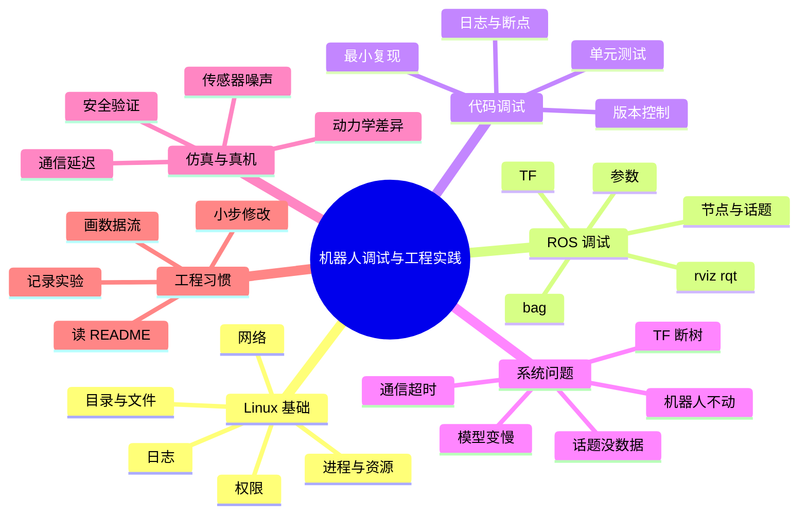

# 机器人系统调试与工程实践

机器人调试和纯软件调试不一样：代码只是其中一层，下面还有传感器、驱动、通信、电源、机械结构。一个「机器人不动」可能是代码 bug，也可能是急停没松、电池没电、CAN 线松了。这一篇整理一套从软件到硬件的排查顺序，以及接手陌生项目时怎么开始。

## 知识体系思维导图



## 1. Linux 常用命令

| 命令                 | 作用        |
| ------------------ | --------- |
| `pwd`              | 当前目录      |
| `ls -la`           | 文件和隐藏文件   |
| `cd`               | 切换目录      |
| `mkdir`            | 建目录       |
| `cp` / `mv` / `rm` | 复制、移动、删除  |
| `grep -r`          | 递归搜索文本    |
| `find`             | 按条件找文件    |
| `ps aux`           | 查看进程      |
| `top` / `htop`     | 查看 CPU、内存 |
| `kill PID`         | 结束进程      |
| `chmod`            | 修改权限      |
| `tail -f log.txt`  | 持续看日志     |
| `df -h`            | 磁盘空间      |
| `free -h`          | 内存        |
| `ip addr`          | 网络接口      |
| `ping`             | 网络连通性     |
| git status`        | 工作区状态     |

这些命令不需要背全，但要知道遇到问题该用哪个。比如「磁盘满了」用 `df -h`，「进程卡死」用 `ps aux` 和 `kill`，「日志刷屏」用 `tail -f`。

## 2. 进程、线程与资源

- **进程**：独立地址空间，独立资源。一个 ROS 节点通常是一个进程。
- **线程**：进程内的执行单元，共享内存。多线程要注意数据竞争。
- **CPU**：算力是否吃满，是否有单核 100%。
- **内存**：是否泄漏，是否被图像/点云占满。
- **GPU**：显存、利用率、温度、功耗。
- **磁盘**：bag 和日志很容易把磁盘写满。
- **网络**：多机通信、带宽、延迟、丢包。

机器人上常见的情况是「CPU 看起来不高，但某个核满了」，或者「GPU 利用率高但都在等数据」。要用 `htop`、`nvidia-smi`、`tegrastats` 等工具分开看。

## 3. 日志

日志要能回答三个问题：

- 什么时候发生的？
- 哪个节点/模块？
- 错误是什么，上下文是什么？

ROS 2 的日志带时间、节点名、级别。常用：

```bash
ros2 run my_pkg node --ros-args --log-level debug
ros2 launch my_pkg demo.launch.py --screen
```

看日志的顺序：

1. 先看第一个错误，不要被后面的连锁错误带偏；
2. 看错误发生的模块和时间点；
3. 对照当时的操作和传感器状态；
4. 能复现就写最小复现步骤；
5. 不能复现就加日志、录 bag。

## 4. 机器人不动怎么查

按数据流从上层到底层：

1. **节点在不在**：`ros2 node list`。
2. **控制指令有没有**：`ros2 topic echo /cmd_vel`。
3. **指令是不是 0**：线速度、角速度、坐标系。
4. **底盘驱动收到没有**：`ros2 topic info /cmd_vel` 看订阅者，查驱动日志。
5. **硬件状态**：急停、使能、电池、CAN/串口、电机报错。
6. **规划有没有输出**：导航 Action feedback、全局路径、局部代价地图。
7. **TF 完不完整**：`view_frames` 看坐标树。

这个顺序能快速区分「没发指令」「发了没收到」「收到没执行」「执行了没动」。

## 5. 话题没数据怎么查

1. 话题是否存在：`ros2 topic list`。
2. 有没有发布者：`ros2 topic info /scan`。
3. 消息类型对不对。
4. QoS 是否兼容：`reliable` / `best_effort`、`transient_local`。
5. Domain ID 是否一致：`echo $ROS_DOMAIN_ID`。
6. 网络和防火墙。
7. 传感器驱动和硬件连接。
8. 节点日志。

QoS 不匹配是最隐蔽的一类：话题列表里有，`topic info` 也正常，但订阅端就是收不到。排查时把两端的 QoS 打出来对比。

## 6. 模型在机器人上变慢

不要只看模型推理时间，按链路拆：

- 图像采集：分辨率、帧率、USB 带宽；
- 图像传输：拷贝、编码、网络；
- 预处理：缩放、归一化、颜色空间转换；
- 模型推理：batch、精度、输入尺寸；
- 后处理：NMS、解码、坐标变换；
- ROS 通信：序列化、队列、QoS；
- 控制：频率不匹配、等待。

用时间戳算端到端延迟，用 profiler 看每段耗时。优化顺序见 [[模型推理加速]]。

## 7. 接手陌生项目

1. 读 `README`、目录结构、依赖文件。
2. 确认 Ubuntu、ROS 2 版本、Python 版本。
3. 找启动入口：`launch` 文件、`ros2 run` 命令。
4. 画节点和话题的数据流图。
5. 运行已有示例，确认环境能跑通。
6. 看日志和 `ros2 topic echo`，理解输入输出。
7. 选一个范围明确的小任务，先做最小修改。
8. 每次修改后验证原有功能没坏。

不要一上来就大范围重构。先建立「哪条数据从哪来、到哪去」的地图，再动代码。

## 8. 仿真与真机

仿真能做的事：

- 快速验证算法和接口；
- 重复测试极端场景；
- 低成本采集数据；
- 测试安全逻辑。

仿真不能替代真机的地方：

- 传感器噪声、延迟、标定误差；
- 轮胎打滑、地面摩擦、机械间隙；
- 电机响应、负载变化；
- 光照、反光、遮挡；
- 人机共存的安全问题。

真机测试要低速、小范围、有人看护，先验证急停和限速，再逐步放开。

## 9. 工程习惯

- **版本控制**：代码、配置、launch 文件都进 Git，别只存在机器人上。
- **最小复现**：能用一个节点、一条命令复现问题，就不要拉整套系统。
- **记录实验**：改了什么、为什么改、结果如何，写下来。
- **分离配置**：参数放 YAML，不要硬编码。
- **安全兜底**：模型/规划失败时能停，不要「继续执行上一个动作」。
- **小步提交**：一次改一件事，方便回滚和定位。

## 相关

- [[ROS 2 常用命令与调试]]
- [[模型推理加速]]
- [[SLAM 与导航]]
- [[ROS Index]]
