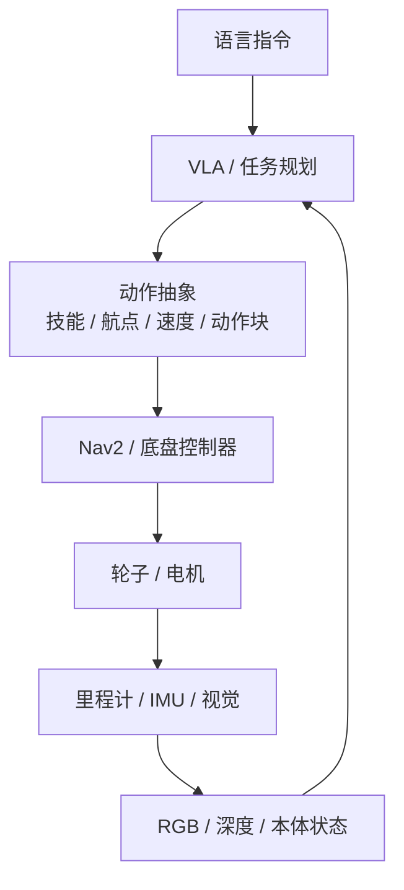

# 机器人轮胎与底盘构型

这篇是 [[WHEELTEC ROS1 教程学习笔记]] 的延伸。官方教程会告诉你「把 `car_mode` 改成 `mini_mec`」，但很少解释：为什么麦轮能横移、阿克曼为什么不能原地转、轮胎直径改了里程计为什么会偏、同一个 VLA 模型换一台底盘为什么就不灵。

先把结论放在前面：**轮胎不是「配件」，它决定了机器人的运动学约束、里程计可信度、可控速度和可适应的地面**。ROS2 里的控制器参数、Nav2 的规划器选择、VLA 的动作空间，都是这些物理约束的软件投影。

---

## 一、先分清三个词

| 中文 | 英文 | 指什么 |
| --- | --- | --- |
| 轮子总成 | wheel | 轮胎 + 轮毂 + 轴承/联轴器的整体 |
| 轮胎 | tire | 接触地面的外圈，决定摩擦、缓冲、磨损 |
| 轮毂 | hub | 连接轮胎与电机轴的部分 |
| 辊子 | roller | 麦轮/全向轮外圈那圈可被动转动的轮子 |

日常说「机器人轮胎」时，通常指整个轮子总成；但在讨论打滑、磨损、气压时，指的是外胎。

---

## 二、轮胎在机器人上的五个作用

### 2.1 传递驱动力

电机输出扭矩，轮胎把扭矩变成地面对车体的反作用力。极限由摩擦决定：

$$
F_t \le \mu F_n
$$

其中 `\mu` 是摩擦系数，`F_n` 是法向载荷。轮胎材料、地面材质、清洁度、接触面积都会影响实际 `\mu`。

### 2.2 承载

车体、电池、雷达、机械臂的重量最终通过轮子传到地面。轮子太少、太小、太软都会导致：

- 轮胎压扁，有效半径变小，里程计偏。
- 轮毂/轴承变形，阻力增大。
- 悬挂被压到底，失去缓冲。

### 2.3 缓冲

橡胶、充气胎、悬挂吸收地面不平。硬轮在瓷砖缝、门槛、地毯边缘容易跳起，导致：

- 编码器空转或打滑，里程计跳变。
- 雷达/相机抖动，建图重影。
- 轮子瞬间离地，牵引力丢失。

### 2.4 提供里程计基准

轮式里程计的本质是：

$$
\Delta s = r \Delta\theta
$$

`r` 是**有效半径**，不是新胎的标称半径。轮胎磨损、气压不足、负载压扁都会让 `r` 变小，走同样的距离，编码器会多转一点，里程计就会「走多了」。

### 2.5 保护地面与降噪

室内机器人常用 PU、橡胶、硅胶。硬塑料轮容易划伤木地板；软胶轮安静但磨损快；黑色橡胶可能留下痕迹。办公室、展厅、实验室对「不划地、不吵」的要求，往往比摩擦系数更重要。

---

## 三、轮胎参数怎么影响性能

| 参数 | 变大后 | 变小后 | 典型影响 |
| --- | --- | --- | --- |
| 直径 | 速度上限高、越障好、重心高 | 扭矩大、重心低、越障差 | 里程计比例、离地间隙、电机负载 |
| 宽度 | 接触面积大、横向稳定 | 阻力小、转向轻 | 滚动阻力、转弯刮擦、麦轮横向力 |
| 软度/硬度 | 软胎抓地好、缓冲好、磨损快 | 硬胎耐磨、路感硬、易打滑 | 室内静音 vs 室外耐久 |
| 胎面花纹 | 粗糙地面抓地好 | 平整地面接触更完整 | 地毯/草地 vs 瓷砖 |
| 轮毂/轴承精度 | 同心度好、虚位小 | 偏摆、噪音、里程计抖 | 编码器可信度 |
| 充气压力 | 接触面积大、缓冲好 | 阻力小、抓地差 | 充气胎的标定与维护 |

### 3.1 直径：速度和扭矩的交换

同样的电机转速，轮子越大，线速度越高：

$$
v = \omega r
$$

但同样的电机扭矩，轮子越大，牵引力越小：

$$
F = \frac{\tau}{r}
$$

所以「轮子越大越好」是错的：大轮子适合高速、越障；小轮子适合低速、大扭矩、低重心。轮子直径还直接进入里程计比例，换轮子必须重新标定。

### 3.2 宽度：接触面积不是万能

库仑摩擦里 `F = \mu N` 和接触面积无关，但真实橡胶有黏着、滞后、磨损，宽胎通常更稳、更不容易陷进软地面。代价是：

- 滚动阻力增加。
- 转弯时横向刮擦增加，麦轮尤其明显。
- 同一电机要驱动更大的转动惯量。

### 3.3 材料：没有一种胎适合所有地面

| 材料 | 优点 | 缺点 | 适合 |
| --- | --- | --- | --- |
| 橡胶 | 抓地好、静音、缓冲好 | 易磨损、可能留痕 | 室内瓷砖/木地板、室外平整路面 |
| PU（聚氨酯） | 耐磨、不留痕、承载力好 | 湿滑地面抓地下降 | 室内工业、展厅、实验室 |
| 硅胶 | 摩擦高、软 | 易吸灰、磨损快 | 轻载、需要高摩擦的室内 |
| 泡沫 | 轻、缓冲好 | 承载低、精度差 | 轻量原型、缓冲 |
| 充气胎 | 缓冲好、越障好、接触面积大 | 需要维护气压、易扎 | 室外、草地、不平路面 |
| 实心橡胶 | 免维护、耐扎 | 重、缓冲差 | 工业、粗糙地面 |

### 3.4 胎面：平整地面反而要「光」

- 瓷砖、环氧地坪、木地板：光滑胎面接触更完整，噪音小。
- 地毯、草地、泥地：需要花纹排水/排屑，光胎容易打滑。
- 麦轮/全向轮：辊子表面要干净，头发、灰尘、砂粒会卡住辊子，导致横移不准。

### 3.5 硬度

橡胶/PU 常用邵氏硬度（Shore A）表示。软胎（约 50—60A）抓地好、缓冲好，但磨损快、滚动阻力大；硬胎（约 80—95A）耐磨、阻力小，但容易在光滑地面打滑。具体选型要看负载和地面，不要只看硬度数字。

---

## 四、五类底盘构型

### 4.1 差速驱动

**结构**：左右两个独立驱动轮 + 一个或两个万向轮/牛眼轮。

**运动**：前进、后退、原地转；不能横移。

**运动学**：

$$
v = \frac{r(\omega_r + \omega_l)}{2}
$$

$$
\omega = \frac{r(\omega_r - \omega_l)}{L}
$$

`L` 是左右轮中心距（轮距）。

**优点**：结构简单、成本低、控制成熟、零半径转向。

**缺点**：不能横移；万向轮承载有限；地面不平时驱动轮可能离地。

**适合**：室内通用、教学、巡检。

**ROS 影响**：`Twist` 只用 `linear.x` 和 `angular.z`；Nav2 用差速运动模型；DWA 很合适。

### 4.2 四驱/滑移转向

**结构**：四个固定驱动轮，左右两侧各两个。

**运动**：前进、后退、原地转；转向靠左右轮速差。

**特点**：牵引力大、重载稳定；但转弯时轮胎必须横向刮擦，里程计容易漂。

**适合**：重载、粗糙地面、低速。

**ROS 影响**：常按差速模型处理；但实际滑移大，建议融合 IMU/视觉。

### 4.3 麦轮（Mecanum）

**结构**：四个轮子，每个轮子外圈有一圈与轮轴成 45° 的被动辊子。

**运动**：全向——前后、左右、斜行、原地转。

**优点**：不需要转向机构就能横移，窄道对位方便。

**缺点**：

- 对地面敏感：瓷砖缝、地毯、砂粒会降低效率。
- 辊子磨损后横向力下降。
- 四个轮子必须同时着地，悬挂/车架变形会影响。
- 横移时能耗高、速度低。

**适合**：室内平整地面、需要精确对位的场景。

**ROS 影响**：`Twist` 可用 `linear.y`；Nav2 用全向运动模型；局部控制器可选 DWB/MPPI；代价地图 footprint 要覆盖四个轮子的外接矩形。

### 4.4 全向轮（Omni）

**结构**：三个或四个轮子，外圈辊子与轮轴成 90°。

**运动**：全向，类似麦轮。

**优点**：结构比麦轮简单，辊子被动转动阻力小；三轮布局常见。

**缺点**：承载和横向力通常弱于麦轮；对地面同样敏感；三轮布局的冗余和受力不如四轮。

**适合**：室内科研、轻载全向平台。

**ROS 影响**：同麦轮，`linear.y` 可用；运动模型选全向。

### 4.5 阿克曼（Ackermann）

**结构**：前轮转向、后轮驱动（或四轮驱动），左右前轮转角不同，符合阿克曼几何。

**运动**：前进、后退、转弯；不能原地转。

**运动学**（自行车模型）：

$$
\omega = \frac{v \tan\delta}{L}
$$

$$
R = \frac{L}{\tan\delta}
$$

`L` 是前后轴距，`\delta` 是前轮转角。最小转弯半径：

$$
R_{\min} = \frac{L}{\tan\delta_{\max}}
$$

**优点**：高速稳定、乘坐舒适、轮胎磨损小；适合室外和载人/载货。

**缺点**：不能原地转；需要转向机构；低速大转角时轮胎仍有刮擦。

**适合**：室外巡检、园区物流、自动驾驶沙盘。

**ROS 影响**：`Twist` 仍可发 `linear.x` + `angular.z`，但底层要满足最小转弯半径；Nav2 全局规划用 Hybrid-A*，局部控制用 MPPI/RPP；全覆盖不推荐。

### 4.6 履带

**结构**：左右两条履带，靠左右速度差转向。

**优点**：接地比压低、越障/爬楼梯好、草地/泥地牵引强。

**缺点**：滑移转向严重，里程计不可信；效率低、噪音大；不能横移。

**适合**：楼梯、废墟、草地、野外。

**ROS 影响**：按差速模型近似，但必须融合 IMU/视觉；规划时把滑移和转弯半径考虑进去。

---

## 五、运动学：把轮子转速变成车体速度

### 5.1 符号

| 符号 | 含义 |
| --- | --- |
| `r` | 轮子有效半径 |
| `L` | 差速的左右轮距；阿克曼的前后轴距（注意区分） |
| `W` | 阿克曼的左右轮距 |
| `\omega_l`, `\omega_r` | 左右轮角速度 |
| `v` | 车体线速度 |
| `\omega` | 车体角速度 |
| `l_x`, `l_y` | 麦轮公式中前后、左右半距 |

### 5.2 差速

正运动学：

$$
v = \frac{r(\omega_r + \omega_l)}{2}
$$

$$
\omega = \frac{r(\omega_r - \omega_l)}{L}
$$

逆运动学（给定 `v, \omega`）：

$$
\omega_l = \frac{v - \omega L/2}{r}
$$

$$
\omega_r = \frac{v + \omega L/2}{r}
$$

### 5.3 阿克曼

$$
\omega = \frac{v \tan\delta}{L}
$$

$$
R = \frac{L}{\tan\delta}
$$

左右前轮转角不同，理想阿克曼几何满足：

$$
\cot\delta_o - \cot\delta_i = \frac{W}{L}
$$

`\delta_o` 是外侧轮转角，`\delta_i` 是内侧轮转角。实际车辆常用平行转向或折中曲线，不会完全满足。

### 5.4 麦轮

以 X 型辊子、四轮对称布局为例：

$$
\begin{aligned}
v_x &= \frac{r}{4}(\omega_{fl} + \omega_{fr} + \omega_{rl} + \omega_{rr}) \\
v_y &= \frac{r}{4}(-\omega_{fl} + \omega_{fr} + \omega_{rl} - \omega_{rr}) \\
\omega_z &= \frac{r}{4(l_x + l_y)}(-\omega_{fl} + \omega_{fr} - \omega_{rl} + \omega_{rr})
\end{aligned}
$$

其中 `l_x`、`l_y` 是前后轮轴、左右轮到车体中心的半距。不同教材用全距时，分母系数会变；辊子旋向和电机安装方向也会改变符号。**不要直接抄公式，先用「前进/横移/自转」三个动作各测一次，确认符号。**

### 5.5 全向轮

三轮 120° 布局和四轮 90° 布局的公式不同，但本质都是「把车体速度投影到每个轮子的驱动方向」。工程上更稳妥的做法是：

1. 先写出每个轮子的单位驱动方向。
2. 用最小二乘/伪逆求轮速。
3. 用实测动作校验符号。

### 5.6 里程计积分

差速机器人常用中点积分：

$$
\Delta\theta = \frac{\Delta s_r - \Delta s_l}{L}
$$

$$
\Delta s = \frac{\Delta s_r + \Delta s_l}{2}
$$

$$
x_{k+1} = x_k + \Delta s \cos(\theta_k + \Delta\theta/2)
$$

$$
y_{k+1} = y_k + \Delta s \sin(\theta_k + \Delta\theta/2)
$$

$$
\theta_{k+1} = \theta_k + \Delta\theta
$$

这只在「轮子不打滑、轮径准确、轮距准确」时成立。麦轮横移、履带滑移、阿克曼转弯刮擦都会破坏假设，所以需要 EKF/IMU/视觉修正。

### 5.7 打滑与有效半径

滑移率可以粗略写成：

$$
s = \frac{v_w - v}{\max(|v|, \epsilon)}
$$

`v_w = r\omega` 是轮子表面线速度。`s \ne 0` 时，编码器里程计和车体真实运动不一致。

有效半径受这些因素影响：

- 负载压扁轮胎。
- 气压不足。
- 胎面磨损。
- 地面软硬。
- 轮毂/轴承偏摆。

**标定方法**：在地面量 2 m 直线，低速直行，比较 `/odom` 的位移和实际位移；重复 3 次取平均，按比例修正 `wheel_radius`。再原地转 10 圈，比较 `/odom` 的 yaw 和实际角度，修正 `wheel_separation`。

---

## 六、在 ROS1 里怎么落地

### 6.1 URDF/xacro

轮子是一个 `link`，几何通常是圆柱：

```xml
<link name="left_wheel_link">
  <visual>
    <geometry>
      <cylinder radius="0.03" length="0.02"/>
    </geometry>
    <origin xyz="0 0 0" rpy="1.5708 0 0"/>
  </visual>
  <collision>
    <geometry>
      <cylinder radius="0.03" length="0.02"/>
    </geometry>
    <origin xyz="0 0 0" rpy="1.5708 0 0"/>
  </collision>
</link>
```

驱动轮 joint 用 `continuous`：

```xml
<joint name="left_wheel_joint" type="continuous">
  <parent link="base_link"/>
  <child link="left_wheel_link"/>
  <origin xyz="0 0.1 -0.02" rpy="0 0 0"/>
  <axis xyz="0 1 0"/>
</joint>
```

阿克曼前轮转向用 `revolute`，并设置上下限：

```xml
<joint name="front_left_steer_joint" type="revolute">
  <parent link="base_link"/>
  <child link="front_left_steer_link"/>
  <axis xyz="0 0 1"/>
  <limit lower="-0.6" upper="0.6" effort="10" velocity="1"/>
</joint>
```

### 6.2 Gazebo 摩擦

```xml
<gazebo reference="left_wheel_link">
  <mu1>1.0</mu1>
  <mu2>1.0</mu2>
  <kp>1000000.0</kp>
  <kd>1.0</kd>
</gazebo>
```

- `mu1`/`mu2` 是两个方向的摩擦系数。麦轮需要让辊子方向更容易滑动，必要时用 `fdir1` 指定方向。
- `kp`/`kd` 是接触刚度/阻尼，太硬会抖，太软会陷。
- joint 的 `<dynamics damping="..." friction="..."/>` 影响轮子空转和低速特性。

### 6.3 WHEELTEC 的 Gazebo 插件参数

官方自定义插件 `libgazebo_ros_wheeltec_mec.so` 里：

| 参数 | 含义 | 注意 |
| --- | --- | --- |
| `axlebase` | 前后轴距 | 官方把它叫「轴距」 |
| `wheelbase` | 左右轮距 | 官方把它叫「轮距」，和通用英文相反 |
| `wheelDiameter` | 轮子直径 | 线速度 ↔ 角速度 |
| `torque` | 轮子扭矩常数 | 仿真用 |
| `max_vel` | 最大线速度 | 限幅 |
| `max_turn` | 最大角速度 | 限幅 |

再次强调：**改参数前量车、看注释**。字段名和汽车工程的习惯不一致，是常见坑。

### 6.4 代价地图与规划器

- `footprint`/`vertices` 要覆盖车体最外沿，包括麦轮的外接矩形。
- `inflation_radius` 小于车身时不起作用，真正生效的是 `footprint`。
- `min_obstacle_dist` 以车体外侧为基准，不是车体中心。
- 差速常用 DWA；全向/阿克曼常用 TEB；全覆盖推荐 DWA，不推荐阿克曼。
- 阿克曼的 `min_turning_radius` 要和实车一致，否则 TEB 会规划出转不过去的弯。

### 6.5 里程计与 TF

WHEELTEC ROS1 的链路：

```text
STM32 → /odom + /imu → robot_pose_ekf → odom_combined → TF
```

Cartographer 建图时会关闭 `robot_pose_ekf`，由 Cartographer 自己发布 `map → odom`。切回 gmapping 时要确认 EKF 恢复，避免两个节点抢 TF。

---

## 七、在 ROS2 里怎么落地

### 7.1 URDF 与 ros2_control

ROS2 的 URDF 结构和 ROS1 类似，但多了 `<ros2_control>`：

```xml
<ros2_control name="WheeltecSystem" type="system">
  <hardware>
    <plugin>your_hardware_plugin/YourSystemHardware</plugin>
  </hardware>  

  <joint name="left_wheel_joint">
    <command_interface name="velocity"/>
    <state_interface name="position"/>
    <state_interface name="velocity"/>
  </joint>

  <joint name="right_wheel_joint">
    <command_interface name="velocity"/>
    <state_interface name="position"/>
    <state_interface name="velocity"/>
  </joint>
</ros2_control>
```

差速轮通常命令 `velocity`，状态读 `position` + `velocity`；阿克曼转向轮命令 `position`，驱动轮命令 `velocity`。

### 7.2 差速控制器

```yaml
diff_drive_controller:
  ros__parameters:
    left_wheel_names: ["left_wheel_joint"]
    right_wheel_names: ["right_wheel_joint"]
    wheel_separation: 0.20
    wheel_radius: 0.03
    base_frame_id: base_footprint
    odom_frame_id: odom
    enable_odom_tf: true
    publish_rate: 50.0
    cmd_vel_timeout: 0.5
```

- `wheel_separation` 是左右轮中心距，不是前后轴距。
- `wheel_radius` 是有效半径，换胎/磨损后要改。
- `enable_odom_tf` 为 true 时控制器发布 `odom → base_footprint`；如果再开 EKF 发布同一变换，会抢 TF。

### 7.3 阿克曼控制器

```yaml
ackermann_steering_controller:
  ros__parameters:
    steering_joints: ["front_left_steer_joint", "front_right_steer_joint"]
    traction_joints: ["rear_left_wheel_joint", "rear_right_wheel_joint"]
    wheelbase: 0.30
    track_width: 0.24
    wheel_radius: 0.05
```

- `wheelbase` 是前后轴距（这次是通用英文含义）。
- `track_width` 是左右轮距。
- 参数名以当前发行版文档为准；不同版本可能增加 `front_steering`、`open_loop` 等选项。

### 7.4 麦轮/全向控制器

不是所有 ROS2 发行版都提供稳定的官方麦轮控制器。常见做法：

1. 自定义 `ros2_control` 控制器，把 `Twist` 的 `linear.x/y`、`angular.z` 解算成四个轮速。
2. 底盘节点直接订阅 `/cmd_vel`，在节点内部做解算，再通过串口下发给 STM32。
3. 使用社区/新版 `ros2_controllers` 里的 mecanum 控制器（先查发行版是否包含）。

Nav2 侧要把机器人配置成全向运动模型，局部控制器用 DWB 或 MPPI，`footprint` 覆盖四个轮子。

### 7.5 Nav2 配置

| 配置 | 差速 | 麦轮/全向 | 阿克曼 |
| --- | --- | --- | --- |
| AMCL 运动模型 | `DifferentialMotionModel` | `OmniMotionModel` | 常见按差速近似，规划层约束最小转弯半径；看发行版支持 |
| 全局规划器 | NavFn/Smac 2D | NavFn/Smac 2D | Smac Hybrid-A* |
| 局部控制器 | DWB | DWB/MPPI | MPPI/RPP |
| `footprint` | 车体矩形 | 四轮外接矩形 | 车体 + 转向包络 |
| 关键约束 | 轮距/轮径 | 横向速度、打滑 | 最小转弯半径 |

### 7.6 Gazebo 摩擦

ROS2 的 Gazebo 插件同样支持：

```xml
<gazebo reference="wheel_link">
  <mu1>1.0</mu1>
  <mu2>1.0</mu2>
  <fdir1>1 0 0</fdir1>
</gazebo>
```

麦轮的辊子方向、阿克曼的转向限位、joint 的 damping/friction 都要和实车接近，否则仿真里能过、实车过不去。

### 7.7 验证命令

```bash
ros2 launch turn_on_wheeltec_robot turn_on_wheeltec_robot.launch.py
ros2 control list_controllers
ros2 topic echo /odom
ros2 topic hz /odom
ros2 run tf2_ros tf2_echo odom base_link
ros2 param get /diff_drive_controller wheel_separation
```

---

## 八、在 VLA 里怎么落地

### 8.1 VLA 是什么

VLA（Vision-Language-Action）把视觉观测、语言指令（有时还有本体状态）映射成动作。它不是「一个大模型直接控制电机」，工程上通常分层：



### 8.2 动作空间：轮子以什么形式出现

| 动作表示 | 典型维度 | 谁执行 | 适合 |
| --- | --- | --- | --- |
| 离散技能 | 前进/左转/停止/跟随 | 技能层 | 语音交互、演示系统 |
| 航点/目标位姿 | `x, y, yaw` | Nav2 | 有地图的室内导航 |
| 车体速度 | `vx, vy, wz` | 底盘控制器 | 端到端策略、遥操作 |
| 轮速/关节轨迹 | 每轮角速度/关节角 | `ros2_control` | 底层控制、 sim-to-real |
| 动作块 | 上述序列 | 策略/控制器 | 扩散策略、action chunking |

### 8.3 构型如何改变 VLA 的动作空间

| 构型 | 可用动作 | 约束 | 对 VLA 的影响 |
| --- | --- | --- | --- |
| 差速 | `vx, wz` | 不能横移 | 动作维度低，数据容易采 |
| 麦轮/全向 | `vx, vy, wz` | 打滑、地面敏感 | 多一维动作，需要更多数据覆盖横移 |
| 阿克曼 | `vx, wz` 或 `vx, \delta` | 最小转弯半径，不能原地转 | 策略要学会「前进+转弯」的组合，不能直接原地转 |
| 履带 | `vx, wz` | 滑移大 | 里程计不可信，依赖视觉/IMU |

### 8.4 轮胎在 VLA 里「表现」在哪里

1. **动作空间**：能不能横移、能不能原地转，直接决定策略输出维度。
2. **本体状态**：轮速、IMU、里程计是 proprioception；轮胎打滑会让状态和真实运动不一致。
3. **动力学分布**：摩擦、轮径、负载、地面材质决定「同样的动作会走多远」。训练集和部署地的轮胎/地面不一致，就是分布偏移。
4. **语言 grounding**：VLA 可以理解「在草地上慢一点」，但它不知道轮胎是橡胶还是 PU；轮胎是 embodiment，不是语义 token。
5. **安全层**：VLA 输出速度/航点，底层仍要限幅、避障、急停。不要让模型直接输出 PWM。

### 8.5 sim-to-real

轮胎相关的 sim-to-real 重点：

- **摩擦随机化**：训练时随机化 `mu`、接触刚度、地面材质。
- **轮径/轮距随机化**：模拟磨损、负载、装配误差。
- **延迟随机化**：电机响应、串口、控制器周期。
- **地形随机化**：瓷砖缝、地毯、轻微坡度。
- **标定**：部署前用 2 m 直线和 10 圈原地转标定 `wheel_radius`、`wheel_separation`。
- **低层抽象**：让 VLA 输出航点/速度，底层控制器吸收轮胎差异；比直接输出轮速更稳。

### 8.6 评估指标

| 指标 | 说明 |
| --- | --- |
| 任务成功率 | 语言指令是否完成 |
| 碰撞率 | 是否撞到障碍/人 |
| 路径效率 | 实际路径 / 最短路径 |
| 平滑度 | 加速度/角速度突变 |
| 定位漂移 | 轮胎打滑导致的 `odom` 误差 |
| 恢复能力 | 被挡住/打滑后能否重试 |

轮胎打滑通常不会让 VLA「语义理解」出错，而是让定位和执行出错。排查时先看 `/odom` 和 TF，再看策略。

### 8.7 一个 WHEELTEC 例子

现有 AI 多模态链路：

```text
语音 → ASR → LLM/RAG → 动作函数 → ROS 功能 → 底盘
```

往 VLA 演进的链路：

```text
语言 + 相机 → VLA 策略 → 技能/航点 → Nav2 → diff_drive_controller → 轮子
```

第一版不建议端到端。先把「VLA 输出航点/技能」跑通，底层继续用 Nav2 和底盘控制器；等数据够了，再尝试输出 `Twist` 或动作块。

---

## 九、选型与维护

### 9.1 按地面选

| 地面 | 推荐轮子 | 说明 |
| --- | --- | --- |
| 瓷砖/环氧地坪 | PU 或橡胶平胎 | 干净、低阻力、不留痕 |
| 木地板 | PU/软橡胶 | 避免划伤和黑印 |
| 地毯 | 较大直径、软橡胶/花纹 | 克服绒毛阻力 |
| 草地/泥地 | 充气胎/深花纹 | 需要抓地和排屑 |
| 门槛/缝隙 | 大直径 + 悬挂 | 通过性优先 |
| 楼梯/废墟 | 履带 | 接地比压低 |

### 9.2 维护清单

- 检查胎面磨损、裂纹、异物。
- 麦轮/全向轮：清理辊子间的头发、灰尘、砂粒。
- 充气胎：检查气压。
- 轮毂/联轴器：检查螺丝松动、偏摆。
- 轴承：听噪音、摸温度。
- 标定：换胎、换轮、负载变化后重新标定 `wheel_radius`、`wheel_separation`。

### 9.3 标定流程

1. 地面量 2 m 直线。
2. 低速直行，记录 `/odom` 位移。
3. 重复 3 次，算平均误差。
4. 按比例修正 `wheel_radius`。
5. 原地转 10 圈，比较 `/odom` yaw 和实际角度。
6. 修正 `wheel_separation`。
7. 用麦轮/全向时，再分别测横移和斜行，校验符号和比例。

### 9.4 常见误区

| 误区 | 实际 |
| --- | --- |
| 轮子越大越好 | 大轮速度快、越障好，但扭矩小、重心高 |
| 胎越宽抓地越好 | 接触面积受载荷/材料影响，宽胎阻力/刮擦也大 |
| 麦轮可以越野 | 辊子怕砂石、地毯，室内平整地面才准 |
| 阿克曼可以原地转 | 不能，必须满足最小转弯半径 |
| ROS2 的 `wheelbase` 一定是轴距 | 看控制器/插件定义，WHEELTEC 插件里含义相反 |
| VLA 直接控制轮子 | 通常输出技能/航点/速度，底层仍有控制器和安全层 |

---

## 相关

- [[WHEELTEC ROS1 教程学习笔记]]
- [[WHEELTEC ROS 教程学习报告]]
- [[TF 与 URDF]]
- [[SLAM 与导航]]
- [[路径规划算法]]
- [[VLA 与机器人 AI]]
- [[ROS 2 通信机制]]
- [[机器人系统调试与工程实践]]
