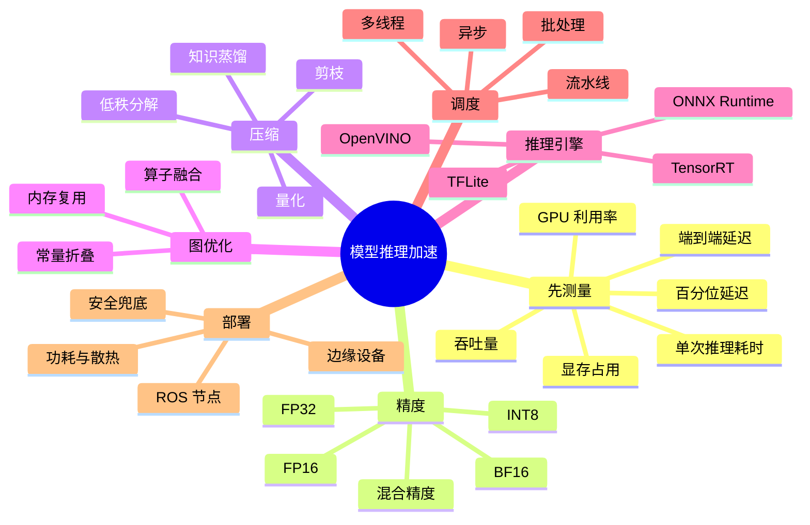

# 模型推理加速

机器人上的模型推理和服务器上不一样：算力有限、功耗有限、散热有限，而且模型慢一点，控制环路就可能跟不上。推理加速不是「把模型换成更小的」这么简单，顺序应该是先测量、再定位瓶颈、最后选手段，并且每次都要验证精度和任务成功率。

## 知识体系思维导图



## 1. 先测量，不要先优化

优化前先建立基线：

- **端到端延迟**：从传感器采集到动作输出，总共多久。
- **单次推理耗时**：模型 forward 一次多久。
- **预处理/后处理耗时**：缩放、归一化、解码、NMS。
- **数据传输耗时**：CPU→GPU、相机→主机、主机→机器人。
- **GPU/CPU 利用率**：是不是根本没吃满，瓶颈在别处。
- **显存/内存占用**：会不会 OOM。
- **吞吐量**：每秒能处理多少帧。
- **百分位延迟**：P50、P95、P99，平均值会掩盖卡顿。

测量时注意：

- 先 warmup，排除第一次加载和编译的影响；
- 固定输入尺寸和 batch size；
- 区分「模型推理」和「端到端」；
- 在目标设备上测，不要在开发机上测完就下结论。

## 2. 延迟和吞吐量不是一回事

- **延迟**：单个请求从进到出要多久。
- **吞吐量**：单位时间能处理多少请求。

批处理能提高吞吐量，但可能增加单请求延迟。机器人控制通常更关心延迟和稳定性，不是最大吞吐量。一个系统每秒能处理 100 张图，不代表每张图都能在 10ms 内出结果。

## 3. 精度优化

| 精度 | 优点 | 风险 |
| --- | --- | --- |
| FP32 | 精度高，兼容好 | 显存和算力开销大 |
| FP16 | 显存减半，GPU 上通常更快 | 数值范围小，可能溢出 |
| BF16 | 范围接近 FP32，训练稳定 | 精度略低，硬件支持要求 |
| INT8 | 显著降低显存和带宽 | 量化误差，需要校准 |

混合精度不是把所有计算都降成 FP16，而是关键部分保留高精度，矩阵乘、卷积等用低精度。实际收益取决于硬件是否支持对应的 Tensor Core 或 NPU。

## 4. 量化

量化是把浮点权重/激活换成低位宽整数。

- **训练后量化（PTQ）**：用一小批校准数据统计范围，直接量化，成本低。
- **量化感知训练（QAT）**：训练时模拟量化误差，精度更好，但需要重新训练。
- **动态量化**：运行时根据数据范围量化，适合 LSTM/Transformer 的部分层。
- **静态量化**：提前校准，推理更快。

量化后一定要看：

- 精度掉了多少；
- 哪些层对量化敏感；
- 实际推理速度是否真的提升；
- 目标硬件是否支持 INT8 算子。

不是所有层量化后都变快，有些算子会回退到 FP32，反而更慢。

## 5. 知识蒸馏

用一个大的教师模型指导小的学生模型：

- 教师模型输出软标签（概率分布）；
- 学生模型同时学习真实标签和软标签；
- 学生模型更小、更快，但尽量保留教师的能力。

蒸馏适合「模型太大，但任务相对固定」的场景。它的风险是学生模型不一定完全复现教师，尤其在分布外数据上。需要比较蒸馏前后的精度、延迟和实际任务成功率。

## 6. 图优化与推理引擎

- **算子融合**：把卷积 + BN + ReLU 合成一个算子，减少访存。
- **常量折叠**：把编译期能算的计算提前算掉。
- **内存复用**：减少中间张量的分配。
- **ONNX**：跨框架的模型表示，方便在不同运行时部署。
- **TensorRT**：NVIDIA GPU 上的推理优化，支持 FP16/INT8、层融合、kernel 自动调优。
- **ONNX Runtime**：跨平台，支持 CPU/GPU/多种后端。
- **OpenVINO**：Intel CPU/GPU/NPU 上的优化。
- **TFLite**：移动端和嵌入式。

转换模型时要验证算子兼容性。有些自定义算子 TensorRT 不支持，需要插件或回退，实际收益可能不如预期。

## 7. 批处理与流水线

- **批处理**：一次处理多帧，提高 GPU 利用率，但增加等待时间。
- **流水线**：预处理、推理、后处理重叠执行，提高整体吞吐。
- **多线程/多进程**：CPU 预处理和 GPU 推理并行。
- **异步**：不阻塞主控制循环，但要处理结果过期。

机器人里要小心：批处理可能让延迟变大，异步可能让动作对应的是旧画面。要做时间戳对齐和过期丢弃。

## 8. 部署到机器人

典型链路：

```text
相机 → 图像采集 → 预处理 → 模型推理 → 后处理 → ROS 消息 → 规划/控制
```

每一步都可能成为瓶颈：

- 相机 USB 带宽不够；
- 图像格式转换（BGR/RGB、H264 解码）耗时；
- CPU 预处理成为瓶颈；
- GPU 显存不足，频繁换入换出；
- ROS 消息序列化和拷贝；
- 控制频率和推理频率不匹配。

部署时建议：

- 用 `ros2 topic hz` 看实际频率；
- 用时间戳算端到端延迟；
- 在机器人上跑 profiler，不要只看开发机；
- 给推理留安全余量，不要跑满；
- 模型失败时回退到传统方法或安全停止。

## 9. 优化顺序

1. 测基线，找到最大瓶颈。
2. 如果是数据搬运，先减少拷贝、改格式、用零拷贝。
3. 如果是模型计算，考虑 FP16/BF16、TensorRT/ONNX Runtime。
4. 如果还不够，考虑 INT8 量化或蒸馏。
5. 如果任务允许，考虑更小的模型或更低的输入分辨率。
6. 每次优化都回归精度和任务成功率。

不要一上来就量化到 INT8，也不要在没测清楚瓶颈时换推理引擎。

## 相关

- [[VLA 与机器人 AI]]
- [[ROS 2 节点编程]]
- [[机器人系统调试与工程实践]]
- [[ROS Index]]
