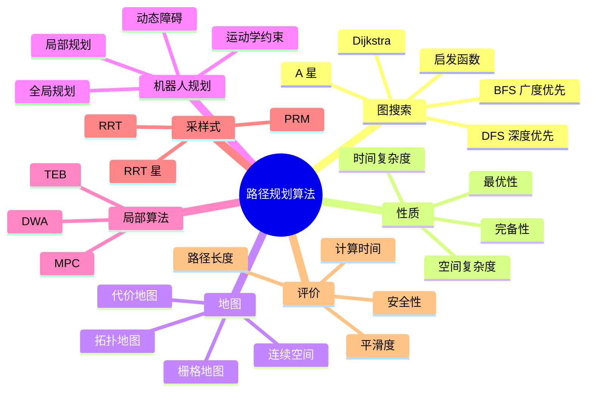

# 路径规划算法

路径规划是机器人「决定怎么走」的部分。面试里最常问 BFS、Dijkstra、A* 的差别，但真正做机器人时，还要区分全局规划和局部避障，考虑机器人能不能转弯、通道有多宽、动态障碍怎么办。这一篇先把图搜索讲清楚，再接到机器人实际使用的规划器。

## 知识体系思维导图



## 1. BFS：按层扩展

BFS（Breadth-First Search）用队列，从起点开始一层一层向外扩展。

```text
queue = [start]
visited = {start}
while queue:
    node = queue.pop_front()
    if node == goal: return path
    for next in neighbors(node):
        if next not in visited:
            visited.add(next)
            queue.push_back(next)
```

特点：

- 无权图里能找到边数最少的路径；
- 时间复杂度 \(O(V+E)\)；
- 空间开销可能很大，因为要存一整层节点；
- 不能直接处理不同代价的边。

BFS 适合「每走一步代价一样」的栅格，比如只关心步数、不关心距离和风险。

## 2. Dijkstra：按累计代价扩展

Dijkstra 每次从优先队列里取出「从起点到当前节点累计代价最小」的节点，再更新邻居。

```text
dist[start] = 0
pq = [(0, start)]
while pq:
    d, node = pq.pop_min()
    if d > dist[node]: continue
    for next, w in neighbors(node):
        if dist[node] + w < dist[next]:
            dist[next] = dist[node] + w
            pq.push((dist[next], next))
```

特点：

- 适用于非负边权；
- 能得到最短路径；
- 用邻接表和二叉堆，复杂度约为 \(O((V+E)\log V)\)；
- 不使用目标方向的信息，搜索范围可能很大。

Dijkstra 适合边权不一样的地图，比如草地、砂石、斜坡的通行代价不同。

## 3. A*：带启发函数的 Dijkstra

A* 在 Dijkstra 的基础上加了一个「到目标的估计代价」：

\[
f(n) = g(n) + h(n)
\]

- \(g(n)\)：起点到当前节点的实际代价；
- \(h(n)\)：当前节点到目标的启发式估计；
- \(f(n)\)：综合优先级。

常见启发函数：

| 启发函数 | 适用 | 说明 |
| --- | --- | --- |
| 曼哈顿距离 | 四连通栅格 | 只能上下左右走 |
| 欧几里得距离 | 八连通或连续空间 | 直线距离 |
| 对角线距离 | 八连通栅格 | 允许斜走 |
| 切比雪夫距离 | 八连通，斜走代价相同 | 最大坐标差 |

A* 的最优性依赖启发函数的**可采纳性**：\(h(n)\) 不能高估真实剩余代价。如果 \(h(n)\) 还满足一致性，可以避免重复扩展节点。

A* 的优点是搜索更有方向，通常比 Dijkstra 快；缺点是启发函数设计不好时，优势不明显，甚至退化成 Dijkstra。

## 4. 三者怎么选

| 场景 | 推荐 | 原因 |
| --- | --- | --- |
| 无权栅格，只关心步数 | BFS | 简单，能找到最少步数 |
| 边权不同，非负 | Dijkstra | 保证最短路径 |
| 有明确目标，想要更快 | A* | 启发函数减少搜索 |
| 连续空间、高维 | RRT / RRT* | 不需要显式建图 |
| 动态障碍、实时避障 | DWA / TEB / MPC | 滚动优化，反应快 |

面试回答不要停在「我会 A* 所以用 A*」。更完整的说法是：

> 如果是二维栅格地图，可以先用 A* 做全局规划；如果边权复杂、启发函数不好设计，就用 Dijkstra。实际导航还要考虑局部避障、机器人运动学约束和控制频率，不能只靠一个全局搜索算法。

## 5. 全局规划与局部规划

- **全局规划**：在静态地图上找一条从起点到目标的路径，关注整体最优。
- **局部规划**：沿着全局路径走，根据实时传感器避障，关注即时安全和控制可行性。

全局路径可能穿过动态障碍，局部规划要负责绕开；局部规划也可能陷入局部极小值，需要恢复行为或重新全局规划。

## 6. 局部规划算法

### DWA

Dynamic Window Approach，在速度空间里采样：

- 根据当前速度和加速度限制，算出一个可行的速度窗口；
- 对每个速度采样，前向模拟一段轨迹；
- 用「靠近目标、避开障碍、速度尽量快」打分；
- 选最高分的速度发给底盘。

优点：计算快，适合差速底盘。缺点：容易陷入局部最优，狭窄空间表现一般。

### TEB

Timed Elastic Band，把路径看成一条带时间信息的弹性带，优化路径点、时间和障碍物约束。

优点：路径更平滑，能考虑运动学约束。缺点：优化问题更复杂，参数多。

### MPC

Model Predictive Control，用机器人模型预测未来若干步，滚动求解最优控制。

优点：能处理约束、动态障碍，控制效果好。缺点：计算量大，需要可靠模型。

## 7. 采样式规划

RRT（Rapidly-exploring Random Tree）在空间里随机采样，向采样点扩展树，适合高维和复杂约束。

- RRT：找到可行路径，不保证最优；
- RRT*：通过重连和重新选择父节点，逐渐逼近最优；
- PRM：先建概率路图，再查询路径，适合多次查询。

采样式算法在机械臂高维空间中很常用，因为显式建图不可行。

## 8. 评价指标

- **路径长度**：是否绕远。
- **平滑度**：曲率变化、转角大小。
- **安全性**：离障碍物的最小距离。
- **计算时间**：能否满足规划频率。
- **成功率**：复杂场景下能否找到可行路径。
- **可执行性**：是否满足最小转弯半径、速度、加速度约束。

## 相关

- [[SLAM 与导航]]
- [[TF 与 URDF]]
- [[ROS Index]]
